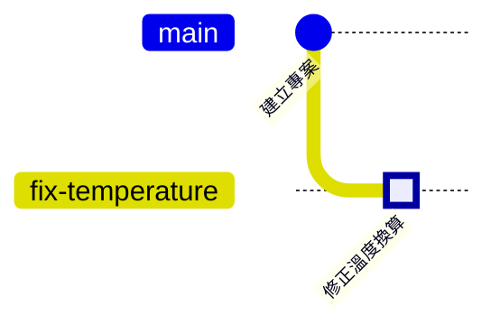

# 寫作規範 / Style Guide

這份規範讓全書的風格保持一致，也讓之後的翻譯更容易。修改或新增內容之前，請先讀一遍。第 1～8 節是繁體中文原文的規範，第 9 節是英文版，第 10 節是日文版與韓文版的格式。

這本書屬於 Introduction 系列，共通的骨架和[半導體製造概論](https://github.com/chenwei810/Semiconductor_Manufacturing_Introduction)相同；歷史圖、深入一點、跟著做與本章指令，是這本書自己的特色。

Sections 1–8 cover the Traditional Chinese original. Section 9 covers the English version, and section 10 the Japanese and Korean versions.

---

## 1. 讀者與深度

這本書要讓沒有底子的人看得懂，也要讓資工系學生拿來用、真的會用。所以內容分成兩層：

| 層 | 寫給誰 | 寫到哪裡 |
|---|---|---|
| **正文** | 完全沒碰過 Git 的人 | 停在「做什麼、為什麼、做錯會怎樣」。不需要任何程式背景 |
| **🔍 深入一點** | 資工系學生 | Git 內部怎麼運作。可以使用雜湊、指標、圖這類資工系熟悉的概念 |

- 正文不能依賴「深入一點」。讀者跳過所有「深入一點」，也要能讀懂後面每一章。
- **不寫公式**。需要說明原理時，用比喻和例子。
- **長度**：每章約 250 行以內（含空行與分隔線）。正文約 160 行，其餘是深入一點、跟著做與本章指令。

---

## 2. 用語

### 使用台灣的繁體中文用語

| 使用 | 不使用 |
|---|---|
| 程式、程式碼、原始碼 | 程序、代碼、源碼 |
| 儲存庫 | 倉庫 |
| 遠端 | 遠程 |
| 預設 | 默認、缺省 |
| 設定、設定檔 | 配置、配置文件 |
| 檔案、資料夾 | 文件、文件夾 |
| 文件（document） | 文檔 |
| 訊息 | 信息 |
| 使用者 | 用戶 |
| 資料 | 數據 |
| 伺服器 | 服務器 |
| 建立 | 創建 |
| 執行 | 運行 |
| 介面 | 界面、接口 |
| 除錯 | 調試 |
| 還原、復原 | 回滾 |
| 軟體、硬體、網路 | 軟件、硬件、網絡 |

### 術語

- 第一次出現時，寫成「中文（English）」，例如「暫存區（Staging Area）」。有縮寫時寫成「中文（English，縮寫）」。
- 之後使用團隊裡實際的說法。工程師習慣直接講英文的，就直接用英文，例如 commit、tag、rebase、Pull Request、HEAD。習慣講中文的，就用中文，例如分支、合併、衝突、遠端、暫存區。
- 用詞以[附錄 A 術語總表](zh-TW/appendix/glossary.md)為準。新增術語時，請一併更新術語總表。

---

## 3. 排版

- 中文與英文、數字之間加一個半形空格，例如「3 個 commit」「用 Git 管理」。
- 數字與單位之間加空格，例如「100 MiB」「25 kHz」；百分比不加空格，例如「80%」。
- 中文使用全形標點；引號使用「」，引號中再引用使用『』。
- 範圍使用全形波浪號，例如「第 6～8 章」。
- 描述一連串步驟時，先用一行粗體的箭頭流程，例如 **修改 → add → commit**，再用編號清單逐步說明。
- 文中提到的指令、檔名、分支名稱，用行內程式碼，例如 `git status`、`sensor.c`、`main`。
- 要讀者輸入的指令放在 `bash` 程式碼區塊；Git 的輸出放在 `text` 程式碼區塊。每個區塊 15 行以內。

---

## 4. 章節結構

每一章依照以下順序撰寫，可以直接複製[章節範本](templates/chapter-template.md)開始：

1. **標題**：`# 第 N 章　主題：副標題`（「章」後面是一個全形空格）
2. **📍 專案與修改位置**
3. **本文**：依內容分節，大致依照「為什麼需要 → 概念 → 操作 → 常見問題」的順序。
4. **🌿 歷史圖、📖 名詞框、🔧 Know-how 框、🔍 深入一點**：放在相關段落的後面。名詞框與 Know-how 框各約 2～4 個，深入一點 1～2 個，每章至少一張歷史圖。
5. **🧪 跟著做**
6. **📋 本章指令**
7. **本章重點**：3～5 點。
8. **延伸閱讀**：2～3 項公開資料。
9. **導覽列**：上一章、目錄、下一章。

---

## 5. 提示框與區塊

### 📍 專案與修改位置

第一行寫專案進度，後三行描述那筆修改（溫度換算的修正）走到哪裡。

```markdown
> 📍 **專案與修改位置**
>
> - 專案進度：……
> - 前一站：……
> - **本章：……**
> - 下一站：……
```

### 📖 名詞框

```markdown
> [!NOTE]
> **📖 名詞｜中文（English，縮寫）**
>
> - **定義**：一句話說明它是什麼。
> - **現場用法**：團隊裡實際怎麼說，最好附一句例句。
> - **相關名詞**：二到四個相關的術語。
> - **常見混淆**：最容易和什麼搞混，差別在哪裡。
```

### 🔧 Know-how 框

```markdown
> [!TIP]
> **🔧 Know-how｜用一句話點出重點**
>
> - **情境**：在什麼情況下會遇到。
> - **做法**：團隊裡怎麼做。
> - **為什麼**：背後的原因。
> - **沒做會怎樣**：後果是什麼。
> - **相關章節**：[第 N 章 標題](相對路徑)
```

「沒做會怎樣」是 Know-how 框最重要的一欄。團隊的規則大多是從出事學來的，讀者理解了後果，才記得住規則。

> [!IMPORTANT]
> 框裡的每個欄位都要寫成清單項目，也就是每一行都以 `> -` 開頭。GitHub 顯示 `.md` 檔案時，不會把單一換行顯示成換行；如果不用清單，所有欄位會擠成同一段。

### 🔍 深入一點

給資工系的原理說明，預設收合。標題要能讓讀者判斷要不要點開。

```markdown
<details>
<summary><strong>🔍 深入一點｜commit 的編號是怎麼算出來的</strong></summary>

內文可以有段落、清單和 15 行以內的指令或輸出。

</details>
```

`<details>` 與 `<summary>` 各佔一行；`</summary>` 之後與 `</details>` 之前都要空一行，GitHub 才會把裡面當成 Markdown。

### 🧪 跟著做

用[練習專案](practice/README.md)把本章的操作做一遍。這是示範步驟，不是作業：沒有題目，也沒有要對的答案。

````markdown
## 🧪 跟著做

**開始前**：接著上一章的練習專案繼續做。想從這一章開始，在本書的根目錄執行 `bash practice/setup.sh 4`。

1. 說明這一步要做什麼：

   ```bash
   git switch -c fix-temperature
   ```

   在 Sourcetree 裡：……

2. ……

**你應該看到**：……
````

- 每一步都要能在 `practice/setup.sh` 建立的起點上照做成功。修改步驟之後，請從頭實際跑一遍。
- 本章結束時的狀態，必須和 `bash practice/setup.sh <下一章>` 建立的起點相同。
- 結尾一定要有「你應該看到」，讓讀者自己確認做對了。

### 📋 本章指令

```markdown
## 📋 本章指令

| 想做的事 | 指令 | 在 Sourcetree 裡 |
|---|---|---|
| 查看目前狀態 | `git status` | 左側的 File Status |
```

附錄 C 是把各章的小表依操作分類合起來。修改這張表時，也請同步附錄 C。

---

## 6. 指令、Sourcetree 與歷史圖

### 每個操作都教兩次

順序固定為 **概念 → 指令 → 在 Sourcetree 裡**：

1. 先用比喻講概念。
2. 指令放在 `bash` 程式碼區塊，必要時用 `#` 加上簡短的中文註解。
3. 接著一行「**在 Sourcetree 裡**：」，用粗體箭頭寫出操作，例如 **Stage All → 輸入訊息 → Commit**。

### 指令

- 以 2019 年之後的 Git 寫法為主：切換分支用 `git switch`，還原檔案用 `git restore`。舊寫法 `git checkout` 放在名詞框的「常見混淆」說明。
- 預設分支名稱一律用 `main`。
- Commit 訊息用英文，例如 `Fix temperature sensor offset`，這是業界最常見的做法。
- 分支名稱和故事一致：`main`、`night-mode`、`fix-temperature`、`hotfix-filter`。

### Sourcetree

- 按鈕與選單名稱用英文介面，照畫面上的寫法，例如 Stage All、Commit、Push。
- Windows 與 macOS 版的名稱不同時，寫成「Reset current branch to this commit（macOS 版是 Reset main to this commit）」。
- Sourcetree 沒有對應功能的操作（例如 reflog），請直接說明，並請讀者按工具列的 Terminal 輸入指令。
- Sourcetree 只有 Windows 與 macOS 版，Linux 讀者只看指令。

### 🌿 歷史圖

使用 Mermaid 的 `gitGraph`，畫出操作前後的 commit 歷史。



- 那筆修改的 commit 一律標成 `type: HIGHLIGHT`，讓讀者一眼找到主角。
- commit 的標籤寫短，十個字以內。
- 不是 commit 歷史的流程（例如三個區域之間的移動），可以用 Mermaid 的 `flowchart`。

---

## 7. 圖片與內容原則

### 圖片

- **不放截圖**。Sourcetree 和 GitHub 的畫面會隨版本和作業系統改變，改畫簡化的示意圖，用數字編號標出按鈕位置，在圖說解釋。
- **圖上不放文字**，讓所有語言版本可以共用同一張圖。
- 優先使用 SVG。檔名格式為「章節編號-描述」，例如 `02-three-areas.svg`，統一放在根目錄的 `images/` 資料夾。
- 只能使用自己繪製或授權相容的圖片。
- 還沒畫好的圖，先用註解標出位置和內容，例如 `<!-- 圖：Sourcetree 的 File Status 畫面示意 -->`。執行 `python3 scripts/list_figures.py` 可以列出所有待補的圖。

### 內容原則

- 系列規則是不寫產品名稱。這本書的例外是 **Sourcetree**（圖形介面的示範）與 **GitHub**（託管平台的示範）；其他產品不寫名稱。Git 生態系裡、讀者需要名字才找得到的開放原始碼工具（例如 Git LFS、git filter-repo），以及附錄 D 列出的公開資料，可以寫出名稱。
- 不以任何公司為主角，不寫任何公司的機密或內部流程。
- 範例裡的密碼、權杖、金鑰，一律使用一看就知道是假的值。
- 不寫 Git、Sourcetree 或 GitHub 的版本號。會隨時間改變的資訊，寫成「2020 年代中期」這類範圍，必要時註明「截至某年」。
- 句子盡量短，一句話說一件事。避免雙關、俚語和只有特定地區讀者才懂的梗，翻譯會比較順利。

---

## 8. 連結

- 一律使用相對路徑。
- 章節之間的引用寫成 `[第 N 章 標題](../../資料夾/章節資料夾/README.md)`。
- 新增、移動或改名檔案之後，執行 `python3 scripts/check_book.py`，確認沒有失效的連結。

---

## 9. English version

The English version in `en/` is a translation of the Traditional Chinese original in `zh-TW/`. It follows the same structure, depth and principles as sections 1–8.

### Language

- Use American English spelling, such as "color" and "analyze."
- Write short, plain sentences. Prefer everyday words over academic ones.
- Use the terms in [Appendix A: Glossary](en/appendix/glossary.md).
- Commands, branch names, commit messages, Git output and Sourcetree or GitHub button names stay exactly as in the original.
- Use an en dash for ranges, such as "Chapters 6–8."

### Chapter structure

- Title: `# Chapter N: Topic — Subtitle`
- 📍 **Where the project and the change are**, with "Project," "Previous stop," "**This chapter**" and "Next stop"
- `**In Sourcetree**:` after each command block
- Deep dive summary: `<summary><strong>🔍 Deep dive | …</strong></summary>`
- `## 🧪 Hands-on`, with `**Before you start**:` and `**What you should see**:`
- `## 📋 Commands in this chapter`, with the columns "What you want to do," "Command" and "In Sourcetree"
- `## Key takeaways` (3–5 points) and `## Further reading`
- Navigation bar: `[← Chapter N-1: Title](...) | [Contents](../../README.md) | [Chapter N+1: Title →](...)`
- Figure placeholders: `<!-- Figure: description -->`

### Boxes

```markdown
> [!NOTE]
> **📖 Term | English term (中文術語)**
>
> - **Definition**: One sentence that says what it is.
> - **On the job**: How a team actually says it, ideally with an example sentence.
> - **Related terms**: Two to four related terms.
> - **Common confusion**: What it is most often confused with, and the difference.
```

```markdown
> [!TIP]
> **🔧 Know-how | One sentence that states the point**
>
> - **Situation**: When you run into it.
> - **Practice**: What a team does.
> - **Why**: The reason behind it.
> - **If you skip it**: What goes wrong.
> - **Related chapters**: [Chapter N: Title](relative/path/README.md)
```

As in the Chinese version, every field must be a list item, because GitHub does not render a single line break as a new line in `.md` files.

---

## 10. Japanese and Korean versions

The Japanese (`ja/`) and Korean (`ko/`) versions follow the same structure as the English version. Only the labels differ. `scripts/check_book.py` checks these labels.

| Element | 日本語 (`ja/`) | 한국어 (`ko/`) |
|---|---|---|
| Title | `# 第 N 章　トピック：サブタイトル` | `# 제N장 주제: 부제` |
| Position box | 📍 **プロジェクトと変更の現在地**（プロジェクト／前の段階／**この章**／次の段階） | 📍 **프로젝트와 변경의 현재 위치**（프로젝트／이전 단계／**이 장**／다음 단계） |
| After commands | `**Sourcetree では**：` | `**Sourcetree에서는**:` |
| Term box | `**📖 用語｜用語（中文）**`: 定義／現場での使い方／関連用語／よくある混同 | `**📖 용어｜용어（中文）**`: 정의／현장에서는／관련 용어／흔한 혼동 |
| Know-how box | `**🔧 ノウハウ｜要点**`: 状況／やり方／理由／やらないとどうなる／関連する章 | `**🔧 노하우｜요점**`: 상황／방법／이유／안 하면 어떻게 되나／관련 장 |
| Deep dive | `🔍 もっと詳しく｜…` | `🔍 더 알아보기｜…` |
| Hands-on | `## 🧪 やってみよう`, `**始める前に**`, `**こうなれば成功**` | `## 🧪 따라 해 보기`, `**시작하기 전에**`, `**이렇게 보이면 성공**` |
| Commands table | `## 📋 この章のコマンド`: やりたいこと／コマンド／Sourcetree では | `## 📋 이 장의 명령어`: 하고 싶은 일／명령어／Sourcetree에서는 |
| End sections | `## この章のポイント`, `## 参考文献` | `## 이 장의 핵심`, `## 참고 자료` |
| Navigation | `[← 第 N 章　タイトル](...) ｜ [目次](../../README.md) ｜ [第 N 章　タイトル →](...)` | `[← 제N장 제목](...) ｜ [목차](../../README.md) ｜ [제N장 제목 →](...)` |
| Style | Prose in です・ます; boxes in plain だ・である | Prose in 합니다체; boxes in plain ~다 |

Use the terms in each language's glossary ([日本語](ja/appendix/glossary.md), [한국어](ko/appendix/glossary.md)).
