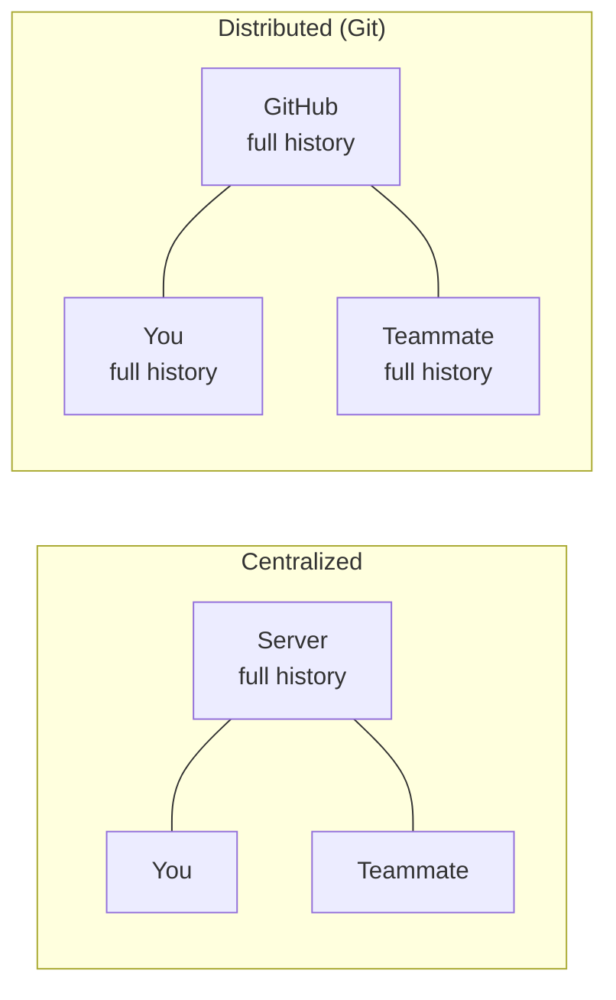
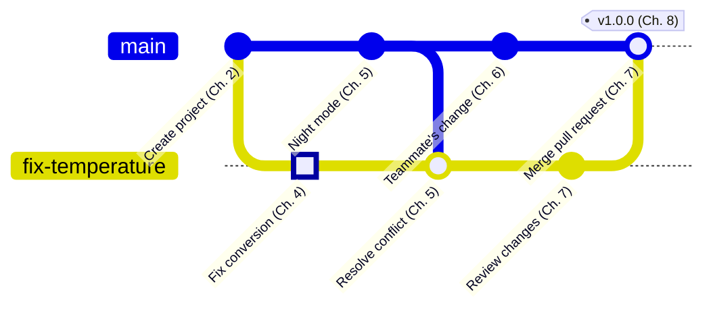

<!-- source: zh-TW/0-before-you-start/00-overview/README.md | sha: 51049a365d8c -->

# Chapter 0: The Big Picture — One Project, One Change

> 📍 **Where the project and the change are**
>
> - Project: `fan-controller` is managed by copying folders, and the folder names get messier every day
> - Previous stop: the start of the journey
> - **This chapter: a bug is found; the fan starts too late**
> - Next stop: install Git and Sourcetree and get ready to fix it

---

## Life without version control

You may have seen a folder like this:

```text
fan_v1/
fan_v2/
fan_v2_edited/
fan_v2_final/
fan_v2_really_final/
fan_v2_from_teammate.zip
```

Every copy is almost the same, but not quite. You soon run into questions like these:

- Which copy is actually flashed onto the board?
- Which lines changed in `fan_v2_edited`, and why?
- How do you combine your teammate's zip file with your own version?
- It worked yesterday and today it is broken. How do you get back to yesterday?

These are exactly the problems that version control solves.

---

## What version control does

**Version control** is like a diary for your project. Each time you finish a piece of work, you write an entry: what changed, who changed it, when, and why.

With that diary, you can do four things:

| Ability | Problem it solves | Chapter |
|---|---|---|
| Record every version | Know who changed what, when and why | Chapters 2 and 3 |
| Compare versions | See at a glance which lines differ between two versions | Chapter 2 |
| Work in parallel | Fix a bug and build a new feature at the same time without getting in each other's way | Chapters 4 and 5 |
| Go back in time | When something breaks, return to any recorded version | Chapter 9 |

Git is the most widely used version control tool today. Everything from small personal projects to operating systems built by thousands of developers is managed with it.

> [!NOTE]
> **📖 Term | Git and GitHub**
>
> - **Definition**: Git is a version control tool installed on your computer. GitHub is a website where people put their Git repositories to share them and work together.
> - **On the job**: "Does this project use Git?" is a question about version control. "Push it to GitHub" is about putting it on the website.
> - **Related terms**: repository, remote, Sourcetree
> - **Common confusion**: Git and GitHub are two different things. You can use Git on your own computer with no network and no GitHub account.

---

## Centralized and distributed

Version control tools work in one of two ways.

**Centralized**: the history lives only on one server. Everyone takes the latest files from the server and sends their changes back. It is like a whole class sharing one attendance book: when the server is down, nobody can record anything.

**Distributed**: everyone's computer has the complete history. Git works this way. On a plane or in a lab with no network, you can still record versions and look at the history. The copy on GitHub is simply the one everyone agrees to sync with.



> [!NOTE]
> **📖 Term | Distributed version control (分散式版本控制)**
>
> - **Definition**: A way of doing version control in which everyone's computer holds a complete copy of the history.
> - **On the job**: People rarely say the full name. When someone says "clone it," they mean copy the whole history onto your own computer.
> - **Related terms**: centralized version control, clone, remote
> - **Common confusion**: Distributed does not mean there is no center. Teams usually still treat the copy on GitHub as the official one; technically, though, it is no different from the copy on your computer.

<details>
<summary><strong>🔍 Deep dive | Where Git came from</strong></summary>

Git was born in 2005. The developers of the Linux operating system kernel could no longer use the commercial version control tool they had relied on for free, so Linus Torvalds spent a few weeks writing the first version of Git.

Its design goals reflect what open source projects need:

- **Fast**: in a project with thousands of people and tens of thousands of files, looking at history and creating branches must be instant.
- **Distributed**: anyone can copy the full history, work on their own computer, and then offer their changes to the maintainers.
- **Tamper-evident**: every version is named by a hash computed from its content, so any change to the history shows up immediately when IDs are compared (Chapter 3).

Being distributed also makes "anyone can contribute" natural. You do not need write access to a server: you make your changes in your own copy and ask the maintainers to pull them. That is the origin of the pull request in Chapter 7.

</details>

---

## The two main characters

**The main character: one project.** `fan-controller` is a small piece of firmware. Once a second it reads a temperature sensor, turns the fan on above 45 °C and turns it off below 40 °C. The book follows it from a one-person project until teammates join and an official version is released.

**The supporting character: one change.** The sensor's datasheet says it "outputs 500 mV at 0 °C, plus 10 mV for every 1 °C," but the code subtracts 600 mV first. Every reading comes out 10 °C too low, so the fan does not start until the real temperature reaches 55 °C.

The fix is a single line, but it will travel the whole journey through Git. The graph below shows the history it passes through; the highlighted commit is the change:



Don't worry if the graph makes no sense yet. Come back after Chapter 8, and you will know where every dot came from.

> [!TIP]
> **🔧 Know-how | Start using Git on day one**
>
> - **Situation**: The project has just started, you are the only developer, and version control feels like something for later.
> - **Practice**: Run `git init` on the day you create the project folder, and make the first commit.
> - **Why**: The version you most often need to look back at is "the first version that worked." It is the simplest one, and the best one to compare against when something goes wrong.
> - **If you skip it**: By the time a problem makes you want Git, the crucial "last version that worked" is gone, and you are left guessing from memory.
> - **Related chapters**: [Chapter 2: The Three Areas](../../1-on-your-computer/02-three-areas/README.md)

> [!TIP]
> **🔧 Know-how | Saving a file is not recording a version**
>
> - **Situation**: You think that once you press Save in your editor, Git remembers it.
> - **Practice**: Commit each time you finish a small piece of work, such as fixing one bug or adding one function.
> - **Why**: Git only records the moments when you commit. It knows nothing about the saves in between.
> - **If you skip it**: If you work all day before committing and break something along the way, you can only go back to this morning's version, and the whole day's work goes with it.
> - **Related chapters**: [Chapter 3: What a Commit Really Is](../../1-on-your-computer/03-commits/README.md)

---

## Both commands and Sourcetree

Git itself is used by typing commands in a terminal. Commands feel unfamiliar at first, but they are the same on every operating system, and almost every explanation on the internet uses them.

**Sourcetree** is a graphical interface for Git. You can do most things with the mouse, and it draws the history as a graph, which is a great help when you are starting out. Behind the scenes it runs the same Git commands.

So this book shows every step twice: first the idea, then the command, and finally where to click in Sourcetree. You can use just one of them, or learn both side by side.

---

## 🧪 Hands-on

**Before you start**: You do not need Git yet for this chapter, only a web browser and a file manager.

1. Open this book's GitHub page, click **Code → Download ZIP**, and unzip the download.
2. Open the `practice/fan-controller` folder inside it. This is the project from the story.
3. Open `sensor.c` in any text editor. Compare the comment on line 5 with the `return` line at the end, and find the bug.
4. Read `practice/README.md`, which explains how the later chapters use this practice project.

**What you should see**: The comment in `sensor.c` says 500 mV, but the code says:

```c
    return (mv - 600) / 10.0f;
```

Don't change it yet. In Chapter 2 you will fix this line with Git keeping a record.

---

## 📋 Commands in this chapter

You do not need to type any commands in this chapter yet. Here are the ones used most often in the book; later chapters explain each in detail:

| What you want to do | Command | In Sourcetree |
|---|---|---|
| See the current state | `git status` | File Status on the left |
| Record a version | `git add`, `git commit` | Stage → Commit |
| Create or switch branches | `git switch -c`, `git switch` | Branch on the toolbar; double-click a branch |
| Sync with GitHub | `git pull`, `git push` | Pull and Push on the toolbar |

---

## Key takeaways

1. Version control records who changed each version, when and why, and lets you compare versions, work in parallel and go back in time.
2. Git is distributed: everyone's computer holds the full history, and GitHub holds the copy everyone agrees to sync with.
3. Git is a tool and GitHub is a website. They are not the same thing.
4. This book follows one firmware project and one change through the whole journey of Git.

---

## Further reading

- Scott Chacon and Ben Straub, *[Pro Git](https://git-scm.com/book/en/v2)*, 2nd edition, Chapter 1 (Getting Started; free to read online)
- The Git website: [About Git](https://git-scm.com/about)

---

[Contents](../../README.md) | [Chapter 1: Setting Up Your Tools →](../01-setup/README.md)
