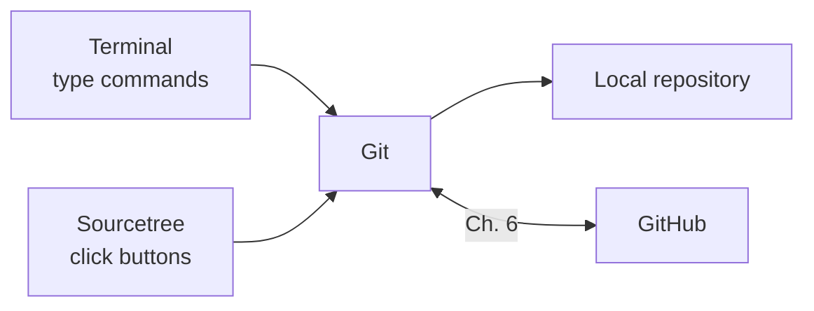

<!-- source: zh-TW/0-before-you-start/01-setup/README.md | sha: c338394334a7 -->

# Chapter 1: Setting Up Your Tools — Installing Git and Sourcetree

> 📍 **Where the project and the change are**
>
> - Project: there are no tools on the computer yet; this chapter sets up Git, Sourcetree and a GitHub account
> - Previous stop: a bug is found; the fan starts too late
> - **This chapter: the change has not started yet; first get the tools ready**
> - Next stop: create a repository and put the fix in the staging area

---

## What you need

| Tool | What it is for | Required? |
|---|---|---|
| Git | Version control itself | Required |
| Terminal | Where you type commands. On Windows, use Git Bash, which is installed with Git; on macOS and Linux, use the built-in terminal | Required |
| Code editor | For editing code; any editor will do | Required |
| Sourcetree | A graphical interface for Git, available only for Windows and macOS | Optional |
| GitHub account | For working with others from Chapter 6 on | Needed before Chapter 6 |

This is how the tools fit together. Whether you click a button in Sourcetree or type a command in the terminal, the same Git does the work:



---

## Three basic moves in the terminal

If you have never used a terminal, don't worry. This book needs only three moves:

```bash
pwd                          # which folder am I in?
ls                           # what is in this folder?
cd ~/git-practice            # go into a folder; ~ means your home folder
```

`cd ..` goes up one level. Type part of a path and press Tab, and the terminal completes it for you.

> [!NOTE]
> **📖 Term | Terminal (終端機)**
>
> - **Definition**: A window where you control the computer by typing text commands.
> - **On the job**: Also called the command line or the shell, as in "Just run `git status` in the terminal and you'll see."
> - **Related terms**: Git Bash, command, path
> - **Common confusion**: The Command Prompt built into Windows is also a terminal, but many commands differ; for example, it has no `ls`. Type this book's commands in Git Bash.

---

## Installing Git

**Windows**: Download the installer from the Git website, git-scm.com. You can keep the defaults on most screens; only two need attention:

1. **Default editor**: The default is an editor that runs inside the terminal, and people who have never used it easily get stuck. Choose the code editor you are familiar with instead.
2. **Initial branch name for new repositories**: Choose "Override the default branch name" and enter `main`.

For line endings, keep the default, "Checkout Windows-style, commit Unix-style line endings."

**macOS**: Open the terminal and type `git --version`. If Git is not installed yet, the system pops up a window asking whether to install the command line developer tools. Click Install.

**Linux**: Install it with your distribution's package manager, for example `sudo apt install git`.

Once it is installed, check the version:

```bash
git --version
```

This book uses commands such as `git switch`, which only exist in Git versions released in 2019 or later. If `git switch` later gives a "not a git command" error, your Git is too old; please update to the latest version.

---

## First-time setup: git config

Git records your name and email in every commit. Before you use it for the first time, tell it who you are:

```bash
git config --global user.name "Chen Xiao-Ming"
git config --global user.email "xiaoming@example.com"
git config --global init.defaultBranch main
```

- `--global` means the setting applies to every repository on this computer.
- `init.defaultBranch main` makes new repositories start with a branch called `main`. Git's default has long been `master`, and the community plans to change it to `main` in a future version. GitHub and newer tutorials already use `main`.

**In Sourcetree**: Sourcetree uses the settings above by default. You can also fill in Default user information under **Tools → Options → General** (on macOS, **Settings → General**; older versions call it Preferences).

> [!NOTE]
> **📖 Term | Configuration, git config (設定)**
>
> - **Definition**: Git's options, such as your name, email and default branch name, which you read and write with `git config`.
> - **On the job**: "Your global email is wrong" refers to the setting at the `--global` level.
> - **Related terms**: `--global`, `.gitconfig`, `.git/config`
> - **Common confusion**: Git's configuration and your account settings on the GitHub website are two different things. Changing your GitHub profile does not change the name your computer puts in commits.

> [!TIP]
> **🔧 Know-how | Use the email of your GitHub account, or its private noreply address**
>
> - **Situation**: Setting `user.email` for the first time, you type whatever address comes to mind.
> - **Practice**: Use the email of your GitHub account. If you don't want your address to be public, turn on email privacy in GitHub's email settings and use the noreply address it gives you.
> - **Why**: GitHub uses the email to decide who made a commit. Once a commit is pushed to a public repository, anyone can see the email in it.
> - **If you skip it**: Your commits are not linked to your account and your contribution record stays empty, or your private email becomes public and starts attracting spam.
> - **Related chapters**: [Chapter 6: Remote Repositories](../../2-beyond-your-computer/06-remotes/README.md)

### Line endings

On Windows, each line of a text file ends with two characters (CRLF); macOS and Linux use only one (LF). Git can store everything as LF when you commit, and convert back for your system when files are checked out:

| System | Setting |
|---|---|
| Windows | `core.autocrlf true`; the installer sets this by default |
| macOS, Linux | `git config --global core.autocrlf input` |

> [!TIP]
> **🔧 Know-how | Keep line-ending settings consistent across the team**
>
> - **Situation**: In the same project, some people use Windows and others use macOS or Linux.
> - **Practice**: Everyone sets it up as in the table above. A team can also put a `.gitattributes` file in the repository to fix the line endings for everyone.
> - **Why**: When line endings differ, Git thinks every line of the file has changed.
> - **If you skip it**: You change one line, yet the diff shows the whole file deleted and rewritten. Reviewers cannot see what really changed, and merges conflict more easily.
> - **Related chapters**: [Chapter 7: Pull Requests and Code Review](../../2-beyond-your-computer/07-pull-requests/README.md)

<details>
<summary><strong>🔍 Deep dive | The three levels of configuration</strong></summary>

Git's configuration has three levels. The narrower the scope, the higher the priority:

| Level | Option | Where it is stored | Scope |
|---|---|---|---|
| system | `--system` | On Windows, inside the Git installation; on macOS and Linux, usually `/etc/gitconfig` | Every user on this computer |
| global | `--global` | `.gitconfig` in your home folder | All your repositories |
| local | no option | `.git/config` inside the repository | This repository only |

So you can set your personal email at the global level, then run `git config user.email` inside a work project's folder to set your work email; only that repository uses it. To see which level a setting comes from, run `git config --list --show-origin`.

</details>

---

## Creating a GitHub account

Sign up at github.com. GitHub requires two-factor authentication (2FA), so have an authenticator app ready on your phone.

You only need the account by Chapter 6. If you plan to use Sourcetree, you will need it in the next section to connect your account. Chapter 6 explains how to prove "I am me" when you push.

---

## Installing Sourcetree and connecting it to GitHub

**Download and install**: Download Sourcetree from its website, sourcetreeapp.com. If the installer asks you to sign in or create an account, follow the screens or skip that step.

**Use the system Git** (Windows): Sourcetree comes with its own copy of Git. Go to **Tools → Options → Git** and choose **System** under Git Version, so that Sourcetree and the terminal use the same Git and the same configuration.

**Connect your GitHub account**:

- Windows: **Tools → Options → Authentication → Add**, choose GitHub as the Hosting Service, and sign in through the browser to authorize it.
- macOS: **Settings → Accounts → Add**, choose GitHub, and sign in through the browser to authorize it.


*Figure: ① The Add button, to add an account ② The Hosting Service menu, where you choose GitHub ③ The authorize button, which opens the browser to sign in. The real screen differs slightly between versions and operating systems.*

---

## 🧪 Hands-on

**Before you start**: Install Git as described above. Sourcetree and the GitHub account can wait.

1. Open a terminal (on Windows, find Git Bash in the Start menu) and check that Git is installed: `git --version`
2. Set your name, email and default branch. On macOS and Linux, also set line endings:

   ```bash
   git config --global user.name "Your Name"
   git config --global user.email "your email"
   git config --global init.defaultBranch main
   git config --global core.autocrlf input    # macOS and Linux only
   ```

3. List your global settings: `git config --global --list`
4. If you plan to use Sourcetree: after installing it, choose the system Git and connect your GitHub account.
5. If you downloaded this book as a ZIP in Chapter 0, you can now download it with Git instead. This is the first time you get a repository from the internet with Git:

   ```bash
   git clone https://github.com/chenwei810/Git_Introduction.git
   ```

**What you should see**: `git config --global --list` lists the settings you just made. The setting names are shown in lowercase:

```text
user.name=Chen Xiao-Ming
user.email=xiaoming@example.com
init.defaultbranch=main
```

On macOS and Linux there is one more line, `core.autocrlf=input`.

---

## 📋 Commands in this chapter

| What you want to do | Command | In Sourcetree |
|---|---|---|
| Check the Git version | `git --version` | — |
| Set your name and email | `git config --global user.name`, `user.email` | Tools → Options → General (macOS: Settings → General) |
| Name the first branch of new repositories main | `git config --global init.defaultBranch main` | — |
| Set line endings (macOS, Linux) | `git config --global core.autocrlf input` | — |
| List global settings | `git config --global --list` | — |
| Connect your GitHub account | — | Tools → Options → Authentication (macOS: Settings → Accounts) |

---

## Key takeaways

1. You need Git, a terminal and a code editor. Sourcetree is an optional graphical interface, and the same Git works behind it.
2. Before your first commit, use `git config --global` to set your name, email and the default branch `main`.
3. Your email is public in every commit. Use the one on your GitHub account, or GitHub's private noreply address.
4. Everyone on a team needs the same line-ending settings; otherwise changing one line can look like changing the whole file.

---

## Further reading

- Scott Chacon and Ben Straub, *[Pro Git](https://git-scm.com/book/en/v2)*, 2nd edition, sections 1.5 (Installing Git) and 1.6 (First-Time Git Setup)
- Git documentation: [git-config](https://git-scm.com/docs/git-config)
- GitHub Docs: [Setting your commit email address](https://docs.github.com/en/account-and-profile/setting-up-and-managing-your-personal-account-on-github/managing-email-preferences/setting-your-commit-email-address)

---

[← Chapter 0: The Big Picture](../00-overview/README.md) | [Contents](../../README.md) | [Chapter 2: The Three Areas →](../../1-on-your-computer/02-three-areas/README.md)
