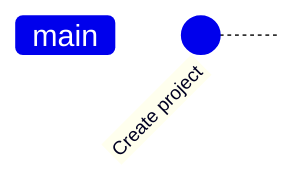

<!-- source: zh-TW/1-on-your-computer/02-three-areas/README.md | sha: 03509c355ea7 -->

# Chapter 2: The Three Areas — Working Directory, Staging Area and Repository

> 📍 **Where the project and the change are**
>
> - Project: `fan-controller` is still an ordinary folder; this chapter turns it into a repository and makes the first commit
> - Previous stop: the bug has been found, and Git and Sourcetree are installed
> - **This chapter: the fix is written and put in the staging area**
> - Next stop: open a commit and see what it becomes once it is committed

---

## Why there are three areas

Files managed by Git live in three places. Sending a parcel is the easiest way to picture them:

- The **working directory** is your desk. Your files lie on it, and you can change them at any time.
- The **staging area** is the box you are packing. From the things on your desk, you pick what to send this time and put it in the box.
- The **repository** is the shipping record. Once the box is sealed and sent, its contents are recorded permanently. That act is called a **commit**.


Why bother with a box? Because you often change several things at once. Say you fixed the temperature conversion and also added a few debug prints to `main.c`. You want to record only the fix as one version, without the debug code. The staging area lets you choose which changes to record this time, and leave the rest on the desk.

> [!NOTE]
> **📖 Term | Repository (儲存庫)**
>
> - **Definition**: The place where Git records every version of a project: the hidden `.git` folder inside the project folder.
> - **On the job**: People usually just say "repo," as in "This repo is the firmware; the hardware drawings are in another repo."
> - **Related terms**: working directory, staging area, remote repository
> - **Common confusion**: The project folder is not the repository. Delete `.git` and the files in the folder are still there, but the whole history is gone.

---

## Creating a repository: git init

Run `git init` in the project folder, and Git creates the `.git` folder and starts managing the project.

```bash
cd ~/git-practice/fan-controller
git init
```

**In Sourcetree**: **Create in a new tab → choose the fan-controller folder → Create** (on macOS, **New → Create Local Repository**). Sourcetree warns that the folder already exists; choose to continue.

> [!TIP]
> **🔧 Know-how | Check which folder you are in before git init**
>
> - **Situation**: You open a terminal and type `git init` straight away.
> - **Practice**: Run `pwd` first to check where you are, and only run `git init` when you are sure it is the project folder.
> - **Why**: A terminal usually starts in your home folder. Run `git init` there and your entire home folder becomes one project.
> - **If you skip it**: `git status` lists thousands of files, and every subfolder you work in accidentally uses that repository. You have to delete the `.git` in your home folder to recover.
> - **Related chapters**: [Chapter 1: Setting Up Your Tools](../../0-before-you-start/01-setup/README.md)

<details>
<summary><strong>🔍 Deep dive | What is inside the .git folder</strong></summary>

All of Git lives inside `.git`. Here are the most important entries; later chapters come back to each of them:

```text
HEAD       which branch you are on (Chapter 4)
config     this repository's own settings (Chapter 1)
index      the staging area (this chapter)
objects/   the contents of every version (Chapter 3)
refs/      branches and tags (Chapters 4 and 8)
```

These are all ordinary files. Open `HEAD` and you find a single line, `ref: refs/heads/main`, which means "you are on the main branch."

</details>

---

## Checking the state: git status

`git status` tells you which area each file is in. It is the command you will use most. Whenever you are not sure what is going on, run it first.

Right after `git init`, Git is not tracking any file yet, so every file is listed under "Untracked files."

| Heading in `git status` | Meaning |
|---|---|
| Untracked files | New files that Git has never recorded |
| Changes not staged for commit | Changed, but still on the desk |
| Changes to be committed | Already in the box; the next commit will record them |

**In Sourcetree**: **File Status** on the left. Unstaged files in the lower half is the desk, and Staged files in the upper half is the box.


*Figure: ① Staged files, the box ② Unstaged files, the desk ③ Stage All, which puts everything on the desk into the box ④ The message box ⑤ The Commit button. On the right is the diff of the selected file.*

---

## Staging and committing: git add, git commit

**Choose files → git add → git commit**

1. **git add**: puts files in the staging area. `git add .` means every file in the current folder.
2. **git commit**: records the contents of the staging area as a version. The text after `-m` describes this version.

```bash
git add .
git commit -m "Initial commit"
```

**In Sourcetree**: **Stage All → type a message at the bottom → Commit**.

The project's first commit is born. At this point the history has a single dot:



> [!NOTE]
> **📖 Term | Staging area (暫存區)**
>
> - **Definition**: The contents of the next commit. When you commit, Git records only what is in the staging area.
> - **On the job**: The verb is usually "stage," as in "You haven't staged that file, so it didn't make it into the commit."
> - **Related terms**: working directory, `git add`, index
> - **Common confusion**: The staging area is also called the index; the two are the same thing. It has nothing to do with `git stash` in Chapter 9, which puts changes away temporarily.

---

## Fixing the bug: git diff

Now fix the temperature conversion. Open `sensor.c`: the comment says the sensor outputs 500 mV at 0 °C, but the code says `(mv - 600)`. Change 600 to 500 and save, and `sensor.c` becomes "changed, but still on the desk." Before you put it in the box, use `git diff` to see exactly what changed:

```bash
git diff             # what differs between the desk and the box
git add sensor.c
git diff --staged    # what differs between the box and the last commit
```

**In Sourcetree**: Click a file in File Status and its diff appears on the right. Red lines were removed and green lines were added.

The staging area keeps the contents as they were at the moment of `git add`. If you change the same file again after adding it, `git status` lists it under both headings, and you have to add it again to put the new change in the box.

> [!TIP]
> **🔧 Know-how | Run git diff --staged before you commit**
>
> - **Situation**: You have changed several files and are about to commit.
> - **Practice**: Run `git diff --staged` first, and check line by line that everything in the box is something you want to record.
> - **Why**: `git add .` puts every changed file in the folder into the box, including debug prints and settings you changed temporarily.
> - **If you skip it**: Debug code gets recorded in an official version and may even be flashed into products. Finding the commit that brought it in later takes even more time.
> - **Related chapters**: [Chapter 10: Good Habits](../../3-when-things-go-wrong/10-good-habits/README.md)

<details>
<summary><strong>🔍 Deep dive | The staging area is actually a file</strong></summary>

The staging area is the binary file `.git/index`. It records each file's path, permissions and a hash of its contents. This command shows what is in it:

```text
$ git ls-files --stage
100644 6305a5e833282a7ac1c6fa02a0c455706b169145 0	Makefile
100644 c50b3ace27f06cf09657fbd19635ee6d06f268ed 0	README.md
```

The 40 characters in the middle are the hash of the file's contents. What `git add` really does is store the file's contents in `.git/objects/` and write the hash into the index. So at the moment you add a file, Git has already saved its contents, which is why changing the file after adding it does not affect the box. Chapter 3 opens these objects.

</details>

---

## Common problems

| Problem | Cause | What to do |
|---|---|---|
| `fatal: not a git repository` | The current folder is not a repository | Use `cd` to go into the project folder |
| `Author identity unknown` | Your name and email are not set | Set `user.name` and `user.email` as in Chapter 1 |
| `LF will be replaced by CRLF` | Windows and other systems use different line endings | This is only a notice and can be ignored; see Chapter 1 |

---

## 🧪 Hands-on

**Before you start**: From the root of this book, run `bash practice/setup.sh 2` to copy the practice project to `~/git-practice/fan-controller`. At this point it is not a repository yet.

1. Create the repository and make the first commit:

   ```bash
   cd ~/git-practice/fan-controller
   git init
   git status          # every file is under Untracked files
   git add .
   git commit -m "Initial commit"
   ```

   In Sourcetree: choose this folder with Create in a new tab, then **Stage All → type a message → Commit**.

2. Open `sensor.c` in your editor, change `(mv - 600)` to `(mv - 500)`, and save.
3. Look at the diff, then put the fix in the staging area, but **do not commit yet**:

   ```bash
   git diff
   git add sensor.c
   git status
   ```

**What you should see**: The first line of the last `git status` is `On branch main`, and `modified: sensor.c` is listed under Changes to be committed. If the first line says `On branch master`, set the default branch as in Chapter 1, delete the `.git` folder and start again. In Chapter 4 this fix will be committed on a new branch.

---

## 📋 Commands in this chapter

| What you want to do | Command | In Sourcetree |
|---|---|---|
| Turn a folder into a repository | `git init` | Create (macOS: New → Create Local Repository) |
| See the current state | `git status` | File Status on the left |
| Put files in the staging area | `git add <file>`, `git add .` | Select files → Stage Selected, or Stage All |
| Commit | `git commit -m "message"` | Type a message → Commit |
| See changes not yet staged | `git diff` | Click a file under Unstaged files |
| See staged changes | `git diff --staged` | Click a file under Staged files |

---

## Key takeaways

1. Files live in three places: the working directory (the desk), the staging area (the box) and the repository (the shipping record).
2. `git add` puts changes in the staging area, and `git commit` records the staging area as a version.
3. The staging area lets you choose which changes to record, so each commit holds only related changes.
4. When in doubt, run `git status`; before committing, run `git diff --staged`.

---

## Further reading

- Scott Chacon and Ben Straub, *[Pro Git](https://git-scm.com/book/en/v2)*, 2nd edition, Chapter 2 (Git Basics; free to read online)
- Git documentation: [git-status](https://git-scm.com/docs/git-status), [git-add](https://git-scm.com/docs/git-add), [git-commit](https://git-scm.com/docs/git-commit)

---

[← Chapter 1: Setting Up Your Tools](../../0-before-you-start/01-setup/README.md) | [Contents](../../README.md) | [Chapter 3: What a Commit Really Is →](../03-commits/README.md)
