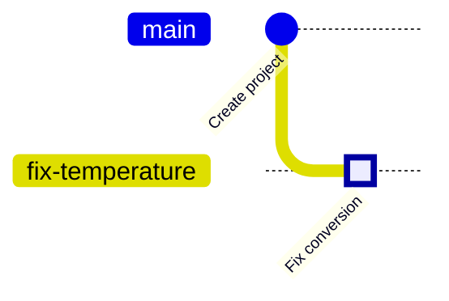

<!-- source: zh-TW/1-on-your-computer/03-commits/README.md | sha: 0d2783081470 -->

# Chapter 3: What a Commit Really Is — Snapshots, Hashes and Objects

> 📍 **Where the project and the change are**
>
> - Project: the repository has its first commit, "Initial commit"
> - Previous stop: the fix is written and put in the staging area
> - **This chapter: the fix waits in the staging area; first, open the first commit and see what a commit becomes**
> - Next stop: create a new branch and commit the fix there

---

## A commit is a snapshot, not a diff

Many people think a commit records "which lines changed this time." In fact, Git records a **snapshot**: what the whole project looked like at the moment you committed.

It is like taking a group photo of the whole project each time you finish a piece of work. When you take the next photo, files that have not changed are not photographed again; Git reuses the same copy from the previous photo. Only changed files are stored again.

So snapshots do not waste space, and "which lines changed this time" is something Git works out by comparing two snapshots. That is also why Git can compare any two versions, not just neighboring ones.

---

## What is inside a commit

| Contents | Description |
|---|---|
| Snapshot | The contents of every file in this version |
| Previous commit | A link to its "previous version"; the first commit has none |
| Author and time | Who wrote these changes and when |
| Message | Why this change was made |

All of this is turned into a 40-character ID, such as `21e1fda6273505ec510e3aec8e96e4888e3c597a`. It is the commit's identity number. Usually only the first 7 characters are written, as in `21e1fda`.

> [!NOTE]
> **📖 Term | Commit (提交)**
>
> - **Definition**: A snapshot of the project at a point in time, plus the author, the time, a message and a link to the previous commit.
> - **On the job**: Used both as a noun and as a verb, as in "Which commit introduced this bug?" and "Remember to commit when you're done."
> - **Related terms**: snapshot, hash, parent commit, `git log`
> - **Common confusion**: A commit exists only on your computer; it is not on GitHub yet. Others can see it only after you push it (Chapter 6).

> [!NOTE]
> **📖 Term | Hash (雜湊值)**
>
> - **Definition**: A fixed-length ID computed by feeding content into a hash function. Change a single character of the content and the ID is completely different.
> - **On the job**: Often called the commit hash, commit ID or SHA, as in "Send me the SHA of the bad commit."
> - **Related terms**: commit, SHA-1, SHA-256
> - **Common confusion**: It is not a sequence number and says nothing about order. The order comes from each commit's link to its previous commit.

---

## Looking at history: git log

```bash
git log              # the full history
git log --oneline    # one commit per line
```

```text
commit 21e1fda6273505ec510e3aec8e96e4888e3c597a
Author: Chen Xiao-Ming <xiaoming@example.com>
Date:   Tue Oct 13 00:32:17 2026 +0800

    Initial commit
```

When the history is long, the terminal stops at a scrollable screen. Press the space bar to page down and `q` to leave.

**In Sourcetree**: **History** on the left. Each row is a commit, and the lines on the left are the commit graph.

Right now the history has one dot. The fix in the staging area will become the second dot in the next chapter:



---

## Seeing what a commit changed: git show

```bash
git show HEAD            # the latest commit and what it changed
git show --stat HEAD     # only which files changed, and by how many lines
```

`HEAD` means "the commit you are on right now"; Chapter 4 explains it in detail. You can replace `HEAD` with any commit ID.

**In Sourcetree**: Click a commit in History. The files it changed are listed below; click a file to see its diff.

> [!TIP]
> **🔧 Know-how | One commit does one thing**
>
> - **Situation**: You fixed a bug, tidied up some formatting along the way and tweaked a parameter, and you plan to commit them all together.
> - **Practice**: Make three commits. Use the staging area from Chapter 2 to put one thing in at a time.
> - **Why**: Each commit is a unit you can later look at on its own and undo on its own.
> - **If you skip it**: When you find the parameter was wrong and want to undo it, the bug fix gets undone too. Reviewers also struggle to see which lines are the real fix.
> - **Related chapters**: [Chapter 9: Undoing Things](../../3-when-things-go-wrong/09-undoing-things/README.md)

> [!TIP]
> **🔧 Know-how | Include the commit ID when you report a problem**
>
> - **Situation**: A colleague who tests the boards says, "The new firmware has a problem."
> - **Practice**: Ask which commit they flashed, or record the commit ID in the firmware at build time and print it at startup.
> - **Why**: "The new version" changes every day. Only a commit ID points to exactly one version of the code.
> - **If you skip it**: You can't find the problem in the latest code, while they are holding a version from three days ago. Both of you waste your time.
> - **Related chapters**: [Chapter 8: Branching Strategies and Releases](../../2-beyond-your-computer/08-branching-and-releases/README.md)

<details>
<summary><strong>🔍 Deep dive | Blobs, trees and commits</strong></summary>

What `.git/objects/` stores are called objects. The three most common kinds are:

- **blob**: the contents of one file. Contents only, no file name.
- **tree**: a folder. It lists every file name in it, and the blob or subfolder tree each name points to.
- **commit**: points to the top-level tree, and adds the parent commit, author, time and message.

`git cat-file -p` opens any object:

```text
$ git cat-file -p HEAD
tree ba262450ee64e15410fdcb083ad5d02175363fb7
author Chen Xiao-Ming <xiaoming@example.com> 1791822737 +0800
committer Chen Xiao-Ming <xiaoming@example.com> 1791822737 +0800

Initial commit
```

Every object's ID is computed from its contents, so files with the same contents always have the same ID. Try `git rev-parse HEAD:sensor.c` and you get exactly the same `28a712d460300d19b5ccfad1dedb2fe190f91adc` as the book, because our `sensor.c` files are identical. This is how snapshots avoid wasting space: files that did not change point to the same blob in the old and new snapshots.

</details>

<details>
<summary><strong>🔍 Deep dive | From SHA-1 to SHA-256</strong></summary>

Git has always computed IDs with the SHA-1 algorithm, which produces 40 hexadecimal characters. SHA-1 was later shown to allow deliberately creating two different pieces of data with the same ID. Git added protection that detects this attack and began supporting the safer SHA-256, whose IDs are 64 characters long.

As of the mid-2020s, most repositories and hosting platforms still use SHA-1, and the Git community is planning to make SHA-256 the default for new repositories. For everyday users the only difference is longer IDs; the commands work the same way.

</details>

---

## Common problems

| Problem | Cause | What to do |
|---|---|---|
| Commit IDs differ from the book | A different author and time produce a different ID | This is normal |
| The author name in `git log` is wrong | The `user.name` setting from Chapter 1 is wrong | Fix the setting; later commits will be correct |

---

## 🧪 Hands-on

**Before you start**: Continue with the practice project from Chapter 2. To start from this chapter, run `bash practice/setup.sh 3` from the root of this book.

1. Look at the history and find the single commit. If the screen stops, press `q`:

   ```bash
   cd ~/git-practice/fan-controller
   git log
   git log --oneline
   ```

   In Sourcetree: History on the left.

2. See which files the first commit contains: `git show --stat HEAD`
3. Check that the fix is still in the staging area and has not been committed: `git status`
4. If you are reading the deep dives, open the commit object and look up the blob ID of `sensor.c`:

   ```bash
   git cat-file -p HEAD
   git rev-parse HEAD:sensor.c
   ```

**What you should see**: `git log --oneline` shows a single line, `Initial commit`. `git show --stat HEAD` lists 10 files. `git status` still lists `modified: sensor.c` under Changes to be committed. `git rev-parse HEAD:sensor.c` prints `28a712d460300d19b5ccfad1dedb2fe190f91adc`, the same as in the book.

---

## 📋 Commands in this chapter

| What you want to do | Command | In Sourcetree |
|---|---|---|
| Look at the history | `git log` | History on the left |
| One commit per line | `git log --oneline` | History shows this by default |
| See what a commit changed | `git show <ID>` | Click the commit in History |
| See only which files changed | `git show --stat <ID>` | Click the commit in History and look at the file list below |
| Open an object | `git cat-file -p <ID>` | — |

---

## Key takeaways

1. A commit is a snapshot of the whole project, not a diff; a diff is what you get by comparing two snapshots.
2. Each commit holds a snapshot, the previous commit, the author, the time and a message, and its unique ID is computed from all of these.
3. Use `git log` to look at the history and `git show` to see what one commit changed.
4. One commit does one thing, so that it can later be looked at and undone on its own.

---

## Further reading

- Scott Chacon and Ben Straub, *[Pro Git](https://git-scm.com/book/en/v2)*, 2nd edition, sections 2.3 (Viewing the Commit History) and 10.2 (Git Objects)
- Git documentation: [git-log](https://git-scm.com/docs/git-log), [git-cat-file](https://git-scm.com/docs/git-cat-file)

---

[← Chapter 2: The Three Areas](../02-three-areas/README.md) | [Contents](../../README.md) | [Chapter 4: Branches →](../04-branches/README.md)
