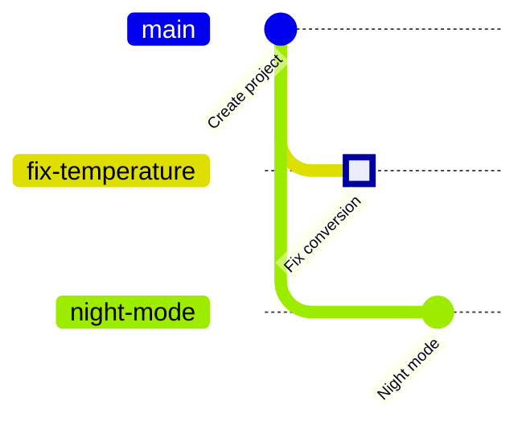

<!-- source: zh-TW/1-on-your-computer/04-branches/README.md | sha: a220b015c202 -->

# Chapter 4: Branches — Just a Sticky Note

> 📍 **Where the project and the change are**
>
> - Project: two things need doing at once: fixing the temperature conversion and building a "night mode"
> - Previous stop: the fix waits in the staging area
> - **This chapter: the fix moves with you to a new branch, `fix-temperature`, and becomes a commit there**
> - Next stop: night mode is merged into `main` first, and the fix branch runs into a conflict with it

---

## Why branches are needed

The code on `main` should always be a version you can flash onto the board and that works. But you have two jobs in hand:

- Fix the temperature conversion, then verify it on the board.
- Build night mode, which may take several days; nobody should touch the half-finished work in between.

If both jobs are done directly on `main`, unfinished work slips in, and a fix that is only half verified gets in the way of the new feature. **Branches** let each job run on its own line without disturbing the other, and be merged back into `main` when it is ready.

---

## A branch is just a sticky note

Imagine each commit is a photo in an album, and every photo remembers which photo came before it.

**A branch is a sticky note stuck on one of the photos**, with a name written on it, such as `main`. When you commit on that branch, the new photo is added after it and the sticky note moves to the new photo automatically.

Creating a new branch just adds another sticky note; no files are copied. That is why branches take almost no time in Git, and people create several a day.

There is also a special arrow called **HEAD**, which means "you are here." It usually points to a sticky note, telling you which branch you are on.

> [!NOTE]
> **📖 Term | Branch (分支)**
>
> - **Definition**: A name that points to a commit. When you commit on the branch, it moves forward to the new commit automatically.
> - **On the job**: "Make a branch for the fix." "Which branch are you on?"
> - **Related terms**: `main`, HEAD, `git switch`
> - **Common confusion**: A branch is not a copied folder. When you switch branches, the files in the same folder change to match that branch.

> [!NOTE]
> **📖 Term | HEAD**
>
> - **Definition**: A pointer meaning "where you are now." It usually points to a branch, and through the branch to a commit.
> - **On the job**: "Where is HEAD?" asks which branch and which commit you are on.
> - **Related terms**: branch, detached HEAD, `git switch`
> - **Common confusion**: Older tutorials switch branches with `git checkout`. It does several jobs, including restoring files, so in 2019 Git added `git switch` (switch branches) and `git restore` (restore files) to share its work.

---

## Creating a branch and switching to it: git switch -c

**List branches → create a branch and switch to it → commit**

```bash
git branch                       # list all branches; * marks the one you are on
git switch -c fix-temperature    # create a new branch and switch to it
git commit -m "Fix temperature sensor offset"
```

**In Sourcetree**: **Branch on the toolbar → type the branch name → make sure Checkout New Branch is ticked → Create Branch**, then click Commit in File Status.

The fix you left in the staging area in the last chapter comes with you to the new branch, so you can commit it straight away.

> [!TIP]
> **🔧 Know-how | Remembered to branch halfway through? Your changes come with you**
>
> - **Situation**: You have already changed code on `main` when you realize you should have made a branch.
> - **Practice**: Just run `git switch -c new-branch-name`. Uncommitted changes, whether in the working directory or the staging area, come along with you.
> - **Why**: Creating a branch only adds a new sticky note. The files in your folder do not move at all.
> - **If you skip it**: Thinking you must commit to `main` first and move it later, you let unfinished work into `main`; or you copy files somewhere by hand and end up not knowing which copy is newer.
> - **Related chapters**: [Chapter 2: The Three Areas](../02-three-areas/README.md)

---

## Switching branches: git switch

```bash
git switch main
```

**In Sourcetree**: Under **Branches** on the left, double-click the branch name.

After switching, open `sensor.c`: on `main` it still has the buggy `(mv - 600)`. The fix exists only on the `fix-temperature` branch; switch back and it appears again.

> [!TIP]
> **🔧 Know-how | Deal with your changes before switching branches**
>
> - **Situation**: Halfway through a change on one branch, you need to switch to another branch to look at something.
> - **Practice**: Commit first, or put the changes away temporarily with `git stash` (Chapter 9), then switch.
> - **Why**: Uncommitted changes belong to no branch. They follow you when you switch.
> - **If you skip it**: If a file you changed differs between the two branches, Git refuses to switch. Otherwise your changes follow you to the other branch, where they are easily committed in the wrong place.
> - **Related chapters**: [Chapter 9: Undoing Things](../../3-when-things-go-wrong/09-undoing-things/README.md)

---

## A second branch: night mode

Night mode works by averaging the temperature readings, so that the fan does not keep switching on and off around the threshold. Go back to `main` and create another branch:

```bash
git switch -c night-mode
# change the return line in sensor.c to: return smooth((mv - 600) / 10.0f);
git commit -am "Smooth temperature readings for night mode"
```

`-a` first puts every changed file that Git already tracks into the staging area, and then commits. Brand-new files are not included; you still need `git add` for them.

Now the history has split into two lines, both growing from "Create project":



In the terminal, `--graph` draws the same picture:

```text
$ git log --oneline --graph --all
* 8303532 Smooth temperature readings for night mode
| * 5b16173 Fix temperature sensor offset
|/
* 21e1fda Initial commit
```

Notice that both branches changed the same line of `sensor.c`. When the next chapter brings them together, there will be a conflict.

<details>
<summary><strong>🔍 Deep dive | A branch is just a text file</strong></summary>

Branches live under `.git/refs/heads/`. Each branch is one file containing a single line, a commit ID:

```text
$ cat .git/refs/heads/fix-temperature
5b161734b18d772125579ecab6dcdce2955b740c
$ cat .git/HEAD
ref: refs/heads/main
```

Creating a branch means writing a 41-byte file, and committing rewrites the ID inside it. That is why branching is instant even in huge projects. When there are many branches, Git may also gather them into `.git/packed-refs`; the idea is the same. The `HEAD` file records which branch you are on.

If you switch to a commit instead of a branch, for example with `git switch --detach 21e1fda`, HEAD points directly at the commit. This is called a **detached HEAD**. You can look at old versions this way, but new commits belong to no branch, and once you switch away they are hard to find. To keep them, give them a sticky note first with `git switch -c new-branch-name`.

</details>

---

## Common problems

| Problem | Cause | What to do |
|---|---|---|
| `fatal: a branch named '…' already exists` | The branch name is already taken | Pick another name, or switch to it with `git switch` |
| `Your local changes … would be overwritten` | Your changes clash with the target branch | Commit or `git stash` first, then switch |
| `HEAD detached at …` | You switched to a commit, not a branch | Run `git switch main` to get back onto a branch |

---

## 🧪 Hands-on

**Before you start**: Continue with the practice project from Chapter 3. To start from this chapter, run `bash practice/setup.sh 4` from the root of this book.

1. Create the branch for the fix. The fix comes with you, so commit it directly:

   ```bash
   cd ~/git-practice/fan-controller
   git switch -c fix-temperature
   git status
   git commit -m "Fix temperature sensor offset"
   ```

2. Go back to `main` and check that `sensor.c` says `(mv - 600)` again: `git switch main`
3. Create the night mode branch. In your editor, change `return (mv - 600) / 10.0f;` in `sensor.c` to `return smooth((mv - 600) / 10.0f);`, then commit:

   ```bash
   git switch -c night-mode
   git commit -am "Smooth temperature readings for night mode"
   ```

4. Go back to `main` and draw the history:

   ```bash
   git switch main
   git log --oneline --graph --all
   git branch
   ```

   In Sourcetree: History on the left, with All Branches selected in the menu at the top.

**What you should see**: The history splits into two lines, with `fix-temperature` and `night-mode` both growing from `Initial commit`. `git branch` lists three branches, with `*` in front of `main`.

---

## 📋 Commands in this chapter

| What you want to do | Command | In Sourcetree |
|---|---|---|
| List branches | `git branch` | Branches on the left |
| Create a branch and switch to it | `git switch -c <name>` | Branch on the toolbar |
| Switch branches | `git switch <name>` | Double-click the branch name on the left |
| Commit every changed file | `git commit -am "message"` | Stage All → Commit |
| Draw the history of every branch | `git log --oneline --graph --all` | History, with All Branches selected |

---

## Key takeaways

1. Branches let bug fixes and new features run on separate lines, so `main` always stays usable.
2. A branch is just a sticky note on a commit. Creating one copies no files, so it takes almost no time.
3. HEAD means "you are here." When you switch branches, the files in your folder change to match that branch.
4. Uncommitted changes follow you when you switch branches, so commit them or put them away first.

---

## Further reading

- Scott Chacon and Ben Straub, *[Pro Git](https://git-scm.com/book/en/v2)*, 2nd edition, section 3.1 (Branches in a Nutshell)
- Git documentation: [git-switch](https://git-scm.com/docs/git-switch), [git-branch](https://git-scm.com/docs/git-branch)

---

[← Chapter 3: What a Commit Really Is](../03-commits/README.md) | [Contents](../../README.md) | [Chapter 5: Merging and Conflicts →](../05-merging-and-conflicts/README.md)
