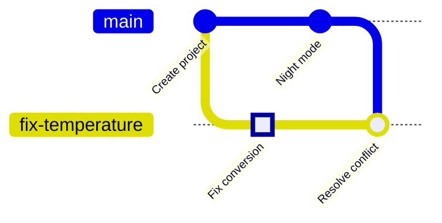

<!-- source: zh-TW/1-on-your-computer/05-merging-and-conflicts/README.md | sha: efb028ad41e5 -->

# Chapter 5: Merging and Conflicts — Merge, Rebase and Resolving Conflicts

> 📍 **Where the project and the change are**
>
> - Project: night mode is finished and merged back into `main`
> - Previous stop: the fix became a commit on the `fix-temperature` branch
> - **This chapter: `main` and the fix changed the same line; the conflict is resolved on the fix branch**
> - Next stop: push the project to GitHub

---

## What merging is

Branches let two jobs run on separate lines. When the work is done, the lines have to be joined again. That is **merging**.

Merges in Git come in two kinds: in one, Git only moves a sticky note forward; in the other, it really has to combine the changes from both sides.

---

## The simplest case: a fast-forward merge

Night mode is done and needs to go back into `main`. Since `night-mode` branched off, `main` has had no new commits, so `night-mode` is simply "`main` a few steps further on."

All Git has to do is move the `main` sticky note forward to where `night-mode` is. This is called a **fast-forward**:

```bash
git switch main
git merge night-mode
git branch -d night-mode    # the merge is done; delete this branch
```

```text
Updating 21e1fda..8303532
Fast-forward
 sensor.c | 2 +-
```

**In Sourcetree**: Switch to `main` first, right-click `night-mode` on the left, and choose **Merge night-mode into current branch**.

Deleting a branch only peels off the sticky note. The commits are all still in the history of `main`.

---

## Both lines moved on: a three-way merge

Next, the fix branch needs to catch up with `main`. This time it is different: the fix branch has its own commit, and `main` now has night mode. Both lines have moved on.

Git finds three versions to compare: the latest version on each line, and the point where they split, called the **merge base**. If the two sides changed different places, Git combines them automatically and makes a merge commit with two "previous" commits. This approach is called a **three-way merge**.

> [!NOTE]
> **📖 Term | Merge (合併)**
>
> - **Definition**: Bringing another branch's changes into the current branch. When needed, it creates a merge commit, which has two previous commits.
> - **On the job**: "Has this been merged into main?" "Merge main into your branch first."
> - **Related terms**: fast-forward, merge commit, merge base, rebase
> - **Common confusion**: `git merge night-mode` brings `night-mode` into "the branch you are on now," not the other way around. Check which branch you are on before merging.

> [!TIP]
> **🔧 Know-how | Merge main into your branch, and resolve conflicts there**
>
> - **Situation**: Your branch is ready, but `main` has gained new commits in the meantime.
> - **Practice**: First run `git merge main` on your own branch, resolve any conflicts and check that the code works. Only then merge back into `main`.
> - **Why**: Conflicts resolved on your branch only affect you if something goes wrong. `main` only ever receives versions that are already integrated.
> - **If you skip it**: If you merge directly on `main` and resolve a conflict wrongly, `main` breaks, and the code everyone pulls stops working.
> - **Related chapters**: [Chapter 7: Pull Requests and Code Review](../../2-beyond-your-computer/07-pull-requests/README.md)

---

## Conflicts: both sides changed the same line

```bash
git switch fix-temperature
git merge main
```

```text
Auto-merging sensor.c
CONFLICT (content): Merge conflict in sensor.c
Automatic merge failed; fix conflicts and then commit the result.
```

Both branches changed the `return` line in `sensor.c`. Git does not know which one to follow, so it stops and asks you. Open `sensor.c` and you will see the **conflict markers** Git inserted:

```text
<<<<<<< HEAD
    return (mv - 500) / 10.0f;
=======
    return smooth((mv - 600) / 10.0f);
>>>>>>> main
```

From `<<<<<<< HEAD` to `=======` is your current branch's version; from `=======` to `>>>>>>> main` is the version on `main`.

**Understand both sides → write the correct content → delete the markers → git add → git commit**

1. **Understand both sides**: the top is the fix (600 changed to 500), the bottom is night mode (adding `smooth`). Both must stay.
2. **Write the correct content**: `return smooth((mv - 500) / 10.0f);`
3. **Delete the three marker lines**, and save.
4. **git add**: tells Git the conflict in this file is resolved.
5. **git commit**: completes the merge. `--no-edit` uses Git's default merge message as it is.

```bash
git add sensor.c
git commit --no-edit
```

**In Sourcetree**: Conflicted files show a warning icon in File Status. Right-click and choose **Resolve Conflicts** to keep only one side (Resolve Using 'Mine' or 'Theirs') or to open a merge tool. This time both sides must stay, so edit the file by hand in your editor, then right-click and choose **Resolve Conflicts → Mark Resolved**, and Commit.


*Figure: Right-click the conflicted file with the warning icon. ① The Resolve Conflicts submenu ② Resolve Using 'Mine', which keeps only your current branch's version ③ Resolve Using 'Theirs', which keeps only the other side's version ④ Mark Resolved, which marks the file as resolved after you have fixed it by hand.*

> [!NOTE]
> **📖 Term | Merge conflict (衝突)**
>
> - **Definition**: Two branches changed the same place, and Git cannot decide automatically which to use; a person has to decide.
> - **On the job**: "I got a conflict when I merged." "Resolve the conflicts."
> - **Related terms**: conflict markers, merge base, `git merge --abort`
> - **Common confusion**: A conflict is not an error and does not mean anyone did something wrong. Two people simply changed the same place, and someone who understands the code has to decide.

> [!TIP]
> **🔧 Know-how | Resolving a conflict is not picking a side**
>
> - **Situation**: You hit a conflict, and Sourcetree offers two buttons: "use mine" or "use theirs."
> - **Practice**: First understand what each side was trying to do, then write a version that satisfies both. When unsure, ask whoever wrote the other side.
> - **Why**: Both sides of a conflict are usually meaningful changes that just happen to touch the same line.
> - **If you skip it**: Choose "mine" and night mode quietly disappears; choose "theirs" and the fixed bug comes back. The code still compiles, and the problem only shows up on the board.
> - **Related chapters**: [Chapter 9: Undoing Things](../../3-when-things-go-wrong/09-undoing-things/README.md)

After the merge, the fix branch has both the fix and night mode:



---

## Another way: rebase

**Rebase** is another way to catch up with `main`. Instead of making a merge commit, it replays the commits on your branch one by one on top of the latest `main`, so the history becomes a straight line.

| | merge | rebase |
|---|---|---|
| Shape of the history | Keeps the fork and adds a merge commit | A straight line |
| The original commits | Unchanged | Become new commits, all with new IDs |
| Conflicts | Resolved once | May need resolving once per commit |
| Good for | Branches already shared with others | Branches only you use that have not been pushed |

**In Sourcetree**: Right-click `main` and choose **Rebase current changes onto main**.

The practice in this book uses merge. Rebase is very useful, but it rewrites commits, so never rebase commits you have already shared with others. Chapter 9 explains why.

<details>
<summary><strong>🔍 Deep dive | How a three-way merge decides</strong></summary>

Git compares three versions, section by section: the merge base B, your current branch O (ours) and the other branch T (theirs):

| B vs O | B vs T | Result |
|---|---|---|
| Same | Same | Unchanged |
| Different | Same | Use O |
| Same | Different | Use T |
| Different | Different, but both changed it the same way | Use the changed content |
| Different | Different, and the two sides changed it differently | Conflict |

So anything only one side changed is always handled automatically. `git merge-base main fix-temperature` shows which commit is the merge base.

Commits linked to their "previous" commits form a directed acyclic graph (DAG): every edge points into the past and never loops back. A merge commit is a node with two edges going out. `git log --graph` draws exactly this graph.

</details>

---

## Common problems

| Problem | Cause | What to do |
|---|---|---|
| An unfamiliar editor screen pops up | Without `--no-edit`, Git opens an editor for the merge message | If it is an editor running in the terminal, usually press Esc, type `:wq` and press Enter |
| You want to give up halfway through | — | `git merge --abort` returns to before the merge |
| The code fails to compile and contains `<<<<<<<` | You forgot to delete the conflict markers | Search for `<<<<<<<`, fix it and commit again |

---

## 🧪 Hands-on

**Before you start**: Continue with the practice project from Chapter 4. To start from this chapter, run `bash practice/setup.sh 5` from the root of this book.

1. Fast-forward night mode into `main`, then delete that branch:

   ```bash
   cd ~/git-practice/fan-controller
   git switch main
   git merge night-mode
   git branch -d night-mode
   ```

2. Switch to the fix branch and merge `main` into it. A conflict appears:

   ```bash
   git switch fix-temperature
   git merge main
   ```

3. Open `sensor.c` in your editor, replace the conflict markers and the two lines between them with this line, and save:

   ```c
       return smooth((mv - 500) / 10.0f);
   ```

4. Mark it resolved, finish the merge, then go back to `main` and look at the history:

   ```bash
   git add sensor.c
   git commit --no-edit
   git switch main
   git log --oneline --graph --all
   ```

**What you should see**: Step 1 shows `Fast-forward`. Step 2 shows `CONFLICT`. In the final graph, `fix-temperature` has a commit called `Merge branch 'main' into fix-temperature`, where the two lines join.

---

## 📋 Commands in this chapter

| What you want to do | Command | In Sourcetree |
|---|---|---|
| Merge a branch into the current branch | `git merge <branch>` | Right-click the branch → Merge … into current branch |
| Delete a branch that has been merged | `git branch -d <branch>` | Right-click the branch → Delete |
| Mark a conflict as resolved | `git add <file>` | Right-click the file → Resolve Conflicts → Mark Resolved |
| Finish the merge with the default message | `git commit --no-edit` | Commit |
| Give up on this merge | `git merge --abort` | — |
| Replay the branch on top of main | `git rebase main` | Right-click main → Rebase current changes onto main |

---

## Key takeaways

1. When the target branch has no new commits, a merge only moves the sticky note forward. This is a fast-forward.
2. When both sides have moved on, Git does a three-way merge using the merge base and both versions. Only changes to the same place cause a conflict.
3. To resolve a conflict, first understand what each side intended, then write a version that satisfies both. It is not a matter of picking one.
4. Merge `main` into your own branch and resolve conflicts there, so `main` only receives integrated versions.
5. Rebase makes the history a straight line but rewrites commits. Never rebase commits you have already shared.

---

## Further reading

- Scott Chacon and Ben Straub, *[Pro Git](https://git-scm.com/book/en/v2)*, 2nd edition, sections 3.2 (Basic Branching and Merging) and 3.6 (Rebasing)
- Git documentation: [git-merge](https://git-scm.com/docs/git-merge), [git-rebase](https://git-scm.com/docs/git-rebase)

---

[← Chapter 4: Branches](../04-branches/README.md) | [Contents](../../README.md) | [Chapter 6: Remote Repositories →](../../2-beyond-your-computer/06-remotes/README.md)
