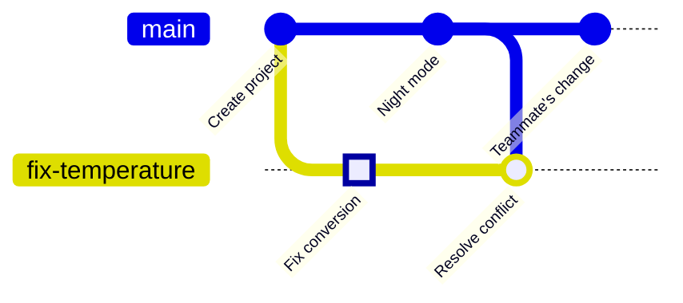

<!-- source: zh-TW/2-beyond-your-computer/06-remotes/README.md | sha: 80c96fea1cc8 -->

# Chapter 6: Remote Repositories — clone, fetch, pull, push

> 📍 **Where the project and the change are**
>
> - Project: pushed to GitHub; a teammate clones it and pushes a change of their own
> - Previous stop: the conflict was resolved on the fix branch
> - **This chapter: the fix branch is pushed to GitHub**
> - Next stop: open a pull request and ask a teammate to review it

---

## What a remote is

So far, the whole history lives only on your computer. For teammates to take part, there needs to be a place everyone can reach, holding a copy of the same repository. That copy is called a **remote repository**, and it usually lives on GitHub.

Think of it as a shared cloud photo album. Everyone has all the photos on their own phone (distributed), but everyone agrees that the cloud copy is the official one: upload new photos when you take them, and download the ones others upload.

| Action | Command | Direction |
|---|---|---|
| Copy the whole repository the first time | `git clone` | GitHub → your computer |
| Send your commits up | `git push` | Your computer → GitHub |
| Bring others' commits down without touching your files | `git fetch` | GitHub → your computer |
| Bring them down and merge them into the current branch | `git pull` | GitHub → your computer |

> [!NOTE]
> **📖 Term | Remote and origin (遠端與 origin)**
>
> - **Definition**: A remote is the same repository somewhere else, usually on GitHub. `origin` is the name it gets by default.
> - **On the job**: "Push it to origin." "There are new commits on origin's main."
> - **Related terms**: `git remote`, `origin/main`, clone, push
> - **Common confusion**: `origin` is just a name, not a command, and it does not have to point to GitHub. A repository can have several remotes, each with its own name.

---

## Creating a repository on GitHub

On GitHub, click **New repository**, name it `fan-controller`, choose Public or Private, and click Create repository. The page that appears shows the repository's URL, for example `https://github.com/your-account/fan-controller.git`.

> [!TIP]
> **🔧 Know-how | To push a project that already has history, create an empty repository on GitHub**
>
> - **Situation**: When creating the GitHub repository, you see options to add a README, a .gitignore and a license.
> - **Practice**: Your project already has commits on your computer, so leave all of these unticked and create an empty repository.
> - **Why**: If you tick them, GitHub starts with a commit of its own that has nothing to do with the history on your computer.
> - **If you skip it**: Your first push is rejected. Beginners often force-push over it at this point, or make things messier and messier.
> - **Related chapters**: [Chapter 10: Good Habits](../../3-when-things-go-wrong/10-good-habits/README.md)

---

## Connecting the remote and pushing: git remote add, git push

```bash
git remote add origin https://github.com/your-account/fan-controller.git
git push -u origin main
git push -u origin fix-temperature
```

- `git remote add` gives this URL the name `origin`.
- `-u` makes your local branch remember "which branch on origin I correspond to." After that, on this branch, typing `git push` is enough.

**In Sourcetree**: **Settings on the toolbar → Remotes → Add** (on macOS, **Repository → Repository Settings** in the menu). Enter `origin` as the name and paste the URL. Then click **Push** on the toolbar, and tick the branches to push and the Track column.

**Proving you are you**: The first time you push, GitHub needs to confirm who you are, and you **cannot** type your GitHub login password in the password field. There are three common ways:

- Authorize in the browser. Git for Windows comes with this, and a browser window pops up automatically.
- Create a personal access token in GitHub's developer settings, and paste it into the password field. When you create it, choose this repository under Repository access and set Contents to Read and write under Permissions (for a classic token, tick `repo`); otherwise the push is rejected.
- Set up an SSH key and use a URL that starts with `git@github.com:`. If you have already added `origin`, switch its URL with `git remote set-url origin git@github.com:your-account/fan-controller.git`.

Sourcetree users who connected their GitHub account in Chapter 1 don't need to do anything else.

---

## clone: a teammate copies the project

When a teammate joins, the first thing they do is copy the whole repository to their own computer:

```bash
git clone https://github.com/your-account/fan-controller.git
```

**In Sourcetree**: **Clone** in a new tab (on macOS, **New → Clone from URL**). Paste the URL and choose a folder to put it in.

A clone brings back the full history and automatically sets the source as `origin`.

---

## fetch and pull: bringing others' changes back

Your teammate raised the fan's PWM frequency (how many times a second the on/off signal that drives the fan switches) from 1 kHz to 25 kHz, moving the motor's noise out of the range people can hear, and pushed it to `main`. Now `main` on GitHub has one more commit than yours:



**fetch** is like collecting your mail: the new commits are downloaded but not opened, and your files do not change at all. **pull** is collecting the mail and acting on it: after fetching, it immediately merges into the current branch.

```bash
git fetch
git status
```

A fetch updates a sticky note on your computer called `origin/main`, which records "where `main` on GitHub was the last time we talked." `git status` compares your `main` with it:

```text
On branch main
Your branch is behind 'origin/main' by 1 commit, and can be fast-forwarded.
```

Once you are happy with the changes, pull them down and merge:

```bash
git pull
```

**In Sourcetree**: **Fetch** and **Pull** on the toolbar. After a fetch, a down arrow and a number appear next to the branch name on the left, showing how many new commits you can pull.

> [!NOTE]
> **📖 Term | fetch and pull**
>
> - **Definition**: fetch only downloads new commits from the remote; pull fetches and then merges them into the current branch.
> - **On the job**: "Pull before you start work." "Fetch first and see what others have pushed."
> - **Related terms**: `origin/main`, merge, push
> - **Common confusion**: pull changes your files and can cause conflicts; fetch does not. When in doubt, fetch first.

> [!TIP]
> **🔧 Know-how | When a push is rejected, pull first; don't force-push**
>
> - **Situation**: `git push` shows `rejected` and `fetch first`, because a teammate pushed new commits first.
> - **Practice**: Run `git pull` first, resolve any conflicts as in Chapter 5, check that the code works, then push.
> - **Why**: The remote has commits you don't have, and Git will not let you simply overwrite them.
> - **If you skip it**: If you force your way through with `git push --force`, your version overwrites your teammate's commits on GitHub. Next time they pull, their history no longer matches at all.
> - **Related chapters**: [Chapter 9: Undoing Things](../../3-when-things-go-wrong/09-undoing-things/README.md)

<details>
<summary><strong>🔍 Deep dive | What origin/main is</strong></summary>

`origin/main` is called a **remote-tracking branch**. It is the sticky note on your computer that records "where origin's main was the last time we talked," stored in `.git/refs/remotes/origin/main`.

It is only updated when you fetch, pull or push. So when `git status` says behind by 1 commit, it is comparing your `main` with this sticky note, not with GitHub in real time. If you haven't fetched for a long time, it is out of date.

```text
$ git branch -vv
  fix-temperature 28dd820 [origin/fix-temperature] Merge branch 'main' into fix-temperature
* main            c67c821 [origin/main] Raise fan PWM frequency to 25 kHz
```

The names in square brackets are the remote-tracking branch that each branch corresponds to. `push -u` set up this link, and it is recorded in `.git/config`. `git log main..origin/main` lists the commits the remote has that you don't.

</details>

---

## Common problems

| Problem | Cause | What to do |
|---|---|---|
| `Authentication failed` | You typed your GitHub login password in the password field | Use browser authorization, a personal access token or SSH instead |
| `Need to specify how to reconcile divergent branches` | Both sides have new commits, and Git wants you to decide whether pull should merge or rebase | Run `git config --global pull.rebase false` to use merge, then pull again |
| `remote origin already exists` | `origin` has already been added | Check the URL with `git remote -v` |

---

## 🧪 Hands-on

**Before you start**: You need a GitHub account. Continue with the practice project from Chapter 5; to start from this chapter, run `bash practice/setup.sh 6` from the root of this book.

1. Create an empty repository called `fan-controller` on GitHub, without ticking any of the default files, and copy its URL.
2. Connect the remote and push both branches (replace the URL with yours):

   ```bash
   cd ~/git-practice/fan-controller
   git remote add origin https://github.com/your-account/fan-controller.git
   git push -u origin main
   git push -u origin fix-temperature
   ```

3. Play the teammate: on the GitHub website, open `fan.c` on the `main` branch, click edit (the pencil icon) and change `FAN_PWM_HZ       1000` to `25000`. Use `Raise fan PWM frequency to 25 kHz` as the commit message, and choose to commit directly to `main`.
4. Back on your computer, fetch first to take a look, then pull:

   ```bash
   git switch main
   git fetch
   git status
   git pull
   git log --oneline --graph --all
   ```

5. To see things from your teammate's side, clone a copy into another folder: `git clone your-url ~/git-practice/colleague`

**What you should see**: After the fetch, `git status` shows `behind 'origin/main' by 1 commit`. After the pull it shows `Fast-forward`, and the top commit on `main` is `Raise fan PWM frequency to 25 kHz`. On GitHub you can see two branches, `main` and `fix-temperature`.

---

## 📋 Commands in this chapter

| What you want to do | Command | In Sourcetree |
|---|---|---|
| Add a remote | `git remote add origin <URL>` | Settings → Remotes → Add |
| Look at remotes | `git remote -v` | Settings → Remotes |
| Push a branch for the first time | `git push -u origin <branch>` | Push, ticking the branch and Track |
| Push | `git push` | Push |
| Copy a whole repository | `git clone <URL>` | Clone in a new tab |
| Download only, without touching files | `git fetch` | Fetch |
| Download and merge | `git pull` | Pull |
| List commits the remote has that you don't | `git log main..origin/main` | — |

---

## Key takeaways

1. A remote is the same repository somewhere else, called `origin` by default, and everyone agrees to treat it as the official copy.
2. push sends commits up, clone copies everything the first time, fetch only downloads, and pull downloads and merges.
3. To push to GitHub, prove who you are with browser authorization, a personal access token or SSH, not your login password.
4. When a push is rejected, pull and then push. Don't force-push.

---

## Further reading

- Scott Chacon and Ben Straub, *[Pro Git](https://git-scm.com/book/en/v2)*, 2nd edition, sections 2.5 (Working with Remotes) and 3.5 (Remote Branches)
- GitHub Docs: [About remote repositories](https://docs.github.com/en/get-started/getting-started-with-git/about-remote-repositories)

---

[← Chapter 5: Merging and Conflicts](../../1-on-your-computer/05-merging-and-conflicts/README.md) | [Contents](../../README.md) | [Chapter 7: Pull Requests and Code Review →](../07-pull-requests/README.md)
