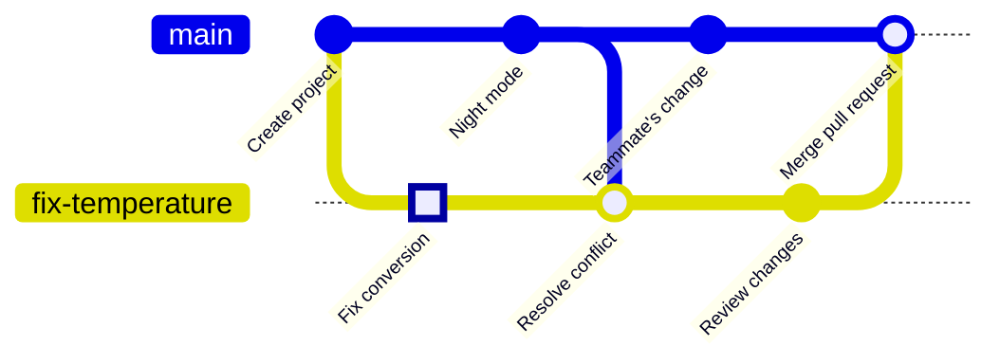

<!-- source: zh-TW/2-beyond-your-computer/07-pull-requests/README.md | sha: 7e5348fffdf0 -->

# Chapter 7: Pull Requests and Code Review — Opening, Reviewing and Merging

> 📍 **Where the project and the change are**
>
> - Project: the team agrees not to push directly to `main`; every change goes through a pull request
> - Previous stop: the fix branch was pushed to GitHub
> - **This chapter: open a pull request, make one more change after review, and merge into `main`**
> - Next stop: released with the project as v1.0.0

---

## Why not push straight to main

When you work alone, pushing to `main` as soon as something works feels natural. Once the team grows, `main` is shared by everyone, and when it breaks, everyone stops. So teams agree: **every change goes on its own branch first, and only enters `main` after someone else has looked at it**.

A second pair of eyes catches mistakes you can't see yourself, and the discussion leaves a record, so months later you can still find out why a change was made.

---

## What a pull request is

A **pull request** (often shortened to PR) is a request made on GitHub: "Please merge my branch into `main`." It gathers all of a branch's changes on one page:

- **Changes**: which files and lines this branch changed.
- **Discussion**: reviewers can comment on specific lines.
- **Checks**: the results of automatic builds and tests.
- **Merge button**: once every condition is met, one click merges it.

> [!NOTE]
> **📖 Term | Pull request, PR**
>
> - **Definition**: A request made on a hosting platform to merge a branch, with its changes, discussion and automated checks; it is merged only after review.
> - **On the job**: "I opened a PR. Could you review it?" "There are still two comments on this PR to address."
> - **Related terms**: code review, branch protection, merge
> - **Common confusion**: A pull request is a feature of platforms like GitHub, not a Git command. Some platforms call the same thing a merge request.

---

## Opening a pull request

**Choose the branches → write a title and description → create**

1. **Choose the branches**: On the repository's GitHub page, open **Pull requests → New pull request**. Choose `main` as the base (the branch to merge into) and `fix-temperature` as compare (your branch). Right after you push a branch, a **Compare & pull request** button also appears at the top of the page.
2. **Write a title and description**: The title says what the PR does; the description explains why and how you verified it.
3. **Create**: Click **Create pull request**.

**In Sourcetree**: Right-click the branch on the left and choose **Create Pull Request**. Sourcetree opens your browser on the GitHub page.


*Figure: ① base, the branch to merge into (`main`) ② compare, your branch (`fix-temperature`); the green dot beside it means it can be merged automatically ③ Title ④ Description ⑤ The Create pull request button.*

> [!TIP]
> **🔧 Know-how | Say "why" and "how you checked" in a PR description**
>
> - **Situation**: The code is done and the diff seems self-explanatory, so you leave the description empty.
> - **Practice**: Write what problem you are solving, why you changed it this way, and how you confirmed it is right, for example "Heated the board to 50 °C and the fan started correctly."
> - **Why**: Reviewers can see what you changed, but not why.
> - **If you skip it**: Reviewers have to guess and ask questions round after round. Six months later, someone who wants to change it back cannot find the original reason.
> - **Related chapters**: [Chapter 10: Good Habits](../../3-when-things-go-wrong/10-good-habits/README.md)

---

## Code review: comments and changes

**Code review** means asking teammates to read your changes. On the PR's **Files changed** tab, a reviewer can click the **+** next to a line to comment on it, and finally choose:

| Option | Meaning |
|---|---|
| Comment | Just a comment, with no conclusion |
| Approve | Looked at it; it can be merged |
| Request changes | These places need changing first |

This time your teammate comments: "What are `500` and `10`? Please use named constants." You don't need a new PR. Just change the code on the same branch, commit and push, and the PR updates automatically:

```bash
git switch fix-temperature
# replace 500 and 10 with SENSOR_OFFSET_MV and SENSOR_MV_PER_C
git commit -am "Use named constants for sensor conversion"
git push
```

> [!TIP]
> **🔧 Know-how | Keep PRs small: one PR, one thing**
>
> - **Situation**: You have a week of changes and open a single PR with over a thousand lines.
> - **Practice**: Split it into several small PRs, each solving one thing, ideally under a few hundred lines.
> - **Why**: Reviewers' attention is limited. A ten-line PR gets read line by line; a thousand-line PR gets skimmed.
> - **If you skip it**: The reviewer replies "looks fine" and approves, and a real bug slips into `main` along with everything else.
> - **Related chapters**: [Chapter 3: What a Commit Really Is](../../1-on-your-computer/03-commits/README.md)

---

## Automated checks and branch protection

Every time you push, GitHub can automatically run a series of checks, such as building the firmware, running tests and checking code style. This is called **continuous integration (CI)**. GitHub has this automation built in, and the results appear directly on the PR.

Combine it with **branch protection** and `main` has to follow the rules:

- No direct pushes; changes only arrive through PRs.
- At least one person must approve.
- All automated checks must pass.

Classic branch protection is set up under **Settings → Branches** in the repository. A second, newer feature that lets you stack several rules is called rulesets, under **Settings → Rules → Rulesets**. Once they are set, GitHub stops anyone who forgets the rules. As of the mid-2020s, free accounts can use these rules only on public repositories.

> [!NOTE]
> **📖 Term | Branch protection (分支保護)**
>
> - **Definition**: Rules set on a hosting platform for a branch, such as forbidding direct pushes and requiring reviews and passing checks.
> - **On the job**: "main is protected, so you can't push to it directly. Please open a PR."
> - **Related terms**: pull request, CI, approve, rulesets
> - **Common confusion**: Branch protection is a GitHub feature, and it only governs pushes to GitHub. You can still commit to `main` on your own computer; you just can't push it.

---

## Merging the pull request

When the review is approved and the checks pass, you can click **Merge pull request**. The arrow next to the button offers three merge methods:

| Method | What the history looks like | Good for |
|---|---|---|
| Create a merge commit | Keeps every commit on the branch and adds a merge commit | Keeping the full development history |
| Squash and merge | Squashes all the branch's commits into one on `main` | Branches with many small commits |
| Rebase and merge | Adds the branch's commits to `main` one by one, without a merge commit | A straight-line history |

Teams usually pick one and write it into their guidelines. This book uses Create a merge commit. After the merge, the history looks like this:



After the merge, a **Delete branch** button appears on the PR page; it deletes the branch on GitHub. Back on your computer, bring `main` up to date and clean up your local branch:

```bash
git switch main
git pull
git branch -d fix-temperature
git fetch --prune    # remove remote-tracking branches whose branch was deleted on GitHub
```

<details>
<summary><strong>🔍 Deep dive | Pull requests are not a Git feature</strong></summary>

Git itself has no pull requests. Their origin is Git's built-in `git request-pull` command, which produces a piece of text saying "this branch of my repository has these changes; please pull them," to be emailed to a maintainer. That is where the "pull" in the name comes from: you ask the other person to pull your changes.

GitHub turned this process into web pages and keeps a special reference in the repository for each PR, such as `refs/pull/1/head`. So a reviewer can fetch any PR to their own computer to test it:

```bash
git fetch origin pull/1/head:pr-1
git switch pr-1
```

The three merge methods also make sense in terms of the last two chapters: Create a merge commit is the three-way merge from Chapter 5; Rebase and merge is the rebase from Chapter 5, so the commit IDs change; Squash puts all the changes into one brand-new commit.

</details>

---

## Common problems

| Problem | Cause | What to do |
|---|---|---|
| The PR says This branch has conflicts | `main` changed the same places in the meantime | As in Chapter 5, run `git merge main` on your own branch, resolve the conflicts and push |
| You can't approve your own PR | GitHub does not let authors approve their own PRs | Ask a teammate to review; you can only comment |
| The merge button is gray | The branch protection conditions are not met yet | Look above the button to see what is missing |

---

## 🧪 Hands-on

**Before you start**: Continue with the practice project from Chapter 6. To start from this chapter, run `bash practice/setup.sh 7` from the root of this book, then follow steps 1 and 2 of the Chapter 6 hands-on to push it to your own GitHub repository.

1. Open a PR on GitHub: base `main`, compare `fix-temperature`, with the title `Fix temperature sensor offset` and a description of why the change is needed.
2. Play the reviewer: on the **Files changed** tab, click the **+** next to the `return` line and ask for named constants. Because it is your own PR, you can only choose Comment.
3. Back on your computer, change `sensor.c` to the following, then commit and push:

   ```c
   #include "board.h"
   #include "filter.h"
   #include "sensor.h"

   #define SENSOR_OFFSET_MV  500   /* output at 0 °C */
   #define SENSOR_MV_PER_C   10    /* change per °C */

   /* Analog temperature sensor: 500 mV at 0 °C, plus 10 mV per °C. */
   float sensor_read_celsius(void)
   {
       int mv = adc_read_mv();
       return smooth((mv - SENSOR_OFFSET_MV) / (float)SENSOR_MV_PER_C);
   }
   ```

   ```bash
   cd ~/git-practice/fan-controller
   git switch fix-temperature
   git commit -am "Use named constants for sensor conversion"
   git push
   ```

4. Back on the PR page, check that there is one more commit. Click **Merge pull request → Confirm merge**, then **Delete branch**.
5. Update `main` on your computer and clean up the local branch:

   ```bash
   git switch main
   git pull
   git branch -d fix-temperature
   git fetch --prune
   git log --oneline --graph -6
   ```

**What you should see**: The latest commit on `main` is `Merge pull request #1 from your-account/fix-temperature`, and `sensor.c` on `main` uses `SENSOR_OFFSET_MV`. `git branch` lists only `main`.

---

## 📋 Commands in this chapter

| What you want to do | Command | In Sourcetree |
|---|---|---|
| Open a pull request | — (on the GitHub website) | Right-click the branch → Create Pull Request |
| Update a PR after review | `git commit`, `git push` | Commit → Push |
| Update main after the merge | `git switch main`, `git pull` | Double-click main → Pull |
| Delete a merged local branch | `git branch -d <branch>` | Right-click the branch → Delete |
| Remove deleted remote branches | `git fetch --prune` | Fetch, ticking Prune |
| Fetch someone's PR to test it | `git fetch origin pull/<number>/head:<name>` | — |

---

## Key takeaways

1. Teams use pull requests so that every change is reviewed first, and `main` only receives code someone has looked at.
2. A PR description says why the change was made and how it was verified. Keep PRs small: one PR, one thing.
3. To respond to review comments, commit and push on the same branch, and the PR updates automatically.
4. Continuous integration checks every push automatically, and branch protection makes GitHub enforce the rules.
5. There are three merge methods; a team picks one. After merging, delete the branch and update your local `main`.

---

## Further reading

- Scott Chacon and Ben Straub, *[Pro Git](https://git-scm.com/book/en/v2)*, 2nd edition, section 6.2 (Contributing to a Project)
- GitHub Docs: [About pull requests](https://docs.github.com/en/pull-requests/collaborating-with-pull-requests/proposing-changes-to-your-work-with-pull-requests/about-pull-requests), [About protected branches](https://docs.github.com/en/repositories/configuring-branches-and-merges-in-your-repository/managing-protected-branches/about-protected-branches)

---

[← Chapter 6: Remote Repositories](../06-remotes/README.md) | [Contents](../../README.md) | [Chapter 8: Branching Strategies and Releases →](../08-branching-and-releases/README.md)
