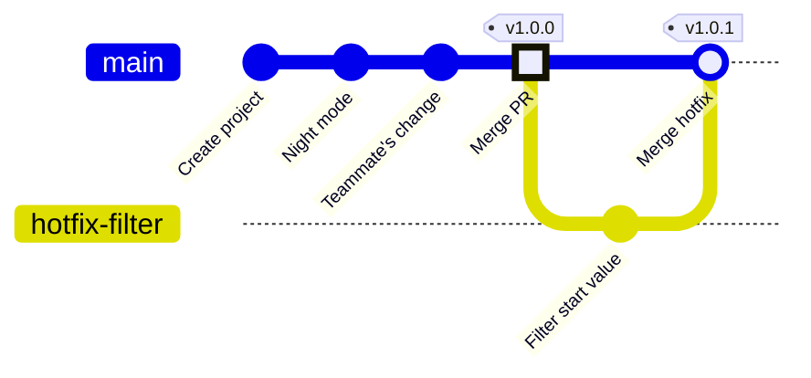

<!-- source: zh-TW/2-beyond-your-computer/08-branching-and-releases/README.md | sha: 02131aaadcc7 -->

# Chapter 8: Branching Strategies and Releases — Tags, Releases and Trunk-Based Development

> 📍 **Where the project and the change are**
>
> - Project: the first official version, v1.0.0, is released; then a startup problem is fixed urgently and v1.0.1 is released
> - Previous stop: the fix was merged into `main` through a pull request
> - **This chapter: the fix becomes part of v1.0.0**
> - Next stop: someone loses commits with reset

---

## Why version numbers are needed

Once firmware ships, there are batches of boards running code from different times. The first thing support asks about any problem is: "Which firmware version do you have?"

A commit ID is precise, but a string of hexadecimal characters is hard to read aloud and says nothing about order. So teams put a human-readable name on the commit they release, such as `v1.0.0`.

---

## Semantic versioning

The most common version format is called **semantic versioning**. It has three numbers: **major.minor.patch**.

| Which number goes up | When | Example |
|---|---|---|
| Major | After the change, the old way of using it no longer works | The communication protocol changes and the old configuration software on the PC stops working |
| Minor | A feature is added, and the old way of using it still works | Night mode is added |
| Patch | Only bugs are fixed, with no new features | The temperature conversion is fixed |

When a number goes up, the numbers after it reset to zero. For example, `1.4.2` with a new feature becomes `1.5.0`.

> [!NOTE]
> **📖 Term | Semantic versioning, SemVer (語意化版本)**
>
> - **Definition**: A version numbering rule that uses three numbers, major.minor.patch, to show how big a change is.
> - **On the job**: "It's only a bug fix, so just bump the patch number." "We changed the settings format and it's not compatible, so the major version has to go up."
> - **Related terms**: tag, release, hotfix
> - **Common confusion**: A version number is not a decimal. `1.10.0` is newer than `1.9.0`, because the three numbers are compared separately.

---

## Tags: a permanent label on a commit

A **tag**, like a branch, is a name pointing to a commit. The difference is that a branch moves forward with new commits, while a tag stays put once it is attached.

```bash
git switch main
git tag -a v1.0.0 -m "Version 1.0.0"
git tag                      # list all tags
git push origin v1.0.0       # tags must be pushed separately
```

`-a` creates an annotated tag, which records who made it, when and why. Always use annotated tags for official releases.

**In Sourcetree**: **Tag on the toolbar → type the name → tick Push tag → Add**.

> [!NOTE]
> **📖 Term | Tag (標籤)**
>
> - **Definition**: A name attached to a commit that never moves, usually used to mark a released version.
> - **On the job**: "Has the v1.0.0 tag been created?" "Branch a hotfix off the v1.0.0 tag."
> - **Related terms**: branch, release, semantic versioning, `git describe`
> - **Common confusion**: A tag is not a branch, and `git switch v1.0.0` is rejected. To make changes to an old version, create a branch from the tag with `git switch -c <branch> v1.0.0`.

> [!TIP]
> **🔧 Know-how | Tags don't go up with git push automatically**
>
> - **Situation**: You create `v1.0.0` on your computer, run `git push`, and think the release is done.
> - **Practice**: Push the tag with `git push origin v1.0.0`. You can also use `git push --follow-tags` to push annotated tags along with your branch.
> - **Why**: By default, `git push` only pushes branches. Tags must be named explicitly.
> - **If you skip it**: Your teammates, the automated builds and GitHub cannot see `v1.0.0`. Everyone thinks it hasn't been released, while you think it has.
> - **Related chapters**: [Chapter 6: Remote Repositories](../06-remotes/README.md)

---

## Releases on GitHub

On GitHub, go to **Releases → Draft a new release** and choose a tag to create a release page:

- **Release notes**: what changed in this version. Click Generate release notes and GitHub drafts them from the merged PRs.
- **Attached files**: drag the built firmware `fan.bin` in. Users download it from here instead of building it themselves.

> [!TIP]
> **🔧 Know-how | Attach firmware binaries to a release; don't commit them**
>
> - **Situation**: You want the testers to get the built `fan.bin`, so you commit it while you're at it.
> - **Practice**: The repository holds only source code. Attach built files to a release, or have the automated build produce them.
> - **Why**: A binary is completely different after every build, so Git cannot store its changes efficiently.
> - **If you skip it**: Every release adds a whole copy of the file to the repository forever, and after a few years a clone takes minutes. The source and the binaries can also drift apart, and nobody knows which `.bin` came from which code.
> - **Related chapters**: [Chapter 10: Good Habits](../../3-when-things-go-wrong/10-good-habits/README.md)

---

## Branching strategies

A team has to agree on which branches exist, what each is for and when they are merged. The two most common approaches are:

| | Trunk-based development | Git Flow |
|---|---|---|
| Long-lived branches | Only `main` | `main` and `develop`, plus release and hotfix branches |
| Feature branches | Very short; merged back into `main` within a day or two | Branched from `develop` and merged back into `develop` when done |
| How releases are made | Tag a commit on `main` | Branch a release from `develop`, polish it, merge it into `main` and tag it |
| Good for | Small teams, continuous releases, automated checks | Releases on a fixed schedule, maintaining several versions at once |

This book's project uses trunk-based development: `main` plus short-lived feature branches, with a tag for each release. Teams just starting out should begin with this simplest approach and add branches only when they really need them. The Git-flow button on Sourcetree's toolbar (Git Flow on macOS) creates the branches Git Flow needs in one click.

---

## Urgent fixes: hotfix

After v1.0.0 ships, a report comes in from the field: for roughly the first half-minute after the board starts, the fan reacts slowly. The cause is that night mode's average starts at 0 °C and takes a while to catch up with the real temperature.

For a problem that must be fixed right away, create a **hotfix** branch from the released tag and fix only this one problem:

```bash
git switch -c hotfix-filter v1.0.0
# change the starting value in filter.c from 0.0f to room temperature, 25.0f
git commit -am "Start temperature filter at room temperature"
git switch main
git merge --no-ff hotfix-filter -m "Merge branch 'hotfix-filter'"
git tag -a v1.0.1 -m "Version 1.0.1"
```

`--no-ff` tells Git to always make a merge commit, even when a fast-forward is possible, so the history clearly shows that a hotfix was merged here. If the team uses branch protection, open a pull request for this step instead.



To keep this graph simple, the fix branch from Chapter 7 is folded into the "Merge PR" dot.

<details>
<summary><strong>🔍 Deep dive | Annotated tags and git describe</strong></summary>

There are two kinds of tags, and both are stored in `.git/refs/tags/`. A **lightweight tag** (without `-a`) points directly at a commit. An **annotated tag** points at a separate tag object that holds the tagger, the time and the message, and that object points at the commit:

```text
$ git cat-file -t v1.0.0
tag
```

`git describe` finds the nearest tag and says how many commits away it is:

```text
$ git describe
v1.0.1-1-g86f7e81
```

This means "1 commit after `v1.0.1`, currently at `86f7e81`" (the `g` stands for Git). Exactly on a tag, it prints only `v1.0.1`. Many teams write this string into the firmware at build time and print it at startup, which automatically takes care of the Chapter 3 advice to include the commit ID when reporting a problem. With `--dirty`, a `-dirty` suffix is added when there are uncommitted changes, a reminder that this firmware was not built from clean code.

</details>

---

## Common problems

| Problem | Cause | What to do |
|---|---|---|
| `tag 'v1.0.0' already exists` | A tag with the same name already exists | Use another version number; never change a tag that has been pushed |
| `git describe` shows `fatal` | There is no annotated tag; by default it only looks at annotated tags | Create an annotated tag first, or add `--tags` to include lightweight tags |

---

## 🧪 Hands-on

**Before you start**: Continue with the practice project from Chapter 7. To start from this chapter, run `bash practice/setup.sh 8` from the root of this book. If you have not pushed to GitHub, just skip every `git push` and GitHub step.

1. Tag `v1.0.0` on `main` and push it:

   ```bash
   cd ~/git-practice/fan-controller
   git switch main
   git tag -a v1.0.0 -m "Version 1.0.0"
   git push origin v1.0.0
   ```

2. On GitHub, go to **Releases → Draft a new release**, choose `v1.0.0`, click Generate release notes, then Publish release.
3. Create a hotfix branch from the tag. In your editor, change `static float average = 0.0f;` in `filter.c` to `25.0f`, then commit:

   ```bash
   git switch -c hotfix-filter v1.0.0
   git commit -am "Start temperature filter at room temperature"
   ```

4. Merge it back into `main`, tag `v1.0.1`, push, and clean up the branch:

   ```bash
   git switch main
   git merge --no-ff hotfix-filter -m "Merge branch 'hotfix-filter'"
   git tag -a v1.0.1 -m "Version 1.0.1"
   git branch -d hotfix-filter
   git push
   git push origin v1.0.1
   git tag
   git describe
   git log --oneline --graph -4
   ```

**What you should see**: `git tag` lists `v1.0.0` and `v1.0.1`. `git describe` prints `v1.0.1`. The top of `git log --oneline --graph -4` is `Merge branch 'hotfix-filter'`.

---

## 📋 Commands in this chapter

| What you want to do | Command | In Sourcetree |
|---|---|---|
| Create an annotated tag | `git tag -a <name> -m "message"` | Tag on the toolbar |
| List tags | `git tag` | Tags on the left |
| Push a tag | `git push origin <name>` | Tick Push tag when creating it |
| Create a branch from a tag | `git switch -c <branch> <tag>` | Right-click the commit in History → Branch |
| Always make a merge commit | `git merge --no-ff <branch>` | Tick Create a new commit even if fast-forward is possible when merging |
| Find the nearest tag | `git describe` | — |

---

## Key takeaways

1. Name released versions with semantic versioning: major.minor.patch.
2. A tag is a name that never moves. Use annotated tags for official releases, and push them separately.
3. Attach built firmware to a GitHub release; don't commit it to the repository.
4. Small teams should start with trunk-based development: `main` plus short-lived branches, with a tag for each release.
5. For an urgent fix, branch a hotfix from the released tag, merge it back into `main` when it is fixed, and tag a new version.

---

## Further reading

- Scott Chacon and Ben Straub, *[Pro Git](https://git-scm.com/book/en/v2)*, 2nd edition, sections 2.6 (Tagging) and 5.1 (Distributed Workflows)
- [Semantic Versioning 2.0.0](https://semver.org/)
- GitHub Docs: [About releases](https://docs.github.com/en/repositories/releasing-projects-on-github/about-releases)

---

[← Chapter 7: Pull Requests and Code Review](../07-pull-requests/README.md) | [Contents](../../README.md) | [Chapter 9: Undoing Things →](../../3-when-things-go-wrong/09-undoing-things/README.md)
