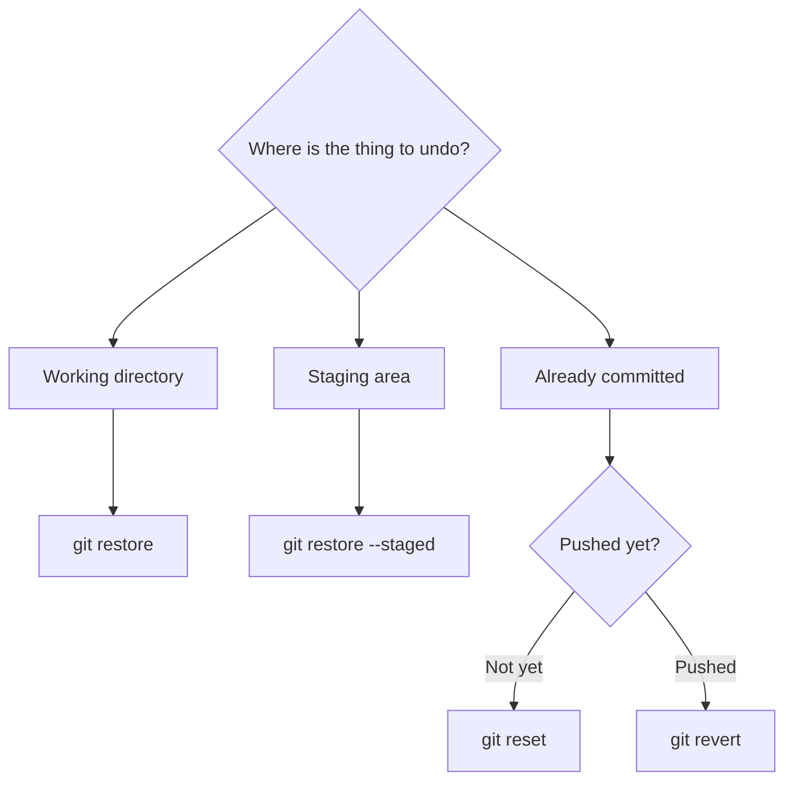
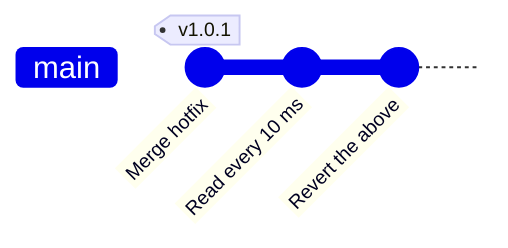

<!-- source: zh-TW/3-when-things-go-wrong/09-undoing-things/README.md | sha: 481f8fbe5f81 -->

# Chapter 9: Undoing Things — restore, reset, revert, reflog

> 📍 **Where the project and the change are**
>
> - Project: someone loses commits with reset, and an experimental change needs to be undone
> - Previous stop: the fix became part of v1.0.0
> - **This chapter: the fix is wiped out by reset, then rescued with reflog**
> - Next stop: write good commit messages and deal with a committed password

---

## First ask: where is the thing you want to undo?

Git has several ways to undo things, and picking the wrong one makes matters worse. Work out which area the thing you want to undo is in, and you will know which tool to use:



There is also a special remedy, `git reflog`, made for rescuing commits you thought were gone.

---

## Throwing away changes in the working directory: git restore

After a long time editing, you realize you went the wrong way. You want to throw away the changes on your desk and put the file back the way it is in the box; if you never added it, that means the way it was in the last commit:

```bash
git restore fan.c
```

**In Sourcetree**: Right-click the file in File Status and choose **Discard**.

There is no undo for this. These changes were never in Git, so once thrown away they are really gone.

## Taking a file out of the staging area: git restore --staged

You accidentally ran `git add` on a debugging file. You want to take it out of the box but keep the changes on your desk:

```bash
git restore --staged board.h
```

**In Sourcetree**: Select the file under Staged files and click **Unstage Selected**.

---

## Moving a branch back in time: git reset

`git reset` moves the current branch's sticky note back to an earlier commit. The commits it skips no longer belong to the branch.

Whether the desk and the box are restored as well when the sticky note moves depends on three modes:

| Mode | Branch | Staging area | Working directory | Use |
|---|---|---|---|---|
| `--soft` | Moves back | Kept | Kept | Redo the last few commits; the changes stay in the box |
| `--mixed` (default) | Moves back | Restored | Kept | Choose again what to commit |
| `--hard` | Moves back | Restored | Restored | Throw everything away and return to that commit |

```bash
git reset --soft HEAD~1    # undo the last commit, keeping its changes in the staging area
```

`HEAD~1` means "the commit before the current one," and `HEAD~2` the one before that.

**In Sourcetree**: Right-click a commit in History and choose **Reset current branch to this commit** (on macOS, **Reset main to this commit**, with the name of the current branch in the middle), then choose Soft, Mixed or Hard.

> [!NOTE]
> **📖 Term | reset and revert**
>
> - **Definition**: reset moves a branch back in time, so the skipped commits disappear from the branch. revert adds a new opposite commit that cancels an older commit's changes.
> - **On the job**: "If you haven't pushed, just reset it." "It's already pushed, so revert it."
> - **Related terms**: `HEAD~1`, reflog, force push
> - **Common confusion**: reset rewrites history; revert only adds to it. Sourcetree calls revert "Reverse commit."

> [!TIP]
> **🔧 Know-how | Glance at git status before reset --hard**
>
> - **Situation**: You want to move the branch back, and add `--hard` without thinking.
> - **Practice**: Run `git status` first. If there are uncommitted changes you want to keep, commit them or `git stash` them first.
> - **Why**: `--hard` restores the working directory as well.
> - **If you skip it**: Uncommitted changes are gone for good, and you can only hope your editor kept a local history. reflog can rescue anything you committed, but nothing can bring back what was never in Git.
> - **Related chapters**: [Chapter 2: The Three Areas](../../1-on-your-computer/02-three-areas/README.md)

---

## Rescuing lost commits: git reflog

A teammate accidentally types `git reset --hard HEAD~2` on `main`. In one stroke `main` goes back to Chapter 6: the temperature fix and the hotfix vanish from the history, and `sensor.c` says `(mv - 600)` again.

Don't panic. The skipped commits are still in `.git`; no sticky note points at them anymore. **reflog** records every step HEAD has taken:

```text
$ git reflog -3
c67c821 HEAD@{0}: reset: moving to HEAD~2
c32dfaf HEAD@{1}: merge hotfix-filter: Merge made by the 'ort' strategy.
95fb995 HEAD@{2}: checkout: moving from hotfix-filter to main
```

`HEAD@{1}` is where you were before the reset. Move the branch back there:

```bash
git reset --hard HEAD@{1}
```

**In Sourcetree**: Sourcetree has no screen for the reflog. Click **Terminal** on the right of the toolbar and run the commands above in the terminal.

> [!NOTE]
> **📖 Term | reflog (reference log)**
>
> - **Definition**: A log of every commit that HEAD and each branch have pointed to. It exists only on your own computer.
> - **On the job**: "Your commit disappeared? Don't panic; check the reflog."
> - **Related terms**: `HEAD@{1}`, reset, garbage collection
> - **Common confusion**: The reflog is not pushed and does not come with a clone. A commit your teammate lost can only be rescued from the reflog on their own computer.

---

## Commits that have been pushed: git revert

Someone changed the temperature reading interval from 1 second to 10 ms and pushed it, only to find that night mode's averaging became too sensitive and the fan started switching on and off around the threshold again. Everyone has already pulled this commit, so you can't rewrite history with reset.

`git revert` adds a new opposite commit that cancels that change:

```bash
git revert HEAD
```

**In Sourcetree**: Right-click the commit in History and choose **Reverse commit**.



One more commit is added to the history, and nothing is rewritten.

> [!TIP]
> **🔧 Know-how | Undo a pushed commit with revert, not reset**
>
> - **Situation**: You notice that a commit you just pushed to GitHub is wrong, and you want it gone.
> - **Practice**: Use `git revert` to add a new "opposite" commit that cancels the original change, then push it.
> - **Why**: Teammates may already have pulled that commit and built on top of it. A revert only adds history; it never rewrites history that has already been shared.
> - **If you skip it**: If you rewrite history with `reset` and force-push, your teammates' history no longer matches the remote. At best they get a pile of duplicate commits; at worst someone's work is overwritten.
> - **Related chapters**: [Chapter 6: Remote Repositories](../../2-beyond-your-computer/06-remotes/README.md)

---

## Putting things away for a while: git stash

Halfway through a change, your manager says, "Take a look at this urgent problem first." Your change isn't finished and you don't want to commit it, but you have to switch to another branch:

```bash
git stash          # put the changes in the drawer; the working directory becomes clean
git stash list     # see what is in the drawer
git stash pop      # take them back out and remove them from the drawer
```

**In Sourcetree**: **Stash** on the toolbar. To get the changes back, right-click under Stashes on the left and choose **Apply Stash**.

<details>
<summary><strong>🔍 Deep dive | How long reflog can save you</strong></summary>

The reflog lives in `.git/logs/`, with one log for each branch and one for HEAD, recording every time they move.

Skipped commits are not deleted right away. Every so often Git runs garbage collection (`git gc`), which removes objects that no sticky note and no reflog entry points to. By default, reflog entries are kept for 90 days, entries for commits that are no longer on any branch for 30 days, and objects that have lost every reference get another two weeks of grace.

So "anything you committed is almost never lost" is true, but only for a while. If you lose something, rescue it quickly; don't put it off.

</details>

---

## Common problems

| Problem | Cause | What to do |
|---|---|---|
| Reverting a merge commit gives an error | A merge commit has two previous commits, and Git doesn't know which side to treat as the base | Add `-m 1` to treat the branch you were on before the merge as the base |
| `git stash pop` causes a conflict | The same place was changed again after you stashed | Resolve the conflict as in Chapter 5. The stash is kept, so delete it with `git stash drop` once you have checked |

---

## 🧪 Hands-on

**Before you start**: Continue with the practice project from Chapter 8. To start from this chapter, run `bash practice/setup.sh 9` from the root of this book. Every step in this chapter happens on your computer; don't push until you are done.

1. Simulate the accident: go back two steps and check that the fix is gone:

   ```bash
   cd ~/git-practice/fan-controller
   git reset --hard HEAD~2
   grep return sensor.c
   ```

2. Rescue it with reflog:

   ```bash
   git reflog -3
   git reset --hard HEAD@{1}
   grep return sensor.c
   ```

3. Make an experiment, then undo it. In your editor, change `delay_ms(1000);` in `main.c` to `delay_ms(10);`, then:

   ```bash
   git commit -am "Read temperature every 10 ms"
   git revert --no-edit HEAD
   ```

4. Try the drawer. Change anything in `fan.c`, run `git stash`, check with `git status` that the working directory is clean, get the change back with `git stash pop`, and finally throw it away with `git restore fan.c`. After steps 3 and 4, check the result with these two lines:

   ```bash
   git log --oneline -2
   git status
   ```

**What you should see**: In step 1, `sensor.c` shows `(mv - 600)`; in step 2 it shows `SENSOR_OFFSET_MV` again. After step 3, the top of `git log --oneline -2` is `Revert "Read temperature every 10 ms"`, and `main.c` says `delay_ms(1000);` again. After step 4, `git status` shows `nothing to commit, working tree clean`.

---

## 📋 Commands in this chapter

| What you want to do | Command | In Sourcetree |
|---|---|---|
| Throw away changes in the working directory | `git restore <file>` | Right-click the file → Discard |
| Take a file out of the staging area | `git restore --staged <file>` | Unstage Selected |
| Move the branch back in time | `git reset --soft/--mixed/--hard <commit>` | Right-click the commit → Reset current branch to this commit (macOS: Reset main to this commit) |
| See every step HEAD has taken | `git reflog` | Click Terminal and type the command |
| Add an opposite commit | `git revert <commit>` | Right-click the commit → Reverse commit |
| Put changes away for a while | `git stash`, `git stash pop` | Stash on the toolbar; right-click → Apply Stash |

---

## Key takeaways

1. First work out which area the thing to undo is in: restore for the working directory, restore --staged for the staging area, reset or revert for commits.
2. reset has three modes: soft, mixed and hard. hard throws away uncommitted changes, and they cannot be rescued.
3. Commits that have not been pushed can be reset; commits that have been pushed are always reverted.
4. Almost anything you committed can be rescued with reflog, but only for a while.
5. When you need to switch tasks halfway through a change, put it away with stash.

---

## Further reading

- Scott Chacon and Ben Straub, *[Pro Git](https://git-scm.com/book/en/v2)*, 2nd edition, sections 2.4 (Undoing Things) and 7.7 (Reset Demystified)
- Git documentation: [git-reset](https://git-scm.com/docs/git-reset), [git-revert](https://git-scm.com/docs/git-revert), [git-reflog](https://git-scm.com/docs/git-reflog)

---

[← Chapter 8: Branching Strategies and Releases](../../2-beyond-your-computer/08-branching-and-releases/README.md) | [Contents](../../README.md) | [Chapter 10: Good Habits →](../10-good-habits/README.md)
