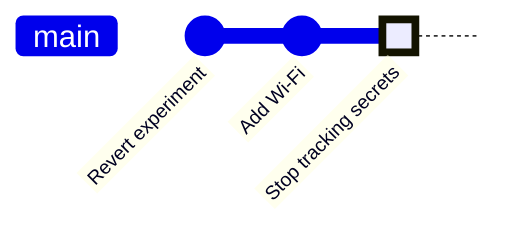

<!-- source: zh-TW/3-when-things-go-wrong/10-good-habits/README.md | sha: f6d85ea4d8a0 -->

# Chapter 10: Good Habits — Commit Messages, .gitignore, Binaries and Leaked Secrets

> 📍 **Where the project and the change are**
>
> - Project: while adding Wi-Fi status reporting, the Wi-Fi password gets committed
> - Previous stop: the fix was wiped out by reset, then rescued with reflog
> - **This chapter: look back at the fix's commit message and learn to write a better one**
> - Next stop: the end of the journey; go back to the map of the book in Chapter 0

---

## Writing good commit messages

Six months from now, someone sees `SENSOR_OFFSET_MV 500` in `sensor.c` and wonders why it is 500. They use `git log` or `git blame` (which shows the commit that last changed each line) to find the commit, then read its message. The message is the manual you leave for the future.

A good commit message looks like this:

```text
Fix temperature sensor offset

The sensor outputs 500 mV at 0 °C, but the code subtracted 600 mV,
so every reading was 10 °C too low and the fan started at 55 °C
instead of 45 °C.
```

| Rule | Reason |
|---|---|
| The first line is the subject, 50 characters or fewer | `git log --oneline`, GitHub and Sourcetree show only the first line |
| Write the subject in the imperative, saying what the commit does, such as Fix, Add, Remove | It reads like "If applied, this commit will…". Some teams also require a prefix such as `fix:` or `feat:`; follow your team's rules |
| Leave a blank line between the subject and the body | Git uses the blank line to tell the subject from the body |
| The body says why, and what effect the change has | The diff already shows what changed; only you know why |

Our fix only had a subject: `Fix temperature sensor offset`. The subject itself is good: it uses the imperative and says exactly what changed. But there is no body, so nobody can tell why the value is 500. It has already been pushed and is part of v1.0.0, so by the principle from Chapter 9 it must not be rewritten; we can only write better messages in later commits.

```bash
git commit -m "Subject" -m "First paragraph of the body"    # each -m is one paragraph
git commit                                               # without -m, Git opens an editor for you
```

**In Sourcetree**: The message box accepts several lines. Write the subject on the first line, leave a blank line, then write the body.

> [!TIP]
> **🔧 Know-how | Say "why" in commit messages**
>
> - **Situation**: Right after changing the code, you type `update`, `fix bug` or something equally vague as the message.
> - **Practice**: The subject says what you did; the body says why, and which symptom it fixes.
> - **Why**: The code explains "how." Only the commit message can explain "why."
> - **If you skip it**: The history fills with rows of `fix bug`, and you have to open each one when hunting a problem. Someone assumes 500 was a typo and changes it back to 600.
> - **Related chapters**: [Chapter 3: What a Commit Really Is](../../1-on-your-computer/03-commits/README.md)

---

## .gitignore: files that don't belong in the repository

Some files should never be committed: build output, editor temporary files and settings files that contain passwords. Put their names in `.gitignore` at the root of the project, and Git acts as if they aren't there:

```text
build/
*.bin
*.elf
secrets.h
```

- `build/` means the whole folder; `*.bin` means every file ending in `.bin`.
- Commit `.gitignore` itself, so the whole team shares the same rules.
- It only affects files that are not tracked yet. A file that has already been committed must first be untracked with `git rm --cached`.

**In Sourcetree**: Right-click an untracked file in File Status and choose **Ignore**. You can ignore that file, every file with that extension, or the whole folder.

> [!NOTE]
> **📖 Term | .gitignore**
>
> - **Definition**: A file listing which files Git should ignore. It lives in the repository and is committed with it.
> - **On the job**: "Remember to add the build folder to gitignore."
> - **Related terms**: `git rm --cached`, build output, `git check-ignore`
> - **Common confusion**: `.gitignore` only decides whether Git pays attention to a file. It does not delete anything, and it is not a security measure: `git add -f` can still force a file in.

---

## Binaries, large files and submodules

**Binaries**: Built firmware is completely different every time. Each commit adds a whole copy to the history, and it is hard to get rid of afterward. Leave build output to `.gitignore` and to releases, as in Chapter 8.

**Large files**: GitHub warns about files larger than 50 MiB and rejects files larger than 100 MiB. For large files that really do need version control, such as hardware design files, you can use **Git LFS (Large File Storage)**: the repository holds only a small pointer, and the file itself is stored separately.

**Submodules**: Firmware projects often use code from another repository, such as a driver library from the chip vendor. A **submodule** lets you put another repository in a folder of your project and record exactly which commit of it you use:

```bash
git submodule add https://github.com/some-org/driver-library.git drivers
git clone --recurse-submodules <URL>     # fetch the submodules while cloning
git submodule update --init              # if you forgot it when cloning, run this
```

**In Sourcetree**: **Repository → Add Submodule**. When cloning, expand Advanced Options and tick Recurse submodules to get the submodules as well.

> [!NOTE]
> **📖 Term | Submodule (子模組)**
>
> - **Definition**: A fixed reference, from a folder in one repository, to one particular commit of another repository.
> - **On the job**: "The driver library comes in as a submodule, so remember `--recurse-submodules` when you clone."
> - **Related terms**: `git submodule update`, `.gitmodules`, Git LFS
> - **Common confusion**: A submodule records "one particular commit," not "the latest version." When the other repository is updated, your project does not follow automatically; you have to update it and commit.

---

## A password got committed

When Wi-Fi status reporting was added, the Wi-Fi name and password were written in `secrets.h`, and the file was committed along with everything else.

**Change the password → stop tracking → clean the history if needed**

1. **Change the password**: This is the most important step. Once it has been pushed to a public repository, assume the password has leaked; some programs scan GitHub for passwords around the clock.
2. **Stop tracking**: Keep `secrets.h` only on each person's own computer, and provide a template with fake values, `secrets.example.h`:

   ```bash
   git rm --cached secrets.h      # stop tracking, but keep the file on your computer
   echo "secrets.h" >> .gitignore
   git add .gitignore secrets.example.h
   git commit -m "Stop tracking Wi-Fi credentials"
   ```

3. **Clean the history if needed**: Even after you stop tracking it, the password is still in the old commit. Removing it completely means rewriting every commit after it, and everyone has to clone again. If the password has already been changed, this step is usually unnecessary.



The password in the "Add Wi-Fi" commit can still be seen after you stop tracking the file. That is why the first step must always be changing the password.

GitHub turns on push protection for every account by default. When you push to a public repository and it detects keys or tokens in common formats, it blocks the push. But it can't recognize every password, a Wi-Fi password for example, so don't rely on it.

> [!TIP]
> **🔧 Know-how | After a password leaks, change it first; don't start by rewriting history**
>
> - **Situation**: You find that a password, a cloud service key or a token has been committed and pushed.
> - **Practice**: Immediately revoke or replace it at the service it belongs to, then stop tracking the file; clean the history only if needed.
> - **Why**: The moment it was pushed, someone may have cloned or fetched it. Rewriting your history cannot reach the copies on other people's computers.
> - **If you skip it**: You spend an afternoon working out how to clean the history while the old password stays valid, and it has long since been used.
> - **Related chapters**: [Chapter 9: Undoing Things](../09-undoing-things/README.md)

<details>
<summary><strong>🔍 Deep dive | Why untracking does not make the password disappear</strong></summary>

As Chapter 3 explained, a commit points to a tree, and a tree points to blobs. The tree of the "Add Wi-Fi" commit has a blob holding the contents of `secrets.h`. Later commits no longer include it, but the old commit is still there, and so is the blob:

```text
$ git show HEAD~1:secrets.h | grep PASSWORD
#define WIFI_PASSWORD  "fan-lab-2026"
```

To make the blob disappear, you need a new tree without it, which means a new commit. A new commit has a different ID, so every commit after it has to be redone too. That is why cleaning history needs a dedicated tool (such as git filter-repo), and why everyone has to clone again.

</details>

<details>
<summary><strong>🔍 Deep dive | How snapshots save space: packfiles</strong></summary>

Chapter 3 said that Git stores snapshots, and unchanged files reuse the same blob. A changed file gets a new blob, which at first is compressed into a file of its own, called a loose object.

Once there are many objects, Git packs them into a **packfile**. While packing, Git finds objects with similar contents, stores one of them in full and the others as differences. So at the storage level Git does store differences; that is just a storage optimization, and conceptually every commit is still a complete snapshot.

When a few lines of a text file change, the difference is small and packing works very well. A built binary is completely different every time, so its difference is as big as the file itself. That is why binaries make a repository keep getting fatter. `git count-objects -vH` shows how big the repository currently is.

</details>

---

## Common problems

| Problem | Cause | What to do |
|---|---|---|
| A file is in `.gitignore` but still shows up in `git status` | The file is already tracked | `git rm --cached <file>`, then commit |
| You don't know why a file is being ignored | Some rule matches it | `git check-ignore -v <file>` shows which rule |
| After cloning, the submodule folder is empty | The submodules were not fetched during the clone | `git submodule update --init` |

---

## 🧪 Hands-on

**Before you start**: Continue with the practice project from Chapter 9. To start from this chapter, run `bash practice/setup.sh 10` from the root of this book.

1. Recreate the accident. In your editor, create `secrets.h` at the root of the project with the contents below (for this practice the Wi-Fi code is left out; only the password file remains):

   ```c
   #ifndef SECRETS_H
   #define SECRETS_H

   #define WIFI_SSID      "fan-lab"
   #define WIFI_PASSWORD  "fan-lab-2026"

   #endif
   ```

   Then simulate a build and commit the password file:

   ```bash
   cd ~/git-practice/fan-controller
   mkdir -p build && echo "firmware" > build/fan.bin
   git add secrets.h
   git commit -m "Add Wi-Fi status reporting"
   git status
   ```

2. In your editor, create `.gitignore` at the root of the project with the four lines shown above, save it, and look at `git status` again.
3. Make a copy as a template and change the name and password in it to `your-ssid` and `your-password`, then stop tracking the real password file:

   ```bash
   cp secrets.h secrets.example.h
   git rm --cached secrets.h
   git add .gitignore secrets.example.h
   git commit -m "Stop tracking Wi-Fi credentials" -m "secrets.h holds the real password, so it must stay on each developer's machine. Copy secrets.example.h to secrets.h and fill in your own values."
   ```

4. Check that the password file is no longer tracked but is still in the history:

   ```bash
   git status
   git ls-files
   git show HEAD~1:secrets.h
   ```

**What you should see**: In step 1, `git status` lists `build/` under Untracked files; after step 2 only `.gitignore` is left there. The final `git status` shows `nothing to commit, working tree clean`. `git ls-files` lists `secrets.example.h` but not `secrets.h`. `git show HEAD~1:secrets.h` still prints `fan-lab-2026`.

This is the last hands-on section in the book. Look at the whole history with `git log --oneline --graph --all` and compare it with the graph in Chapter 0: every step the change took is there, plus the hotfix, the reverted experiment and the password file from Chapters 8 to 10.

---

## 📋 Commands in this chapter

| What you want to do | Command | In Sourcetree |
|---|---|---|
| Write a commit message with a body | `git commit -m "subject" -m "body"` | Subject on the first line of the message box, a blank line, then the body |
| Find who changed each line | `git blame <file>` | Right-click the file → Blame Selected |
| Stop tracking a file but keep it | `git rm --cached <file>` | Right-click the file → Stop Tracking |
| See why a file is ignored | `git check-ignore -v <file>` | — |
| Add a submodule | `git submodule add <URL> <folder>` | Repository → Add Submodule |
| Get the submodules | `git submodule update --init` | — |
| See how big the repository is | `git count-objects -vH` | — |

---

## Key takeaways

1. A commit message's subject says what was done and its body says why. Keep the subject within 50 characters, in the imperative.
2. Put build output, temporary files and password files in `.gitignore`. Files already tracked need `git rm --cached` first.
3. Every version of a binary stays in the history as a whole copy. Put build output in releases, and use Git LFS for large files you really need.
4. If a password is committed, change it first, then stop tracking the file, and clean the history only if needed.

---

## Further reading

- Scott Chacon and Ben Straub, *[Pro Git](https://git-scm.com/book/en/v2)*, 2nd edition, sections 2.2 (Ignoring Files), 5.2 (Commit Guidelines) and 7.11 (Submodules)
- GitHub Docs: [Ignoring files](https://docs.github.com/en/get-started/getting-started-with-git/ignoring-files), [Removing sensitive data from a repository](https://docs.github.com/en/authentication/keeping-your-account-and-data-secure/removing-sensitive-data-from-a-repository)

---

[← Chapter 9: Undoing Things](../09-undoing-things/README.md) | [Contents](../../README.md) | [Appendix A: Glossary →](../../appendix/glossary.md)
