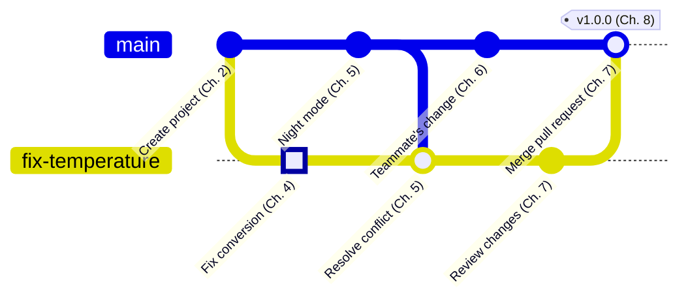

<!-- source: zh-TW/README.md | sha: 44319858e0bc -->

<div align="center">


# Introduction to Git

**Follow one project and one change, from the first line of code to a tagged release**

🌐 [繁體中文](../zh-TW/README.md) ｜ **English** ｜ [日本語](../ja/README.md) ｜ [한국어](../ko/README.md) ｜ [Home](../README.md)

</div>

---

## What this book is about

You have probably seen folders like these: "firmware_v2", "firmware_v2_edited", "firmware_v2_final", "firmware_v2_really_final". The copies keep piling up, yet nobody can say which one is actually flashed onto the board.

Git is the tool that solves this. It remembers every version of a project, lets several people change the same code at the same time, and takes you back to any point in time when something goes wrong.

The book follows two main characters:

- **One project**: a small firmware project that reads a temperature sensor and controls a fan. It starts with one developer, grows until teammates join, and ends with an official release.
- **One change**: a bug in that project. The temperature conversion is wrong, so the fan starts too late. The fix starts the moment you edit the code, then travels stop by stop through staging, branches, a conflict, a push and a review, until it becomes part of the official release.

## Who it is for

The book is written for two kinds of readers: people with no background at all, and computer science students who need to use Git for real. The content has two layers, so each reader takes what they need:

| Reader | What to read | What you can do afterward |
|---|---|---|
| 🌱 Never used Git | The main text, the commit graphs and the hands-on sections; skip the deep dives | Use Git in your own projects and work with others on GitHub |
| 🎓 Computer science students | Everything, including the deep dives | Explain how Git works inside, and use it in course projects, internships and team work |
| 🔧 Already using Git | The command tables, Appendix C and Chapter 9 | Look up commands quickly and know how to recover when things go wrong |

The main text needs no Git or programming background. Typing commands in a terminal helps, but it is not required: every step can also be done in a graphical tool.

## Every step is shown twice

Each step starts with an everyday comparison, then shows the Git command and the same step in Sourcetree. For example, committing a change:

```bash
git add sensor.c
git commit -m "Fix temperature sensor offset"
```

**In Sourcetree**: **Select sensor.c → Stage Selected → Type a message → Commit**

- The commands are the same on Windows, macOS and Linux.
- Sourcetree is only available for Windows and macOS. Linux readers can follow the commands alone.
- GitHub is used as the example hosting platform. Other platforms work in much the same way; only the names and screens differ.

## Helpers in every chapter

| Marker | What it gives you |
|---|---|
| 📍 Where the project and the change are | How far the project has grown, and which stop the change has reached |
| 🌿 Commit graph | The history before and after each step: how branches grow and what a merge looks like |
| 📖 Term box | Definition, how the term is used on the job, related terms and the most common confusion |
| 🔧 Know-how box | What teams actually do, why they do it, and what goes wrong if you skip it |
| 🔍 Deep dive | How Git works inside, for computer science students. Collapsed by default; you can skip it |
| 🧪 Hands-on | Do the chapter's steps yourself on the practice project, and check what you should see |
| 📋 Commands in this chapter | The commands used in the chapter, and where to click in Sourcetree |

Here is a know-how box from Chapter 9, Undoing Things:

> [!TIP]
> **🔧 Know-how | Undo a pushed commit with revert, not reset**
>
> - **Situation**: You notice that a commit you just pushed to GitHub is wrong, and you want it gone.
> - **Practice**: Use `git revert` to add a new "opposite" commit that cancels the original change, then push it.
> - **Why**: Teammates may already have pulled that commit and built on top of it. A revert only adds history; it never rewrites history that has already been shared.
> - **If you skip it**: If you rewrite history with `reset` and force-push, your teammates' history no longer matches the remote. At best they get a pile of duplicate commits; at worst someone's work is overwritten.

The idea behind this know-how lives in a deep dive. Open it if you like, or skip it:

<details>
<summary><strong>🔍 Deep dive | Where commit IDs come from</strong></summary>

Every commit has an ID such as `21e1fda`. It is not a sequence number. Git feeds the contents of the commit into a hash function and uses the result. The contents include the snapshot, the ID of the previous commit, the author, the time and the message.

This has two important consequences:

- Change a single character and the ID is completely different. If anyone tampers with the history, comparing IDs reveals it.
- The previous commit's ID is part of the contents, so rewriting an old commit changes the ID of every commit after it. That is why rewriting shared history leaves your teammates' history out of step.

Chapter 3 opens a commit with `git cat-file` so you can see what is stored inside.

</details>

## The practice project

The book comes with a practice project: `fan-controller`, the project from the story. Every hands-on section uses it, so as you read you can build exactly the same history on your own computer.

You do not have to start from the beginning. Download this book to your computer, and run this line from its root folder to create the practice repository as it is at the start of a chapter:

```bash
bash practice/setup.sh 4
```

On Windows, run it in Git Bash, which is installed together with Git. Sourcetree users can then add the new folder to Sourcetree.

---

## Map of the book

This graph is the history the change travels through. The top line is `main`, the bottom line is the branch for the fix, and the highlighted commit is the change itself.



On your computer, the change is committed on its own branch, runs into a conflict with a new feature on `main`, and gets resolved. Then it is pushed to GitHub, reviewed by a teammate, merged into `main`, and finally released with the project as v1.0.0.

The chapters that do not appear on the graph: Chapters 0 and 1 prepare you for the journey, Chapter 3 opens a commit to see what is inside, and Chapters 9 and 10 cover how to recover when things go wrong and how to avoid trouble in the first place.

---

## Contents

### Part 0: Before You Start

| Chapter | What you will read |
|---|---|
| [Chapter 0: The Big Picture](0-before-you-start/00-overview/README.md) | Why version control is needed, and the journey ahead for the two main characters |
| [Chapter 1: Setting Up Your Tools](0-before-you-start/01-setup/README.md) | Installing Git and Sourcetree, first-time setup, and connecting to GitHub |

### Part 1: On Your Own Computer

| Chapter | What you will read |
|---|---|
| [Chapter 2: The Three Areas](1-on-your-computer/02-three-areas/README.md) | The working directory, the staging area and the repository, and why the staging area exists |
| [Chapter 3: What a Commit Really Is](1-on-your-computer/03-commits/README.md) | What a commit actually stores, and how to look at the history |
| [Chapter 4: Branches](1-on-your-computer/04-branches/README.md) | branch, switch and HEAD, and why branches are so cheap |
| [Chapter 5: Merging and Conflicts](1-on-your-computer/05-merging-and-conflicts/README.md) | Fast-forward merges, three-way merges, resolving conflicts, and the trade-offs of rebase |

### Part 2: Beyond Your Computer

| Chapter | What you will read |
|---|---|
| [Chapter 6: Remote Repositories](2-beyond-your-computer/06-remotes/README.md) | clone, fetch, pull and push, and the difference between fetch and pull |
| [Chapter 7: Pull Requests and Code Review](2-beyond-your-computer/07-pull-requests/README.md) | Opening a pull request, review, automated checks and branch protection |
| [Chapter 8: Branching Strategies and Releases](2-beyond-your-computer/08-branching-and-releases/README.md) | Version numbers, tags and releases, and common team branching strategies |

### Part 3: When Things Go Wrong

| Chapter | What you will read |
|---|---|
| [Chapter 9: Undoing Things](3-when-things-go-wrong/09-undoing-things/README.md) | restore, reset, revert and reflog: recovering from wrong edits, lost commits and bad merges |
| [Chapter 10: Good Habits](3-when-things-go-wrong/10-good-habits/README.md) | Commit messages, .gitignore, firmware binaries, and what to do after a password leaks |

### Appendices

| Appendix | What you will read |
|---|---|
| [Appendix A: Glossary](appendix/glossary.md) | Every term in the book in English and Chinese; the reference for the book's wording |
| [Appendix B: Team Jargon](appendix/jargon.md) | Phrases you will hear on a team, with example sentences |
| [Appendix C: Commands and Sourcetree](appendix/commands-and-sourcetree.md) | The same task as a command and as clicks in Sourcetree |
| [Appendix D: Further Reading](appendix/further-reading.md) | Official documentation and public books |

---

## Reading paths

Reading in order is the most complete way. If you only need to solve something right now, start with one of these paths:

| Path | Chapters |
|---|---|
| 🚀 Start using Git today | Chapters 0, 1, 2, 4 and 6 |
| 👥 Getting ready to join a team | Chapters 6–8 and Appendix B |
| 🚑 Something went wrong | Chapter 9 and Appendix C |

---

## Contributing

This book is an open project, and you are welcome to help make it better:

- **Found a mistake?** Open an [issue](../../../issues) with the "Erratum" template.
- **Want to add content or figures?** Read the [contributing guide](../CONTRIBUTING.md) and the [style guide](../STYLE_GUIDE.md) first.
- **Want to translate the book into another language?** Read the [translation guide](../TRANSLATIONS.md).

If this book helps you, please give it a ⭐ star so that more people can find it.

---

## Disclaimer

- This book is based on public documentation and common industry practice.
- It is not affiliated with the Git project, GitHub or Sourcetree. Sourcetree and GitHub are used only as examples of a graphical client and a hosting platform.
- Their screens change between versions and operating systems, so the book uses simplified diagrams instead of screenshots. What you see may differ slightly.
- If you find anything wrong or out of date, please let us know in an issue.

## License

The text and images are licensed under [Creative Commons Attribution-NonCommercial-ShareAlike 4.0 International](../LICENSE) (CC BY-NC-SA 4.0). You may share, adapt and translate them for non-commercial purposes, as long as you give credit and share your work under the same license.
