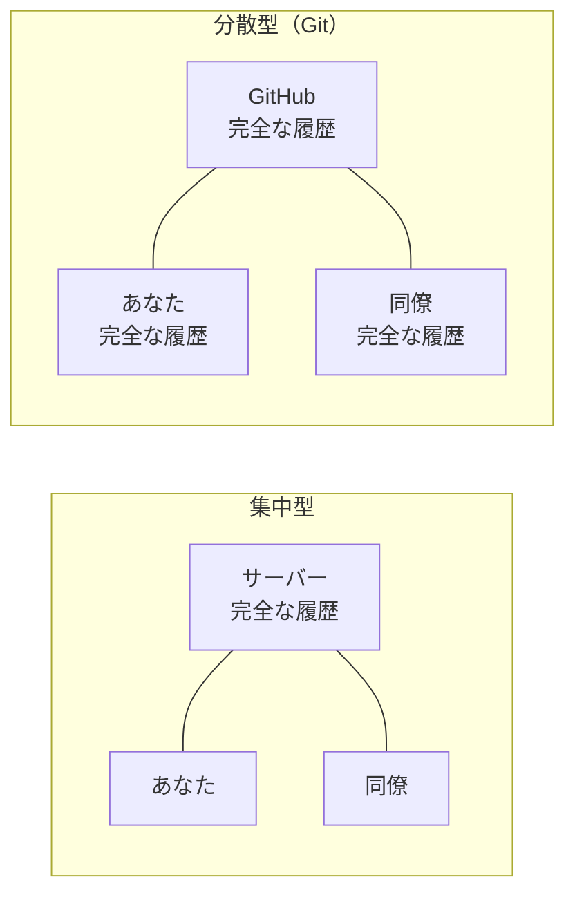
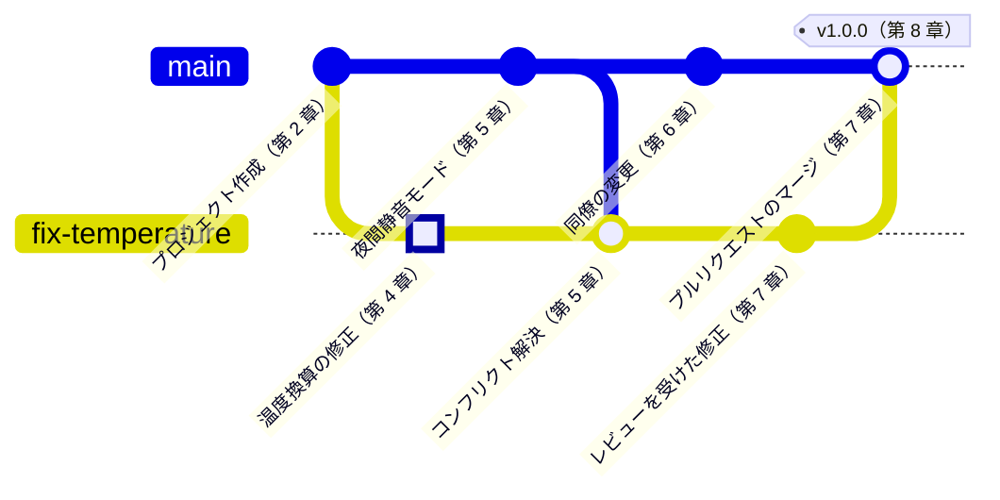

<!-- source: zh-TW/0-before-you-start/00-overview/README.md | sha: 51049a365d8c -->

# 第 0 章　Git の全体像：1 つのプロジェクト、1 つの変更

> 📍 **プロジェクトと変更の現在地**
>
> - プロジェクト：`fan-controller` はフォルダをコピーしてバージョンを管理していて、フォルダ名がどんどん乱れていく
> - 前の段階：旅の出発点
> - **この章：バグが見つかる。ファンが動き出すのが遅すぎる**
> - 次の段階：Git と Sourcetree をインストールし、修正の準備をする

---

## バージョン管理のない日々

こんなフォルダを見たことがあるかもしれません。

```text
fan_v1/
fan_v2/
fan_v2_修正/
fan_v2_最終/
fan_v2_本当に最終/
fan_v2_同僚が修正.zip
```

どれもほとんど同じで、でも少しずつ違います。すぐにこんな問題にぶつかります。

- いまボードに書き込まれているのは、いったいどれなのか。
- `fan_v2_修正` では何行目を変えたのか。なぜ変えたのか。
- 同僚から送られてきた zip と自分のバージョンを、どうやって 1 つにまとめるのか。
- 昨日は動いていたのに、今日は壊れた。どうやって昨日に戻るのか。

こうした問題を解決するのが、バージョン管理です。

---

## バージョン管理がしてくれること

**バージョン管理（Version Control）** は、プロジェクトの日記のようなものです。作業がひと区切りつくたびに、日記を 1 つ書きます。何を変えたのか、誰が変えたのか、いつ、なぜ変えたのか。

この日記があれば、次の 4 つのことができます。

| できること | 解決する問題 | 章 |
|---|---|---|
| すべてのバージョンを記録する | 誰がいつ、なぜ何を変えたのかがわかる | 第 2、3 章 |
| 違いを比べる | 2 つのバージョンでどの行が違うのかがひと目でわかる | 第 2 章 |
| 並行して開発する | バグの修正と新機能の開発を、互いに邪魔せず同時に進められる | 第 4、5 章 |
| 過去に戻る | 壊してしまっても、記録したどのバージョンにでも戻れる | 第 9 章 |

Git は現在もっとも普及しているバージョン管理ツールです。個人の小さなプロジェクトから、数千人で開発する OS まで、Git でコードを管理しています。

> [!NOTE]
> **📖 用語｜Git と GitHub（Git 與 GitHub）**
>
> - **定義**：Git は自分のパソコンにインストールするバージョン管理ツール。GitHub は Git のリポジトリを置いて、共有や共同作業をするための Web サイト。
> - **現場での使い方**：「このプロジェクトは Git を使っている？」はバージョン管理のことを聞いている。「GitHub にプッシュして」は Web サイトに置くことを言っている。
> - **関連用語**：リポジトリ、リモート、Sourcetree
> - **よくある混同**：Git と GitHub は別物である。ネットワークも GitHub のアカウントもなくても、自分のパソコンで Git は使える。

---

## 集中型と分散型

バージョン管理ツールのやり方は 2 種類あります。

**集中型**：履歴は 1 台のサーバーにしかありません。みんながサーバーから最新のファイルを取ってきて、変更したら送り返します。クラス全員で 1 冊の出席簿を使うようなもので、サーバーが止まると誰も記録できません。

**分散型**：一人ひとりのパソコンに完全な履歴があります。Git はこちらです。飛行機の中でも、ネットワークのない実験室でも、バージョンを記録したり履歴を見たりできます。GitHub にあるものは、みんなで同期すると決めた 1 つにすぎません。



> [!NOTE]
> **📖 用語｜分散型バージョン管理（分散式版本控制）**
>
> - **定義**：一人ひとりのパソコンに完全な履歴のコピーがあるバージョン管理の方式。
> - **現場での使い方**：正式名称で呼ぶことはまれ。「clone して」と言えば、履歴を丸ごと自分のパソコンにコピーすることを指す。
> - **関連用語**：集中型バージョン管理、clone、リモート
> - **よくある混同**：分散型は中心がないという意味ではない。チームでは普通、GitHub にあるものを正式なものとして扱う。ただし技術的には、あなたのパソコンにあるコピーと立場は同じである。

<details>
<summary><strong>🔍 もっと詳しく｜Git はどうやって生まれたか</strong></summary>

Git が生まれたのは 2005 年です。Linux カーネルの開発者たちが無料で使っていた商用のバージョン管理ツールを使えなくなり、Linus Torvalds が数週間で Git の最初のバージョンを書き上げました。

その設計目標には、オープンソースプロジェクトに必要なことがそのまま表れています。

- **速い**：数千人が関わり、数万個のファイルがあるプロジェクトでも、履歴の確認やブランチの作成が一瞬で終わること。
- **分散**：誰でも完全な履歴をコピーして自分のパソコンで作業し、その変更をメンテナーに提供できること。
- **改ざんを検知できる**：どのバージョンも内容から計算したハッシュ値を番号にするので、履歴に手が加えられれば、番号を比べるだけでわかること（第 3 章）。

分散型であることは、「誰でも参加できる」ことも自然にしました。サーバーへの書き込み権限がなくても、自分のコピーで変更を仕上げてから、メンテナーに取り込んでもらえばよいのです。これが第 7 章で扱うプルリクエストの原型です。

</details>

---

## この本の 2 人の主人公

**主人公：1 つのプロジェクト。** `fan-controller` は小さなファームウェアです。1 秒に 1 回温度センサーを読み、45 °C を超えるとファンを回し、40 °C を下回ると止めます。この本は、1 人で開発していたこのプロジェクトに同僚が加わり、正式なバージョンをリリースするまでを追いかけます。

**もう 1 人の主人公：1 つの変更。** センサーの仕様は「0 °C で 500 mV を出力し、1 °C 上がるごとに 10 mV 増える」なのに、コードでは先に 600 mV を引いています。そのため計算した温度はいつも 10 °C 低くなり、実際の温度が 55 °C になるまでファンが回りません。

このバグの修正はたった 1 行ですが、Git の旅をすべてたどります。下の図はこの変更がたどる履歴で、強調されたコミットがその変更です。



いまはこの図がわからなくてもかまいません。第 8 章まで読んでから戻ってくれば、どの点がどうやってできたのか、すべてわかるはずです。

> [!TIP]
> **🔧 ノウハウ｜プロジェクトの初日から Git を使う**
>
> - **状況**：プロジェクトが始まったばかりで開発者は自分 1 人。バージョン管理はまだ先の話だと思っている。
> - **やり方**：プロジェクトのフォルダを作ったその日に `git init` し、最初のコミットをする。
> - **理由**：いちばんよく振り返りたくなるのは「最初に動いたバージョン」である。そのころのバージョンはいちばん単純で、問題と比べるのに最も向いている。
> - **やらないとどうなる**：問題が起きてから Git を使おうとしても、肝心の「前は動いていたバージョン」はもう見つからず、記憶を頼りに少しずつ試すしかない。
> - **関連する章**：[第 2 章　3 つの領域](../../1-on-your-computer/02-three-areas/README.md)

> [!TIP]
> **🔧 ノウハウ｜保存はバージョンの記録ではない**
>
> - **状況**：エディタで保存すれば、Git が覚えてくれると思っている。
> - **やり方**：バグを 1 つ直した、関数を 1 つ追加したなど、小さな区切りがつくたびにコミットする。
> - **理由**：Git が記録するのはコミットした瞬間だけである。2 回のコミットの間の保存については何も知らない。
> - **やらないとどうなる**：1 日中作業してからコミットすると、途中で壊しても朝のバージョンにしか戻れず、1 日分の作業がまとめて失われる。
> - **関連する章**：[第 3 章　コミットの正体](../../1-on-your-computer/03-commits/README.md)

---

## コマンドと Sourcetree、両方を説明

Git そのものは、ターミナルでコマンドを打って使います。コマンドは最初はなじみにくいですが、どの OS でも同じで、インターネット上の説明もほとんどがコマンドを使っています。

**Sourcetree** は Git の GUI ツールです。ほとんどの操作をマウスでこなせて、履歴もグラフで描いてくれるので、始めたばかりの人に向いています。裏で実行しているのは、同じ Git のコマンドです。

そこでこの本では、どの操作も 2 通りで説明します。まず考え方を説明し、次にコマンドを示し、最後に Sourcetree でどこを押すかを説明します。どちらか一方だけ使っても、両方を見比べながら学んでもかまいません。

---

## 🧪 やってみよう

**始める前に**：この章ではまだ Git は要りません。Web ページとフォルダを開ければ十分です。

1. この本の GitHub のページを開き、**Code → Download ZIP** を押してダウンロードし、展開します。
2. 展開したフォルダの中の `practice/fan-controller` を開きます。これが物語に出てくるプロジェクトです。
3. 好きなテキストエディタで `sensor.c` を開き、5 行目のコメントと最後の `return` を見比べて、バグを見つけます。
4. `practice/README.md` を読みます。以降の章でこの練習用プロジェクトをどう使うかが書いてあります。

**こうなれば成功**：`sensor.c` のコメントには 500 mV と書いてあるのに、コードはこうなっています。

```c
    return (mv - 600) / 10.0f;
```

まだ直さないでください。第 2 章で、Git に記録させながらこの行を直します。

---

## 📋 この章のコマンド

この章ではまだコマンドを打つ必要はありません。以下は本書でいちばんよく使うコマンドです。以降の章でそれぞれ詳しく説明します。

| やりたいこと | コマンド | Sourcetree では |
|---|---|---|
| 現在の状態を見る | `git status` | 左側の File Status |
| バージョンを記録する | `git add`、`git commit` | Stage → Commit |
| ブランチを作る、切り替える | `git switch -c`、`git switch` | ツールバーの Branch、ブランチをダブルクリック |
| GitHub と同期する | `git pull`、`git push` | ツールバーの Pull、Push |

---

## この章のポイント

1. バージョン管理は、どのバージョンを誰がいつ、なぜ変えたのかを記録し、比較、並行開発、過去への復帰を可能にする。
2. Git は分散型で、一人ひとりのパソコンに完全な履歴がある。GitHub にあるのは、みんなで同期すると決めたもの。
3. Git はツール、GitHub は Web サイトで、同じものではない。
4. この本は、1 つのファームウェアプロジェクトと 1 つの変更を追いかけて、Git の旅をひととおりたどる。

---

## 参考文献

- Scott Chacon、Ben Straub『[Pro Git](https://git-scm.com/book/ja/v2)』第 2 版、第 1 章（使い始める。オンラインで無料で読めます）
- Git の公式サイト：[About Git](https://git-scm.com/about)

---

[目次](../../README.md) ｜ [第 1 章　ツールの準備 →](../01-setup/README.md)
