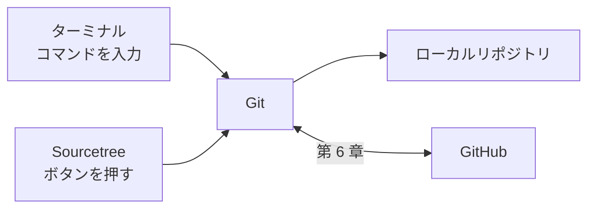

<!-- source: zh-TW/0-before-you-start/01-setup/README.md | sha: c338394334a7 -->

# 第 1 章　ツールの準備：Git と Sourcetree のインストール

> 📍 **プロジェクトと変更の現在地**
>
> - プロジェクト：パソコンにはまだツールが何もない。この章で Git、Sourcetree、GitHub のアカウントを準備する
> - 前の段階：バグが見つかった。ファンが動き出すのが遅すぎる
> - **この章：変更はまだ始まっていない。まずツールを準備する**
> - 次の段階：リポジトリを作り、修正をステージングエリアに入れる

---

## 用意するもの

| ツール | 用途 | 必要か |
|---|---|---|
| Git | バージョン管理そのもの | 必須 |
| ターミナル | コマンドを入力する場所。Windows は Git と一緒にインストールされる Git Bash、macOS と Linux は標準のターミナルを使う | 必須 |
| コードエディタ | コードを編集する。どれでもよい | 必須 |
| Sourcetree | Git の GUI ツール。Windows 版と macOS 版のみ | 任意 |
| GitHub アカウント | 第 6 章からほかの人と共同作業するときに使う | 第 6 章までに用意 |

ツールの関係は次のとおりです。Sourcetree のボタンを押しても、ターミナルでコマンドを打っても、実際に仕事をするのは同じ Git です。



---

## ターミナルの 3 つの基本動作

ターミナルを使ったことがなくても心配はいりません。この本で必要なのは 3 つの動作だけです。

```bash
pwd                          # いまどのフォルダにいるか
ls                           # このフォルダに何があるか
cd ~/git-practice            # フォルダに入る。~ はホームフォルダのこと
```

`cd ..` で 1 つ上の階層に戻ります。パスを途中まで打って Tab キーを押すと、ターミナルが残りを補完してくれます。

> [!NOTE]
> **📖 用語｜ターミナル（終端機）**
>
> - **定義**：文字でコマンドを入力してパソコンを操作するウィンドウ。
> - **現場での使い方**：コマンドライン、シェルとも呼ぶ。たとえば「ターミナルで `git status` を打てばわかるよ」。
> - **関連用語**：Git Bash、コマンド、パス
> - **よくある混同**：Windows 標準のコマンドプロンプトもターミナルの一種だが、多くのコマンドが違い、たとえば `ls` がない。本書のコマンドは Git Bash で入力する。

---

## Git のインストール

**Windows**：Git の公式サイト git-scm.com からインストーラーをダウンロードします。ほとんどの画面は既定のままでかまいませんが、2 つの画面だけ注意してください。

1. **既定のエディタ**：既定はターミナルの中で動くエディタで、使ったことがない人はすぐに操作に詰まります。使い慣れたコードエディタを選んでください。
2. **新しいリポジトリの最初のブランチ名**：「Override the default branch name」を選び、`main` と入力します。

改行の設定は、既定の「Checkout Windows-style, commit Unix-style line endings」のままにしてください。

**macOS**：ターミナルを開き、`git --version` と入力します。まだインストールされていなければ、コマンドライン・デベロッパ・ツールをインストールするかを尋ねるウィンドウが出るので、インストールを押します。

**Linux**：ディストリビューションのパッケージマネージャーでインストールします。たとえば `sudo apt install git` です。

インストールできたら、バージョンを確認します。

```bash
git --version
```

この本では `git switch` のような、2019 年以降に加わったコマンドを使います。あとで `git switch` が見つからないというエラーが出たら Git が古すぎるので、最新版に更新してください。

---

## 最初の設定：git config

Git は、すべてのコミットにあなたの名前とメールアドレスを記録します。初めて使う前に、自分が誰なのかを伝えます。

```bash
git config --global user.name "Chen Xiao-Ming"
git config --global user.email "xiaoming@example.com"
git config --global init.defaultBranch main
```

- `--global` は、このパソコンのすべてのリポジトリにこの設定を使うという意味です。
- `init.defaultBranch main` で、新しいリポジトリの最初のブランチが `main` になります。Git の既定の名前は長い間 `master` でしたが、今後のバージョンで `main` に変えることが予定されています。GitHub や新しい解説はすでに `main` を使っています。

**Sourcetree では**：Sourcetree は既定で上の設定をそのまま使います。**Tools → Options → General** の Default user information で入力することもできます（macOS 版は **Settings → General**。古いバージョンでは Preferences という名前です）。

> [!NOTE]
> **📖 用語｜設定、git config（設定）**
>
> - **定義**：名前、メールアドレス、既定のブランチ名など、Git のさまざまなオプション。`git config` で読み書きする。
> - **現場での使い方**：「global のメールアドレスが間違ってるよ」と言えば、`--global` の層の設定を指す。
> - **関連用語**：`--global`、`.gitconfig`、`.git/config`
> - **よくある混同**：Git の設定と GitHub の Web サイトのアカウント設定は別物である。GitHub のプロフィールを変えても、パソコンがコミットに書く名前は変わらない。

> [!TIP]
> **🔧 ノウハウ｜メールアドレスは GitHub アカウントと同じものか、GitHub の非公開用アドレスにする**
>
> - **状況**：初めて `user.email` を設定するとき、思いついたアドレスを適当に入れる。
> - **やり方**：GitHub アカウントのメールアドレスを入れる。アドレスを公開したくなければ、GitHub のメール設定で非公開を有効にし、用意される noreply アドレスを使う。
> - **理由**：GitHub はメールアドレスでコミットした人を判断する。公開リポジトリにプッシュしたコミットのメールアドレスは、誰でも見られる。
> - **やらないとどうなる**：コミットが自分のアカウントにひも付かず、貢献の記録が空のままになる。あるいは個人のメールアドレスが公開され、迷惑メールが届き始める。
> - **関連する章**：[第 6 章　リモートリポジトリ](../../2-beyond-your-computer/06-remotes/README.md)

### 改行コード

Windows のテキストファイルは各行の終わりに 2 文字（CRLF）を使い、macOS と Linux は 1 文字（LF）だけを使います。Git は、コミットするときに LF にそろえ、取り出すときにシステムに合わせて変換できます。

| システム | 設定 |
|---|---|
| Windows | `core.autocrlf true`。インストーラーが既定で設定済み |
| macOS、Linux | `git config --global core.autocrlf input` |

> [!TIP]
> **🔧 ノウハウ｜チームの改行設定はそろえる**
>
> - **状況**：同じプロジェクトに、Windows を使う人と macOS や Linux を使う人がいる。
> - **やり方**：全員が上の表のとおりに設定する。チームでリポジトリに `.gitattributes` を置き、改行の扱いを統一することもできる。
> - **理由**：改行コードが違うだけで、Git はファイルのすべての行が変わったとみなす。
> - **やらないとどうなる**：1 行しか変えていないのに、差分ではファイル全体を消して書き直したように見える。レビューする人は本当の変更がわからず、マージでもコンフリクトが起きやすくなる。
> - **関連する章**：[第 7 章　プルリクエストとコードレビュー](../../2-beyond-your-computer/07-pull-requests/README.md)

<details>
<summary><strong>🔍 もっと詳しく｜設定の 3 つの層</strong></summary>

Git の設定は 3 つの層に分かれています。範囲が狭いほど、優先されます。

| 層 | オプション | 保存場所 | 範囲 |
|---|---|---|---|
| system | `--system` | Windows は Git のインストール先、macOS と Linux は通常 `/etc/gitconfig` | このパソコンのすべてのユーザー |
| global | `--global` | ホームフォルダの `.gitconfig` | 自分のすべてのリポジトリ |
| local | オプションなし | リポジトリの中の `.git/config` | このリポジトリだけ |

たとえば global には個人のメールアドレスを設定し、会社のプロジェクトのフォルダで `git config user.email` を実行して仕事用のメールアドレスを設定すると、そのリポジトリだけがそちらを使います。ある設定がどの層から来ているかは、`git config --list --show-origin` で確認できます。

</details>

---

## GitHub アカウントの作成

github.com でアカウントを登録します。GitHub では 2 要素認証（Two-Factor Authentication、2FA）を求められるので、スマートフォンに認証アプリを用意してください。

アカウントは第 6 章までに用意できていれば大丈夫です。Sourcetree を使うなら、次の節でアカウントを接続するときに必要になります。プッシュするときに「自分が自分である」ことをどう証明するかは、第 6 章で説明します。

---

## Sourcetree のインストールと GitHub への接続

**ダウンロードとインストール**：Sourcetree の公式サイト sourcetreeapp.com からダウンロードします。インストールの途中でログインやアカウント登録を求められたら、画面に従って済ませるか、スキップしてください。

**システムの Git を使う**（Windows）：Sourcetree には専用の Git が組み込まれています。**Tools → Options → Git** で Git Version を **System** にして、Sourcetree とターミナルが同じ Git、同じ設定を使うようにします。

**GitHub アカウントの接続**：

- Windows：**Tools → Options → Authentication → Add** で Hosting Service に GitHub を選び、ブラウザでログインして許可します。
- macOS：**Settings → Accounts → Add** で GitHub を選び、ブラウザでログインして許可します。


*図：① Add ボタン。アカウントを追加する ② Hosting Service のメニュー。GitHub を選ぶ ③ 許可のボタン。押すとブラウザが開いてログインする。実際の画面はバージョンや OS によって少し異なる。*

---

## 🧪 やってみよう

**始める前に**：上の説明に従って Git をインストールします。Sourcetree と GitHub アカウントはあとでもかまいません。

1. ターミナルを開き（Windows はスタートメニューで Git Bash を探します）、Git がインストールされているか確認します：`git --version`
2. 名前、メールアドレス、既定のブランチを設定します。macOS と Linux では改行も設定します。

   ```bash
   git config --global user.name "あなたの名前"
   git config --global user.email "あなたのメールアドレス"
   git config --global init.defaultBranch main
   git config --global core.autocrlf input    # macOS、Linux のみ
   ```

3. global の設定を一覧表示します：`git config --global --list`
4. Sourcetree を使う場合：インストールしたら、システムの Git を選び、GitHub アカウントを接続します。
5. 第 0 章でこの本を ZIP でダウンロードした人は、ここで Git を使ってダウンロードし直せます。Git でインターネットからリポジトリを取ってくる、初めての操作です。

   ```bash
   git clone https://github.com/chenwei810/Git_Introduction.git
   ```

**こうなれば成功**：`git config --global --list` に、いま設定した内容が表示されます。設定名は小文字で表示されます。

```text
user.name=Chen Xiao-Ming
user.email=xiaoming@example.com
init.defaultbranch=main
```

macOS と Linux では、さらに `core.autocrlf=input` の行があります。

---

## 📋 この章のコマンド

| やりたいこと | コマンド | Sourcetree では |
|---|---|---|
| Git のバージョンを確認する | `git --version` | — |
| 名前とメールアドレスを設定する | `git config --global user.name`、`user.email` | Tools → Options → General（macOS：Settings → General） |
| 新しいリポジトリのブランチ名を main にする | `git config --global init.defaultBranch main` | — |
| 改行を設定する（macOS、Linux） | `git config --global core.autocrlf input` | — |
| global の設定を一覧表示する | `git config --global --list` | — |
| GitHub アカウントを接続する | — | Tools → Options → Authentication（macOS：Settings → Accounts） |

---

## この章のポイント

1. 必要なのは Git、ターミナル、コードエディタ。Sourcetree は任意の GUI ツールで、裏で動くのは同じ Git である。
2. 初めて使う前に、`git config --global` で名前、メールアドレス、既定のブランチ `main` を設定する。
3. メールアドレスはコミットの中で公開される。GitHub アカウントと同じものか、GitHub の非公開用アドレスを使う。
4. チーム全員の改行設定をそろえる。そうしないと、1 行の変更がファイル全体の変更に見えてしまう。

---

## 参考文献

- Scott Chacon、Ben Straub『[Pro Git](https://git-scm.com/book/ja/v2)』第 2 版、1.5 節（Git のインストール）と 1.6 節（最初の Git の構成）
- Git 公式ドキュメント：[git-config](https://git-scm.com/docs/git-config)
- GitHub Docs：[コミットメールアドレスを設定する](https://docs.github.com/ja/account-and-profile/setting-up-and-managing-your-personal-account-on-github/managing-email-preferences/setting-your-commit-email-address)

---

[← 第 0 章　Git の全体像](../00-overview/README.md) ｜ [目次](../../README.md) ｜ [第 2 章　3 つの領域 →](../../1-on-your-computer/02-three-areas/README.md)
