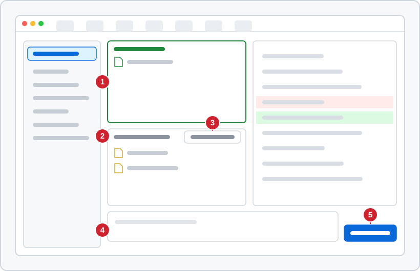

<!-- source: zh-TW/1-on-your-computer/02-three-areas/README.md | sha: 03509c355ea7 -->

# 第 2 章　3 つの領域：作業ディレクトリ、ステージングエリア、リポジトリ

> 📍 **プロジェクトと変更の現在地**
>
> - プロジェクト：`fan-controller` はまだただのフォルダ。この章でリポジトリにし、最初のコミットをする
> - 前の段階：バグが見つかり、Git と Sourcetree のインストールも済んだ
> - **この章：修正を書き、ステージングエリアに入れる**
> - 次の段階：コミットを開き、コミットすると何になるのかを見る

---

## なぜ 3 つの領域に分かれているのか

Git で管理するファイルは、3 つの場所にいます。荷物を送る場面にたとえるといちばんわかりやすいでしょう。

- **作業ディレクトリ（Working Directory）** は机です。ファイルはその上にあって、いつでも変更できます。
- **ステージングエリア（Staging Area）** は発送前の段ボール箱です。机の上から今回送るものを選んで、箱に入れます。
- **リポジトリ（Repository）** は発送記録です。箱を閉じて送ると、中身が永久に記録されます。この操作を **コミット（Commit）** といいます。


なぜわざわざ箱が必要なのでしょうか。いくつかのことを同時に変えることがよくあるからです。たとえば温度の換算を直したついでに、`main.c` にデバッグ用の出力を何行か足したとします。記録したいのは修正だけで、デバッグ用のコードは要りません。ステージングエリアを使えば、今回記録する変更を選び、残りは机の上に置いておけます。

> [!NOTE]
> **📖 用語｜リポジトリ（儲存庫）**
>
> - **定義**：Git がプロジェクトのすべてのバージョンを記録する場所。プロジェクトのフォルダにある隠しフォルダ `.git` のこと。
> - **現場での使い方**：たいてい「リポ」や「repo」と呼ぶ。たとえば「このリポはファームウェア用で、ハードの図面は別のリポにある」。
> - **関連用語**：作業ディレクトリ、ステージングエリア、リモートリポジトリ
> - **よくある混同**：プロジェクトのフォルダとリポジトリは同じではない。`.git` を消してもフォルダのファイルは残るが、履歴はすべて消える。

---

## リポジトリを作る：git init

プロジェクトのフォルダで `git init` を実行すると、Git が `.git` フォルダを作り、プロジェクトの管理を始めます。

```bash
cd ~/git-practice/fan-controller
git init
```

**Sourcetree では**：**新しいタブの Create → fan-controller フォルダを選ぶ → Create**（macOS 版は **New → Create Local Repository**）。フォルダがすでにあると注意されたら、続行を選びます。

> [!TIP]
> **🔧 ノウハウ｜git init の前に、いまいるフォルダを確かめる**
>
> - **状況**：ターミナルを開いてすぐに `git init` と打つ。
> - **やり方**：まず `pwd` でいまの場所を確かめ、プロジェクトのフォルダだと確認してから実行する。
> - **理由**：ターミナルは普通、ホームフォルダから始まる。そこで `git init` を実行すると、ホームフォルダ全体が 1 つのプロジェクトになってしまう。
> - **やらないとどうなる**：`git status` に何千ものファイルが並び、どのサブフォルダで作業してもそのリポジトリを誤って使うことになる。元に戻すには、ホームフォルダの `.git` を消すしかない。
> - **関連する章**：[第 1 章　ツールの準備](../../0-before-you-start/01-setup/README.md)

<details>
<summary><strong>🔍 もっと詳しく｜.git フォルダの中身</strong></summary>

Git のすべては `.git` の中にあります。特に重要なものを挙げます。以降の章でもう一度出てきます。

```text
HEAD       いまどのブランチにいるか（第 4 章）
config     このリポジトリ自身の設定（第 1 章）
index      ステージングエリア（この章）
objects/   すべてのバージョンの中身（第 3 章）
refs/      ブランチとタグ（第 4、8 章）
```

どれも普通のファイルです。`HEAD` を開くと `ref: refs/heads/main` の 1 行だけが書いてあり、「いまは main ブランチにいる」という意味です。

</details>

---

## 状態を見る：git status

`git status` は、それぞれのファイルがいまどの領域にあるかを教えてくれます。いちばんよく使うコマンドで、何が起きているかわからないときは、まずこれを打てば間違いありません。

`git init` を実行した直後は、Git はまだどのファイルも追跡していないので、すべてのファイルが「未追跡」（Untracked files）の下に並びます。

| `git status` の見出し | 意味 |
|---|---|
| Untracked files | Git が一度も記録したことのない新しいファイル |
| Changes not staged for commit | 変更したが、まだ机の上にある |
| Changes to be committed | もう箱に入っていて、次のコミットで記録される |

**Sourcetree では**：左側の **File Status**。下半分の Unstaged files が机、上半分の Staged files が箱です。



*図：① Staged files。箱にあたる ② Unstaged files。机にあたる ③ Stage All。机の上の変更をすべて箱に入れる ④ メッセージ欄 ⑤ Commit ボタン。右側には選んだファイルの差分が表示される。*

---

## ステージングとコミット：git add、git commit

**ファイルを選ぶ → git add → git commit**

1. **git add**：ファイルをステージングエリアに入れます。`git add .` はいまのフォルダのすべてのファイルを意味します。
2. **git commit**：ステージングエリアの内容を 1 つのバージョンとして記録します。`-m` のあとに、このバージョンの説明を書きます。

```bash
git add .
git commit -m "Initial commit"
```

**Sourcetree では**：**Stage All → 下の欄にメッセージを入力 → Commit**。

これでプロジェクトの最初のコミットが生まれました。この時点の履歴には点が 1 つしかありません。


> [!NOTE]
> **📖 用語｜ステージングエリア（暫存區）**
>
> - **定義**：次のコミットに入る内容。コミットするとき、Git はステージングエリアにあるものだけを記録する。
> - **現場での使い方**：動詞では「ステージする」「add する」と言う。たとえば「そのファイルはまだステージしていないから、コミットに入っていないよ」。
> - **関連用語**：作業ディレクトリ、`git add`、インデックス
> - **よくある混同**：ステージングエリアはインデックス（index）とも呼ばれ、両者は同じもの。第 9 章の `git stash`（変更を一時的にしまう）とはまったく別物である。

---

## バグを直す：git diff

では温度の換算を直しましょう。`sensor.c` を開くと、コメントにはセンサーは 0 °C で 500 mV を出力すると書いてあるのに、コードは `(mv - 600)` になっています。600 を 500 に変えて保存すると、`sensor.c` は「変更したが、まだ机の上にある」状態になります。箱に入れる前に、`git diff` で何を変えたのかを確かめます。

```bash
git diff             # 机の上と箱の中の違いを見る
git add sensor.c
git diff --staged    # 箱の中と最後のコミットの違いを見る
```

**Sourcetree では**：File Status でファイルをクリックすると、右側に差分が表示されます。赤は削除した行、緑は追加した行です。

ステージングエリアが記録するのは、`git add` したその瞬間の内容です。add したあとで同じファイルをまた変えると、`git status` は 2 つの見出しの両方にそのファイルを表示します。新しい変更を箱に入れるには、もう一度 add する必要があります。

> [!TIP]
> **🔧 ノウハウ｜コミットの前に git diff --staged を見る**
>
> - **状況**：いくつものファイルを変えて、コミットしようとしている。
> - **やり方**：まず `git diff --staged` を実行し、箱の中身がすべて記録したいものかを 1 行ずつ確かめる。
> - **理由**：`git add .` はフォルダ内の変更したファイルをすべて箱に入れる。デバッグ用の出力や、一時的に変えた設定値も含めて。
> - **やらないとどうなる**：デバッグ用のコードが正式なバージョンに記録され、そのまま製品に書き込まれることさえある。あとからそれを持ち込んだコミットを探すのに、さらに時間がかかる。
> - **関連する章**：[第 10 章　よい習慣](../../3-when-things-go-wrong/10-good-habits/README.md)

<details>
<summary><strong>🔍 もっと詳しく｜ステージングエリアの正体は 1 つのファイル</strong></summary>

ステージングエリアの正体は `.git/index` というバイナリファイルです。各ファイルのパス、権限、内容のハッシュ値を記録しています。次のコマンドで中身を見られます。

```text
$ git ls-files --stage
100644 6305a5e833282a7ac1c6fa02a0c455706b169145 0	Makefile
100644 c50b3ace27f06cf09657fbd19635ee6d06f268ed 0	README.md
```

真ん中の 40 文字が、ファイルの内容のハッシュ値です。`git add` が実際にしているのは、ファイルの内容を `.git/objects/` に保存し、そのハッシュ値を index に書き込むことです。つまり add した時点で、内容はもう Git に保存されています。add のあとでファイルを変えても箱の中身に影響しないのは、このためです。第 3 章でこれらのオブジェクトを開いてみます。

</details>

---

## よくある問題

| 状況 | 原因 | 対処 |
|---|---|---|
| `fatal: not a git repository` | いまいるフォルダがリポジトリではない | `cd` でプロジェクトのフォルダに移動する |
| `Author identity unknown` | 名前とメールアドレスを設定していない | 第 1 章のとおり `user.name` と `user.email` を設定する |
| `LF will be replaced by CRLF` | Windows とほかのシステムで改行コードが違う | 単なる通知なので無視してよい。第 1 章を参照 |

---

## 🧪 やってみよう

**始める前に**：この本のルートフォルダで `bash practice/setup.sh 2` を実行し、練習用プロジェクトを `~/git-practice/fan-controller` にコピーします。この時点ではまだリポジトリではありません。

1. リポジトリを作り、最初のコミットをします。

   ```bash
   cd ~/git-practice/fan-controller
   git init
   git status          # すべてのファイルが Untracked files の下にある
   git add .
   git commit -m "Initial commit"
   ```

   Sourcetree では：新しいタブの Create でこのフォルダを選び、**Stage All → メッセージを入力 → Commit**。

2. エディタで `sensor.c` を開き、`(mv - 600)` を `(mv - 500)` に変えて保存します。
3. 差分を見てから修正をステージングエリアに入れます。ただし、**まだコミットしないでください**。

   ```bash
   git diff
   git add sensor.c
   git status
   ```

**こうなれば成功**：最後の `git status` の 1 行目が `On branch main` で、Changes to be committed の下に `modified: sensor.c` が表示されます。1 行目が `On branch master` なら、第 1 章のとおり既定のブランチを設定し、`.git` フォルダを消してからやり直してください。この修正は、第 4 章で新しいブランチにコミットします。

---

## 📋 この章のコマンド

| やりたいこと | コマンド | Sourcetree では |
|---|---|---|
| フォルダをリポジトリにする | `git init` | Create（macOS：New → Create Local Repository） |
| 現在の状態を見る | `git status` | 左側の File Status |
| ファイルをステージングエリアに入れる | `git add <ファイル>`、`git add .` | ファイルを選ぶ → Stage Selected、または Stage All |
| コミットする | `git commit -m "メッセージ"` | メッセージを入力 → Commit |
| まだステージしていない変更を見る | `git diff` | Unstaged files のファイルをクリック |
| ステージした変更を見る | `git diff --staged` | Staged files のファイルをクリック |

---

## この章のポイント

1. ファイルは 3 つの場所にいる。作業ディレクトリ（机）、ステージングエリア（箱）、リポジトリ（発送記録）。
2. `git add` で変更をステージングエリアに入れ、`git commit` でステージングエリアを 1 つのバージョンとして記録する。
3. ステージングエリアがあるから、今回記録する変更を選べる。1 つのコミットには関係のあるものだけを入れる。
4. 状況がわからないときはまず `git status`、コミットの前には `git diff --staged` を見る。

---

## 参考文献

- Scott Chacon、Ben Straub『[Pro Git](https://git-scm.com/book/ja/v2)』第 2 版、第 2 章（Git の基本。オンラインで無料で読めます）
- Git 公式ドキュメント：[git-status](https://git-scm.com/docs/git-status)、[git-add](https://git-scm.com/docs/git-add)、[git-commit](https://git-scm.com/docs/git-commit)

---

[← 第 1 章　ツールの準備](../../0-before-you-start/01-setup/README.md) ｜ [目次](../../README.md) ｜ [第 3 章　コミットの正体 →](../03-commits/README.md)
