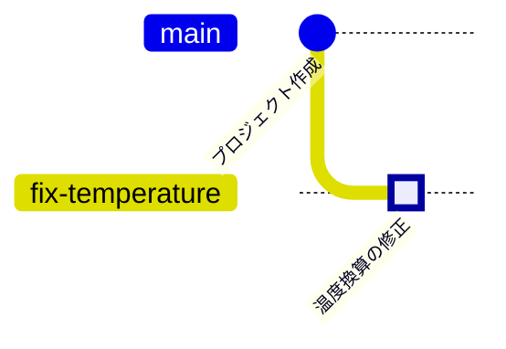

<!-- source: zh-TW/1-on-your-computer/03-commits/README.md | sha: 0d2783081470 -->

# 第 3 章　コミットの正体：スナップショット、ハッシュ、オブジェクト

> 📍 **プロジェクトと変更の現在地**
>
> - プロジェクト：リポジトリに最初のコミット「Initial commit」ができた
> - 前の段階：修正を書き、ステージングエリアに入れた
> - **この章：修正はステージングエリアで待っている。先に最初のコミットを開き、コミットすると何になるのかを見る**
> - 次の段階：新しいブランチを作り、そこに修正をコミットする

---

## コミットは差分ではなくスナップショット

コミットは「今回どの行を変えたか」を記録していると思っている人は多いでしょう。実際に Git が記録しているのは **スナップショット** です。コミットしたその瞬間に、プロジェクト全体がどうなっていたかです。

作業がひと区切りするたびに、プロジェクト全体の集合写真を撮るようなものです。次に撮るとき、変わっていないファイルは撮り直さず、前の写真と同じものをそのまま使います。変更したファイルだけを新しく保存します。

だからスナップショットは場所をむだにしませんし、「今回どの行を変えたか」は、Git が 2 枚のスナップショットを比べて割り出したものです。Git が隣り合ったバージョンだけでなく、任意の 2 つのバージョンを比べられるのもこのためです。

---

## コミットに入っているもの

| 内容 | 説明 |
|---|---|
| スナップショット | このバージョンのすべてのファイルの内容 |
| 1 つ前のコミット | 「前のバージョン」へのつながり。最初のコミットにはない |
| 作者と日時 | 誰がいつこの変更を書いたか |
| メッセージ | なぜこの変更をしたのか |

これらの内容から、`21e1fda6273505ec510e3aec8e96e4888e3c597a` のような 40 文字の番号が計算されます。これがコミットの身分証の番号です。ふだんは `21e1fda` のように先頭の 7 文字だけを書きます。

> [!NOTE]
> **📖 用語｜コミット（提交）**
>
> - **定義**：ある時点のプロジェクトのスナップショットに、作者、日時、メッセージ、1 つ前のコミットへのつながりを加えたもの。
> - **現場での使い方**：名詞にも動詞にも使う。たとえば「このバグはどのコミットで入った？」「終わったらコミットしておいて」。
> - **関連用語**：スナップショット、ハッシュ値、親コミット、`git log`
> - **よくある混同**：コミットはまだ自分のパソコンにあるだけで、GitHub には届いていない。ほかの人に見えるのは、プッシュしてから（第 6 章）である。

> [!NOTE]
> **📖 用語｜ハッシュ値（雜湊值）**
>
> - **定義**：内容をハッシュ関数（Hash Function）に通して計算した、長さの決まった番号。内容が 1 文字でも違えば、番号はまったく別のものになる。
> - **現場での使い方**：コミットハッシュ、コミット ID、SHA とも呼ぶ。たとえば「問題のコミットの SHA を送って」。
> - **関連用語**：コミット、SHA-1、SHA-256
> - **よくある混同**：連番ではないので、前後関係はわからない。順番を決めているのは、コミット同士の「1 つ前」へのつながりである。

---

## 履歴を見る：git log

```bash
git log              # すべての履歴
git log --oneline    # 1 つのコミットを 1 行で
```

```text
commit 21e1fda6273505ec510e3aec8e96e4888e3c597a
Author: Chen Xiao-Ming <xiaoming@example.com>
Date:   Tue Oct 13 00:32:17 2026 +0800

    Initial commit
```

履歴が長いと、ターミナルはスクロールできる画面で止まります。スペースキーで先に進み、`q` で抜けます。

**Sourcetree では**：左側の **History**。1 行が 1 つのコミットで、左側の線がコミットグラフです。

いまの履歴には点が 1 つだけです。ステージングエリアにある修正は、次の章で 2 つ目の点になります。



---

## コミットで何を変えたかを見る：git show

```bash
git show HEAD            # 最新のコミットと、その変更内容
git show --stat HEAD     # どのファイルを何行変えたかだけ
```

`HEAD` は「いまいるコミット」を表します。詳しくは第 4 章で説明します。`HEAD` の代わりに、どのコミットの番号でも使えます。

**Sourcetree では**：History でコミットをクリックすると、下に変更したファイルが並び、ファイルをクリックすると差分が見られます。

> [!TIP]
> **🔧 ノウハウ｜1 つのコミットでは 1 つのことだけをする**
>
> - **状況**：バグを直したついでに書式を整え、パラメータも 1 つ調整したので、まとめてコミットしようとしている。
> - **やり方**：3 つのコミットに分ける。第 2 章のステージングエリアを使い、1 回に 1 つのことだけを入れる。
> - **理由**：コミットは、あとで単独で見たり、単独で取り消したりできる単位である。
> - **やらないとどうなる**：パラメータの調整が間違っていたので取り消そうとすると、バグの修正まで一緒に取り消すことになる。レビューする人も、どの行が本当の修正なのか見分けにくい。
> - **関連する章**：[第 9 章　取り消しとやり直し](../../3-when-things-go-wrong/09-undoing-things/README.md)

> [!TIP]
> **🔧 ノウハウ｜問題を報告するときはコミットの番号を添える**
>
> - **状況**：テスト担当の同僚が「新しいファームウェアに問題がある」と言ってくる。
> - **やり方**：どのコミットを書き込んだのかを聞く。あるいはビルドのときにコミットの番号をファームウェアに記録し、起動時に表示させる。
> - **理由**：「新しいバージョン」は毎日変わる。どのコードなのかを正確に指せるのは、コミットの番号だけである。
> - **やらないとどうなる**：最新のコードでは問題が見つからないのに、相手が持っているのは 3 日前のバージョンで、お互いにむだ骨を折る。
> - **関連する章**：[第 8 章　ブランチ戦略とリリース](../../2-beyond-your-computer/08-branching-and-releases/README.md)

<details>
<summary><strong>🔍 もっと詳しく｜blob、tree、commit の 3 種類のオブジェクト</strong></summary>

`.git/objects/` に保存されているものをオブジェクトと呼びます。よく出てくるのは次の 3 種類です。

- **blob**：1 つのファイルの内容。内容だけで、ファイル名は持たない。
- **tree**：1 つのフォルダ。中のファイル名と、それぞれが指す blob やサブフォルダの tree を並べたもの。
- **commit**：いちばん上の tree を指し、親コミット、作者、日時、メッセージを加えたもの。

`git cat-file -p` を使うと、どのオブジェクトでも開けます。

```text
$ git cat-file -p HEAD
tree ba262450ee64e15410fdcb083ad5d02175363fb7
author Chen Xiao-Ming <xiaoming@example.com> 1791822737 +0800
committer Chen Xiao-Ming <xiaoming@example.com> 1791822737 +0800

Initial commit
```

どのオブジェクトの番号も、その内容から計算されます。だから内容が同じファイルの番号は必ず同じです。`git rev-parse HEAD:sensor.c` を試すと、本と同じ `28a712d460300d19b5ccfad1dedb2fe190f91adc` が得られます。`sensor.c` の内容がまったく同じだからです。スナップショットが場所をむだにしないのは、このおかげです。変わっていないファイルは、新旧のスナップショットが同じ blob を指します。

</details>

<details>
<summary><strong>🔍 もっと詳しく｜SHA-1 から SHA-256 へ</strong></summary>

Git はずっと SHA-1 というアルゴリズムで番号を計算してきました。結果は 16 進数の 40 文字です。その後、SHA-1 では内容が違うのに番号が同じになるデータを意図的に作れることが示されました。Git はこの攻撃を検知する仕組みを加え、より安全な SHA-256 にも対応し始めました。SHA-256 の番号は 64 文字です。

2020 年代半ばの時点では、ほとんどのリポジトリとホスティングサービスがまだ SHA-1 を使っており、Git のコミュニティは新しいリポジトリの既定を SHA-256 にすることを計画しています。ふだん使う人にとっての違いは番号が長くなることだけで、コマンドの使い方は変わりません。

</details>

---

## よくある問題

| 状況 | 原因 | 対処 |
|---|---|---|
| コミットの番号が本と違う | 作者と日時が違えば、計算される番号も違う | 正常なので問題ない |
| `git log` の作者名が違う | 第 1 章の `user.name` の設定が間違っている | 設定を直せば、以降のコミットは正しくなる |

---

## 🧪 やってみよう

**始める前に**：第 2 章の練習用プロジェクトの続きから始めます。この章から始めたい場合は、この本のルートフォルダで `bash practice/setup.sh 3` を実行します。

1. 履歴を見て、コミットが 1 つあることを確かめます。画面が止まったら `q` を押します。

   ```bash
   cd ~/git-practice/fan-controller
   git log
   git log --oneline
   ```

   Sourcetree では：左側の History。

2. 最初のコミットに含まれるファイルを見ます：`git show --stat HEAD`
3. 修正がまだステージングエリアにあり、コミットされていないことを確かめます：`git status`
4. 「もっと詳しく」を読んだ人は、コミットオブジェクトを開き、`sensor.c` の blob の番号を調べます。

   ```bash
   git cat-file -p HEAD
   git rev-parse HEAD:sensor.c
   ```

**こうなれば成功**：`git log --oneline` には `Initial commit` の 1 行だけが表示されます。`git show --stat HEAD` には 10 個のファイルが並びます。`git status` では、Changes to be committed の下に `modified: sensor.c` がまだ表示されます。`git rev-parse HEAD:sensor.c` の結果は `28a712d460300d19b5ccfad1dedb2fe190f91adc` で、本と同じです。

---

## 📋 この章のコマンド

| やりたいこと | コマンド | Sourcetree では |
|---|---|---|
| 履歴を見る | `git log` | 左側の History |
| 1 つのコミットを 1 行で | `git log --oneline` | History は最初からこの形 |
| コミットで何を変えたかを見る | `git show <番号>` | History でそのコミットをクリック |
| 変えたファイルだけを見る | `git show --stat <番号>` | History でコミットをクリックし、下のファイル一覧を見る |
| オブジェクトを開く | `git cat-file -p <番号>` | — |

---

## この章のポイント

1. コミットはプロジェクト全体のスナップショットで、差分ではない。差分は 2 枚のスナップショットを比べて得られる。
2. コミットにはスナップショット、1 つ前のコミット、作者、日時、メッセージが入っていて、これらから一意の番号が計算される。
3. `git log` で履歴を、`git show` で 1 つのコミットの変更内容を見る。
4. 1 つのコミットでは 1 つのことだけをする。そうすれば、あとで単独で見たり取り消したりできる。

---

## 参考文献

- Scott Chacon、Ben Straub『[Pro Git](https://git-scm.com/book/ja/v2)』第 2 版、2.3 節（コミット履歴の閲覧）と 10.2 節（Git オブジェクト）
- Git 公式ドキュメント：[git-log](https://git-scm.com/docs/git-log)、[git-cat-file](https://git-scm.com/docs/git-cat-file)

---

[← 第 2 章　3 つの領域](../02-three-areas/README.md) ｜ [目次](../../README.md) ｜ [第 4 章　ブランチ →](../04-branches/README.md)
