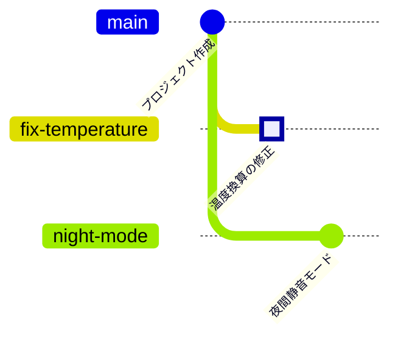

<!-- source: zh-TW/1-on-your-computer/04-branches/README.md | sha: a220b015c202 -->

# 第 4 章　ブランチ：ただの付箋

> 📍 **プロジェクトと変更の現在地**
>
> - プロジェクト：温度換算の修正と「夜間静音モード」の開発、2 つのことを同時に進めたい
> - 前の段階：修正はステージングエリアで待っている
> - **この章：修正は新しいブランチ `fix-temperature` についていき、そこで 1 つのコミットになる**
> - 次の段階：夜間静音モードが先に `main` にマージされ、修正のブランチとコンフリクトを起こす

---

## なぜブランチが必要か

`main` にあるコードは、いつでもボードに書き込めて、正しく動くバージョンであるべきです。ところが、手元には 2 つの仕事があります。

- 温度換算を直し、終わったらボードで確かめる。
- 夜間静音モードを作る。何日もかかるかもしれず、途中の作りかけは誰にも触らせたくない。

どちらも `main` で直接進めると、作りかけが紛れ込み、確認途中の修正が新機能の邪魔をします。**ブランチ（Branch）** を使えば、それぞれの仕事が自分の線の上で進み、互いに干渉しません。できあがったら `main` にマージすればよいのです。

---

## ブランチはただの付箋

コミットの 1 つひとつがアルバムの写真で、どの写真も 1 つ前の写真がどれかを覚えていると想像してください。

**ブランチは、どれかの写真に貼られた付箋** で、`main` のような名前が書いてあります。そのブランチでコミットすると、新しい写真が後ろにつながり、付箋も自動で新しい写真に移ります。

新しいブランチを作るのは、付箋を 1 枚増やすだけで、ファイルは 1 つもコピーしません。だから Git のブランチはほとんど時間がかからず、1 日に何本も作るのが普通です。

もう 1 つ、**HEAD** という特別な矢印があります。「あなたはここにいる」という意味で、普通はどれかの付箋を指し、いまどのブランチにいるかを表します。

> [!NOTE]
> **📖 用語｜ブランチ（分支）**
>
> - **定義**：あるコミットを指す名前。そのブランチでコミットすると、自動的に新しいコミットへ進む。
> - **現場での使い方**：「ブランチを切って直して」「いまどのブランチにいる？」
> - **関連用語**：`main`、HEAD、`git switch`
> - **よくある混同**：ブランチはフォルダのコピーではない。ブランチを切り替えると、同じフォルダの中のファイルがそのブランチの内容に変わる。

> [!NOTE]
> **📖 用語｜HEAD**
>
> - **定義**：「いまいる場所」を表すポインタ。普通はブランチを指し、ブランチを通してコミットを指す。
> - **現場での使い方**：「HEAD はどこを指してる？」は、いまどのブランチ、どのコミットにいるかを聞いている。
> - **関連用語**：ブランチ、detached HEAD、`git switch`
> - **よくある混同**：古い解説ではブランチの切り替えに `git checkout` を使う。これはファイルの復元まで担う多機能なコマンドなので、Git は 2019 年に `git switch`（ブランチの切り替え）と `git restore`（ファイルの復元）を加え、役目を分けた。

---

## ブランチを作って切り替える：git switch -c

**ブランチを一覧表示 → 新しいブランチを作って切り替え → コミット**

```bash
git branch                       # すべてのブランチを表示。* がいまいるブランチ
git switch -c fix-temperature    # 新しいブランチを作り、そこへ切り替える
git commit -m "Fix temperature sensor offset"
```

**Sourcetree では**：**ツールバーの Branch → ブランチ名を入力 → Checkout New Branch にチェックが入っていることを確認 → Create Branch**。そのあと File Status で Commit を押します。

前の章でステージングエリアに残しておいた修正は、新しいブランチについてくるので、そのままコミットすれば大丈夫です。

> [!TIP]
> **🔧 ノウハウ｜途中でブランチを切り忘れに気づいても、変更はついてくる**
>
> - **状況**：`main` でコードを書き換えてから、ブランチを切るべきだったと気づく。
> - **やり方**：そのまま `git switch -c 新しいブランチ名` を実行する。まだコミットしていない変更は、作業ディレクトリにあってもステージングエリアにあっても、一緒についてくる。
> - **理由**：新しいブランチを作るのは付箋を 1 枚貼るだけで、フォルダの中のファイルはまったく動かない。
> - **やらないとどうなる**：いったん `main` にコミットしてから移すしかないと思い込み、作りかけが `main` に入ってしまう。あるいは手作業でファイルを別の場所にコピーし、最後にはどれが新しいのかわからなくなる。
> - **関連する章**：[第 2 章　3 つの領域](../02-three-areas/README.md)

---

## ブランチを切り替える：git switch

```bash
git switch main
```

**Sourcetree では**：左側の **Branches** の下で、ブランチ名をダブルクリックします。

切り替えたら `sensor.c` を開いてみてください。`main` ではまだバグのある `(mv - 600)` のままです。修正は `fix-temperature` ブランチにしかなく、そちらに切り替えると再び現れます。

> [!TIP]
> **🔧 ノウハウ｜ブランチを切り替える前に、手元の変更を片づける**
>
> - **状況**：あるブランチで変更している途中に、急に別のブランチの中身を見たくなる。
> - **やり方**：先にコミットするか、`git stash` で変更をいったんしまってから（第 9 章）切り替える。
> - **理由**：コミットしていない変更はどのブランチにも属さず、切り替えるとそのままついてくる。
> - **やらないとどうなる**：変更したファイルの中身が 2 つのブランチで違えば、Git は切り替えを拒否する。そうでなければ変更が別のブランチについていき、間違った場所にコミットしやすくなる。
> - **関連する章**：[第 9 章　取り消しとやり直し](../../3-when-things-go-wrong/09-undoing-things/README.md)

---

## 2 本目のブランチ：夜間静音モード

夜間静音モードは、温度の読み取り値を平均して、ファンがしきい値のあたりで回ったり止まったりを繰り返さないようにするものです。`main` に戻ってから、もう 1 本ブランチを作ります。

```bash
git switch -c night-mode
# sensor.c の return の行を return smooth((mv - 600) / 10.0f); に変える
git commit -am "Smooth temperature readings for night mode"
```

`-a` は、Git がすでに追跡していて変更されたファイルをすべてステージングエリアに入れてからコミットします。まったく新しいファイルは入らないので、それは先に `git add` する必要があります。

これで履歴は 2 本の線に分かれ、どちらも「プロジェクト作成」から伸びています。



ターミナルでは、`--graph` で同じ図を描けます。

```text
$ git log --oneline --graph --all
* 8303532 Smooth temperature readings for night mode
| * 5b16173 Fix temperature sensor offset
|/
* 21e1fda Initial commit
```

2 本のブランチが、どちらも `sensor.c` の同じ行を変えていることに注目してください。次の章で 2 つを合わせると、コンフリクトが起きます。

<details>
<summary><strong>🔍 もっと詳しく｜ブランチの正体はテキストファイル 1 つ</strong></summary>

ブランチは `.git/refs/heads/` の下にあります。1 本のブランチが 1 つのファイルで、中身はコミットの番号 1 行だけです。

```text
$ cat .git/refs/heads/fix-temperature
5b161734b18d772125579ecab6dcdce2955b740c
$ cat .git/HEAD
ref: refs/heads/main
```

ブランチを作るとは 41 バイトの小さなファイルを書くことで、コミットするとその中の番号が書き換わります。だから、どれほど大きなプロジェクトでもブランチは一瞬で作れます。ブランチが多いと、Git がまとめて `.git/packed-refs` に書くこともありますが、考え方は同じです。`HEAD` ファイルは、いまどのブランチにいるかを記録しています。

ブランチではなくコミットに直接切り替えると、たとえば `git switch --detach 21e1fda` のようにすると、HEAD はコミットを直接指します。これを **detached HEAD** といいます。古いバージョンを見るにはこれで十分ですが、新しく作ったコミットはどのブランチにも属さず、ほかへ切り替えると見つけにくくなります。残したいなら、先に `git switch -c 新しいブランチ名` で付箋を貼ってください。

</details>

---

## よくある問題

| 状況 | 原因 | 対処 |
|---|---|---|
| `fatal: a branch named '…' already exists` | そのブランチ名はすでに使われている | 別の名前にするか、`git switch` でそのブランチに切り替える |
| `Your local changes … would be overwritten` | 手元の変更が切り替え先のブランチとぶつかる | 先にコミットするか `git stash` してから切り替える |
| `HEAD detached at …` | ブランチではなくコミットに切り替えた | `git switch main` でブランチに戻る |

---

## 🧪 やってみよう

**始める前に**：第 3 章の練習用プロジェクトの続きから始めます。この章から始めたい場合は、この本のルートフォルダで `bash practice/setup.sh 4` を実行します。

1. 修正用のブランチを作ります。修正はついてくるので、そのままコミットします。

   ```bash
   cd ~/git-practice/fan-controller
   git switch -c fix-temperature
   git status
   git commit -m "Fix temperature sensor offset"
   ```

2. `main` に戻り、`sensor.c` が `(mv - 600)` に戻っていることを確かめます：`git switch main`
3. 夜間静音モードのブランチを作ります。エディタで `sensor.c` の `return (mv - 600) / 10.0f;` を `return smooth((mv - 600) / 10.0f);` に変えてから、コミットします。

   ```bash
   git switch -c night-mode
   git commit -am "Smooth temperature readings for night mode"
   ```

4. `main` に戻り、履歴を描きます。

   ```bash
   git switch main
   git log --oneline --graph --all
   git branch
   ```

   Sourcetree では：左側の History で、上のメニューからすべてのブランチ（All Branches）を表示する設定を選びます。

**こうなれば成功**：履歴が 2 本の線に分かれ、`fix-temperature` と `night-mode` がどちらも `Initial commit` から伸びています。`git branch` には 3 本のブランチが表示され、`main` の前に `*` が付いています。

---

## 📋 この章のコマンド

| やりたいこと | コマンド | Sourcetree では |
|---|---|---|
| ブランチを一覧表示する | `git branch` | 左側の Branches |
| 新しいブランチを作って切り替える | `git switch -c <名前>` | ツールバーの Branch |
| ブランチを切り替える | `git switch <名前>` | 左側のブランチ名をダブルクリック |
| 変更したファイルをすべてコミットする | `git commit -am "メッセージ"` | Stage All → Commit |
| すべてのブランチの履歴を描く | `git log --oneline --graph --all` | History で All Branches を選ぶ |

---

## この章のポイント

1. ブランチを使えば、バグの修正と新機能の開発を別々の線で進められ、`main` はいつでも使える状態を保てる。
2. ブランチはコミットに貼った付箋にすぎない。ブランチを作ってもファイルはコピーされないので、ほとんど時間がかからない。
3. HEAD は「あなたはここにいる」という意味。ブランチを切り替えると、フォルダの中のファイルがそのブランチの内容に変わる。
4. コミットしていない変更はブランチを切り替えるとついてくる。切り替える前にコミットするか、しまっておく。

---

## 参考文献

- Scott Chacon、Ben Straub『[Pro Git](https://git-scm.com/book/ja/v2)』第 2 版、3.1 節（ブランチとは）
- Git 公式ドキュメント：[git-switch](https://git-scm.com/docs/git-switch)、[git-branch](https://git-scm.com/docs/git-branch)

---

[← 第 3 章　コミットの正体](../03-commits/README.md) ｜ [目次](../../README.md) ｜ [第 5 章　マージとコンフリクト →](../05-merging-and-conflicts/README.md)
