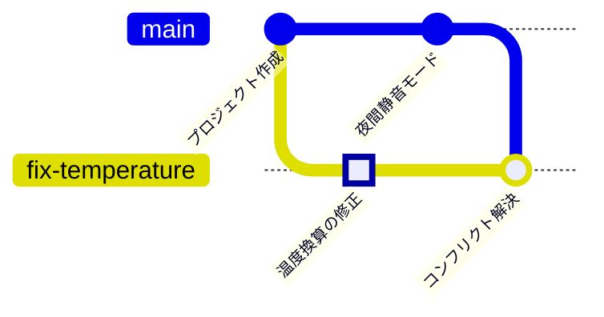

<!-- source: zh-TW/1-on-your-computer/05-merging-and-conflicts/README.md | sha: efb028ad41e5 -->

# 第 5 章　マージとコンフリクト：merge、rebase、コンフリクトの解決

> 📍 **プロジェクトと変更の現在地**
>
> - プロジェクト：夜間静音モードが完成し、`main` にマージされる
> - 前の段階：修正が `fix-temperature` ブランチで 1 つのコミットになった
> - **この章：`main` と修正が同じ行を変えていたので、修正のブランチでコンフリクトを解決する**
> - 次の段階：プロジェクトを GitHub にプッシュする

---

## マージとは

ブランチを使えば、2 つの仕事を別々の線で進められます。仕事が終わったら、線をつなぎ直す必要があります。これが **マージ（Merge）** です。

Git のマージには 2 つの場合があります。付箋を前に進めるだけで済む場合と、両側の変更を本当に 1 つにまとめなければならない場合です。

---

## いちばん簡単な場合：早送りマージ

夜間静音モードができたので、`main` にマージします。`night-mode` を作ってから、`main` には新しいコミットが 1 つもありません。つまり `night-mode` は「`main` が何歩か先に進んだもの」にすぎません。

この場合、Git は `main` の付箋を `night-mode` の位置まで進めるだけです。これを **早送り（Fast-forward）** といいます。

```bash
git switch main
git merge night-mode
git branch -d night-mode    # マージが終わったので、このブランチを削除する
```

```text
Updating 21e1fda..8303532
Fast-forward
 sensor.c | 2 +-
```

**Sourcetree では**：先に `main` に切り替え、左側の `night-mode` を右クリックして **Merge night-mode into current branch** を選びます。

ブランチを削除しても付箋をはがすだけで、コミットはすべて `main` の履歴に残っています。

---

## 両方の線が進んでいる：3-way マージ

次は、修正のブランチを `main` に追いつかせます。今回は事情が違います。修正のブランチには独自のコミットがあり、`main` にも夜間静音モードが加わりました。両方の線が先に進んでいます。

Git は 3 つのバージョンを比べます。それぞれの線の最新のバージョンと、2 本が分かれた点です。この分かれた点を **マージベース（Merge Base）** といいます。両側が違う場所を変えていれば、Git は自動でまとめ、「1 つ前」を 2 つ持つマージコミットを作ります。このやり方を **3-way マージ（Three-way Merge）** といいます。

> [!NOTE]
> **📖 用語｜マージ（合併）**
>
> - **定義**：ほかのブランチの変更をいまのブランチに取り込むこと。必要なときは、1 つ前のコミットを 2 つ持つマージコミットを作る。
> - **現場での使い方**：「これ main にマージした？」「先に main を自分のブランチにマージして」。
> - **関連用語**：早送り、マージコミット、マージベース、rebase
> - **よくある混同**：`git merge night-mode` は `night-mode` を「いまいるブランチ」に取り込むもので、逆ではない。マージの前に、自分がどのブランチにいるかを確かめる。

> [!TIP]
> **🔧 ノウハウ｜先に main を自分のブランチにマージし、自分のブランチでコンフリクトを解決する**
>
> - **状況**：自分のブランチの作業は終わったが、その間に `main` にも新しいコミットが増えている。
> - **やり方**：まず自分のブランチで `git merge main` を実行し、コンフリクトを解決してコードが正しく動くことを確かめてから、`main` にマージする。
> - **理由**：自分のブランチでコンフリクトを解決すれば、間違えても影響は自分だけで済む。`main` には統合済みのバージョンだけが入る。
> - **やらないとどうなる**：`main` で直接マージしてコンフリクトの解決を間違えると、`main` が壊れ、全員がプルしたコードが動かなくなる。
> - **関連する章**：[第 7 章　プルリクエストとコードレビュー](../../2-beyond-your-computer/07-pull-requests/README.md)

---

## コンフリクト：両側が同じ行を変えた

```bash
git switch fix-temperature
git merge main
```

```text
Auto-merging sensor.c
CONFLICT (content): Merge conflict in sensor.c
Automatic merge failed; fix conflicts and then commit the result.
```

2 本のブランチがどちらも `sensor.c` の `return` の行を変えたので、Git はどちらに従えばいいかわからず、止まってあなたに尋ねています。`sensor.c` を開くと、Git が挿入した **コンフリクトマーカー** があります。

```text
<<<<<<< HEAD
    return (mv - 500) / 10.0f;
=======
    return smooth((mv - 600) / 10.0f);
>>>>>>> main
```

`<<<<<<< HEAD` から `=======` まではいまのブランチのバージョン、`=======` から `>>>>>>> main` までは `main` のバージョンです。

**両側を理解する → 正しい内容にする → マーカーを消す → git add → git commit**

1. **両側を理解する**：上は修正（600 を 500 に変えた）、下は夜間静音モード（`smooth` を加えた）です。どちらも残す必要があります。
2. **正しい内容にする**：`return smooth((mv - 500) / 10.0f);`
3. **3 行のマーカーを消して** 保存します。
4. **git add**：このファイルのコンフリクトが解決したことを Git に伝えます。
5. **git commit**：マージを完了します。`--no-edit` は Git の既定のマージメッセージをそのまま使うという意味です。

```bash
git add sensor.c
git commit --no-edit
```

**Sourcetree では**：コンフリクトしたファイルは、File Status に警告アイコン付きで表示されます。右クリックして **Resolve Conflicts** を選ぶと、片方だけを使う（Resolve Using 'Mine' または 'Theirs'）か、マージツールを開くかを選べます。今回は両方を残すので、エディタで手作業で直してから、右クリックして **Resolve Conflicts → Mark Resolved** を選び、Commit します。


*図：警告アイコンの付いたコンフリクトしたファイルを右クリックする。① Resolve Conflicts のサブメニュー ② Resolve Using 'Mine'。いまのブランチのバージョンだけを使う ③ Resolve Using 'Theirs'。相手側のバージョンだけを使う ④ Mark Resolved。手作業で直したあと、解決済みとして印を付ける。*

> [!NOTE]
> **📖 用語｜コンフリクト（衝突）**
>
> - **定義**：2 本のブランチが同じ場所を変えていて、どちらを使うかを Git が自動で決められず、人の判断が必要な状態。
> - **現場での使い方**：「マージしたらコンフリクトした」「コンフリクトを解消して」。日本語では「競合」とも言う。
> - **関連用語**：コンフリクトマーカー、マージベース、`git merge --abort`
> - **よくある混同**：コンフリクトはエラーではなく、誰かが間違えたという意味でもない。2 人が同じ場所を変えたので、コードがわかる人が判断する必要があるだけである。

> [!TIP]
> **🔧 ノウハウ｜コンフリクトの解決は二者択一ではない**
>
> - **状況**：コンフリクトが起き、Sourcetree が「自分の方を使う」と「相手の方を使う」の 2 つのボタンを出している。
> - **やり方**：まず両側がそれぞれ何をしようとしたのかを理解し、両方を満たすバージョンを書く。自信がなければ、相手側を書いた人に聞く。
> - **理由**：コンフリクトの両側は、たいていどちらも意味のある変更で、たまたま同じ行に当たっただけである。
> - **やらないとどうなる**：「自分の方」を選ぶと夜間静音モードが黙って消え、「相手の方」を選ぶと直したはずのバグが戻ってくる。コードはそのままコンパイルできるので、問題はボードで動かすまで見つからない。
> - **関連する章**：[第 9 章　取り消しとやり直し](../../3-when-things-go-wrong/09-undoing-things/README.md)

マージが終わると、修正のブランチは修正と夜間静音モードの両方を持つようになります。



---

## もう 1 つのやり方：rebase

**リベース（Rebase）** も `main` に追いつくための方法です。マージコミットを作らず、自分のブランチのコミットを 1 つずつ、最新の `main` の先に付け直します。履歴は 1 本の直線になります。

| | merge | rebase |
|---|---|---|
| 履歴の形 | 分かれ道を残し、マージコミットが 1 つ増える | 1 本の直線 |
| 元のコミット | 変わらない | 新しいコミットになり、番号がすべて変わる |
| コンフリクト | 1 回で解決する | コミットごとに解決が必要になることがある |
| 向いている場面 | すでにほかの人と共有したブランチ | 自分しか使っていない、まだプッシュしていないブランチ |

**Sourcetree では**：`main` を右クリックして **Rebase current changes onto main** を選びます。

この本の練習では merge を使います。rebase は便利ですが、コミットを書き換えるので、ほかの人と共有済みのコミットを rebase してはいけません。理由は第 9 章で説明します。

<details>
<summary><strong>🔍 もっと詳しく｜3-way マージはどう判断するか</strong></summary>

Git はマージベース B、いまのブランチ O（ours）、相手のブランチ T（theirs）の 3 つのバージョンを、部分ごとに比べます。

| B と O | B と T | 結果 |
|---|---|---|
| 同じ | 同じ | 変えない |
| 違う | 同じ | O を使う |
| 同じ | 違う | T を使う |
| 違う | 違うが、両側が同じように変えた | 変えた内容を使う |
| 違う | 違い、両側の変え方も違う | コンフリクト |

だから片側だけが変えた場所は、Git が必ず自動で処理できます。`git merge-base main fix-temperature` を実行すると、マージベースがどのコミットかがわかります。

コミットと「1 つ前」のつながりは、有向非巡回グラフ（Directed Acyclic Graph、DAG）を作ります。どの辺も過去を向き、ぐるりと戻ってくることはありません。マージコミットは、辺が 2 本出ている点です。`git log --graph` が描いているのは、このグラフです。

</details>

---

## よくある問題

| 状況 | 原因 | 対処 |
|---|---|---|
| 見慣れないエディタの画面が出てきた | `--no-edit` を付けなかったので、Git がマージメッセージ用のエディタを開いた | ターミナルの中で動くエディタなら、多くの場合 Esc を押してから `:wq` と入力して Enter |
| 途中であきらめたい | — | `git merge --abort` でマージ前に戻る |
| コンパイルに失敗し、`<<<<<<<` が残っている | コンフリクトマーカーを消し忘れた | `<<<<<<<` を検索して直し、もう一度コミットする |

---

## 🧪 やってみよう

**始める前に**：第 4 章の練習用プロジェクトの続きから始めます。この章から始めたい場合は、この本のルートフォルダで `bash practice/setup.sh 5` を実行します。

1. 夜間静音モードを `main` に早送りマージし、そのブランチを削除します。

   ```bash
   cd ~/git-practice/fan-controller
   git switch main
   git merge night-mode
   git branch -d night-mode
   ```

2. 修正のブランチに切り替え、`main` をマージします。ここでコンフリクトが起きます。

   ```bash
   git switch fix-temperature
   git merge main
   ```

3. エディタで `sensor.c` を開き、コンフリクトマーカーとその間の 2 行を、次の 1 行に置き換えて保存します。

   ```c
       return smooth((mv - 500) / 10.0f);
   ```

4. 解決済みとして印を付け、マージを完了してから、`main` に戻って履歴を見ます。

   ```bash
   git add sensor.c
   git commit --no-edit
   git switch main
   git log --oneline --graph --all
   ```

**こうなれば成功**：手順 1 で `Fast-forward`、手順 2 で `CONFLICT` と表示されます。最後の履歴では、`fix-temperature` に `Merge branch 'main' into fix-temperature` があり、そこで 2 本の線がつながっています。

---

## 📋 この章のコマンド

| やりたいこと | コマンド | Sourcetree では |
|---|---|---|
| あるブランチをいまのブランチにマージする | `git merge <ブランチ>` | ブランチを右クリック → Merge … into current branch |
| マージ済みのブランチを削除する | `git branch -d <ブランチ>` | ブランチを右クリック → Delete |
| コンフリクトを解決済みにする | `git add <ファイル>` | ファイルを右クリック → Resolve Conflicts → Mark Resolved |
| 既定のメッセージでマージを完了する | `git commit --no-edit` | Commit |
| このマージをやめる | `git merge --abort` | — |
| ブランチを main の先に付け直す | `git rebase main` | main を右クリック → Rebase current changes onto main |

---

## この章のポイント

1. マージ先のブランチに新しいコミットがなければ、マージは付箋を前に進めるだけ。これを早送りという。
2. 両側が進んでいるときは、Git がマージベースと両側のバージョンを使って 3-way マージをする。同じ場所を変えたときだけコンフリクトになる。
3. コンフリクトの解決では、まず両側の意図を理解し、両方を満たすバージョンを書く。二者択一ではない。
4. 先に `main` を自分のブランチにマージしてコンフリクトを解決し、`main` には統合済みのバージョンだけを入れる。
5. rebase は履歴を 1 本の直線にするが、コミットを書き換える。共有済みのコミットを rebase してはいけない。

---

## 参考文献

- Scott Chacon、Ben Straub『[Pro Git](https://git-scm.com/book/ja/v2)』第 2 版、3.2 節（ブランチとマージの基本）と 3.6 節（リベース）
- Git 公式ドキュメント：[git-merge](https://git-scm.com/docs/git-merge)、[git-rebase](https://git-scm.com/docs/git-rebase)

---

[← 第 4 章　ブランチ](../04-branches/README.md) ｜ [目次](../../README.md) ｜ [第 6 章　リモートリポジトリ →](../../2-beyond-your-computer/06-remotes/README.md)
