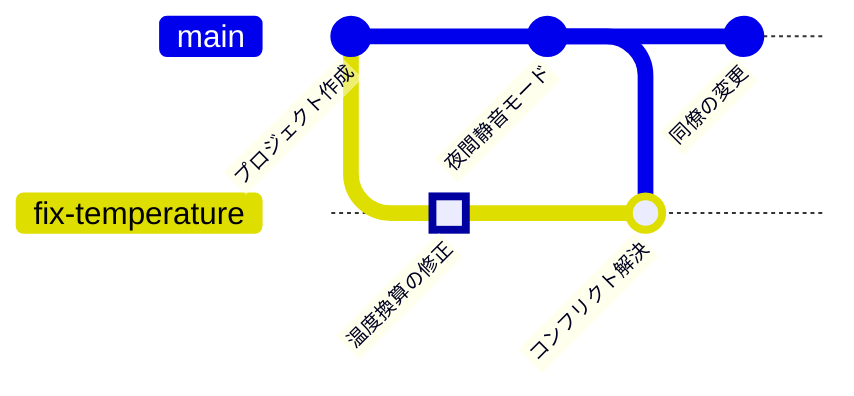

<!-- source: zh-TW/2-beyond-your-computer/06-remotes/README.md | sha: 80c96fea1cc8 -->

# 第 6 章　リモートリポジトリ：clone、fetch、pull、push

> 📍 **プロジェクトと変更の現在地**
>
> - プロジェクト：GitHub にプッシュし、同僚が clone して、同僚も変更を 1 つプッシュする
> - 前の段階：修正のブランチでコンフリクトを解決した
> - **この章：修正のブランチが GitHub にプッシュされる**
> - 次の段階：プルリクエストを作り、同僚にレビューを頼む

---

## リモートとは

これまで、履歴はすべてあなたのパソコンの中だけにありました。同僚が加わるには、みんながアクセスできる場所に、同じリポジトリのコピーを置く必要があります。このコピーを **リモートリポジトリ（Remote Repository）** といい、普通は GitHub に置きます。

みんなで使うクラウドのフォトアルバムだと考えてください。一人ひとりのスマートフォンにすべての写真があります（分散型）が、クラウドにあるものを正とすることにみんなで決めています。新しい写真を撮ったらアップロードし、ほかの人がアップロードした写真はダウンロードします。

| 操作 | コマンド | 向き |
|---|---|---|
| 初めてリポジトリを丸ごとコピーする | `git clone` | GitHub → 自分のパソコン |
| 自分のコミットを送る | `git push` | 自分のパソコン → GitHub |
| ほかの人のコミットを取ってくるが、ファイルは変えない | `git fetch` | GitHub → 自分のパソコン |
| 取ってきて、いまのブランチにマージする | `git pull` | GitHub → 自分のパソコン |

> [!NOTE]
> **📖 用語｜リモートと origin（遠端與 origin）**
>
> - **定義**：リモートは別の場所にある同じリポジトリで、普通は GitHub にある。`origin` は既定でそれに付けられる名前。
> - **現場での使い方**：「origin にプッシュして」「origin の main に新しいコミットが入ってるよ」。
> - **関連用語**：`git remote`、`origin/main`、clone、push
> - **よくある混同**：`origin` はただの名前で、コマンドではなく、GitHub を指すとも限らない。1 つのリポジトリが複数のリモートを持ち、それぞれ別の名前を付けることもできる。

---

## GitHub にリポジトリを作る

GitHub で **New repository** を押し、名前に `fan-controller` と入力して、Public か Private を選び、Create repository を押します。作成後のページに、`https://github.com/あなたのアカウント/fan-controller.git` のようなリポジトリの URL が表示されます。

> [!TIP]
> **🔧 ノウハウ｜履歴のあるプロジェクトをプッシュするなら、GitHub 側は空のリポジトリにする**
>
> - **状況**：GitHub でリポジトリを作るとき、README、.gitignore、ライセンスを一緒に追加するオプションが目に入る。
> - **やり方**：プロジェクトにはもうパソコン上のコミットがあるので、これらには一切チェックを入れず、空のリポジトリを作る。
> - **理由**：チェックを入れると、GitHub 側に独自のコミットが先にでき、パソコンの履歴とはまったく無関係になる。
> - **やらないとどうなる**：最初のプッシュで拒否される。初心者はここで強制プッシュして無理やり上書きしたり、どんどんややこしくしたりしがちである。
> - **関連する章**：[第 10 章　よい習慣](../../3-when-things-go-wrong/10-good-habits/README.md)

---

## リモートにつないでプッシュする：git remote add、git push

```bash
git remote add origin https://github.com/あなたのアカウント/fan-controller.git
git push -u origin main
git push -u origin fix-temperature
```

- `git remote add` は、この URL に `origin` という名前を付けます。
- `-u` を付けると、手元のブランチが「origin のどのブランチに対応しているか」を覚えます。以降、そのブランチでは `git push` と打つだけで済みます。

**Sourcetree では**：**ツールバーの Settings → Remotes → Add**（macOS 版はメニューの **Repository → Repository Settings**）で、名前に `origin` と入力し、URL を貼り付けます。そのあとツールバーの **Push** を押し、プッシュするブランチと Track の列にチェックを入れます。

**自分であることを証明する**：初めてプッシュするとき、GitHub は本人確認をします。パスワード欄に GitHub のログインパスワードを入力することは **できません**。よく使う方法は 3 つあります。

- ブラウザで許可する。Windows 版の Git にはこの機能が付いていて、自動でブラウザが開きます。
- GitHub の開発者設定で個人用アクセストークン（Personal Access Token）を作り、パスワード欄に貼り付ける。作るときは Repository access でこのリポジトリを選び、Permissions の Contents を Read and write にします（classic トークンなら `repo` にチェック）。そうしないとプッシュが拒否されます。
- SSH キーを設定し、`git@github.com:` で始まる URL を使う。すでに `origin` を追加しているなら、`git remote set-url origin git@github.com:あなたのアカウント/fan-controller.git` で URL を差し替えます。

第 1 章で GitHub アカウントを接続した Sourcetree の利用者は、ほかに何もする必要はありません。

---

## clone：同僚がプロジェクトをコピーする

同僚が加わったら、最初にすることはリポジトリ全体を自分のパソコンにコピーすることです。

```bash
git clone https://github.com/あなたのアカウント/fan-controller.git
```

**Sourcetree では**：新しいタブの **Clone**（macOS 版は **New → Clone from URL**）で URL を貼り付け、置く場所のフォルダを選びます。

clone すると完全な履歴が手に入り、コピー元が自動で `origin` に設定されます。

---

## fetch と pull：ほかの人の変更を取ってくる

同僚がファンの PWM 周波数（ファンを動かすオン・オフの信号が 1 秒間に切り替わる回数）を 1 kHz から 25 kHz に上げ、モーターの音を人の耳に聞こえない範囲に移して、`main` にプッシュしました。いま、GitHub の `main` にはあなたのものより 1 つ多くコミットがあります。



**fetch** は郵便を受け取るようなものです。新しいコミットをダウンロードするだけで、まだ開封しないので、ファイルはまったく変わりません。**pull** は郵便を受け取って、その内容に従うことです。fetch のあと、すぐにいまのブランチへマージします。

```bash
git fetch
git status
```

fetch すると、パソコンにある `origin/main` という付箋が更新されます。これは「最後に連絡したとき、GitHub の `main` がどこにあったか」を記録したものです。`git status` は、あなたの `main` をこれと比べています。

```text
On branch main
Your branch is behind 'origin/main' by 1 commit, and can be fast-forwarded.
```

内容に問題がなければ、取り込んでマージします。

```bash
git pull
```

**Sourcetree では**：ツールバーの **Fetch** と **Pull**。fetch すると、左側のブランチ名の横に下向きの矢印と数字が出て、取り込める新しいコミットの数を示します。

> [!NOTE]
> **📖 用語｜fetch と pull**
>
> - **定義**：fetch はリモートの新しいコミットをダウンロードするだけ。pull は fetch したあと、いまのブランチにマージする。
> - **現場での使い方**：「作業を始める前に pull して」「まず fetch して、ほかの人が何をプッシュしたか見てみて」。
> - **関連用語**：`origin/main`、merge、push
> - **よくある混同**：pull はファイルを変え、コンフリクトを起こすこともあるが、fetch は変えない。迷ったら、まず fetch する。

> [!TIP]
> **🔧 ノウハウ｜プッシュを拒否されたら、強制プッシュせずに先に pull する**
>
> - **状況**：同僚が先に新しいコミットをプッシュしていたので、`git push` が `rejected` と `fetch first` を表示した。
> - **やり方**：先に `git pull` し、コンフリクトがあれば第 5 章のとおり解決して、コードが動くのを確かめてからプッシュする。
> - **理由**：リモートには自分の持っていないコミットがあり、Git はそれを黙って上書きすることを許さない。
> - **やらないとどうなる**：`git push --force` で押し切ると、GitHub にあった同僚のコミットが自分のバージョンで上書きされる。同僚が次に pull したとき、履歴がまったく合わなくなる。
> - **関連する章**：[第 9 章　取り消しとやり直し](../../3-when-things-go-wrong/09-undoing-things/README.md)

<details>
<summary><strong>🔍 もっと詳しく｜origin/main とは何か</strong></summary>

`origin/main` は **リモート追跡ブランチ** と呼ばれます。パソコン上で「最後に連絡したとき、origin の main がどこにあったか」を記録している付箋で、`.git/refs/remotes/origin/main` に保存されています。

更新されるのは fetch、pull、push のときだけです。だから `git status` が behind by 1 commit と言うとき、比べているのはあなたの `main` とこの付箋であって、リアルタイムの GitHub ではありません。長い間 fetch していなければ、古いままです。

```text
$ git branch -vv
  fix-temperature 28dd820 [origin/fix-temperature] Merge branch 'main' into fix-temperature
* main            c67c821 [origin/main] Raise fan PWM frequency to 25 kHz
```

角かっこの中が、それぞれのブランチに対応するリモート追跡ブランチです。この対応は `push -u` が設定したもので、`.git/config` に記録されています。`git log main..origin/main` を使うと、リモートにはあって自分にはないコミットを一覧できます。

</details>

---

## よくある問題

| 状況 | 原因 | 対処 |
|---|---|---|
| `Authentication failed` | パスワード欄に GitHub のログインパスワードを入れた | ブラウザでの許可、個人用アクセストークン、SSH のいずれかに切り替える |
| `Need to specify how to reconcile divergent branches` | 両側に新しいコミットがあり、pull で merge と rebase のどちらを使うかを Git が尋ねている | `git config --global pull.rebase false` で merge を使うようにして、もう一度 pull する |
| `remote origin already exists` | すでに `origin` を追加している | `git remote -v` で URL を確かめる |

---

## 🧪 やってみよう

**始める前に**：GitHub のアカウントが必要です。第 5 章の練習用プロジェクトの続きから始めます。この章から始めたい場合は、この本のルートフォルダで `bash practice/setup.sh 6` を実行します。

1. GitHub に空のリポジトリ `fan-controller` を作ります。既定のファイルには何もチェックを入れず、URL をコピーします。
2. リモートにつなぎ、2 本のブランチをプッシュします（URL は自分のものに置き換えてください）。

   ```bash
   cd ~/git-practice/fan-controller
   git remote add origin https://github.com/あなたのアカウント/fan-controller.git
   git push -u origin main
   git push -u origin fix-temperature
   ```

3. 同僚の役をします。GitHub の Web ページで `main` ブランチの `fan.c` を開き、編集（鉛筆のアイコン）を押して、`FAN_PWM_HZ       1000` を `25000` に変えます。コミットメッセージは `Raise fan PWM frequency to 25 kHz` とし、`main` に直接コミットすることを選びます。
4. パソコンに戻り、まず fetch して様子を見てから pull します。

   ```bash
   git switch main
   git fetch
   git status
   git pull
   git log --oneline --graph --all
   ```

5. 同僚の立場も体験したければ、別のフォルダに clone します：`git clone あなたの URL ~/git-practice/colleague`

**こうなれば成功**：fetch のあと、`git status` に `behind 'origin/main' by 1 commit` と表示されます。pull のあとは `Fast-forward` と表示され、`main` のいちばん上は `Raise fan PWM frequency to 25 kHz` です。GitHub では `main` と `fix-temperature` の 2 本のブランチが見えます。

---

## 📋 この章のコマンド

| やりたいこと | コマンド | Sourcetree では |
|---|---|---|
| リモートを追加する | `git remote add origin <URL>` | Settings → Remotes → Add |
| リモートを確認する | `git remote -v` | Settings → Remotes |
| ブランチを初めてプッシュする | `git push -u origin <ブランチ>` | Push で、ブランチと Track にチェック |
| プッシュする | `git push` | Push |
| リポジトリを丸ごとコピーする | `git clone <URL>` | 新しいタブの Clone |
| ダウンロードだけして、ファイルは変えない | `git fetch` | Fetch |
| ダウンロードしてマージする | `git pull` | Pull |
| リモートにあって自分にないコミットを一覧する | `git log main..origin/main` | — |

---

## この章のポイント

1. リモートは別の場所にある同じリポジトリで、既定の名前は `origin`。みんなでこれを正とすることに決めている。
2. push は送る、clone は初めてのコピー、fetch はダウンロードだけ、pull はダウンロードしてマージする。
3. GitHub にプッシュするときは、ログインパスワードではなく、ブラウザでの許可、個人用アクセストークン、SSH のいずれかで本人であることを示す。
4. プッシュを拒否されたら、pull してからプッシュする。強制プッシュはしない。

---

## 参考文献

- Scott Chacon、Ben Straub『[Pro Git](https://git-scm.com/book/ja/v2)』第 2 版、2.5 節（リモートでの作業）と 3.5 節（リモートブランチ）
- GitHub Docs：[リモートリポジトリについて](https://docs.github.com/ja/get-started/getting-started-with-git/about-remote-repositories)

---

[← 第 5 章　マージとコンフリクト](../../1-on-your-computer/05-merging-and-conflicts/README.md) ｜ [目次](../../README.md) ｜ [第 7 章　プルリクエストとコードレビュー →](../07-pull-requests/README.md)
