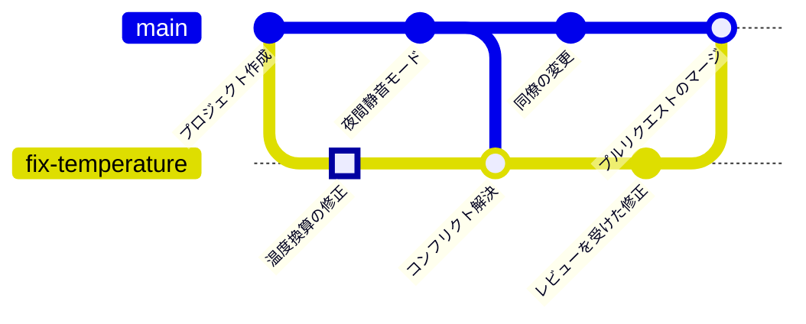

<!-- source: zh-TW/2-beyond-your-computer/07-pull-requests/README.md | sha: 7e5348fffdf0 -->

# 第 7 章　プルリクエストとコードレビュー：PR の作成、レビュー、マージ

> 📍 **プロジェクトと変更の現在地**
>
> - プロジェクト：チームで「main に直接プッシュしない」と決め、すべての変更をプルリクエスト経由にする
> - 前の段階：修正のブランチを GitHub にプッシュした
> - **この章：プルリクエストを作り、レビューを受けてもう 1 回直し、`main` にマージする**
> - 次の段階：プロジェクトと一緒に v1.0.0 としてリリースされる

---

## なぜ main に直接プッシュしないのか

1 人で開発しているときは、できたら `main` にプッシュするのが自然です。チームが大きくなると、`main` はみんなが使うもので、壊れれば全員の手が止まります。そこでチームは決まりを作ります。**変更はすべてまず自分のブランチに置き、ほかの人に見てもらってから `main` に入れる**。

もう 1 人の目があれば、自分では気づけない誤りが見つかります。議論の記録も残るので、何か月たっても「なぜこう変えたのか」を調べられます。

---

## プルリクエストとは

**プルリクエスト（Pull Request）**（略して PR とも）は、GitHub 上で出す「私のブランチを `main` にマージしてください」というお願いです。1 本のブランチの変更が、1 つのページにまとまります。

- **差分**：このブランチで、どのファイルのどの行を変えたか。
- **議論**：レビューする人が、行ごとにコメントできる。
- **チェック**：自動で実行したビルドやテストの結果。
- **マージボタン**：条件がそろえば、押すだけでマージできる。

> [!NOTE]
> **📖 用語｜プルリクエスト、PR（Pull Request）**
>
> - **定義**：ホスティングサービス上で出すマージの依頼。差分、議論、自動チェックがそろっていて、レビューを通ってからマージされる。
> - **現場での使い方**：「PR を出したのでレビューお願いします」「この PR にはまだ対応していないコメントが 2 つある」。
> - **関連用語**：コードレビュー、ブランチ保護、merge
> - **よくある混同**：プルリクエストは GitHub のようなサービスの機能で、Git そのもののコマンドではない。同じものをマージリクエストと呼ぶサービスもある。

---

## プルリクエストを作る

**ブランチを選ぶ → タイトルと説明を書く → 作成する**

1. **ブランチを選ぶ**：GitHub のリポジトリのページで **Pull requests → New pull request** を開きます。base には `main`（マージ先）、compare には `fix-temperature`（自分のブランチ）を選びます。プッシュしたばかりのブランチなら、ページの上に **Compare & pull request** ボタンも出ます。
2. **タイトルと説明を書く**：タイトルにはこの PR が何をするのかを、説明にはなぜ変えたのかと、どう確かめたのかを書きます。
3. **作成する**：**Create pull request** を押します。

**Sourcetree では**：左側のブランチを右クリックして **Create Pull Request** を選ぶと、Sourcetree がブラウザで GitHub のページを開きます。


*図：① base。マージ先のブランチ（`main`） ② compare。自分のブランチ（`fix-temperature`）。横の緑の点は自動でマージできることを示す ③ タイトル ④ 説明 ⑤ Create pull request ボタン。*

> [!TIP]
> **🔧 ノウハウ｜PR の説明には「なぜ」と「どう確かめたか」を書く**
>
> - **状況**：コードはもう直したし、差分を見ればわかるだろうと、説明欄を空にしている。
> - **やり方**：何の問題を解決するのか、なぜこう変えたのか、正しいことをどう確かめたのかを書く。たとえば「ボードを 50 °C まで温め、ファンが正しく回り始めることを確認した」。
> - **理由**：レビューする人には、何を変えたかは見えても、なぜ変えたかは見えない。
> - **やらないとどうなる**：レビューする人は推測するしかなく、何往復も質問することになる。半年後に元に戻したい人がいても、当時の理由が見つからない。
> - **関連する章**：[第 10 章　よい習慣](../../3-when-things-go-wrong/10-good-habits/README.md)

---

## コードレビュー：コメントと修正

**コードレビュー（Code Review）** とは、同僚に自分の変更を読んでもらうことです。PR の **Files changed** タブで、レビューする人は行の横の **+** を押してコメントし、最後に次のどれかを選びます。

| 選択肢 | 意味 |
|---|---|
| Comment | コメントだけで、結論はない |
| Approve | 確認した。マージしてよい |
| Request changes | 先にここを直してほしい |

今回、同僚から「`500` と `10` は何？ 名前の付いた定数にしてください」とコメントが来ました。新しい PR を作る必要はありません。同じブランチで直して、コミットして、プッシュすれば、PR は自動で更新されます。

```bash
git switch fix-temperature
# 500 と 10 を SENSOR_OFFSET_MV と SENSOR_MV_PER_C に変える
git commit -am "Use named constants for sensor conversion"
git push
```

> [!TIP]
> **🔧 ノウハウ｜PR は小さく。1 つの PR では 1 つのことだけをする**
>
> - **状況**：1 週間分の変更をためて、千行を超える PR を 1 つ出す。
> - **やり方**：小さな PR に分け、それぞれが 1 つのことだけを解決するようにする。できれば数百行以内にする。
> - **理由**：レビューの集中力には限りがある。10 行の PR は 1 行ずつ読まれるが、千行の PR はざっと眺められるだけになる。
> - **やらないとどうなる**：レビューする人は「問題なさそう」とだけ返して承認し、本物のバグが大量の変更と一緒に `main` に紛れ込む。
> - **関連する章**：[第 3 章　コミットの正体](../../1-on-your-computer/03-commits/README.md)

---

## 自動チェックとブランチ保護

プッシュするたびに、GitHub はファームウェアのビルド、テストの実行、コードスタイルの確認といった一連のチェックを自動で実行できます。これを **継続的インテグレーション（Continuous Integration、CI）** といいます。GitHub にはこの自動化の機能が組み込まれていて、結果は PR に直接表示されます。

さらに **ブランチ保護（Branch Protection）** を組み合わせると、`main` にルールを守らせることができます。

- 直接プッシュは禁止で、PR からしかマージできない。
- 少なくとも 1 人の Approve が必要。
- 自動チェックがすべて通っている必要がある。

従来のブランチ保護は、リポジトリの **Settings → Branches** で設定します。複数のルールを重ねられる新しい機能もあり、Rulesets といいます。**Settings → Rules → Rulesets** で設定します。設定しておけば、誰かがルールを忘れても GitHub が止めてくれます。2020 年代半ばの時点では、無料アカウントでこれらのルールを使えるのは公開リポジトリだけです。

> [!NOTE]
> **📖 用語｜ブランチ保護（分支保護）**
>
> - **定義**：ホスティングサービス上で、あるブランチに設定するルール。直接プッシュの禁止、レビューと自動チェックの合格の必須化など。
> - **現場での使い方**：「main は保護されているから直接プッシュできないよ。PR を出して」。
> - **関連用語**：プルリクエスト、CI、Approve、Rulesets
> - **よくある混同**：ブランチ保護は GitHub の機能で、GitHub へのプッシュにしか効かない。自分のパソコンの `main` には普通にコミットでき、ただプッシュできないだけである。

---

## プルリクエストをマージする

レビューで承認され、チェックもすべて通ったら、**Merge pull request** を押せます。ボタンの横の矢印から、3 つのマージ方法を選べます。

| 方法 | 履歴の形 | 向いている場面 |
|---|---|---|
| Create a merge commit | ブランチのコミットをすべて残し、マージコミットを 1 つ加える | 開発の過程をすべて残したい |
| Squash and merge | ブランチのコミットを 1 つにまとめて `main` につなぐ | ブランチに細かいコミットがたくさんある |
| Rebase and merge | ブランチのコミットを 1 つずつ `main` につなぐ。マージコミットはない | 1 本の直線の履歴にしたい |

チームではたいてい 1 つに決めて、ルールに書いておきます。この本では Create a merge commit を使います。マージ後の履歴は次のとおりです。



マージすると、PR のページに **Delete branch** ボタンが出て、GitHub 上のブランチを削除できます。パソコンに戻ったら、`main` を最新にし、手元のブランチを片づけます。

```bash
git switch main
git pull
git branch -d fix-temperature
git fetch --prune    # GitHub で削除されたブランチのリモート追跡ブランチを片づける
```

<details>
<summary><strong>🔍 もっと詳しく｜プルリクエストは Git の機能ではない</strong></summary>

Git そのものにはプルリクエストがありません。その原型は Git に組み込まれた `git request-pull` コマンドで、「私のリポジトリのこのブランチにこういう変更があるので、取り込んでください」という文面を作り、メールでメンテナーに送るものでした。名前の「pull」もここから来ています。相手にあなたの変更を pull してもらうのです。

GitHub はこの流れを Web ページにし、PR ごとにリポジトリの中に `refs/pull/1/head` のような特別な参照を残しています。だからレビューする人は、どの PR でも自分のパソコンに取ってきてテストできます。

```bash
git fetch origin pull/1/head:pr-1
git switch pr-1
```

3 つのマージ方法の違いも、前の 2 章の考え方で理解できます。Create a merge commit は第 5 章の 3-way マージ、Rebase and merge は第 5 章の rebase なので、コミットの番号が変わります。Squash は、すべての変更をまったく新しい 1 つのコミットにまとめるものです。

</details>

---

## よくある問題

| 状況 | 原因 | 対処 |
|---|---|---|
| PR に This branch has conflicts と表示される | その間に `main` で同じ場所が変更された | 第 5 章のとおり自分のブランチで `git merge main` し、解決してからプッシュする |
| 自分の PR を Approve できない | GitHub では作者が自分の PR を承認できない | 同僚にレビューを頼む。自分はコメントしかできない |
| マージボタンがグレーになっている | ブランチ保護の条件がまだそろっていない | ボタンの上に、足りないものが表示されている |

---

## 🧪 やってみよう

**始める前に**：第 6 章の練習用プロジェクトの続きから始めます。この章から始めたい場合は、この本のルートフォルダで `bash practice/setup.sh 7` を実行してから、第 6 章の「やってみよう」の手順 1、2 に従って自分の GitHub リポジトリにプッシュします。

1. GitHub で PR を作ります。base は `main`、compare は `fix-temperature`、タイトルは `Fix temperature sensor offset` とし、説明にはなぜ変えるのかを書きます。
2. レビューする同僚の役をします。**Files changed** タブで `return` の行の横の **+** を押し、名前の付いた定数を使うようにコメントします。自分の PR なので、Comment しか選べません。
3. パソコンに戻り、`sensor.c` を次のように変えてから、コミットしてプッシュします。

   ```c
   #include "board.h"
   #include "filter.h"
   #include "sensor.h"

   #define SENSOR_OFFSET_MV  500   /* output at 0 °C */
   #define SENSOR_MV_PER_C   10    /* change per °C */

   /* Analog temperature sensor: 500 mV at 0 °C, plus 10 mV per °C. */
   float sensor_read_celsius(void)
   {
       int mv = adc_read_mv();
       return smooth((mv - SENSOR_OFFSET_MV) / (float)SENSOR_MV_PER_C);
   }
   ```

   ```bash
   cd ~/git-practice/fan-controller
   git switch fix-temperature
   git commit -am "Use named constants for sensor conversion"
   git push
   ```

4. PR のページに戻り、コミットが 1 つ増えたことを確かめます。**Merge pull request → Confirm merge** を押し、続けて **Delete branch** を押します。
5. パソコンの `main` を更新し、手元のブランチを片づけます。

   ```bash
   git switch main
   git pull
   git branch -d fix-temperature
   git fetch --prune
   git log --oneline --graph -6
   ```

**こうなれば成功**：`main` の最新のコミットが `Merge pull request #1 from あなたのアカウント/fix-temperature` になり、`main` の `sensor.c` が `SENSOR_OFFSET_MV` を使っています。`git branch` には `main` だけが残ります。

---

## 📋 この章のコマンド

| やりたいこと | コマンド | Sourcetree では |
|---|---|---|
| プルリクエストを作る | —（GitHub の Web ページで） | ブランチを右クリック → Create Pull Request |
| レビューを受けて直し、PR を更新する | `git commit`、`git push` | Commit → Push |
| マージ後に main を更新する | `git switch main`、`git pull` | main をダブルクリック → Pull |
| マージ済みの手元のブランチを削除する | `git branch -d <ブランチ>` | ブランチを右クリック → Delete |
| 削除されたリモートブランチを片づける | `git fetch --prune` | Fetch で Prune にチェック |
| ほかの人の PR を取ってきてテストする | `git fetch origin pull/<番号>/head:<名前>` | — |

---

## この章のポイント

1. チームはプルリクエストを使い、すべての変更をまずレビューに通す。`main` には誰かが見たコードだけが入る。
2. PR の説明には、なぜ変えたのかとどう確かめたのかを書く。PR は小さく、1 つの PR では 1 つのことだけをする。
3. レビューを受けて直すときは、同じブランチでコミットしてプッシュすれば、PR が自動で更新される。
4. 継続的インテグレーションがプッシュのたびに自動でチェックし、ブランチ保護でルールを GitHub に守らせる。
5. マージ方法は 3 つあり、チームで 1 つに決める。マージしたらブランチを削除し、手元の `main` を更新する。

---

## 参考文献

- Scott Chacon、Ben Straub『[Pro Git](https://git-scm.com/book/ja/v2)』第 2 版、6.2 節（プロジェクトへの貢献）
- GitHub Docs：[プルリクエストについて](https://docs.github.com/ja/pull-requests/collaborating-with-pull-requests/proposing-changes-to-your-work-with-pull-requests/about-pull-requests)、[保護されたブランチについて](https://docs.github.com/ja/repositories/configuring-branches-and-merges-in-your-repository/managing-protected-branches/about-protected-branches)

---

[← 第 6 章　リモートリポジトリ](../06-remotes/README.md) ｜ [目次](../../README.md) ｜ [第 8 章　ブランチ戦略とリリース →](../08-branching-and-releases/README.md)
