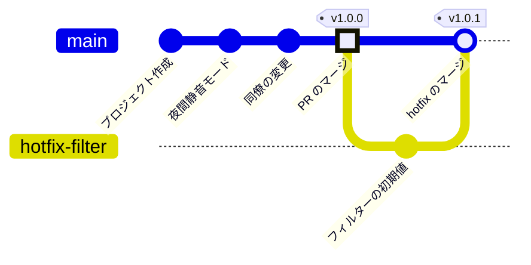

<!-- source: zh-TW/2-beyond-your-computer/08-branching-and-releases/README.md | sha: 02131aaadcc7 -->

# 第 8 章　ブランチ戦略とリリース：tag、release、トランクベース開発

> 📍 **プロジェクトと変更の現在地**
>
> - プロジェクト：最初の正式バージョン v1.0.0 をリリースし、そのあと起動時の問題を緊急に直して v1.0.1 をリリースする
> - 前の段階：修正がプルリクエストを通じて `main` にマージされた
> - **この章：修正が v1.0.0 の一部になる**
> - 次の段階：誰かが reset でコミットを失う

---

## なぜバージョン番号が必要か

ファームウェアを出荷すると、時期の違うプログラムを積んだボードが何ロットも出回ります。サポートが問題の連絡を受けたら、最初に聞くのは「ファームウェアのバージョンは？」です。

コミットの番号は正確ですが、16 進数の文字列は読み上げにくく、前後関係もわかりません。そこでチームは、リリースするコミットに人が読める名前を付けます。たとえば `v1.0.0` です。

---

## セマンティックバージョニング

いちばんよく使われるバージョン番号の形式は **セマンティックバージョニング（Semantic Versioning）** と呼ばれ、**メジャー.マイナー.パッチ** の 3 つの数字で書きます。

| どの数字を上げるか | いつ | 例 |
|---|---|---|
| メジャー | 変えたあと、以前の使い方が通用しなくなる | 通信プロトコルが変わり、以前の PC 用設定ソフトが使えなくなった |
| マイナー | 機能を追加したが、以前の使い方もそのまま使える | 夜間静音モードを追加した |
| パッチ | バグを直しただけで、機能は追加していない | 温度換算を直した |

前の数字を上げたら、後ろの数字は 0 に戻します。たとえば `1.4.2` に新機能を加えると `1.5.0` になります。

> [!NOTE]
> **📖 用語｜セマンティックバージョニング、SemVer（語意化版本）**
>
> - **定義**：「メジャー.マイナー.パッチ」の 3 つの数字で、変更の大きさを表すバージョン番号の規則。
> - **現場での使い方**：「バグ修正だけだから、パッチを 1 つ上げればいい」「設定の形式を変えて互換性がなくなったから、メジャーを上げないと」。
> - **関連用語**：タグ、リリース、hotfix
> - **よくある混同**：バージョン番号は小数ではない。3 つの数字を別々に比べるので、`1.10.0` は `1.9.0` より新しい。

---

## タグ：コミットに貼る動かないラベル

**タグ（Tag）** は、ブランチと同じく、あるコミットを指す名前です。違いは、ブランチがコミットに合わせて前に進むのに対し、タグは一度貼ったら動かないことです。

```bash
git switch main
git tag -a v1.0.0 -m "Version 1.0.0"
git tag                      # すべてのタグを一覧表示する
git push origin v1.0.0       # タグは別にプッシュする必要がある
```

`-a` を付けると注釈付きタグになり、誰が、いつ、なぜ付けたのかが記録されます。正式なリリースには必ず注釈付きタグを使ってください。

**Sourcetree では**：**ツールバーの Tag → 名前を入力 → Push tag にチェック → Add**。

> [!NOTE]
> **📖 用語｜タグ（標籤）**
>
> - **定義**：あるコミットに貼る、動かない名前。普通はリリースしたバージョンを示すのに使う。
> - **現場での使い方**：「v1.0.0 のタグは打った？」「v1.0.0 のタグから hotfix のブランチを切って」。
> - **関連用語**：ブランチ、リリース、セマンティックバージョニング、`git describe`
> - **よくある混同**：タグはブランチではなく、`git switch v1.0.0` は拒否される。古いバージョンを変更したいときは、`git switch -c <ブランチ> v1.0.0` でタグからブランチを作る。

> [!TIP]
> **🔧 ノウハウ｜タグは git push で自動的には送られない**
>
> - **状況**：パソコンで `v1.0.0` を付け、`git push` したので、リリースは終わったと思っている。
> - **やり方**：`git push origin v1.0.0` でこのタグをプッシュする。`git push --follow-tags` で、注釈付きタグをまとめてプッシュすることもできる。
> - **理由**：`git push` が既定で送るのはブランチだけで、タグは別に指定する必要がある。
> - **やらないとどうなる**：同僚にも自動ビルドにも GitHub にも `v1.0.0` が見えず、みんなはまだリリースされていないと思い、自分はもうリリースしたと思っている。
> - **関連する章**：[第 6 章　リモートリポジトリ](../06-remotes/README.md)

---

## GitHub のリリース

GitHub の **Releases → Draft a new release** でタグを選ぶと、リリースのページを作れます。

- **リリースノート**：このバージョンで何が変わったか。Generate release notes を押すと、マージ済みの PR をもとに GitHub が下書きを作ってくれます。
- **添付ファイル**：ビルドしたファームウェア `fan.bin` をドラッグして追加します。利用者は自分でビルドせず、ここからダウンロードできます。

> [!TIP]
> **🔧 ノウハウ｜ファームウェアのバイナリはリリースに添付し、リポジトリにはコミットしない**
>
> - **状況**：テスト担当の同僚にビルドした `fan.bin` を渡したいので、ついでにコミットしてしまう。
> - **やり方**：リポジトリにはソースコードだけを置く。ビルドしたファイルはリリースに添付するか、自動ビルドで作らせる。
> - **理由**：バイナリはビルドのたびに丸ごと変わるので、Git は差分を効率よく保存できない。
> - **やらないとどうなる**：リリースのたびにファイル 1 つ分がリポジトリに永久に増え、何年かたつと clone に何分もかかる。ソースとバイナリの対応も崩れ、どの `.bin` がどのコードからできたのか誰にもわからなくなる。
> - **関連する章**：[第 10 章　よい習慣](../../3-when-things-go-wrong/10-good-habits/README.md)

---

## ブランチ戦略

チームでは、どんなブランチを置き、それぞれを何に使い、いつマージするかを決めておく必要があります。よく使われるのは次の 2 つです。

| | トランクベース開発（Trunk-Based Development） | Git Flow |
|---|---|---|
| 長く残るブランチ | `main` だけ | `main`、`develop`、それに release と hotfix のブランチ |
| 機能ブランチ | とても短く、1、2 日で `main` にマージする | `develop` から作り、終わったら `develop` にマージする |
| リリースの方法 | `main` でタグを付ける | `develop` から release ブランチを作り、仕上げてから `main` にマージしてタグを付ける |
| 向いている場面 | 小さなチーム、継続的なリリース、自動チェックがある | 決まった日程でのリリース、複数のバージョンの同時保守 |

この本のプロジェクトはトランクベース開発を使います。`main` と短命の機能ブランチだけで、リリースのときにタグを付けます。始めたばかりのチームは、このいちばん単純なやり方から始め、本当に必要になってからブランチを増やせば十分です。Sourcetree のツールバーにある Git-flow ボタン（macOS 版は Git Flow）を使うと、Git Flow に必要なブランチを一度に作れます。

---

## 緊急の修正：hotfix

v1.0.0 を出荷したあと、現場から報告が来ました。ボードを起動してから 30 秒ほど、ファンの反応が遅いというのです。原因は、夜間静音モードの平均値が 0 °C から計算を始めるので、実際の温度に追いつくまでしばらくかかることでした。

すぐに直すべき問題は、リリースしたタグから **hotfix** ブランチを作り、その問題だけを直します。

```bash
git switch -c hotfix-filter v1.0.0
# filter.c の初期値を 0.0f から室温の 25.0f に変える
git commit -am "Start temperature filter at room temperature"
git switch main
git merge --no-ff hotfix-filter -m "Merge branch 'hotfix-filter'"
git tag -a v1.0.1 -m "Version 1.0.1"
```

`--no-ff` は、早送りできる場合でも必ずマージコミットを作るよう Git に指示します。こうすると、「ここで hotfix をマージした」ことが履歴ではっきりわかります。チームでブランチ保護を使っているなら、この手順はプルリクエストに置き換えます。



この図は簡潔にするため、第 7 章の修正のブランチを「PR のマージ」の点にまとめています。

<details>
<summary><strong>🔍 もっと詳しく｜注釈付きタグと git describe</strong></summary>

タグには 2 種類あり、どちらも `.git/refs/tags/` に保存されます。**軽量タグ**（`-a` なし）はコミットを直接指します。**注釈付きタグ** は独立した tag オブジェクトを指し、そこに付けた人、日時、メッセージが入っていて、そのオブジェクトがコミットを指します。

```text
$ git cat-file -t v1.0.0
tag
```

`git describe` は、いちばん近いタグを探し、そこから何コミット離れているかを示します。

```text
$ git describe
v1.0.1-1-g86f7e81
```

「`v1.0.1` のあとにコミットが 1 つ増え、いまは `86f7e81` にいる」という意味です（`g` は Git を表します）。ちょうどタグの上にいるときは `v1.0.1` だけが表示されます。多くのチームはビルドのときにこの文字列をファームウェアに書き込み、起動時に表示させています。第 3 章の「問題を報告するときはコミットの番号を添える」が自動で実現できるわけです。`--dirty` を付けると、コミットしていない変更があるときに `-dirty` が付き、このファームウェアがきれいなコードからビルドされていないことを知らせてくれます。

</details>

---

## よくある問題

| 状況 | 原因 | 対処 |
|---|---|---|
| `tag 'v1.0.0' already exists` | 同じ名前のタグがすでにある | 別のバージョン番号にする。プッシュ済みのタグは変えない |
| `git describe` が `fatal` になる | 注釈付きタグがない。既定では注釈付きタグしか見ない | 先に注釈付きタグを付けるか、`--tags` を付けて軽量タグも探す |

---

## 🧪 やってみよう

**始める前に**：第 7 章の練習用プロジェクトの続きから始めます。この章から始めたい場合は、この本のルートフォルダで `bash practice/setup.sh 8` を実行します。GitHub にプッシュしていない場合は、`git push` と GitHub の手順をすべて飛ばしてください。

1. `main` で `v1.0.0` を付け、プッシュします。

   ```bash
   cd ~/git-practice/fan-controller
   git switch main
   git tag -a v1.0.0 -m "Version 1.0.0"
   git push origin v1.0.0
   ```

2. GitHub の **Releases → Draft a new release** で `v1.0.0` を選び、Generate release notes を押してから Publish release を押します。
3. タグから hotfix ブランチを作ります。エディタで `filter.c` の `static float average = 0.0f;` を `25.0f` に変えてから、コミットします。

   ```bash
   git switch -c hotfix-filter v1.0.0
   git commit -am "Start temperature filter at room temperature"
   ```

4. `main` にマージし、`v1.0.1` を付け、プッシュしてブランチを片づけます。

   ```bash
   git switch main
   git merge --no-ff hotfix-filter -m "Merge branch 'hotfix-filter'"
   git tag -a v1.0.1 -m "Version 1.0.1"
   git branch -d hotfix-filter
   git push
   git push origin v1.0.1
   git tag
   git describe
   git log --oneline --graph -4
   ```

**こうなれば成功**：`git tag` に `v1.0.0` と `v1.0.1` が表示されます。`git describe` は `v1.0.1` を表示します。`git log --oneline --graph -4` のいちばん上は `Merge branch 'hotfix-filter'` です。

---

## 📋 この章のコマンド

| やりたいこと | コマンド | Sourcetree では |
|---|---|---|
| 注釈付きタグを付ける | `git tag -a <名前> -m "メッセージ"` | ツールバーの Tag |
| タグを一覧表示する | `git tag` | 左側の Tags |
| タグをプッシュする | `git push origin <名前>` | タグを付けるときに Push tag にチェック |
| タグからブランチを作る | `git switch -c <ブランチ> <タグ>` | History でそのコミットを右クリック → Branch |
| 必ずマージコミットを作る | `git merge --no-ff <ブランチ>` | Merge で Create a new commit even if fast-forward is possible にチェック |
| いちばん近いタグを調べる | `git describe` | — |

---

## この章のポイント

1. リリースするバージョンは、セマンティックバージョニング（メジャー.マイナー.パッチ）で名前を付ける。
2. タグは動かない名前。正式なリリースには注釈付きタグを使い、別にプッシュする。
3. ビルドしたファームウェアは GitHub のリリースに添付し、リポジトリにはコミットしない。
4. 小さなチームはトランクベース開発から始める。`main` と短命のブランチだけで、リリースのときにタグを付ける。
5. 緊急の修正は、リリースしたタグから hotfix ブランチを作り、直したら `main` にマージして新しいタグを付ける。

---

## 参考文献

- Scott Chacon、Ben Straub『[Pro Git](https://git-scm.com/book/ja/v2)』第 2 版、2.6 節（タグ）と 5.1 節（分散作業の流れ）
- [セマンティック バージョニング 2.0.0](https://semver.org/lang/ja/)
- GitHub Docs：[リリースについて](https://docs.github.com/ja/repositories/releasing-projects-on-github/about-releases)

---

[← 第 7 章　プルリクエストとコードレビュー](../07-pull-requests/README.md) ｜ [目次](../../README.md) ｜ [第 9 章　取り消しとやり直し →](../../3-when-things-go-wrong/09-undoing-things/README.md)
