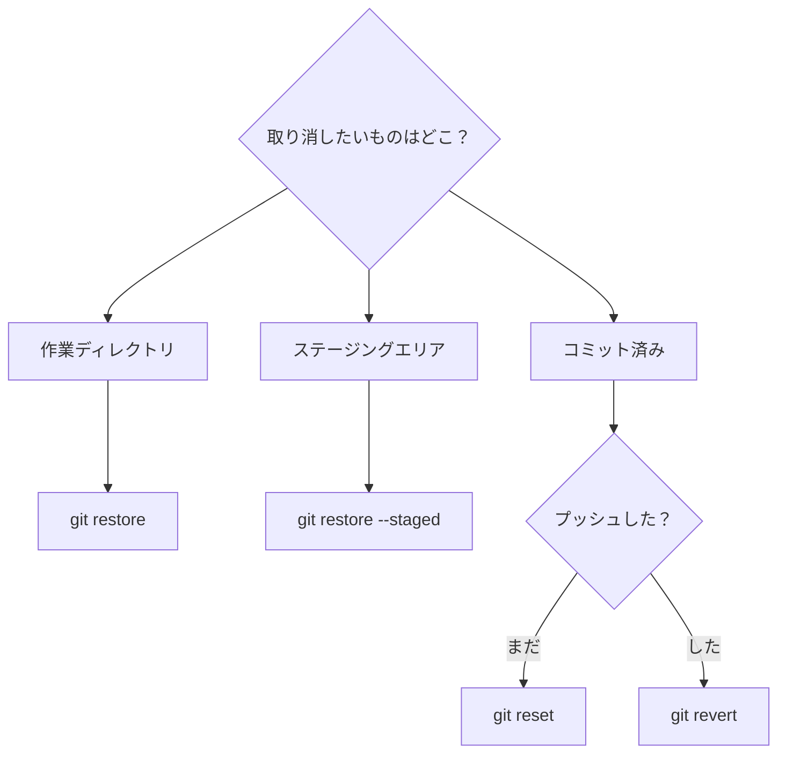
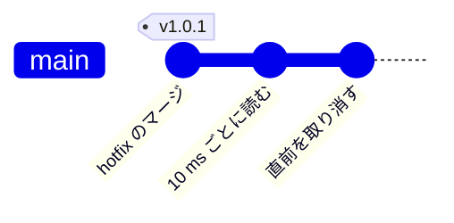

<!-- source: zh-TW/3-when-things-go-wrong/09-undoing-things/README.md | sha: 481f8fbe5f81 -->

# 第 9 章　取り消しとやり直し：restore、reset、revert、reflog

> 📍 **プロジェクトと変更の現在地**
>
> - プロジェクト：誰かが reset でコミットを失い、試しに入れた変更も取り消す必要がある
> - 前の段階：修正が v1.0.0 の一部になった
> - **この章：修正が reset で消されてしまい、reflog で救い出す**
> - 次の段階：よいコミットメッセージを書き、コミットしてしまったパスワードに対処する

---

## まず確認：取り消したいものはどこにあるか

Git の取り消しの手段はいくつもあり、選び間違えるとかえって悪くなります。取り消したいものがどの領域にあるかを見極めれば、どれを使えばいいかがわかります。



ほかに `git reflog` という特効薬もあり、「消えたと思った」コミットを救い出すためのものです。

---

## 作業ディレクトリの変更を捨てる：git restore

さんざん書き換えたあとで、方向を間違えたと気づきました。机の上の変更を捨て、ファイルを箱の中の状態に戻したいとします。一度も add していなければ、最後のコミットの状態に戻ります。

```bash
git restore fan.c
```

**Sourcetree では**：File Status でファイルを右クリックし、**Discard** を選びます。

これは取り消せません。これらの変更は一度も Git に入っていないので、捨てたら本当になくなります。

## ファイルをステージングエリアから出す：git restore --staged

デバッグ用のファイルをうっかり `git add` してしまいました。箱からは出したいけれど、机の上の変更は残しておきたいとします。

```bash
git restore --staged board.h
```

**Sourcetree では**：Staged files でファイルを選び、**Unstage Selected** を押します。

---

## ブランチを過去に戻す：git reset

`git reset` は、いまのブランチの付箋を過去のあるコミットまで戻します。飛ばされたコミットは、もうそのブランチには属しません。

付箋を動かすときに、机と箱も一緒に戻すかどうかは、3 つのモードで決まります。

| モード | ブランチ | ステージングエリア | 作業ディレクトリ | 用途 |
|---|---|---|---|---|
| `--soft` | 戻る | そのまま | そのまま | 最近のいくつかのコミットをやり直したい。変更は箱に入ったまま |
| `--mixed`（既定） | 戻る | 戻す | そのまま | コミットするものを選び直したい |
| `--hard` | 戻る | 戻す | 戻す | すべて捨てて、そのコミットの状態に戻る |

```bash
git reset --soft HEAD~1    # 直前のコミットを取り消し、変更はステージングエリアに残す
```

`HEAD~1` は「いまの位置の 1 つ前のコミット」、`HEAD~2` は 2 つ前です。

**Sourcetree では**：History でコミットを右クリックして **Reset current branch to this commit**（macOS 版は **Reset main to this commit** で、真ん中にはいまのブランチ名が入ります）を選び、Soft、Mixed、Hard のどれかを選びます。

> [!NOTE]
> **📖 用語｜reset と revert**
>
> - **定義**：reset はブランチを過去に戻し、飛ばされたコミットはブランチから消える。revert は逆向きのコミットを新しく作り、古いコミットの変更を打ち消す。
> - **現場での使い方**：「まだプッシュしていないなら reset でいい」「もうプッシュしたなら revert で」。
> - **関連用語**：`HEAD~1`、reflog、強制プッシュ
> - **よくある混同**：reset は履歴を書き換え、revert は後ろに追加するだけである。Sourcetree では revert を Reverse commit と呼ぶ。

> [!TIP]
> **🔧 ノウハウ｜reset --hard の前に、git status をひと目見る**
>
> - **状況**：ブランチを戻したくて、何気なく `--hard` を付ける。
> - **やり方**：先に `git status` を実行する。まだコミットしていない、残したい変更があれば、先にコミットするか `git stash` する。
> - **理由**：`--hard` は作業ディレクトリも一緒に元に戻す。
> - **やらないとどうなる**：コミットしていない変更は永久に消え、エディタのローカル履歴に望みを託すしかない。コミットしたものは reflog で救えるが、一度も Git に入っていないものは Git にも救えない。
> - **関連する章**：[第 2 章　3 つの領域](../../1-on-your-computer/02-three-areas/README.md)

---

## 失ったコミットを救う：git reflog

同僚が `main` で、うっかり `git reset --hard HEAD~2` と打ってしまいました。`main` は一気に第 6 章の状態まで戻り、温度の修正も hotfix も履歴から消え、`sensor.c` は再び `(mv - 600)` になりました。

慌てないでください。飛ばされたコミットはまだ `.git` の中にあり、指している付箋がないだけです。**reflog** には、HEAD がたどった道がすべて記録されています。

```text
$ git reflog -3
c67c821 HEAD@{0}: reset: moving to HEAD~2
c32dfaf HEAD@{1}: merge hotfix-filter: Merge made by the 'ort' strategy.
95fb995 HEAD@{2}: checkout: moving from hotfix-filter to main
```

`HEAD@{1}` が reset する前の位置です。ブランチをそこへ戻します。

```bash
git reset --hard HEAD@{1}
```

**Sourcetree では**：Sourcetree には reflog を表示する画面がありません。ツールバー右側の **Terminal** を押し、ターミナルで上のコマンドを実行してください。

> [!NOTE]
> **📖 用語｜reflog（Reference Log）**
>
> - **定義**：HEAD と各ブランチがこれまでどのコミットを指してきたかの記録。自分のパソコンにしかない。
> - **現場での使い方**：「コミットが消えた？ 慌てないで、reflog を見てみて」。
> - **関連用語**：`HEAD@{1}`、reset、ガベージコレクション
> - **よくある混同**：reflog はプッシュされず、clone しても付いてこない。同僚が失ったコミットは、同僚自身のパソコンで reflog を見なければ救えない。

---

## プッシュ済みのコミット：git revert

誰かが温度を読み取る間隔を 1 秒から 10 ms に変えてプッシュしたところ、夜間静音モードの平均計算が敏感になりすぎ、ファンがまたしきい値のあたりで回ったり止まったりし始めました。このコミットはもう全員がプルしているので、reset で履歴を書き換えてはいけません。

`git revert` は逆向きのコミットを新しく作り、その変更を打ち消します。

```bash
git revert HEAD
```

**Sourcetree では**：History でそのコミットを右クリックし、**Reverse commit** を選びます。



履歴の後ろにコミットが 1 つ増えるだけで、何も書き換えられません。

> [!TIP]
> **🔧 ノウハウ｜プッシュ済みのコミットは reset ではなく revert で取り消す**
>
> - **状況**：GitHub にプッシュしたばかりのコミットに誤りがあり、なかったことにしたい。
> - **やり方**：`git revert` で元の変更を打ち消す「逆向き」のコミットを新しく作り、それをプッシュする。
> - **理由**：同僚がそのコミットをすでにプルし、その上で作業を続けているかもしれない。revert は履歴を後ろに追加するだけで、共有済みの履歴を書き換えない。
> - **やらないとどうなる**：`reset` で履歴を書き換えて強制プッシュすると、同僚の履歴とリモートが食い違う。軽ければ重複したコミットが大量にでき、悪ければ他人の変更が上書きされて消える。
> - **関連する章**：[第 6 章　リモートリポジトリ](../../2-beyond-your-computer/06-remotes/README.md)

---

## いったんしまう：git stash

作業の途中で、上司に「先にこの緊急の問題を見てほしい」と言われました。変更はまだ終わっていないのでコミットしたくありませんが、別のブランチに切り替えなければなりません。

```bash
git stash          # 変更を引き出しにしまい、作業ディレクトリをきれいにする
git stash list     # 引き出しの中身を見る
git stash pop      # 取り出して、引き出しからは消す
```

**Sourcetree では**：ツールバーの **Stash**。取り出すときは、左側の Stashes の下で右クリックして **Apply Stash** を選びます。

<details>
<summary><strong>🔍 もっと詳しく｜reflog でどこまでさかのぼれるか</strong></summary>

reflog は `.git/logs/` にあり、ブランチごとと HEAD に 1 つずつ、それぞれが動いたときの記録が残っています。

飛ばされたコミットは、すぐには消されません。Git はときどきガベージコレクション（`git gc`）を実行し、付箋からも reflog からも指されていないオブジェクトを片づけます。既定では、reflog の記録は 90 日、どのブランチにも属さなくなったコミットを指す記録は 30 日残り、すべての参照を失ったオブジェクトにもさらに 2 週間の猶予があります。

つまり「コミットしたものはほとんど消えない」というのは本当ですが、期限があります。失ったら、先延ばしにせずすぐに救い出してください。

</details>

---

## よくある問題

| 状況 | 原因 | 対処 |
|---|---|---|
| マージコミットを revert しようとしたらエラーになった | マージコミットには 1 つ前のコミットが 2 つあり、Git はどちらを基準にすればいいかわからない | `-m 1` を付けて、マージ前にいたブランチを基準にする |
| `git stash pop` でコンフリクトが起きた | しまったあとで、同じ場所がまた変更された | 第 5 章のとおりコンフリクトを解決する。引き出しの中身は残っているので、確認してから `git stash drop` で消す |

---

## 🧪 やってみよう

**始める前に**：第 8 章の練習用プロジェクトの続きから始めます。この章から始めたい場合は、この本のルートフォルダで `bash practice/setup.sh 9` を実行します。この章の手順はすべてパソコンの中で行います。終わるまでプッシュしないでください。

1. 事故を再現します。2 つ前に戻り、修正が消えたことを確かめます。

   ```bash
   cd ~/git-practice/fan-controller
   git reset --hard HEAD~2
   grep return sensor.c
   ```

2. reflog で救い出します。

   ```bash
   git reflog -3
   git reset --hard HEAD@{1}
   grep return sensor.c
   ```

3. 実験をして、それを取り消します。エディタで `main.c` の `delay_ms(1000);` を `delay_ms(10);` に変えてから、次を実行します。

   ```bash
   git commit -am "Read temperature every 10 ms"
   git revert --no-edit HEAD
   ```

4. 引き出しを試します。`fan.c` を適当に変えてから `git stash` を実行し、`git status` で作業ディレクトリがきれいになったことを確かめ、`git stash pop` で取り出し、最後に `git restore fan.c` でその変更を捨てます。手順 3、4 が終わったら、次の 2 行で結果を確かめます。

   ```bash
   git log --oneline -2
   git status
   ```

**こうなれば成功**：手順 1 では `sensor.c` が `(mv - 600)`、手順 2 では `SENSOR_OFFSET_MV` に戻ります。手順 3 のあと、`git log --oneline -2` のいちばん上は `Revert "Read temperature every 10 ms"` で、`main.c` は `delay_ms(1000);` に戻っています。手順 4 のあと、`git status` に `nothing to commit, working tree clean` と表示されます。

---

## 📋 この章のコマンド

| やりたいこと | コマンド | Sourcetree では |
|---|---|---|
| 作業ディレクトリの変更を捨てる | `git restore <ファイル>` | ファイルを右クリック → Discard |
| ファイルをステージングエリアから出す | `git restore --staged <ファイル>` | Unstage Selected |
| ブランチを過去に戻す | `git reset --soft/--mixed/--hard <コミット>` | コミットを右クリック → Reset current branch to this commit（macOS：Reset main to this commit） |
| HEAD がたどった道を見る | `git reflog` | Terminal を押してコマンドを入力 |
| 逆向きのコミットを作る | `git revert <コミット>` | コミットを右クリック → Reverse commit |
| 変更をいったんしまう | `git stash`、`git stash pop` | ツールバーの Stash。右クリック → Apply Stash |

---

## この章のポイント

1. まず取り消したいものがどの領域にあるかを見極める。作業ディレクトリは restore、ステージングエリアは restore --staged、コミットは reset か revert。
2. reset には soft、mixed、hard の 3 つのモードがある。hard はコミットしていない変更を捨て、それは救えない。
3. まだプッシュしていないコミットは reset してよい。プッシュ済みのコミットは必ず revert する。
4. コミットしたものは reflog でほぼ救えるが、期限がある。
5. 作業の途中でほかの仕事に切り替えるときは、stash でいったんしまう。

---

## 参考文献

- Scott Chacon、Ben Straub『[Pro Git](https://git-scm.com/book/ja/v2)』第 2 版、2.4 節（作業のやり直し）と 7.7 節（リセットコマンド詳説）
- Git 公式ドキュメント：[git-reset](https://git-scm.com/docs/git-reset)、[git-revert](https://git-scm.com/docs/git-revert)、[git-reflog](https://git-scm.com/docs/git-reflog)

---

[← 第 8 章　ブランチ戦略とリリース](../../2-beyond-your-computer/08-branching-and-releases/README.md) ｜ [目次](../../README.md) ｜ [第 10 章　よい習慣 →](../10-good-habits/README.md)
