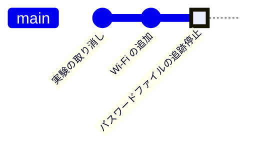

<!-- source: zh-TW/3-when-things-go-wrong/10-good-habits/README.md | sha: f6d85ea4d8a0 -->

# 第 10 章　よい習慣：コミットメッセージ、.gitignore、バイナリ、秘密情報の漏えい

> 📍 **プロジェクトと変更の現在地**
>
> - プロジェクト：Wi-Fi で状態を報告する機能を加えたとき、Wi-Fi のパスワードをコミットしてしまった
> - 前の段階：修正が reset で消され、reflog で救い出された
> - **この章：修正のコミットメッセージを振り返り、もっとよいメッセージの書き方を学ぶ**
> - 次の段階：旅の終点。第 0 章に戻って本書の地図を見る

---

## よいコミットメッセージを書く

半年後、誰かが `sensor.c` で `SENSOR_OFFSET_MV 500` を見て、なぜ 500 なのかを知りたくなりました。その人は `git log` や `git blame`（各行を最後に変えたコミットを表示する）でそのコミットを見つけ、メッセージを読みます。メッセージは、未来の人に残す説明書です。

よいコミットメッセージはこんな形をしています。

```text
Fix temperature sensor offset

The sensor outputs 500 mV at 0 °C, but the code subtracted 600 mV,
so every reading was 10 °C too low and the fan started at 55 °C
instead of 45 °C.
```

| 規則 | 理由 |
|---|---|
| 1 行目は件名で、50 文字以内 | `git log --oneline`、GitHub、Sourcetree は 1 行目しか表示しない |
| 件名は命令形で、このコミットが何をするかを書く。たとえば Fix、Add、Remove | 「このコミットを適用すると……する」と読める。件名の先頭に `fix:` や `feat:` などを付けると決めているチームもあるので、チームのルールに従う |
| 件名と本文の間は 1 行空ける | Git は空行で件名と本文を区別する |
| 本文には、なぜ変えたのかと、どんな影響があるのかを書く | 何を変えたかは差分を見ればわかる。なぜ変えたかは、あなたにしかわからない |

私たちの修正には、件名 `Fix temperature sensor offset` しかありませんでした。件名自体はよく書けています。命令形で、何を変えたのかを具体的に示しています。ただ本文がないので、なぜ 500 なのかがわかりません。このコミットはもうプッシュされて v1.0.0 の一部になっているので、第 9 章の原則に従って書き換えてはいけません。これからのコミットでよりよく書くしかありません。

```bash
git commit -m "件名" -m "本文の最初の段落"    # -m 1 つが 1 段落
git commit                                    # -m なしだと、Git がエディタを開いて書かせてくれる
```

**Sourcetree では**：メッセージ欄には複数行を入力できます。1 行目に件名を書き、1 行空けてから本文を書きます。

> [!TIP]
> **🔧 ノウハウ｜コミットメッセージには「なぜ」を書く**
>
> - **状況**：コードを直した直後に、メッセージを `update`、`fix bug`、`修正` などで適当に済ませる。
> - **やり方**：件名には何をしたかを、本文にはなぜしたのか、どんな症状を直したのかを書く。
> - **理由**：コードが説明するのは「どうやるか」で、「なぜ」を説明できるのはコミットメッセージだけである。
> - **やらないとどうなる**：履歴に `fix bug` がずらりと並び、問題を探すときに 1 つずつ開くはめになる。誰かが 500 を打ち間違いだと思い込み、600 に戻してしまう。
> - **関連する章**：[第 3 章　コミットの正体](../../1-on-your-computer/03-commits/README.md)

---

## .gitignore：リポジトリに入れてはいけないファイル

決してコミットしてはいけないファイルがあります。ビルドで生成されたファイル、エディタの一時ファイル、パスワードを含む設定ファイルなどです。これらの名前をプロジェクトのルートにある `.gitignore` に書くと、Git は見なかったことにしてくれます。

```text
build/
*.bin
*.elf
secrets.h
```

- `build/` はフォルダ全体、`*.bin` は拡張子が `.bin` のすべてのファイルを表します。
- `.gitignore` 自体はコミットして、チーム全員で同じルールを使います。
- 効くのは、まだ追跡されていないファイルだけです。すでにコミットしたファイルは、先に `git rm --cached` で追跡をやめる必要があります。

**Sourcetree では**：File Status で未追跡のファイルを右クリックし、**Ignore** を選びます。そのファイルだけ、その拡張子、フォルダ全体のどれを無視するかを選べます。

> [!NOTE]
> **📖 用語｜.gitignore**
>
> - **定義**：Git が無視すべきファイルを並べた設定ファイル。リポジトリに置き、一緒にコミットする。
> - **現場での使い方**：「build フォルダを gitignore に入れておいて」。
> - **関連用語**：`git rm --cached`、ビルド成果物、`git check-ignore`
> - **よくある混同**：`.gitignore` はファイルを Git が気にかけるかどうかを決めるだけで、ファイルを消しはせず、セキュリティの仕組みでもない。`git add -f` を使えば無理やり追加できてしまう。

---

## バイナリ、大きなファイル、submodule

**バイナリ**：ビルドしたファームウェアは毎回丸ごと変わります。1 回コミットするたびに履歴に丸ごと 1 つ分が増え、あとから取り除くのは大変です。ビルド成果物は `.gitignore` と、第 8 章のリリースに任せましょう。

**大きなファイル**：GitHub は 50 MiB を超えるファイルに警告を出し、100 MiB を超えるファイルは受け付けません。ハードウェアの設計ファイルのように、本当にバージョン管理が必要な大きなファイルには、**Git LFS（Large File Storage）** を使えます。リポジトリには小さなポインタだけを置き、ファイル本体は別の場所に保存します。

**submodule**：ファームウェアのプロジェクトでは、チップメーカーのドライバライブラリのように、別のリポジトリのコードを使うことがよくあります。**サブモジュール（Submodule）** を使うと、別のリポジトリをプロジェクトのフォルダに置き、そのどのコミットを使っているかを記録できます。

```bash
git submodule add https://github.com/某組織/ドライバライブラリ.git drivers
git clone --recurse-submodules <URL>     # clone のときにサブモジュールも一緒に取ってくる
git submodule update --init              # clone のときに付け忘れたら、これを実行する
```

**Sourcetree では**：**Repository → Add Submodule**。clone のときに Advanced Options を開いて Recurse submodules にチェックを入れると、サブモジュールも一緒に取ってきます。

> [!NOTE]
> **📖 用語｜サブモジュール（子模組）**
>
> - **定義**：あるリポジトリのフォルダから、別のリポジトリの特定のコミットを固定して参照する仕組み。
> - **現場での使い方**：「ドライバライブラリは submodule で入れているから、clone のときは `--recurse-submodules` を忘れずに」。
> - **関連用語**：`git submodule update`、`.gitmodules`、Git LFS
> - **よくある混同**：サブモジュールが記録するのは「特定のコミット」で、「最新版」ではない。相手のリポジトリが更新されても自分のプロジェクトは自動では変わらないので、自分で更新してコミットする必要がある。

---

## パスワードをコミットしてしまった

Wi-Fi で状態を報告する機能を加えたとき、Wi-Fi の名前とパスワードを `secrets.h` に書き、それが一緒にコミットされてしまいました。

**パスワードを変える → 追跡をやめる → 必要なら履歴を消す**

1. **パスワードを変える**：これがいちばん重要な手順です。公開リポジトリに一度でもプッシュしたなら、パスワードは漏れたと考えてください。GitHub 上のパスワードを常に探し回っているプログラムもあります。
2. **追跡をやめる**：`secrets.h` は一人ひとりのパソコンだけに置くようにし、代わりに偽の値を入れたひな形 `secrets.example.h` を用意します。

   ```bash
   git rm --cached secrets.h      # 追跡はやめるが、パソコンのファイルは残す
   echo "secrets.h" >> .gitignore
   git add .gitignore secrets.example.h
   git commit -m "Stop tracking Wi-Fi credentials"
   ```

3. **必要なら履歴を消す**：追跡をやめても、古いコミットにはまだパスワードが残っています。完全に消すには、それ以降のすべてのコミットを書き換える必要があり、全員が clone し直さなければなりません。パスワードをもう変えたなら、普通この手順は要りません。



「Wi-Fi の追加」のコミットにあるパスワードは、追跡をやめたあとも見えてしまいます。だからこそ、最初の手順は必ずパスワードを変えることなのです。

GitHub はすべてのアカウントで既定でプッシュ保護（Push Protection）を有効にしていて、公開リポジトリへのプッシュでよくある形式のキーやトークンを見つけると、そのプッシュを止めます。ただし Wi-Fi のパスワードのように、見分けられないものもあるので、頼りにしてはいけません。

> [!TIP]
> **🔧 ノウハウ｜パスワードが漏れたら、まず変える。履歴の書き換えはそのあと**
>
> - **状況**：パスワード、クラウドサービスのキー、トークンがコミットされ、プッシュされていたことに気づく。
> - **やり方**：すぐにそのサービスで無効化するか、新しいものに替え、それからファイルの追跡をやめる。履歴を消すのは必要なときだけ。
> - **理由**：プッシュした瞬間に、誰かがもう clone や fetch しているかもしれない。自分の履歴を書き換えても、ほかの人のパソコンにあるコピーまでは変えられない。
> - **やらないとどうなる**：午後いっぱいかけて履歴の消し方を調べている間、古いパスワードはずっと有効なままで、とっくに使われてしまっている。
> - **関連する章**：[第 9 章　取り消しとやり直し](../09-undoing-things/README.md)

<details>
<summary><strong>🔍 もっと詳しく｜追跡をやめてもパスワードが消えない理由</strong></summary>

第 3 章で説明したように、コミットは tree を指し、tree は blob を指します。「Wi-Fi の追加」のコミットの tree には、`secrets.h` の内容を持つ blob があります。そのあとのコミットにはもう含まれていませんが、古いコミットは残っているので、blob も残っています。

```text
$ git show HEAD~1:secrets.h | grep PASSWORD
#define WIFI_PASSWORD  "fan-lab-2026"
```

blob を消すには、それを含まない新しい tree、つまり新しいコミットを作る必要があります。新しいコミットは番号が違うので、それ以降のすべてのコミットも作り直しになります。履歴を消すのに専用のツール（たとえば git filter-repo）が必要で、全員が clone し直さなければならないのはこのためです。

</details>

<details>
<summary><strong>🔍 もっと詳しく｜スナップショットが場所を取らない仕組み：packfile</strong></summary>

第 3 章で、Git はスナップショットを保存し、変わっていないファイルは同じ blob を使い回すと説明しました。変更したファイルは新しい blob として保存され、最初はそれぞれが独立したファイルとして圧縮されます。これをルーズオブジェクトといいます。

オブジェクトが増えると、Git はそれらを **packfile** にまとめます。まとめるときに内容の似たオブジェクトを探し、1 つだけを丸ごと保存して、ほかは差分として保存します。つまり保存の層では、Git も差分を保存しています。ただしそれは保存のための最適化で、考え方としては、どのコミットも完全なスナップショットのままです。

テキストファイルを数行変えただけなら差分は小さく、まとめる効果は大きくなります。ビルドしたバイナリは毎回丸ごと変わるので、差分が元のファイルと同じくらい大きくなります。バイナリがリポジトリをどんどん太らせるのは、このためです。`git count-objects -vH` で、いまのリポジトリの大きさがわかります。

</details>

---

## よくある問題

| 状況 | 原因 | 対処 |
|---|---|---|
| `.gitignore` に書いたのに、`git status` にファイルが出てくる | そのファイルはすでに追跡されている | `git rm --cached <ファイル>` してからコミットする |
| あるファイルがなぜ無視されているのかわからない | どれかのルールに当てはまっている | `git check-ignore -v <ファイル>` で、どのルールかがわかる |
| clone したら、サブモジュールのフォルダが空だった | clone のときにサブモジュールを取ってこなかった | `git submodule update --init` |

---

## 🧪 やってみよう

**始める前に**：第 9 章の練習用プロジェクトの続きから始めます。この章から始めたい場合は、この本のルートフォルダで `bash practice/setup.sh 10` を実行します。

1. 事故を再現します。エディタでプロジェクトのルートに `secrets.h` を作り、内容は次のとおりにします（練習では Wi-Fi のプログラムは省き、パスワードのファイルだけを残しています）。

   ```c
   #ifndef SECRETS_H
   #define SECRETS_H

   #define WIFI_SSID      "fan-lab"
   #define WIFI_PASSWORD  "fan-lab-2026"

   #endif
   ```

   さらにビルドしたことにして、パスワードのファイルをコミットします。

   ```bash
   cd ~/git-practice/fan-controller
   mkdir -p build && echo "firmware" > build/fan.bin
   git add secrets.h
   git commit -m "Add Wi-Fi status reporting"
   git status
   ```

2. エディタでプロジェクトのルートに `.gitignore` を作り、上の 4 行を書いて保存してから、もう一度 `git status` を見ます。
3. ひな形としてコピーを作り、その中の名前とパスワードを `your-ssid` と `your-password` に変えてから、本物のパスワードのファイルの追跡をやめます。

   ```bash
   cp secrets.h secrets.example.h
   git rm --cached secrets.h
   git add .gitignore secrets.example.h
   git commit -m "Stop tracking Wi-Fi credentials" -m "secrets.h holds the real password, so it must stay on each developer's machine. Copy secrets.example.h to secrets.h and fill in your own values."
   ```

4. パスワードのファイルがもう追跡されていないこと、それでも履歴には残っていることを確かめます。

   ```bash
   git status
   git ls-files
   git show HEAD~1:secrets.h
   ```

**こうなれば成功**：手順 1 の `git status` では、Untracked files に `build/` が表示されます。手順 2 のあとは `.gitignore` だけが残ります。最後の `git status` には `nothing to commit, working tree clean` と表示されます。`git ls-files` には `secrets.example.h` があり、`secrets.h` はありません。`git show HEAD~1:secrets.h` には、まだ `fan-lab-2026` が表示されます。

これが本書で最後の「やってみよう」です。`git log --oneline --graph --all` で履歴全体を眺め、第 0 章の図と見比べてください。変更がたどった道はすべてそこにあり、さらに第 8～10 章の hotfix、取り消した実験、パスワードのファイルが加わっています。

---

## 📋 この章のコマンド

| やりたいこと | コマンド | Sourcetree では |
|---|---|---|
| 本文付きのコミットメッセージを書く | `git commit -m "件名" -m "本文"` | メッセージ欄の 1 行目に件名、1 行空けて本文 |
| 各行を誰が変えたかを調べる | `git blame <ファイル>` | ファイルを右クリック → Blame Selected |
| 追跡はやめるが、ファイルは残す | `git rm --cached <ファイル>` | ファイルを右クリック → Stop Tracking |
| ファイルが無視される理由を調べる | `git check-ignore -v <ファイル>` | — |
| サブモジュールを追加する | `git submodule add <URL> <フォルダ>` | Repository → Add Submodule |
| サブモジュールを取ってくる | `git submodule update --init` | — |
| リポジトリの大きさを調べる | `git count-objects -vH` | — |

---

## この章のポイント

1. コミットメッセージの件名には何をしたかを、本文にはなぜかを書く。件名は 50 文字以内で、命令形にする。
2. ビルド成果物、一時ファイル、パスワードのファイルは `.gitignore` に書く。すでに追跡しているファイルは、先に `git rm --cached` する。
3. バイナリは、バージョンごとに丸ごと 1 つ分が履歴に残る。ビルド成果物はリリースに置き、どうしても必要な大きなファイルには Git LFS を使う。
4. パスワードをコミットしてしまったら、まずパスワードを変え、次に追跡をやめ、必要なときだけ履歴を消す。

---

## 参考文献

- Scott Chacon、Ben Straub『[Pro Git](https://git-scm.com/book/ja/v2)』第 2 版、2.2 節（ファイルを無視する）、5.2 節（コミットのガイドライン）、7.11 節（サブモジュール）
- GitHub Docs：[ファイルを無視する](https://docs.github.com/ja/get-started/getting-started-with-git/ignoring-files)、[リポジトリからの機微なデータの削除](https://docs.github.com/ja/authentication/keeping-your-account-and-data-secure/removing-sensitive-data-from-a-repository)

---

[← 第 9 章　取り消しとやり直し](../09-undoing-things/README.md) ｜ [目次](../../README.md) ｜ [付録 A　用語集 →](../../appendix/glossary.md)
