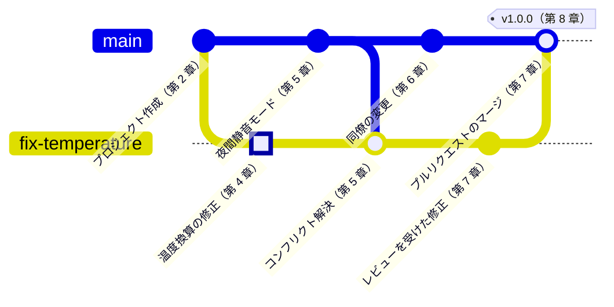

<!-- source: zh-TW/README.md | sha: 44319858e0bc -->

<div align="center">


# Git 入門

**1 つのプロジェクトと 1 つの変更を追いかけて、最初の 1 行から正式リリースまでの旅をたどる**

🌐 [繁體中文](../zh-TW/README.md) ｜ [English](../en/README.md) ｜ **日本語** ｜ [한국어](../ko/README.md) ｜ [ホーム](../README.md)

</div>

---

## この本について

こんなフォルダを見たことがあるはずです。「firmware_v2」「firmware_v2_修正」「firmware_v2_最終」「firmware_v2_本当に最終」。コピーは増えていくのに、いまボードに書き込まれているのがどれなのか、誰にも答えられません。

Git はこの問題を解決するためのツールです。プロジェクトのすべてのバージョンを記録し、何人もが同じコードを同時に変更できるようにし、問題が起きたときにはどの時点にでも戻れるようにします。

この本では、2 人の主人公を追いかけます。

- **1 つのプロジェクト**：温度センサーを読み取り、ファンを制御する小さなファームウェアのプロジェクトです。1 人で開発を始め、同僚が加わり、最後に正式なバージョンをリリースします。
- **1 つの変更**：このプロジェクトにあるバグです。温度の換算が間違っていて、ファンが動き出すのが遅すぎます。この修正は、あなたがコードを書き換えたところから始まり、ステージング、ブランチ、コンフリクト、プッシュ、レビューと 1 つずつ駅を通り、最後に正式リリースの一部になります。

## 対象読者

この本は 2 種類の読者に向けて書かれています。まったく予備知識のない人と、Git を本当に使いこなす必要がある情報系の学生です。内容は 2 層に分かれているので、必要なところを読んでください。

| 読者 | 読むところ | 読み終えるとできること |
|---|---|---|
| 🌱 Git を使ったことがない人 | 本文、コミットグラフ、「やってみよう」。「もっと詳しく」は飛ばす | 自分のプロジェクトで Git を使い、GitHub でほかの人と共同作業できる |
| 🎓 情報系の学生 | すべて。「もっと詳しく」も読む | Git の内部の仕組みを説明でき、課題、インターン、チーム開発で使える |
| 🔧 すでに使っている人 | 各章のコマンド表、付録 C、第 9 章 | コマンドをすぐに調べられ、困ったときに復旧の方法がわかる |

本文を読むのに、Git やプログラミングの知識は要りません。ターミナルでコマンドを打てるとなおよいですが、打てなくても大丈夫です。どの操作にも GUI ツールでのやり方があります。

## どの操作も 2 通りで説明

どの操作も、まず身近なたとえで考え方を説明し、それからコマンドと Sourcetree での操作を示します。たとえば、変更をコミットする場合はこうなります。

```bash
git add sensor.c
git commit -m "Fix temperature sensor offset"
```

**Sourcetree では**：**sensor.c を選択 → Stage Selected → メッセージを入力 → Commit**

- コマンドは Windows、macOS、Linux で共通です。
- Sourcetree は Windows 版と macOS 版しかありません。Linux の読者はコマンドだけで進められます。
- ホスティングサービスの例には GitHub を使います。ほかのサービスも考え方はほぼ同じで、名前と画面が違うだけです。

## 各章にある手助け

| 印 | 内容 |
|---|---|
| 📍 プロジェクトと変更の現在地 | プロジェクトがどこまで育ったか、変更が旅のどの駅にいるか |
| 🌿 コミットグラフ | 操作の前後のコミット履歴。ブランチがどう伸び、マージ後にどんな形になるか |
| 📖 用語ボックス | 定義、現場での使い方、関連用語、いちばん混同しやすい点 |
| 🔧 ノウハウボックス | チームでのやり方と、「なぜそうするのか、やらないとどうなるか」 |
| 🔍 もっと詳しく | 情報系の学生向けの仕組みの解説。最初は折りたたまれていて、飛ばしてもかまいません |
| 🧪 やってみよう | 練習用プロジェクトで、その章の操作を自分の手でやってみる。成功したときの見え方も示します |
| 📋 この章のコマンド | 章で使ったコマンドと、Sourcetree でのクリック先 |

たとえば、第 9 章「取り消しとやり直し」にあるノウハウボックスです。

> [!TIP]
> **🔧 ノウハウ｜プッシュ済みのコミットは reset ではなく revert で取り消す**
>
> - **状況**：GitHub にプッシュしたばかりのコミットに誤りがあり、なかったことにしたい。
> - **やり方**：`git revert` で元の変更を打ち消す「逆向き」のコミットを新しく作り、それをプッシュする。
> - **理由**：同僚がそのコミットをすでにプルし、その上で作業を続けているかもしれない。revert は履歴を後ろに追加するだけで、共有済みの履歴を書き換えない。
> - **やらないとどうなる**：`reset` で履歴を書き換えて強制プッシュすると、同僚の履歴とリモートが食い違う。軽ければ重複したコミットが大量にでき、悪ければ他人の変更が上書きされて消える。

このノウハウの裏にある仕組みは「もっと詳しく」にあります。開いてみてもいいですし、飛ばしてもかまいません。

<details>
<summary><strong>🔍 もっと詳しく｜コミットの番号はどうやって決まるのか</strong></summary>

どのコミットにも `21e1fda` のような番号があります。これは連番ではありません。Git がコミットの内容をハッシュ関数に通して計算した結果です。内容には、そのときのスナップショット、1 つ前のコミットの番号、作者、日時、メッセージが含まれます。

ここから 2 つの重要な性質が生まれます。

- 内容が 1 文字でも違えば、番号はまったく別のものになります。誰かが履歴に手を加えれば、番号を比べるだけでわかります。
- 1 つ前のコミットの番号も内容に含まれるので、古いコミットを書き換えると、それ以降のすべてのコミットの番号が変わります。共有済みの履歴を書き換えると同僚の履歴と食い違うのは、このためです。

第 3 章では `git cat-file` でコミットを開き、中に何が保存されているかを実際に見てみます。

</details>

## 練習用プロジェクト

この本には練習用プロジェクトが付いています。物語に出てくる `fan-controller` です。どの章の「やってみよう」もこれを使うので、読みながら自分のパソコンでまったく同じ履歴を作れます。

最初から始める必要はありません。この本をパソコンにダウンロードし、そのルートフォルダで次の 1 行を実行すると、その章の開始時点の練習用リポジトリができます。

```bash
bash practice/setup.sh 4
```

Windows では、Git と一緒にインストールされる Git Bash で実行してください。Sourcetree を使う人は、実行後にできたフォルダを Sourcetree に追加すれば準備完了です。

---

## 本書の地図

この図は、変更がたどるコミット履歴です。上の線が `main`、下の線が修正用のブランチで、強調されたコミットがその変更です。



変更はまずあなたのパソコンで専用のブランチにコミットされ、`main` に入った新機能とコンフリクトを起こして解決されます。それから GitHub にプッシュされ、同僚のレビューを経て `main` にマージされ、最後にプロジェクトと一緒に v1.0.0 としてリリースされます。

図に出てこない章もあります。第 0 章と第 1 章は出発前の準備、第 3 章はコミットの中身をのぞく章、第 9 章と第 10 章は困ったときの直し方と、困らないための習慣です。

---

## 目次

### 第 0 部　はじめる前に

| 章 | 読める内容 |
|---|---|
| [第 0 章　Git の全体像](0-before-you-start/00-overview/README.md) | バージョン管理が必要な理由と、2 人の主人公のこれからの旅 |
| [第 1 章　ツールの準備](0-before-you-start/01-setup/README.md) | Git と Sourcetree のインストール、最初の設定、GitHub との接続 |

### 第 1 部　自分のパソコンで

| 章 | 読める内容 |
|---|---|
| [第 2 章　3 つの領域](1-on-your-computer/02-three-areas/README.md) | 作業ディレクトリ、ステージングエリア、リポジトリと、ステージングエリアがある理由 |
| [第 3 章　コミットの正体](1-on-your-computer/03-commits/README.md) | コミットに実際に何が保存されているか、履歴の見方 |
| [第 4 章　ブランチ](1-on-your-computer/04-branches/README.md) | branch、switch、HEAD と、ブランチがこれほど軽い理由 |
| [第 5 章　マージとコンフリクト](1-on-your-computer/05-merging-and-conflicts/README.md) | 早送りマージ、3-way マージ、コンフリクトの解決、rebase の長所と短所 |

### 第 2 部　パソコンの外へ

| 章 | 読める内容 |
|---|---|
| [第 6 章　リモートリポジトリ](2-beyond-your-computer/06-remotes/README.md) | clone、fetch、pull、push と、fetch と pull の違い |
| [第 7 章　プルリクエストとコードレビュー](2-beyond-your-computer/07-pull-requests/README.md) | プルリクエストの作成、レビュー、自動チェック、ブランチ保護 |
| [第 8 章　ブランチ戦略とリリース](2-beyond-your-computer/08-branching-and-releases/README.md) | バージョン番号、タグとリリース、チームでよく使われるブランチ戦略 |

### 第 3 部　困ったときは

| 章 | 読める内容 |
|---|---|
| [第 9 章　取り消しとやり直し](3-when-things-go-wrong/09-undoing-things/README.md) | restore、reset、revert、reflog。書き間違い、消してしまったコミット、誤ったマージからの復旧 |
| [第 10 章　よい習慣](3-when-things-go-wrong/10-good-habits/README.md) | コミットメッセージ、.gitignore、ファームウェアのバイナリ、パスワードが漏れたときの対処 |

### 付録

| 付録 | 読める内容 |
|---|---|
| [付録 A　用語集](appendix/glossary.md) | 本書の用語の日本語・英語・中国語の対照。本書の用語の基準 |
| [付録 B　現場の言い回し](appendix/jargon.md) | チームでよく聞く言い回しと例文 |
| [付録 C　コマンドと Sourcetree の対応表](appendix/commands-and-sourcetree.md) | 同じ操作を、コマンドではどう打ち、Sourcetree ではどこを押すか |
| [付録 D　参考文献](appendix/further-reading.md) | 公式ドキュメントと公開されている書籍 |

---

## 読み方のルート

順番に読むのがいちばん確実です。目の前の問題だけをまず片づけたいときは、次のルートから始めてください。

| ルート | おすすめの章 |
|---|---|
| 🚀 今日から使いたい | 第 0、1、2、4、6 章 |
| 👥 チームに加わる準備 | 第 6～8 章と付録 B |
| 🚑 困ったことが起きた | 第 9 章と付録 C |

---

## このプロジェクトへの参加

この本はオープンなプロジェクトです。一緒によりよいものにしていきましょう。

- **誤りを見つけたら**：このプロジェクトの [Issues](../../../issues) で「勘誤回報 / Erratum」テンプレートを使って知らせてください。
- **内容や図を追加したいとき**：まず[コントリビューションガイド](../CONTRIBUTING.md)と[執筆ルール](../STYLE_GUIDE.md)を読んでください。
- **ほかの言語に翻訳したいとき**：[翻訳ガイド](../TRANSLATIONS.md)を読んでください。

この本が役に立ったら、右上の ⭐ Star を押してください。より多くの人に届くようになります。

---

## 免責事項

- 本書の内容は、公開されているドキュメントと業界で一般的なやり方をもとにしています。
- 本書は Git プロジェクト、GitHub、Sourcetree のいずれとも関係がありません。Sourcetree と GitHub は、GUI ツールとホスティングサービスの例として使っているだけです。
- これらのツールの画面はバージョンや OS によって変わるため、本書ではスクリーンショットではなく簡略化した図を使っています。実際の画面とは少し異なる場合があります。
- 誤りや古くなった情報があれば、Issue で教えてください。

## ライセンス

本書の文章と画像は [クリエイティブ・コモンズ 表示 - 非営利 - 継承 4.0 国際](../LICENSE)（CC BY-NC-SA 4.0）ライセンスで提供します。出典を明記し、営利目的で使わず、同じライセンスで共有する限り、自由に転載、改変、翻訳できます。
