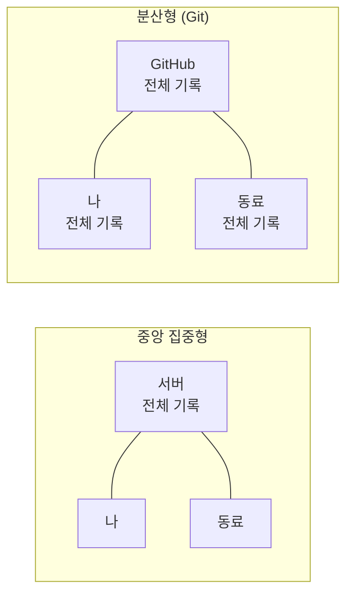
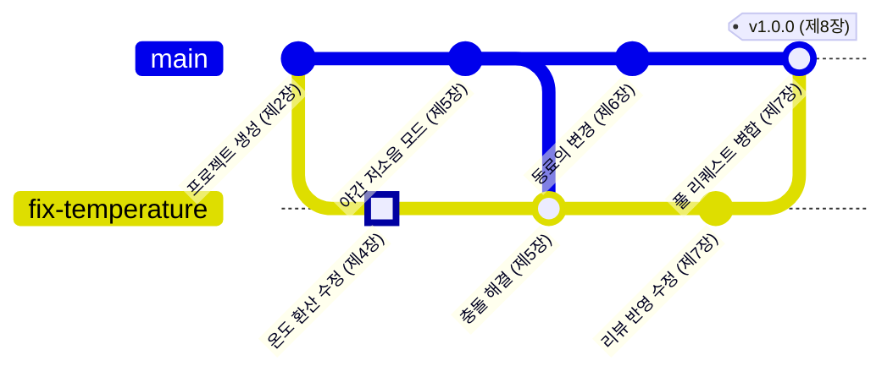

<!-- source: zh-TW/0-before-you-start/00-overview/README.md | sha: 51049a365d8c -->

# 제0장 Git의 전체 그림: 하나의 프로젝트, 하나의 변경

> 📍 **프로젝트와 변경의 현재 위치**
>
> - 프로젝트: `fan-controller`는 폴더를 복사하는 방식으로 버전을 관리하고 있고, 폴더 이름이 점점 엉망이 된다
> - 이전 단계: 여정의 출발점
> - **이 장: 버그가 발견된다. 팬이 너무 늦게 돈다**
> - 다음 단계: Git과 Sourcetree를 설치하고 수정할 준비를 한다

---

## 버전 관리가 없던 시절

이런 폴더를 본 적이 있을지도 모릅니다.

```text
fan_v1/
fan_v2/
fan_v2_수정/
fan_v2_최종/
fan_v2_진짜_최종/
fan_v2_동료가_고침.zip
```

하나하나가 거의 같은데, 조금씩 다릅니다. 곧 이런 문제에 부딪힙니다.

- 지금 보드에 올라가 있는 것은 도대체 어느 것인가?
- `fan_v2_수정`에서는 몇 번째 줄을 바꿨나? 왜 바꿨나?
- 동료가 보낸 압축 파일과 내 버전을 어떻게 합치나?
- 어제는 잘 돌았는데 오늘은 고장 났다. 어떻게 어제로 돌아가나?

이런 문제를 해결하는 것이 바로 버전 관리입니다.

---

## 버전 관리가 하는 일

**버전 관리**(Version Control)는 프로젝트의 일기장 같은 것입니다. 작업 하나를 끝낼 때마다 일기를 한 줄 씁니다. 무엇을 바꿨는지, 누가 바꿨는지, 언제, 왜 바꿨는지.

이 일기장이 있으면 네 가지를 할 수 있습니다.

| 할 수 있는 일 | 해결하는 문제 | 장 |
|---|---|---|
| 모든 버전을 기록한다 | 누가 언제, 왜 무엇을 바꿨는지 안다 | 제2, 3장 |
| 차이를 비교한다 | 두 버전에서 어느 줄이 다른지 한눈에 본다 | 제2장 |
| 동시에 개발한다 | 버그 수정과 새 기능 개발을 서로 방해하지 않고 동시에 진행한다 | 제4, 5장 |
| 과거로 돌아간다 | 망가뜨려도 기록해 둔 어느 버전으로든 돌아갈 수 있다 | 제9장 |

Git은 오늘날 가장 널리 쓰이는 버전 관리 도구입니다. 개인의 작은 프로젝트부터 수천 명이 개발하는 운영체제까지 Git으로 코드를 관리합니다.

> [!NOTE]
> **📖 용어｜Git과 GitHub（Git 與 GitHub）**
>
> - **정의**: Git은 내 컴퓨터에 설치하는 버전 관리 도구다. GitHub는 Git 저장소를 올려 공유하고 협업하는 웹사이트다.
> - **현장에서는**: "이 프로젝트 Git 써요?"는 버전 관리를 묻는 말이다. "GitHub에 푸시해 주세요"는 웹사이트에 올리라는 말이다.
> - **관련 용어**: 저장소, 원격, Sourcetree
> - **흔한 혼동**: Git과 GitHub는 다른 것이다. 네트워크도 GitHub 계정도 없이 내 컴퓨터에서 Git을 쓸 수 있다.

---

## 중앙 집중형과 분산형

버전 관리 도구가 일하는 방식은 두 가지입니다.

**중앙 집중형**: 기록이 서버 한 대에만 있습니다. 모두가 서버에서 최신 파일을 받아 오고, 고친 뒤 다시 보냅니다. 반 전체가 출석부 한 권을 같이 쓰는 것과 같아서, 서버가 멈추면 아무도 기록할 수 없습니다.

**분산형**: 각자의 컴퓨터에 전체 기록이 있습니다. Git이 이쪽입니다. 비행기 안에서도, 네트워크가 없는 실험실에서도 버전을 기록하고 기록을 볼 수 있습니다. GitHub에 있는 것은 모두가 맞추기로 약속한 한 벌일 뿐입니다.



> [!NOTE]
> **📖 용어｜분산 버전 관리（分散式版本控制）**
>
> - **정의**: 각자의 컴퓨터에 전체 기록의 사본이 있는 버전 관리 방식이다.
> - **현장에서는**: 정식 이름으로 부르는 일은 드물다. "clone 받으세요"라고 하면 전체 기록을 내 컴퓨터로 복사하라는 뜻이다.
> - **관련 용어**: 중앙 집중형 버전 관리, clone, 원격
> - **흔한 혼동**: 분산형이라고 중심이 없다는 뜻은 아니다. 팀에서는 보통 GitHub에 있는 것을 기준으로 삼는다. 다만 기술적으로는 내 컴퓨터에 있는 사본과 지위가 같다.

<details>
<summary><strong>🔍 더 알아보기｜Git은 어떻게 태어났을까</strong></summary>

Git은 2005년에 태어났습니다. Linux 운영체제 커널 개발자들이 무료로 쓰던 상용 버전 관리 도구를 더는 쓸 수 없게 되자, Linus Torvalds가 몇 주 만에 Git의 첫 버전을 만들었습니다.

설계 목표에는 오픈 소스 프로젝트에 필요한 것이 그대로 담겨 있습니다.

- **빠르다**: 수천 명이 참여하고 파일이 수만 개인 프로젝트에서도 기록 조회와 브랜치 생성이 순식간에 끝나야 한다.
- **분산**: 누구나 전체 기록을 복사해 자기 컴퓨터에서 작업하고, 그 변경을 메인테이너에게 제공할 수 있어야 한다.
- **변조를 알아챌 수 있다**: 모든 버전은 내용으로 계산한 해시 값을 번호로 쓰므로, 기록이 조금이라도 바뀌면 번호를 비교하는 것만으로 드러난다(제3장).

분산형이라는 점은 "누구나 참여할 수 있다"는 것도 자연스럽게 만들었습니다. 서버에 쓸 권한이 없어도 내 사본에서 변경을 끝낸 뒤, 메인테이너에게 가져가 달라고 부탁하면 됩니다. 이것이 제7장에서 다룰 풀 리퀘스트의 원형입니다.

</details>

---

## 이 책의 두 주인공

**큰 주인공: 하나의 프로젝트.** `fan-controller`는 작은 펌웨어입니다. 1초에 한 번 온도 센서를 읽고, 45 °C를 넘으면 팬을 켜고, 40 °C 아래로 내려가면 끕니다. 이 책은 혼자 개발하던 이 프로젝트에 동료가 합류하고, 정식 버전을 릴리스하기까지를 따라갑니다.

**작은 주인공: 하나의 변경.** 센서 사양은 "0 °C에서 500 mV를 출력하고, 1 °C 오를 때마다 10 mV씩 늘어난다"인데, 코드는 먼저 600 mV를 빼고 있습니다. 그래서 계산한 온도가 늘 10 °C 낮게 나오고, 실제 온도가 55 °C가 되어서야 팬이 돕니다.

이 버그의 수정은 단 한 줄이지만, Git의 여정을 처음부터 끝까지 지나갑니다. 아래 그래프가 이 변경이 지나가는 기록이고, 강조된 커밋이 바로 그 변경입니다.



지금은 이 그래프가 이해되지 않아도 괜찮습니다. 제8장까지 읽고 다시 돌아오면, 점 하나하나가 어떻게 생겼는지 모두 알게 됩니다.

> [!TIP]
> **🔧 노하우｜프로젝트 첫날부터 Git을 쓴다**
>
> - **상황**: 프로젝트가 막 시작됐고 개발자는 나 혼자라서, 버전 관리는 나중 일이라고 생각한다.
> - **방법**: 프로젝트 폴더를 만든 그날 `git init`을 하고 첫 커밋을 한다.
> - **이유**: 가장 자주 되돌아보고 싶어지는 것은 "처음으로 동작한 버전"이다. 그때의 버전이 가장 단순해서 문제와 비교하기에 가장 좋다.
> - **안 하면 어떻게 되나**: 문제가 생기고 나서야 Git을 쓰려고 하면, 정작 중요한 "예전에 동작하던 버전"은 이미 찾을 수 없다. 기억에 기대어 하나씩 시험해 볼 수밖에 없다.
> - **관련 장**: [제2장 세 가지 영역](../../1-on-your-computer/02-three-areas/README.md)

> [!TIP]
> **🔧 노하우｜저장은 버전 기록이 아니다**
>
> - **상황**: 편집기에서 저장만 누르면 Git이 기억해 준다고 생각한다.
> - **방법**: 버그 하나를 고쳤다, 함수 하나를 추가했다처럼 작은 단위가 끝날 때마다 커밋한다.
> - **이유**: Git은 커밋한 순간만 기록한다. 두 커밋 사이의 저장에 대해서는 아무것도 모른다.
> - **안 하면 어떻게 되나**: 하루 종일 작업하고 나서야 커밋하면, 중간에 망가뜨려도 아침 버전으로밖에 돌아갈 수 없고 하루치 작업이 통째로 날아간다.
> - **관련 장**: [제3장 커밋의 정체](../../1-on-your-computer/03-commits/README.md)

---

## 명령어와 Sourcetree, 둘 다 설명합니다

Git 자체는 터미널에서 명령어를 입력해서 씁니다. 명령어는 처음에는 낯설지만, 어느 운영체제에서나 똑같고 인터넷의 설명도 거의 모두 명령어를 씁니다.

**Sourcetree**는 Git의 GUI 도구입니다. 대부분의 작업을 마우스로 할 수 있고 기록도 그래프로 그려 주어서, 막 시작한 사람에게 잘 맞습니다. 뒤에서 실행하는 것은 똑같은 Git 명령어입니다.

그래서 이 책은 모든 작업을 두 번 설명합니다. 먼저 개념을 말하고, 이어서 명령어를 보여 주고, 마지막으로 Sourcetree에서 어디를 누르는지 설명합니다. 한쪽만 써도 되고, 둘을 비교하며 배워도 됩니다.

---

## 🧪 따라 해 보기

**시작하기 전에**: 이 장에서는 아직 Git이 필요 없습니다. 웹 페이지와 폴더만 열 수 있으면 됩니다.

1. 이 책의 GitHub 페이지를 열고 **Code → Download ZIP**을 눌러 내려받은 뒤 압축을 풉니다.
2. 압축을 푼 폴더 안의 `practice/fan-controller`를 엽니다. 이것이 이야기에 나오는 프로젝트입니다.
3. 아무 텍스트 편집기로 `sensor.c`를 열고, 5번째 줄의 주석과 마지막 `return`을 비교해 버그를 찾습니다.
4. `practice/README.md`를 읽습니다. 다음 장들에서 이 연습 프로젝트를 어떻게 쓰는지 설명되어 있습니다.

**이렇게 보이면 성공**: `sensor.c`의 주석에는 500 mV라고 적혀 있는데, 코드는 이렇게 되어 있습니다.

```c
    return (mv - 600) / 10.0f;
```

아직 고치지 마세요. 제2장에서 Git에 기록을 남기면서 이 줄을 고칩니다.

---

## 📋 이 장의 명령어

이 장에서는 아직 명령어를 입력할 필요가 없습니다. 다음은 이 책에서 가장 자주 쓰는 명령어이고, 다음 장들에서 하나씩 자세히 설명합니다.

| 하고 싶은 일 | 명령어 | Sourcetree에서는 |
|---|---|---|
| 현재 상태 보기 | `git status` | 왼쪽의 File Status |
| 버전 기록하기 | `git add`, `git commit` | Stage → Commit |
| 브랜치 만들기, 전환하기 | `git switch -c`, `git switch` | 도구 모음의 Branch, 브랜치 더블클릭 |
| GitHub와 동기화하기 | `git pull`, `git push` | 도구 모음의 Pull, Push |

---

## 이 장의 핵심

1. 버전 관리는 각 버전을 누가 언제, 왜 바꿨는지 기록하고, 비교, 동시 개발, 과거로 돌아가기를 가능하게 한다.
2. Git은 분산형이라 각자의 컴퓨터에 전체 기록이 있다. GitHub에 있는 것은 모두가 맞추기로 약속한 한 벌이다.
3. Git은 도구이고 GitHub는 웹사이트다. 둘은 같은 것이 아니다.
4. 이 책은 펌웨어 프로젝트 하나와 변경 하나를 따라 Git의 여정을 처음부터 끝까지 걷는다.

---

## 참고 자료

- Scott Chacon, Ben Straub, 『[Pro Git](https://git-scm.com/book/ko/v2)』 2판, 1장(시작하기. 온라인에서 무료로 읽을 수 있습니다)
- Git 공식 사이트: [About Git](https://git-scm.com/about)

---

[목차](../../README.md) ｜ [제1장 도구 준비 →](../01-setup/README.md)
