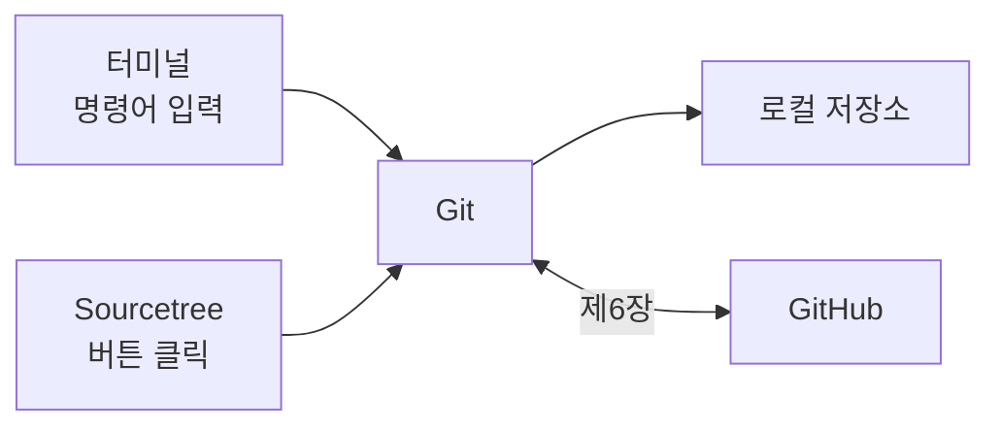

<!-- source: zh-TW/0-before-you-start/01-setup/README.md | sha: c338394334a7 -->

# 제1장 도구 준비: Git과 Sourcetree 설치

> 📍 **프로젝트와 변경의 현재 위치**
>
> - 프로젝트: 컴퓨터에는 아직 아무 도구도 없다. 이 장에서 Git, Sourcetree, GitHub 계정을 준비한다
> - 이전 단계: 버그가 발견됐다. 팬이 너무 늦게 돈다
> - **이 장: 변경은 아직 시작하지 않았다. 먼저 도구를 준비한다**
> - 다음 단계: 저장소를 만들고 수정을 스테이징 영역에 넣는다

---

## 준비할 것

| 도구 | 용도 | 필요한가 |
|---|---|---|
| Git | 버전 관리 그 자체 | 필수 |
| 터미널 | 명령어를 입력하는 곳. Windows는 Git과 함께 설치되는 Git Bash, macOS와 Linux는 기본 터미널을 쓴다 | 필수 |
| 코드 편집기 | 코드를 고친다. 어떤 것이든 된다 | 필수 |
| Sourcetree | Git의 GUI 도구. Windows와 macOS용만 있다 | 선택 |
| GitHub 계정 | 제6장부터 다른 사람과 협업할 때 쓴다 | 제6장 전까지 준비 |

도구들의 관계는 다음과 같습니다. Sourcetree의 버튼을 누르든 터미널에서 명령어를 입력하든, 실제로 일하는 것은 같은 Git입니다.



---

## 터미널의 세 가지 기본 동작

터미널을 써 본 적이 없어도 걱정하지 마세요. 이 책에서 필요한 동작은 세 가지뿐입니다.

```bash
pwd                          # 지금 어느 폴더에 있나
ls                           # 이 폴더에 무엇이 있나
cd ~/git-practice            # 폴더로 들어간다. ~는 홈 폴더를 뜻한다
```

`cd ..`는 한 단계 위로 올라갑니다. 경로를 반쯤 입력하고 Tab 키를 누르면 터미널이 나머지를 채워 줍니다.

> [!NOTE]
> **📖 용어｜터미널（終端機）**
>
> - **정의**: 글자로 명령어를 입력해 컴퓨터를 다루는 창이다.
> - **현장에서는**: 명령줄, 셸이라고도 부른다. 예를 들어 "터미널에서 `git status` 쳐 보면 알아요".
> - **관련 용어**: Git Bash, 명령어, 경로
> - **흔한 혼동**: Windows에 기본으로 있는 명령 프롬프트도 터미널의 한 종류지만, 많은 명령어가 다르고 예를 들어 `ls`가 없다. 이 책의 명령어는 Git Bash에서 입력한다.

---

## Git 설치

**Windows**: Git 공식 사이트 git-scm.com에서 설치 프로그램을 내려받습니다. 대부분의 화면은 기본값 그대로 두면 되고, 두 화면만 주의하세요.

1. **기본 편집기**: 기본값은 터미널 안에서 돌아가는 편집기라서, 써 본 적이 없는 사람은 금방 막힙니다. 익숙한 코드 편집기를 고르세요.
2. **새 저장소의 첫 브랜치 이름**: "Override the default branch name"을 고르고 `main`을 입력합니다.

줄 바꿈 설정은 기본값인 "Checkout Windows-style, commit Unix-style line endings"를 그대로 두세요.

**macOS**: 터미널을 열고 `git --version`을 입력합니다. 아직 설치되어 있지 않으면 명령줄 개발자 도구를 설치할지 묻는 창이 뜨니, 설치를 누르면 됩니다.

**Linux**: 배포판의 패키지 관리자로 설치합니다. 예를 들어 `sudo apt install git`입니다.

설치가 끝나면 버전을 확인합니다.

```bash
git --version
```

이 책은 `git switch`처럼 2019년 이후에 생긴 명령어를 씁니다. 나중에 `git switch`를 쳤을 때 명령어를 찾을 수 없다는 오류가 나오면 Git이 너무 오래된 것이니, 최신 버전으로 업데이트하세요.

---

## 첫 설정: git config

Git은 모든 커밋에 여러분의 이름과 이메일을 기록합니다. 처음 쓰기 전에 내가 누구인지 알려 줍니다.

```bash
git config --global user.name "Chen Xiao-Ming"
git config --global user.email "xiaoming@example.com"
git config --global init.defaultBranch main
```

- `--global`은 이 컴퓨터의 모든 저장소에 이 설정을 쓴다는 뜻입니다.
- `init.defaultBranch main`을 설정하면 새 저장소의 첫 브랜치 이름이 `main`이 됩니다. Git의 기본 이름은 오랫동안 `master`였고, 앞으로의 버전에서 `main`으로 바꿀 계획입니다. GitHub와 새로운 강좌들은 이미 `main`을 씁니다.

**Sourcetree에서는**: Sourcetree는 기본적으로 위의 설정을 그대로 씁니다. **Tools → Options → General**의 Default user information에서 입력할 수도 있습니다(macOS용은 **Settings → General**, 예전 버전에서는 Preferences라는 이름입니다).

> [!NOTE]
> **📖 용어｜설정, git config（設定）**
>
> - **정의**: 이름, 이메일, 기본 브랜치 이름 같은 Git의 여러 옵션이다. `git config`로 읽고 쓴다.
> - **현장에서는**: "global 이메일이 잘못 설정돼 있어요"라고 하면 `--global` 층의 설정을 가리킨다.
> - **관련 용어**: `--global`, `.gitconfig`, `.git/config`
> - **흔한 혼동**: Git의 설정과 GitHub 웹사이트의 계정 설정은 다른 것이다. GitHub 프로필을 바꿔도 컴퓨터가 커밋에 적는 이름은 바뀌지 않는다.

> [!TIP]
> **🔧 노하우｜이메일은 GitHub 계정과 같은 것이나, GitHub의 비공개용 주소를 쓴다**
>
> - **상황**: 처음 `user.email`을 설정하면서 떠오르는 주소를 아무거나 넣는다.
> - **방법**: GitHub 계정의 이메일을 넣는다. 주소를 공개하고 싶지 않으면 GitHub의 이메일 설정에서 비공개를 켜고, 제공되는 noreply 주소를 쓴다.
> - **이유**: GitHub는 이메일로 커밋한 사람을 판단한다. 공개 저장소에 푸시한 커밋의 이메일은 누구나 볼 수 있다.
> - **안 하면 어떻게 되나**: 커밋이 내 계정과 연결되지 않아 기여 기록이 비어 있게 된다. 아니면 개인 이메일이 공개되어 스팸 메일이 오기 시작한다.
> - **관련 장**: [제6장 원격 저장소](../../2-beyond-your-computer/06-remotes/README.md)

### 줄 바꿈 문자

Windows의 텍스트 파일은 각 줄 끝에 문자 두 개(CRLF)를 쓰고, macOS와 Linux는 하나(LF)만 씁니다. Git은 커밋할 때 LF로 통일하고, 꺼낼 때 시스템에 맞게 바꿔 줄 수 있습니다.

| 시스템 | 설정 |
|---|---|
| Windows | `core.autocrlf true`. 설치 프로그램이 기본으로 설정해 둔다 |
| macOS, Linux | `git config --global core.autocrlf input` |

> [!TIP]
> **🔧 노하우｜팀의 줄 바꿈 설정을 맞춘다**
>
> - **상황**: 같은 프로젝트에 Windows를 쓰는 사람과 macOS나 Linux를 쓰는 사람이 있다.
> - **방법**: 모두가 위의 표대로 설정한다. 팀에서 저장소에 `.gitattributes` 파일을 두어 줄 바꿈 방식을 통일할 수도 있다.
> - **이유**: 줄 바꿈 문자만 달라도 Git은 파일의 모든 줄이 바뀌었다고 본다.
> - **안 하면 어떻게 되나**: 한 줄만 고쳤는데 차이에는 파일 전체를 지우고 다시 쓴 것처럼 나온다. 리뷰하는 사람은 진짜 변경을 알 수 없고, 병합할 때도 충돌이 나기 쉽다.
> - **관련 장**: [제7장 풀 리퀘스트와 코드 리뷰](../../2-beyond-your-computer/07-pull-requests/README.md)

<details>
<summary><strong>🔍 더 알아보기｜설정의 세 가지 층</strong></summary>

Git의 설정은 세 층으로 나뉩니다. 범위가 좁을수록 우선합니다.

| 층 | 옵션 | 저장 위치 | 범위 |
|---|---|---|---|
| system | `--system` | Windows는 Git 설치 위치 안, macOS와 Linux는 보통 `/etc/gitconfig` | 이 컴퓨터의 모든 사용자 |
| global | `--global` | 홈 폴더의 `.gitconfig` | 내 모든 저장소 |
| local | 옵션 없음 | 저장소 안의 `.git/config` | 이 저장소만 |

그래서 global에는 개인 이메일을 설정하고, 회사 프로젝트 폴더에서 `git config user.email`을 실행해 업무용 이메일을 설정하면 그 저장소만 그 이메일을 씁니다. 어떤 설정이 어느 층에서 왔는지는 `git config --list --show-origin`으로 확인할 수 있습니다.

</details>

---

## GitHub 계정 만들기

github.com에서 계정을 만듭니다. GitHub는 2단계 인증(Two-Factor Authentication, 2FA)을 요구하므로, 휴대폰에 인증 앱을 준비하세요.

계정은 제6장 전까지만 준비하면 됩니다. Sourcetree를 쓴다면 다음 절에서 계정을 연결할 때 필요합니다. 푸시할 때 "내가 나"라는 것을 어떻게 증명하는지는 제6장에서 설명합니다.

---

## Sourcetree 설치와 GitHub 연결

**내려받기와 설치**: Sourcetree 공식 사이트 sourcetreeapp.com에서 내려받습니다. 설치 중에 로그인이나 계정 등록을 요구하면 화면 안내에 따라 마치거나 건너뛰면 됩니다.

**시스템의 Git 쓰기**(Windows): Sourcetree에는 자체 Git이 들어 있습니다. **Tools → Options → Git**에서 Git Version을 **System**으로 골라, Sourcetree와 터미널이 같은 Git, 같은 설정을 쓰게 합니다.

**GitHub 계정 연결**:

- Windows: **Tools → Options → Authentication → Add**에서 Hosting Service로 GitHub를 고르고, 브라우저로 로그인해 승인합니다.
- macOS: **Settings → Accounts → Add**에서 GitHub를 고르고, 브라우저로 로그인해 승인합니다.


*그림: ① Add 버튼. 계정을 추가한다 ② Hosting Service 메뉴. GitHub를 고른다 ③ 승인 버튼. 누르면 브라우저가 열려 로그인한다. 실제 화면은 버전과 운영체제에 따라 조금 다르다.*

---

## 🧪 따라 해 보기

**시작하기 전에**: 위의 설명대로 Git을 설치합니다. Sourcetree와 GitHub 계정은 나중에 준비해도 됩니다.

1. 터미널을 열고(Windows는 시작 메뉴에서 Git Bash를 찾습니다) Git이 설치됐는지 확인합니다: `git --version`
2. 이름, 이메일, 기본 브랜치를 설정합니다. macOS와 Linux는 줄 바꿈도 설정합니다.

   ```bash
   git config --global user.name "내 이름"
   git config --global user.email "내 이메일"
   git config --global init.defaultBranch main
   git config --global core.autocrlf input    # macOS, Linux만
   ```

3. global 설정을 나열합니다: `git config --global --list`
4. Sourcetree를 쓴다면: 설치한 뒤 시스템의 Git을 고르고 GitHub 계정을 연결합니다.
5. 제0장에서 이 책을 ZIP으로 내려받았다면, 이제 Git으로 다시 내려받을 수 있습니다. Git으로 인터넷에서 저장소를 가져오는 첫 경험입니다.

   ```bash
   git clone https://github.com/chenwei810/Git_Introduction.git
   ```

**이렇게 보이면 성공**: `git config --global --list`에 방금 설정한 내용이 나옵니다. 설정 이름은 소문자로 표시됩니다.

```text
user.name=Chen Xiao-Ming
user.email=xiaoming@example.com
init.defaultbranch=main
```

macOS와 Linux에서는 `core.autocrlf=input` 줄이 하나 더 있습니다.

---

## 📋 이 장의 명령어

| 하고 싶은 일 | 명령어 | Sourcetree에서는 |
|---|---|---|
| Git 버전 확인하기 | `git --version` | — |
| 이름과 이메일 설정하기 | `git config --global user.name`, `user.email` | Tools → Options → General(macOS: Settings → General) |
| 새 저장소의 브랜치 이름을 main으로 | `git config --global init.defaultBranch main` | — |
| 줄 바꿈 설정하기(macOS, Linux) | `git config --global core.autocrlf input` | — |
| global 설정 나열하기 | `git config --global --list` | — |
| GitHub 계정 연결하기 | — | Tools → Options → Authentication(macOS: Settings → Accounts) |

---

## 이 장의 핵심

1. 필요한 도구는 Git, 터미널, 코드 편집기다. Sourcetree는 선택 사항인 GUI 도구이고, 뒤에서 일하는 것은 같은 Git이다.
2. 처음 쓰기 전에 `git config --global`로 이름, 이메일, 기본 브랜치 `main`을 설정한다.
3. 이메일은 커밋 안에 공개된다. GitHub 계정과 같은 이메일이나 GitHub의 비공개용 주소를 쓴다.
4. 팀 전원의 줄 바꿈 설정을 맞춘다. 그렇지 않으면 한 줄만 고쳐도 파일 전체를 고친 것처럼 보인다.

---

## 참고 자료

- Scott Chacon, Ben Straub, 『[Pro Git](https://git-scm.com/book/ko/v2)』 2판, 1.5절(Git 설치)과 1.6절(Git 최초 설정)
- Git 공식 문서: [git-config](https://git-scm.com/docs/git-config)
- GitHub Docs: [커밋 이메일 주소 설정](https://docs.github.com/ko/account-and-profile/setting-up-and-managing-your-personal-account-on-github/managing-email-preferences/setting-your-commit-email-address)

---

[← 제0장 Git의 전체 그림](../00-overview/README.md) ｜ [목차](../../README.md) ｜ [제2장 세 가지 영역 →](../../1-on-your-computer/02-three-areas/README.md)
