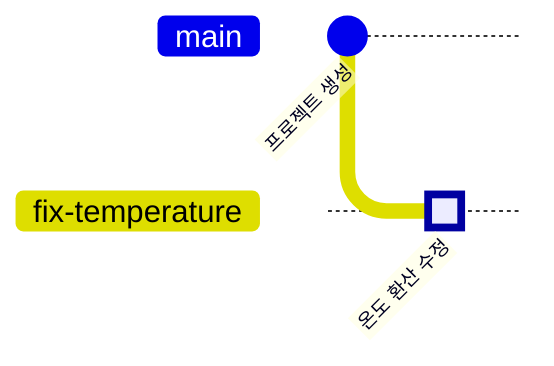

<!-- source: zh-TW/1-on-your-computer/03-commits/README.md | sha: 0d2783081470 -->

# 제3장 커밋의 정체: 스냅숏, 해시, 객체

> 📍 **프로젝트와 변경의 현재 위치**
>
> - 프로젝트: 저장소에 첫 커밋 "Initial commit"이 생겼다
> - 이전 단계: 수정을 작성해 스테이징 영역에 넣었다
> - **이 장: 수정은 스테이징 영역에서 기다린다. 먼저 첫 커밋을 열어, 커밋하고 나면 무엇이 되는지 본다**
> - 다음 단계: 새 브랜치를 만들고 거기에 수정을 커밋한다

---

## 커밋은 차이가 아니라 스냅숏

많은 사람이 커밋은 "이번에 어느 줄을 바꿨는지"를 기록한다고 생각합니다. 사실 Git이 기록하는 것은 **스냅숏**입니다. 커밋하는 그 순간 프로젝트 전체가 어떤 모습이었는지입니다.

작업 하나를 끝낼 때마다 프로젝트 전체의 단체 사진을 찍는 것과 같습니다. 다음에 찍을 때 바뀌지 않은 파일은 다시 찍지 않고, 앞 사진에 있던 것을 그대로 씁니다. 바뀐 파일만 새로 저장합니다.

그래서 스냅숏은 공간을 낭비하지 않습니다. "이번에 어느 줄을 바꿨는지"는 Git이 두 스냅숏을 비교해서 알아낸 것입니다. Git이 이웃한 두 버전뿐 아니라 아무 두 버전이나 비교할 수 있는 것도 이 때문입니다.

---

## 커밋 안에 있는 것

| 내용 | 설명 |
|---|---|
| 스냅숏 | 이 버전의 모든 파일 내용 |
| 바로 앞 커밋 | "앞 버전"으로 이어지는 연결. 첫 커밋에는 없다 |
| 작성자와 시각 | 누가 언제 이 변경을 썼는지 |
| 메시지 | 왜 이 변경을 했는지 |

이 내용으로 `21e1fda6273505ec510e3aec8e96e4888e3c597a` 같은 40글자짜리 번호를 계산합니다. 이것이 커밋의 주민등록번호입니다. 평소에는 `21e1fda`처럼 앞의 7글자만 씁니다.

> [!NOTE]
> **📖 용어｜커밋（提交）**
>
> - **정의**: 어떤 시점의 프로젝트 스냅숏에 작성자, 시각, 메시지, 바로 앞 커밋으로의 연결을 더한 것이다.
> - **현장에서는**: 명사로도 동사로도 쓴다. 예를 들어 "이 버그는 어느 커밋에서 들어왔어요?", "끝나면 커밋해 두세요".
> - **관련 용어**: 스냅숏, 해시 값, 부모 커밋, `git log`
> - **흔한 혼동**: 커밋은 아직 내 컴퓨터에만 있고 GitHub에는 없다. 다른 사람이 볼 수 있는 것은 푸시한 다음(제6장)이다.

> [!NOTE]
> **📖 용어｜해시 값（雜湊值）**
>
> - **정의**: 내용을 해시 함수(Hash Function)에 넣어 계산한, 길이가 정해진 번호다. 내용이 한 글자만 달라도 번호가 완전히 달라진다.
> - **현장에서는**: 커밋 해시, 커밋 ID, SHA라고도 부른다. 예를 들어 "문제 있는 커밋의 SHA 좀 보내 주세요".
> - **관련 용어**: 커밋, SHA-1, SHA-256
> - **흔한 혼동**: 일련번호가 아니라서 앞뒤 순서를 알 수 없다. 순서를 정하는 것은 커밋끼리의 "바로 앞" 연결이다.

---

## 기록 보기: git log

```bash
git log              # 전체 기록
git log --oneline    # 커밋 하나를 한 줄로
```

```text
commit 21e1fda6273505ec510e3aec8e96e4888e3c597a
Author: Chen Xiao-Ming <xiaoming@example.com>
Date:   Tue Oct 13 00:32:17 2026 +0800

    Initial commit
```

기록이 길면 터미널은 스크롤할 수 있는 화면에서 멈춥니다. 스페이스 바로 넘기고, `q`로 빠져나옵니다.

**Sourcetree에서는**: 왼쪽의 **History**. 한 줄이 커밋 하나이고, 왼쪽의 선이 커밋 그래프입니다.

지금 기록에는 점이 하나뿐입니다. 스테이징 영역에 있는 수정은 다음 장에서 두 번째 점이 됩니다.



---

## 커밋이 무엇을 바꿨는지 보기: git show

```bash
git show HEAD            # 최신 커밋과 그 변경 내용
git show --stat HEAD     # 어떤 파일을 몇 줄 바꿨는지만
```

`HEAD`는 "지금 있는 커밋"을 뜻합니다. 제4장에서 자세히 설명합니다. `HEAD` 대신 아무 커밋 번호나 쓸 수 있습니다.

**Sourcetree에서는**: History에서 커밋을 클릭하면 아래에 바뀐 파일이 나오고, 파일을 클릭하면 차이를 볼 수 있습니다.

> [!TIP]
> **🔧 노하우｜커밋 하나에는 한 가지 일만 담는다**
>
> - **상황**: 버그를 고치면서 서식도 정리하고 매개변수도 하나 조정해서, 한꺼번에 커밋하려고 한다.
> - **방법**: 커밋 세 개로 나눈다. 제2장의 스테이징 영역으로 한 번에 한 가지만 넣는다.
> - **이유**: 커밋은 나중에 따로 보고 따로 되돌릴 수 있는 단위다.
> - **안 하면 어떻게 되나**: 매개변수를 잘못 조정한 것을 알고 되돌리려 하면 버그 수정까지 함께 되돌아간다. 리뷰하는 사람도 어느 줄이 진짜 수정인지 알아보기 어렵다.
> - **관련 장**: [제9장 되돌리기](../../3-when-things-go-wrong/09-undoing-things/README.md)

> [!TIP]
> **🔧 노하우｜문제를 알릴 때는 커밋 번호를 붙인다**
>
> - **상황**: 테스트를 맡은 동료가 "새 펌웨어에 문제가 있어요"라고 한다.
> - **방법**: 어느 커밋을 올렸는지 묻는다. 아니면 빌드할 때 커밋 번호를 펌웨어에 기록해 두고 부팅할 때 출력한다.
> - **이유**: "새 버전"은 매일 바뀐다. 어느 코드인지 정확히 가리킬 수 있는 것은 커밋 번호뿐이다.
> - **안 하면 어떻게 되나**: 최신 코드에서는 문제를 찾을 수 없는데, 상대가 가진 것은 사흘 전 버전이라 서로 헛수고를 한다.
> - **관련 장**: [제8장 브랜치 전략과 릴리스](../../2-beyond-your-computer/08-branching-and-releases/README.md)

<details>
<summary><strong>🔍 더 알아보기｜blob, tree, commit 세 가지 객체</strong></summary>

`.git/objects/`에 저장된 것을 객체라고 합니다. 가장 흔한 것은 다음 세 가지입니다.

- **blob**: 파일 하나의 내용이다. 내용만 있고 파일 이름은 없다.
- **tree**: 폴더 하나다. 안에 있는 파일 이름과, 각각이 가리키는 blob이나 하위 폴더의 tree를 나열한다.
- **commit**: 맨 위의 tree를 가리키고, 부모 커밋, 작성자, 시각, 메시지를 더한다.

`git cat-file -p`로 어떤 객체든 열 수 있습니다.

```text
$ git cat-file -p HEAD
tree ba262450ee64e15410fdcb083ad5d02175363fb7
author Chen Xiao-Ming <xiaoming@example.com> 1791822737 +0800
committer Chen Xiao-Ming <xiaoming@example.com> 1791822737 +0800

Initial commit
```

모든 객체의 번호는 그 내용으로 계산합니다. 그래서 내용이 같은 파일은 번호도 반드시 같습니다. `git rev-parse HEAD:sensor.c`를 해 보면 책과 똑같은 `28a712d460300d19b5ccfad1dedb2fe190f91adc`가 나옵니다. 우리의 `sensor.c` 내용이 완전히 같기 때문입니다. 스냅숏이 공간을 낭비하지 않는 것도 이 덕분입니다. 바뀌지 않은 파일은 옛 스냅숏과 새 스냅숏이 같은 blob을 가리킵니다.

</details>

<details>
<summary><strong>🔍 더 알아보기｜SHA-1에서 SHA-256으로</strong></summary>

Git은 오랫동안 SHA-1 알고리즘으로 번호를 계산해 왔고, 결과는 16진수 40글자입니다. 그 뒤 SHA-1로는 내용이 다른데 번호가 같은 데이터를 일부러 만들 수 있다는 것이 밝혀졌습니다. Git은 이런 공격을 알아채는 장치를 더하고, 더 안전한 SHA-256도 지원하기 시작했습니다. SHA-256의 번호는 64글자입니다.

2020년대 중반 현재 대부분의 저장소와 호스팅 서비스는 아직 SHA-1을 쓰고 있고, Git 커뮤니티는 새 저장소의 기본값을 SHA-256으로 바꾸는 것을 계획하고 있습니다. 일반 사용자에게 달라지는 점은 번호가 길어지는 것뿐이고, 명령어 사용법은 그대로입니다.

</details>

---

## 자주 겪는 문제

| 상황 | 원인 | 해결 |
|---|---|---|
| 커밋 번호가 책과 다르다 | 작성자와 시각이 다르면 계산되는 번호도 다르다 | 정상이다 |
| `git log`의 작성자 이름이 틀리다 | 제1장의 `user.name` 설정이 잘못됐다 | 설정을 고치면 이후 커밋은 제대로 나온다 |

---

## 🧪 따라 해 보기

**시작하기 전에**: 제2장의 연습 프로젝트에 이어서 합니다. 이 장부터 시작하려면 이 책의 루트 폴더에서 `bash practice/setup.sh 3`을 실행합니다.

1. 기록을 보고 커밋이 하나 있는 것을 확인합니다. 화면이 멈추면 `q`를 누릅니다.

   ```bash
   cd ~/git-practice/fan-controller
   git log
   git log --oneline
   ```

   Sourcetree에서는: 왼쪽의 History.

2. 첫 커밋에 들어 있는 파일을 봅니다: `git show --stat HEAD`
3. 수정이 아직 스테이징 영역에 있고 커밋되지 않았는지 확인합니다: `git status`
4. "더 알아보기"를 읽은 사람은 커밋 객체를 열고 `sensor.c`의 blob 번호를 찾아봅니다.

   ```bash
   git cat-file -p HEAD
   git rev-parse HEAD:sensor.c
   ```

**이렇게 보이면 성공**: `git log --oneline`에는 `Initial commit` 한 줄만 나옵니다. `git show --stat HEAD`에는 파일 10개가 나옵니다. `git status`에서는 Changes to be committed 아래에 `modified: sensor.c`가 여전히 나옵니다. `git rev-parse HEAD:sensor.c`의 결과는 `28a712d460300d19b5ccfad1dedb2fe190f91adc`로, 책과 같습니다.

---

## 📋 이 장의 명령어

| 하고 싶은 일 | 명령어 | Sourcetree에서는 |
|---|---|---|
| 기록 보기 | `git log` | 왼쪽의 History |
| 커밋 하나를 한 줄로 | `git log --oneline` | History는 기본으로 이렇게 보인다 |
| 커밋이 무엇을 바꿨는지 보기 | `git show <번호>` | History에서 그 커밋 클릭 |
| 바뀐 파일만 보기 | `git show --stat <번호>` | History에서 커밋을 클릭하고 아래 파일 목록 보기 |
| 객체 열기 | `git cat-file -p <번호>` | — |

---

## 이 장의 핵심

1. 커밋은 프로젝트 전체의 스냅숏이지 차이가 아니다. 차이는 두 스냅숏을 비교해서 얻는다.
2. 커밋에는 스냅숏, 바로 앞 커밋, 작성자, 시각, 메시지가 들어 있고, 이 내용으로 고유한 번호를 계산한다.
3. `git log`로 기록을, `git show`로 커밋 하나의 변경 내용을 본다.
4. 커밋 하나에는 한 가지 일만 담는다. 그래야 나중에 따로 보고 따로 되돌릴 수 있다.

---

## 참고 자료

- Scott Chacon, Ben Straub, 『[Pro Git](https://git-scm.com/book/ko/v2)』 2판, 2.3절(커밋 히스토리 조회하기)과 10.2절(Git 개체)
- Git 공식 문서: [git-log](https://git-scm.com/docs/git-log), [git-cat-file](https://git-scm.com/docs/git-cat-file)

---

[← 제2장 세 가지 영역](../02-three-areas/README.md) ｜ [목차](../../README.md) ｜ [제4장 브랜치 →](../04-branches/README.md)
