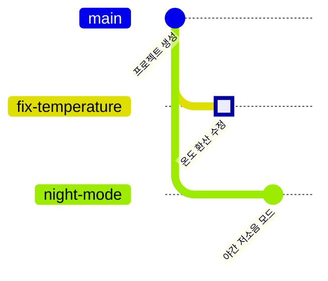

<!-- source: zh-TW/1-on-your-computer/04-branches/README.md | sha: a220b015c202 -->

# 제4장 브랜치: 사실은 메모지 한 장

> 📍 **프로젝트와 변경의 현재 위치**
>
> - 프로젝트: 온도 환산 수정과 "야간 저소음 모드" 개발, 두 가지를 동시에 해야 한다
> - 이전 단계: 수정이 스테이징 영역에서 기다리고 있다
> - **이 장: 수정이 새 브랜치 `fix-temperature`로 따라가고, 거기서 커밋 하나가 된다**
> - 다음 단계: 야간 저소음 모드가 먼저 `main`에 병합되고, 수정 브랜치와 충돌이 난다

---

## 왜 브랜치가 필요할까

`main`에 있는 코드는 언제든 보드에 올릴 수 있고 제대로 동작하는 버전이어야 합니다. 그런데 지금 해야 할 일이 두 가지 있습니다.

- 온도 환산을 고치고, 다 고치면 보드에서 확인한다.
- 야간 저소음 모드를 만든다. 며칠이 걸릴 수 있고, 중간의 미완성 코드는 아무도 건드리면 안 된다.

두 가지를 모두 `main`에서 바로 하면 미완성 코드가 섞여 들어오고, 확인 중인 수정이 새 기능을 방해합니다. **브랜치**(Branch)를 쓰면 각 일이 자기 선 위에서 진행되어 서로 방해하지 않고, 다 되면 `main`에 다시 병합하면 됩니다.

---

## 브랜치는 사실 메모지 한 장

커밋 하나하나가 앨범 속 사진이고, 모든 사진이 자기 바로 앞 사진이 무엇인지 기억한다고 생각해 보세요.

**브랜치는 어느 사진에 붙여 둔 메모지**이고, 거기에는 `main` 같은 이름이 적혀 있습니다. 그 브랜치에서 커밋하면 새 사진이 뒤에 이어지고, 메모지도 자동으로 새 사진으로 옮겨 갑니다.

새 브랜치를 만드는 것은 메모지를 한 장 더 붙이는 것뿐이고, 파일은 하나도 복사하지 않습니다. 그래서 Git에서는 브랜치를 만드는 데 거의 시간이 들지 않고, 하루에 여러 개를 만드는 것도 흔합니다.

또 **HEAD**라는 특별한 화살표가 있습니다. "당신은 여기에 있다"는 뜻이고, 보통 메모지 한 장을 가리켜 지금 어느 브랜치에 있는지 나타냅니다.

> [!NOTE]
> **📖 용어｜브랜치（分支）**
>
> - **정의**: 어떤 커밋을 가리키는 이름이다. 그 브랜치에서 커밋하면 자동으로 새 커밋으로 옮겨 간다.
> - **현장에서는**: "브랜치 따서 고쳐 주세요", "지금 어느 브랜치에 있어요?"
> - **관련 용어**: `main`, HEAD, `git switch`
> - **흔한 혼동**: 브랜치는 복사한 폴더가 아니다. 브랜치를 바꾸면 같은 폴더 안의 파일이 그 브랜치의 내용으로 바뀐다.

> [!NOTE]
> **📖 용어｜HEAD**
>
> - **정의**: "지금 있는 곳"을 나타내는 포인터다. 보통 브랜치를 가리키고, 브랜치를 거쳐 커밋을 가리킨다.
> - **현장에서는**: "HEAD가 어디 있어요?"는 지금 어느 브랜치, 어느 커밋에 있는지 묻는 말이다.
> - **관련 용어**: 브랜치, detached HEAD, `git switch`
> - **흔한 혼동**: 옛 강좌는 브랜치 전환에 `git checkout`을 쓴다. 이 명령어는 파일 복원까지 맡는 등 하는 일이 많아서, Git은 2019년에 `git switch`(브랜치 전환)와 `git restore`(파일 복원)를 추가해 일을 나눴다.

---

## 브랜치를 만들고 전환하기: git switch -c

**브랜치 나열 → 새 브랜치를 만들고 전환 → 커밋**

```bash
git branch                       # 모든 브랜치를 나열한다. *가 지금 있는 브랜치
git switch -c fix-temperature    # 새 브랜치를 만들고 그쪽으로 전환한다
git commit -m "Fix temperature sensor offset"
```

**Sourcetree에서는**: **도구 모음의 Branch → 브랜치 이름 입력 → Checkout New Branch가 체크되어 있는지 확인 → Create Branch**, 그다음 File Status에서 Commit을 누릅니다.

앞 장에서 스테이징 영역에 남겨 둔 수정은 새 브랜치로 따라오므로, 바로 커밋하면 됩니다.

> [!TIP]
> **🔧 노하우｜고치는 도중에 브랜치가 생각나도, 변경은 따라온다**
>
> - **상황**: `main`에서 코드를 이미 고친 뒤에야 브랜치를 만들었어야 했다는 것을 깨닫는다.
> - **방법**: 그냥 `git switch -c 새-브랜치-이름`을 실행한다. 아직 커밋하지 않은 변경은 작업 디렉터리에 있든 스테이징 영역에 있든 함께 따라간다.
> - **이유**: 새 브랜치를 만드는 것은 메모지 한 장을 붙이는 것뿐이라, 폴더 안의 파일은 전혀 움직이지 않는다.
> - **안 하면 어떻게 되나**: 먼저 `main`에 커밋한 다음 옮겨야 한다고 생각해서 미완성 코드가 `main`에 들어간다. 아니면 파일을 손으로 다른 곳에 복사했다가, 결국 어느 쪽이 새것인지 모르게 된다.
> - **관련 장**: [제2장 세 가지 영역](../02-three-areas/README.md)

---

## 브랜치 전환하기: git switch

```bash
git switch main
```

**Sourcetree에서는**: 왼쪽의 **Branches** 아래에서 브랜치 이름을 더블클릭합니다.

전환한 다음 `sensor.c`를 열어 보세요. `main`에는 아직 버그가 있는 `(mv - 600)`이 그대로 있습니다. 수정은 `fix-temperature` 브랜치에만 있고, 그쪽으로 전환하면 다시 나타납니다.

> [!TIP]
> **🔧 노하우｜브랜치를 바꾸기 전에 손에 든 변경부터 정리한다**
>
> - **상황**: 한 브랜치에서 고치는 도중에, 갑자기 다른 브랜치로 가서 뭔가를 봐야 한다.
> - **방법**: 먼저 커밋하거나, `git stash`로 변경을 잠시 치워 둔 다음(제9장) 전환한다.
> - **이유**: 커밋하지 않은 변경은 어느 브랜치에도 속하지 않고, 전환하면 그대로 따라온다.
> - **안 하면 어떻게 되나**: 고친 파일의 내용이 두 브랜치에서 다르면 Git이 전환을 거부한다. 그렇지 않으면 변경이 다른 브랜치로 따라가서, 엉뚱한 곳에 커밋하기 쉽다.
> - **관련 장**: [제9장 되돌리기](../../3-when-things-go-wrong/09-undoing-things/README.md)

---

## 두 번째 브랜치: 야간 저소음 모드

야간 저소음 모드는 온도 측정값을 평균 내서, 팬이 기준 온도 근처에서 켜졌다 꺼졌다를 반복하지 않게 하는 기능입니다. `main`으로 돌아온 다음 브랜치를 하나 더 만듭니다.

```bash
git switch -c night-mode
# sensor.c의 return 줄을 return smooth((mv - 600) / 10.0f);로 바꾼다
git commit -am "Smooth temperature readings for night mode"
```

`-a`는 Git이 이미 추적하고 있는 파일 중 바뀐 것을 모두 스테이징 영역에 넣은 뒤 커밋합니다. 완전히 새로운 파일은 들어가지 않으니, 그런 파일은 먼저 `git add`해야 합니다.

이제 기록이 두 선으로 갈라졌고, 둘 다 "프로젝트 생성"에서 뻗어 나왔습니다.



터미널에서는 `--graph`로 같은 그림을 그릴 수 있습니다.

```text
$ git log --oneline --graph --all
* 8303532 Smooth temperature readings for night mode
| * 5b16173 Fix temperature sensor offset
|/
* 21e1fda Initial commit
```

두 브랜치가 모두 `sensor.c`의 같은 줄을 고쳤다는 점에 주목하세요. 다음 장에서 둘을 합칠 때 충돌이 납니다.

<details>
<summary><strong>🔍 더 알아보기｜브랜치의 정체는 텍스트 파일 하나</strong></summary>

브랜치는 `.git/refs/heads/` 아래에 있습니다. 브랜치 하나가 파일 하나이고, 내용은 커밋 번호 한 줄뿐입니다.

```text
$ cat .git/refs/heads/fix-temperature
5b161734b18d772125579ecab6dcdce2955b740c
$ cat .git/HEAD
ref: refs/heads/main
```

브랜치를 만든다는 것은 41바이트짜리 작은 파일을 쓰는 것이고, 커밋하면 그 안의 번호가 바뀝니다. 그래서 아무리 큰 프로젝트라도 브랜치는 순식간에 만들어집니다. 브랜치가 많으면 Git이 이것들을 `.git/packed-refs`에 모아 적기도 하지만, 원리는 같습니다. `HEAD` 파일은 지금 어느 브랜치에 있는지를 기록합니다.

브랜치가 아니라 커밋으로 바로 전환하면, 예를 들어 `git switch --detach 21e1fda`처럼 하면 HEAD가 커밋을 직접 가리킵니다. 이것을 **detached HEAD**라고 합니다. 옛 버전을 들여다보기에는 충분하지만, 새로 만든 커밋은 어느 브랜치에도 속하지 않아서 다른 곳으로 전환하면 다시 찾기 어렵습니다. 남기고 싶다면 먼저 `git switch -c 새-브랜치-이름`으로 메모지를 붙여 두세요.

</details>

---

## 자주 겪는 문제

| 상황 | 원인 | 해결 |
|---|---|---|
| `fatal: a branch named '…' already exists` | 이미 쓰고 있는 브랜치 이름이다 | 다른 이름을 쓰거나 `git switch`로 그 브랜치로 전환한다 |
| `Your local changes … would be overwritten` | 손에 든 변경이 전환할 브랜치와 부딪힌다 | 먼저 커밋하거나 `git stash`한 뒤 전환한다 |
| `HEAD detached at …` | 브랜치가 아니라 커밋으로 전환했다 | `git switch main`으로 브랜치로 돌아간다 |

---

## 🧪 따라 해 보기

**시작하기 전에**: 제3장의 연습 프로젝트에 이어서 합니다. 이 장부터 시작하려면 이 책의 루트 폴더에서 `bash practice/setup.sh 4`를 실행합니다.

1. 수정용 브랜치를 만듭니다. 수정이 따라오니 바로 커밋합니다.

   ```bash
   cd ~/git-practice/fan-controller
   git switch -c fix-temperature
   git status
   git commit -m "Fix temperature sensor offset"
   ```

2. `main`으로 돌아가 `sensor.c`가 다시 `(mv - 600)`이 됐는지 확인합니다: `git switch main`
3. 야간 저소음 모드 브랜치를 만듭니다. 편집기에서 `sensor.c`의 `return (mv - 600) / 10.0f;`를 `return smooth((mv - 600) / 10.0f);`로 바꾼 다음 커밋합니다.

   ```bash
   git switch -c night-mode
   git commit -am "Smooth temperature readings for night mode"
   ```

4. `main`으로 돌아가 기록을 그립니다.

   ```bash
   git switch main
   git log --oneline --graph --all
   git branch
   ```

   Sourcetree에서는: 왼쪽의 History에서 위쪽 메뉴로 모든 브랜치(All Branches)를 표시하도록 고릅니다.

**이렇게 보이면 성공**: 기록이 두 선으로 갈라지고, `fix-temperature`와 `night-mode`가 모두 `Initial commit`에서 뻗어 나옵니다. `git branch`에는 브랜치 세 개가 나오고, `main` 앞에 `*`가 있습니다.

---

## 📋 이 장의 명령어

| 하고 싶은 일 | 명령어 | Sourcetree에서는 |
|---|---|---|
| 브랜치 나열하기 | `git branch` | 왼쪽의 Branches |
| 새 브랜치를 만들고 전환하기 | `git switch -c <이름>` | 도구 모음의 Branch |
| 브랜치 전환하기 | `git switch <이름>` | 왼쪽의 브랜치 이름 더블클릭 |
| 바뀐 파일을 모두 커밋하기 | `git commit -am "메시지"` | Stage All → Commit |
| 모든 브랜치의 기록 그리기 | `git log --oneline --graph --all` | History에서 All Branches 선택 |

---

## 이 장의 핵심

1. 브랜치를 쓰면 버그 수정과 새 기능 개발이 각자의 선에서 진행되고, `main`은 언제나 쓸 수 있는 상태로 남는다.
2. 브랜치는 커밋에 붙인 메모지일 뿐이다. 브랜치를 만들어도 파일을 복사하지 않으므로 시간이 거의 들지 않는다.
3. HEAD는 "당신은 여기에 있다"는 뜻이다. 브랜치를 바꾸면 폴더 안의 파일이 그 브랜치의 내용으로 바뀐다.
4. 커밋하지 않은 변경은 브랜치를 바꿀 때 따라온다. 바꾸기 전에 커밋하거나 치워 둔다.

---

## 참고 자료

- Scott Chacon, Ben Straub, 『[Pro Git](https://git-scm.com/book/ko/v2)』 2판, 3.1절(브랜치란 무엇인가)
- Git 공식 문서: [git-switch](https://git-scm.com/docs/git-switch), [git-branch](https://git-scm.com/docs/git-branch)

---

[← 제3장 커밋의 정체](../03-commits/README.md) ｜ [목차](../../README.md) ｜ [제5장 병합과 충돌 →](../05-merging-and-conflicts/README.md)
