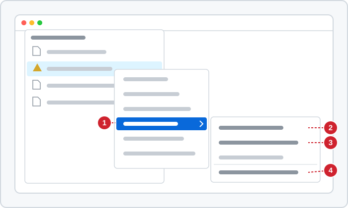
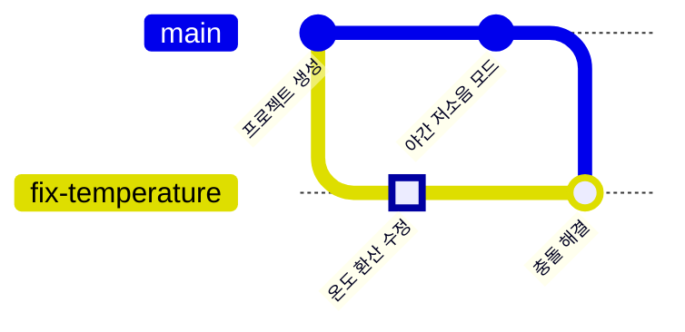

<!-- source: zh-TW/1-on-your-computer/05-merging-and-conflicts/README.md | sha: efb028ad41e5 -->

# 제5장 병합과 충돌: merge, rebase, 충돌 해결

> 📍 **프로젝트와 변경의 현재 위치**
>
> - 프로젝트: 야간 저소음 모드가 완성되어 `main`에 병합된다
> - 이전 단계: 수정이 `fix-temperature` 브랜치에서 커밋 하나가 됐다
> - **이 장: `main`과 수정이 같은 줄을 고쳤으므로, 수정 브랜치에서 충돌을 해결한다**
> - 다음 단계: 프로젝트를 GitHub에 푸시한다

---

## 병합이란

브랜치를 쓰면 두 가지 일이 각자의 선에서 진행됩니다. 일이 끝나면 선을 다시 이어야 합니다. 이것이 **병합**(Merge)입니다.

Git의 병합에는 두 경우가 있습니다. 메모지를 앞으로 옮기기만 하면 되는 경우와, 양쪽의 변경을 정말로 하나로 합쳐야 하는 경우입니다.

---

## 가장 간단한 경우: 빨리 감기 병합

야간 저소음 모드가 다 됐으니 `main`에 병합합니다. `night-mode`를 만든 뒤로 `main`에는 새 커밋이 하나도 없었습니다. 그래서 `night-mode`는 "`main`이 몇 걸음 더 나아간 것"일 뿐입니다.

이때 Git은 `main`의 메모지를 `night-mode` 위치로 옮기기만 하면 됩니다. 이것을 **빨리 감기**(Fast-forward)라고 합니다.

```bash
git switch main
git merge night-mode
git branch -d night-mode    # 병합이 끝났으니 이 브랜치를 지운다
```

```text
Updating 21e1fda..8303532
Fast-forward
 sensor.c | 2 +-
```

**Sourcetree에서는**: 먼저 `main`으로 전환하고, 왼쪽의 `night-mode`를 오른쪽 클릭해 **Merge night-mode into current branch**를 고릅니다.

브랜치를 지우는 것은 메모지를 떼어 내는 것뿐이고, 커밋은 모두 `main`의 기록에 남아 있습니다.

---

## 두 선이 모두 나아갔을 때: 3-way 병합

다음은 수정 브랜치가 `main`을 따라잡게 할 차례입니다. 이번에는 사정이 다릅니다. 수정 브랜치에는 자기 커밋이 있고, `main`에도 야간 저소음 모드가 들어왔습니다. 두 선이 모두 나아갔습니다.

Git은 세 버전을 비교합니다. 두 선 각각의 최신 버전, 그리고 둘이 갈라진 지점입니다. 이 갈라진 지점을 **병합 기준**(Merge Base)이라고 합니다. 양쪽이 서로 다른 곳을 고쳤다면 Git이 자동으로 합치고, "바로 앞"이 둘인 병합 커밋을 만듭니다. 이 방식을 **3-way 병합**(Three-way Merge)이라고 합니다.

> [!NOTE]
> **📖 용어｜병합（合併）**
>
> - **정의**: 다른 브랜치의 변경을 현재 브랜치로 가져오는 것이다. 필요하면 바로 앞 커밋이 둘인 병합 커밋을 만든다.
> - **현장에서는**: "이거 main에 머지했어요?", "먼저 main을 자기 브랜치에 머지하세요". 현장에서는 "머지"라고 많이 부른다.
> - **관련 용어**: 빨리 감기, 병합 커밋, 병합 기준, rebase
> - **흔한 혼동**: `git merge night-mode`는 `night-mode`를 "지금 있는 브랜치"로 가져오는 것이지, 반대가 아니다. 병합하기 전에 내가 어느 브랜치에 있는지 확인한다.

> [!TIP]
> **🔧 노하우｜먼저 main을 내 브랜치에 병합하고, 충돌은 내 브랜치에서 해결한다**
>
> - **상황**: 내 브랜치 작업은 끝났는데, 그사이 `main`에도 새 커밋이 생겼다.
> - **방법**: 먼저 내 브랜치에서 `git merge main`을 실행하고, 충돌을 해결해 코드가 제대로 도는지 확인한 다음 `main`에 병합한다.
> - **이유**: 내 브랜치에서 충돌을 해결하면, 실수해도 영향은 나에게만 미친다. `main`에는 이미 통합된 버전만 들어간다.
> - **안 하면 어떻게 되나**: `main`에서 바로 병합하다 충돌을 잘못 해결하면 `main`이 망가지고, 모두가 받아 간 코드가 돌지 않는다.
> - **관련 장**: [제7장 풀 리퀘스트와 코드 리뷰](../../2-beyond-your-computer/07-pull-requests/README.md)

---

## 충돌: 양쪽이 같은 줄을 고쳤다

```bash
git switch fix-temperature
git merge main
```

```text
Auto-merging sensor.c
CONFLICT (content): Merge conflict in sensor.c
Automatic merge failed; fix conflicts and then commit the result.
```

두 브랜치가 모두 `sensor.c`의 `return` 줄을 고쳤기 때문에, Git은 어느 쪽을 따라야 할지 몰라 멈추고 여러분에게 묻습니다. `sensor.c`를 열면 Git이 넣은 **충돌 표시**가 보입니다.

```text
<<<<<<< HEAD
    return (mv - 500) / 10.0f;
=======
    return smooth((mv - 600) / 10.0f);
>>>>>>> main
```

`<<<<<<< HEAD`부터 `=======`까지는 현재 브랜치의 버전이고, `=======`부터 `>>>>>>> main`까지는 `main`의 버전입니다.

**양쪽 이해하기 → 올바른 내용으로 고치기 → 표시 지우기 → git add → git commit**

1. **양쪽 이해하기**: 위는 수정(600을 500으로), 아래는 야간 저소음 모드(`smooth` 추가)입니다. 둘 다 남겨야 합니다.
2. **올바른 내용으로 고치기**: `return smooth((mv - 500) / 10.0f);`
3. **표시 세 줄을 지우고** 저장합니다.
4. **git add**: 이 파일의 충돌을 해결했다고 Git에 알립니다.
5. **git commit**: 병합을 마칩니다. `--no-edit`는 Git의 기본 병합 메시지를 그대로 쓴다는 뜻입니다.

```bash
git add sensor.c
git commit --no-edit
```

**Sourcetree에서는**: 충돌한 파일은 File Status에 경고 아이콘과 함께 나옵니다. 오른쪽 클릭으로 **Resolve Conflicts**를 고르면 한쪽만 쓸지(Resolve Using 'Mine' 또는 'Theirs'), 병합 도구를 열지 고를 수 있습니다. 이번에는 둘 다 남겨야 하므로 편집기에서 손으로 고친 다음, 오른쪽 클릭으로 **Resolve Conflicts → Mark Resolved**를 고르고 Commit합니다.



*그림: 경고 아이콘이 붙은 충돌 파일을 오른쪽 클릭한다. ① Resolve Conflicts 하위 메뉴 ② Resolve Using 'Mine'. 현재 브랜치의 버전만 쓴다 ③ Resolve Using 'Theirs'. 상대 쪽 버전만 쓴다 ④ Mark Resolved. 손으로 고친 뒤 해결됨으로 표시한다.*

> [!NOTE]
> **📖 용어｜충돌（衝突）**
>
> - **정의**: 두 브랜치가 같은 곳을 고쳐서, 어느 쪽을 쓸지 Git이 자동으로 정할 수 없고 사람이 판단해야 하는 상태다.
> - **현장에서는**: "머지했더니 컨플릭트 났어요", "컨플릭트 좀 풀어 주세요".
> - **관련 용어**: 충돌 표시, 병합 기준, `git merge --abort`
> - **흔한 혼동**: 충돌은 오류가 아니고, 누가 잘못했다는 뜻도 아니다. 두 사람이 같은 곳을 고쳤으니, 코드를 아는 사람이 판단하면 된다.

> [!TIP]
> **🔧 노하우｜충돌 해결은 둘 중 하나 고르기가 아니다**
>
> - **상황**: 충돌이 났고, Sourcetree가 "내 것 쓰기"와 "상대 것 쓰기" 두 버튼을 보여 준다.
> - **방법**: 먼저 양쪽이 각각 무엇을 하려 했는지 이해하고, 둘을 모두 만족하는 버전을 쓴다. 확신이 없으면 상대 쪽을 쓴 사람에게 묻는다.
> - **이유**: 충돌의 양쪽은 대개 모두 의미 있는 변경이고, 우연히 같은 줄에 닿았을 뿐이다.
> - **안 하면 어떻게 되나**: "내 것"을 고르면 야간 저소음 모드가 조용히 사라지고, "상대 것"을 고르면 고친 버그가 되살아난다. 코드는 그대로 컴파일되니, 문제는 보드에서 돌려 봐야 드러난다.
> - **관련 장**: [제9장 되돌리기](../../3-when-things-go-wrong/09-undoing-things/README.md)

병합이 끝나면 수정 브랜치는 수정과 야간 저소음 모드를 모두 갖게 됩니다.



---

## 또 다른 방법: rebase

**리베이스**(Rebase)도 `main`을 따라잡는 방법입니다. 병합 커밋을 만들지 않고, 내 브랜치의 커밋을 하나씩 최신 `main`의 끝에 다시 붙입니다. 기록이 한 줄의 직선이 됩니다.

| | merge | rebase |
|---|---|---|
| 기록의 모양 | 갈림길을 남기고 병합 커밋이 하나 늘어난다 | 한 줄의 직선 |
| 원래 커밋 | 그대로 | 새 커밋이 되고, 번호가 모두 바뀐다 |
| 충돌 | 한 번에 해결한다 | 커밋마다 해결해야 할 수도 있다 |
| 알맞은 경우 | 이미 다른 사람과 공유한 브랜치 | 나만 쓰고 아직 푸시하지 않은 브랜치 |

**Sourcetree에서는**: `main`을 오른쪽 클릭해 **Rebase current changes onto main**을 고릅니다.

이 책의 연습에서는 merge를 씁니다. rebase는 유용하지만 커밋을 고쳐 쓰므로, 이미 다른 사람에게 공유한 커밋은 rebase하면 안 됩니다. 이유는 제9장에서 설명합니다.

<details>
<summary><strong>🔍 더 알아보기｜3-way 병합은 어떻게 판단할까</strong></summary>

Git은 병합 기준 B, 현재 브랜치 O(ours), 상대 브랜치 T(theirs) 세 버전을 부분마다 비교합니다.

| B와 O | B와 T | 결과 |
|---|---|---|
| 같다 | 같다 | 그대로 |
| 다르다 | 같다 | O를 쓴다 |
| 같다 | 다르다 | T를 쓴다 |
| 다르다 | 다르지만, 양쪽이 똑같이 고쳤다 | 고친 내용을 쓴다 |
| 다르다 | 다르고, 양쪽의 고친 방식도 다르다 | 충돌 |

그래서 한쪽만 고친 곳은 Git이 반드시 자동으로 처리합니다. `git merge-base main fix-temperature`를 실행하면 병합 기준이 어느 커밋인지 알 수 있습니다.

커밋과 그 "바로 앞" 커밋의 연결은 방향성 비순환 그래프(Directed Acyclic Graph, DAG)를 이룹니다. 모든 간선이 과거를 향하고, 빙 돌아 제자리로 오지 않습니다. 병합 커밋은 간선이 두 개 나가는 점입니다. `git log --graph`가 그리는 것이 바로 이 그래프입니다.

</details>

---

## 자주 겪는 문제

| 상황 | 원인 | 해결 |
|---|---|---|
| 낯선 편집기 화면이 뜬다 | `--no-edit`를 붙이지 않아서 Git이 병합 메시지용 편집기를 열었다 | 터미널 안에서 도는 편집기라면, 보통 Esc를 누르고 `:wq`를 입력한 뒤 Enter |
| 도중에 포기하고 싶다 | — | `git merge --abort`로 병합 전으로 돌아간다 |
| 컴파일이 실패하고 `<<<<<<<`가 남아 있다 | 충돌 표시를 지우는 것을 잊었다 | `<<<<<<<`를 찾아 고친 뒤 다시 커밋한다 |

---

## 🧪 따라 해 보기

**시작하기 전에**: 제4장의 연습 프로젝트에 이어서 합니다. 이 장부터 시작하려면 이 책의 루트 폴더에서 `bash practice/setup.sh 5`를 실행합니다.

1. 야간 저소음 모드를 `main`에 빨리 감기로 병합하고, 그 브랜치를 지웁니다.

   ```bash
   cd ~/git-practice/fan-controller
   git switch main
   git merge night-mode
   git branch -d night-mode
   ```

2. 수정 브랜치로 전환해 `main`을 병합합니다. 여기서 충돌이 납니다.

   ```bash
   git switch fix-temperature
   git merge main
   ```

3. 편집기로 `sensor.c`를 열고, 충돌 표시와 그 사이의 두 줄을 다음 한 줄로 바꿔 저장합니다.

   ```c
       return smooth((mv - 500) / 10.0f);
   ```

4. 해결됨으로 표시하고 병합을 마친 뒤, `main`으로 돌아가 기록을 봅니다.

   ```bash
   git add sensor.c
   git commit --no-edit
   git switch main
   git log --oneline --graph --all
   ```

**이렇게 보이면 성공**: 1단계에서 `Fast-forward`, 2단계에서 `CONFLICT`가 나옵니다. 마지막 그래프에서 `fix-temperature`에 `Merge branch 'main' into fix-temperature`가 있고, 두 선이 거기서 이어집니다.

---

## 📋 이 장의 명령어

| 하고 싶은 일 | 명령어 | Sourcetree에서는 |
|---|---|---|
| 어떤 브랜치를 현재 브랜치에 병합하기 | `git merge <브랜치>` | 브랜치 오른쪽 클릭 → Merge … into current branch |
| 병합이 끝난 브랜치 지우기 | `git branch -d <브랜치>` | 브랜치 오른쪽 클릭 → Delete |
| 충돌을 해결됨으로 표시하기 | `git add <파일>` | 파일 오른쪽 클릭 → Resolve Conflicts → Mark Resolved |
| 기본 메시지로 병합 마치기 | `git commit --no-edit` | Commit |
| 이번 병합 그만두기 | `git merge --abort` | — |
| 브랜치를 main 끝에 다시 붙이기 | `git rebase main` | main 오른쪽 클릭 → Rebase current changes onto main |

---

## 이 장의 핵심

1. 병합 대상 브랜치에 새 커밋이 없으면 병합은 메모지를 앞으로 옮길 뿐이다. 이것을 빨리 감기라고 한다.
2. 양쪽이 모두 나아갔으면 Git은 병합 기준과 양쪽 버전으로 3-way 병합을 한다. 같은 곳을 고쳤을 때만 충돌이 난다.
3. 충돌 해결은 먼저 양쪽의 의도를 이해하고 둘을 모두 만족하는 버전을 쓰는 것이다. 둘 중 하나를 고르는 것이 아니다.
4. 먼저 `main`을 내 브랜치에 병합해 충돌을 해결하고, `main`에는 통합된 버전만 넣는다.
5. rebase는 기록을 직선으로 만들지만 커밋을 고쳐 쓴다. 이미 공유한 커밋은 rebase하지 않는다.

---

## 참고 자료

- Scott Chacon, Ben Straub, 『[Pro Git](https://git-scm.com/book/ko/v2)』 2판, 3.2절(브랜치와 Merge의 기초)과 3.6절(Rebase하기)
- Git 공식 문서: [git-merge](https://git-scm.com/docs/git-merge), [git-rebase](https://git-scm.com/docs/git-rebase)

---

[← 제4장 브랜치](../04-branches/README.md) ｜ [목차](../../README.md) ｜ [제6장 원격 저장소 →](../../2-beyond-your-computer/06-remotes/README.md)
