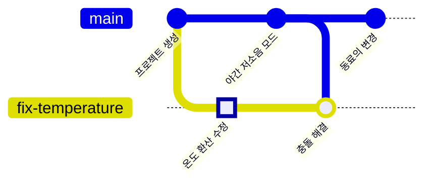

<!-- source: zh-TW/2-beyond-your-computer/06-remotes/README.md | sha: 80c96fea1cc8 -->

# 제6장 원격 저장소: clone, fetch, pull, push

> 📍 **프로젝트와 변경의 현재 위치**
>
> - 프로젝트: GitHub에 푸시하고, 동료가 clone한 뒤 자기 변경도 하나 푸시한다
> - 이전 단계: 수정 브랜치에서 충돌을 해결했다
> - **이 장: 수정 브랜치가 GitHub에 푸시된다**
> - 다음 단계: 풀 리퀘스트를 만들고 동료에게 리뷰를 부탁한다

---

## 원격이란

지금까지 모든 기록은 내 컴퓨터에만 있었습니다. 동료가 참여하려면, 모두가 접근할 수 있는 곳에 같은 저장소의 사본을 하나 두어야 합니다. 이 사본을 **원격 저장소**(Remote Repository)라고 하고, 보통 GitHub에 둡니다.

함께 쓰는 클라우드 사진첩이라고 생각해 보세요. 각자의 휴대폰에 모든 사진이 있지만(분산형), 모두가 클라우드에 있는 것을 기준으로 삼기로 약속합니다. 새 사진을 찍으면 올리고, 다른 사람이 올린 사진은 내려받습니다.

| 동작 | 명령어 | 방향 |
|---|---|---|
| 처음으로 저장소를 통째로 복사한다 | `git clone` | GitHub → 내 컴퓨터 |
| 내 커밋을 올려 보낸다 | `git push` | 내 컴퓨터 → GitHub |
| 다른 사람의 커밋을 가져오되, 내 파일은 건드리지 않는다 | `git fetch` | GitHub → 내 컴퓨터 |
| 가져와서 현재 브랜치에 병합한다 | `git pull` | GitHub → 내 컴퓨터 |

> [!NOTE]
> **📖 용어｜원격과 origin（遠端與 origin）**
>
> - **정의**: 원격은 다른 곳에 있는 같은 저장소이고, 보통 GitHub에 있다. `origin`은 기본으로 거기에 붙는 이름이다.
> - **현장에서는**: "origin에 푸시해 주세요", "origin의 main에 새 커밋이 들어왔어요".
> - **관련 용어**: `git remote`, `origin/main`, clone, push
> - **흔한 혼동**: `origin`은 이름일 뿐 명령어가 아니고, 꼭 GitHub를 가리키는 것도 아니다. 저장소 하나가 원격을 여러 개 갖고, 각각 다른 이름을 붙일 수도 있다.

---

## GitHub에 저장소 만들기

GitHub에서 **New repository**를 누르고, 이름에 `fan-controller`를 넣고, Public이나 Private을 고른 뒤 Create repository를 누릅니다. 만들어진 페이지에 `https://github.com/내-계정/fan-controller.git` 같은 저장소 주소가 나옵니다.

> [!TIP]
> **🔧 노하우｜기록이 있는 프로젝트를 푸시하려면 GitHub 쪽은 빈 저장소로 만든다**
>
> - **상황**: GitHub에서 저장소를 만들 때 README, .gitignore, 라이선스를 함께 추가하는 옵션이 보인다.
> - **방법**: 프로젝트에는 이미 내 컴퓨터의 커밋이 있으니, 이 옵션들은 하나도 체크하지 않고 빈 저장소를 만든다.
> - **이유**: 체크하면 GitHub 쪽에 자기만의 커밋이 먼저 생기고, 내 컴퓨터의 기록과는 아무 관계가 없게 된다.
> - **안 하면 어떻게 되나**: 첫 푸시부터 거부당한다. 초보자는 이때 강제 푸시로 억지로 덮어쓰거나, 점점 더 꼬이게 만들기 쉽다.
> - **관련 장**: [제10장 좋은 습관](../../3-when-things-go-wrong/10-good-habits/README.md)

---

## 원격에 연결하고 푸시하기: git remote add, git push

```bash
git remote add origin https://github.com/내-계정/fan-controller.git
git push -u origin main
git push -u origin fix-temperature
```

- `git remote add`는 이 주소에 `origin`이라는 이름을 붙입니다.
- `-u`를 붙이면 로컬 브랜치가 "나는 origin의 어느 브랜치에 대응하는지"를 기억합니다. 그다음부터 그 브랜치에서는 `git push`만 치면 됩니다.

**Sourcetree에서는**: **도구 모음의 Settings → Remotes → Add**(macOS용은 메뉴의 **Repository → Repository Settings**)에서 이름에 `origin`을 넣고 주소를 붙여 넣습니다. 그다음 도구 모음의 **Push**를 누르고, 푸시할 브랜치와 Track 열에 체크합니다.

**내가 나임을 증명하기**: 처음 푸시할 때 GitHub는 신원을 확인합니다. 비밀번호 칸에 GitHub 로그인 비밀번호를 넣을 수는 **없습니다**. 흔히 쓰는 방법은 세 가지입니다.

- 브라우저로 승인한다. Windows용 Git에는 이 기능이 들어 있어 브라우저가 자동으로 뜹니다.
- GitHub 개발자 설정에서 개인 액세스 토큰(Personal Access Token)을 만들어 비밀번호 칸에 붙여 넣는다. 만들 때 Repository access에서 이 저장소를 고르고, Permissions의 Contents를 Read and write로 설정합니다(classic 토큰이라면 `repo`에 체크). 그렇지 않으면 푸시가 거부됩니다.
- SSH 키를 설정하고 `git@github.com:`으로 시작하는 주소를 쓴다. 이미 `origin`을 추가했다면 `git remote set-url origin git@github.com:내-계정/fan-controller.git`으로 주소를 바꿉니다.

제1장에서 GitHub 계정을 연결한 Sourcetree 사용자는 따로 할 일이 없습니다.

---

## clone: 동료가 프로젝트를 복사해 간다

동료가 합류하면 가장 먼저 저장소 전체를 자기 컴퓨터로 복사합니다.

```bash
git clone https://github.com/내-계정/fan-controller.git
```

**Sourcetree에서는**: 새 탭의 **Clone**(macOS용은 **New → Clone from URL**)에서 주소를 붙여 넣고 둘 폴더를 고릅니다.

clone하면 전체 기록을 가져오고, 가져온 곳을 자동으로 `origin`으로 설정합니다.

---

## fetch와 pull: 다른 사람의 변경 가져오기

동료가 팬의 PWM 주파수(팬을 움직이는 켜짐/꺼짐 신호가 1초에 몇 번 바뀌는지)를 1 kHz에서 25 kHz로 올려 모터 소리를 사람 귀에 들리지 않는 범위로 옮기고, `main`에 푸시했습니다. 이제 GitHub의 `main`에는 내 것보다 커밋이 하나 더 있습니다.



**fetch**는 우편물을 받아 오는 것과 같습니다. 새 커밋을 내려받기만 하고 아직 뜯어보지 않으니, 내 파일은 전혀 바뀌지 않습니다. **pull**은 우편물을 받아 그대로 따르는 것입니다. fetch한 다음 곧바로 현재 브랜치에 병합합니다.

```bash
git fetch
git status
```

fetch를 하면 내 컴퓨터에 있는 `origin/main`이라는 메모지가 갱신됩니다. "마지막으로 연락했을 때 GitHub의 `main`이 어디 있었는지"를 기록한 것입니다. `git status`는 내 `main`을 이것과 비교합니다.

```text
On branch main
Your branch is behind 'origin/main' by 1 commit, and can be fast-forwarded.
```

내용에 문제가 없으면 가져와서 병합합니다.

```bash
git pull
```

**Sourcetree에서는**: 도구 모음의 **Fetch**와 **Pull**. fetch하면 왼쪽 브랜치 이름 옆에 아래쪽 화살표와 숫자가 나와, 가져올 수 있는 새 커밋이 몇 개인지 보여 줍니다.

> [!NOTE]
> **📖 용어｜fetch와 pull**
>
> - **정의**: fetch는 원격의 새 커밋을 내려받기만 한다. pull은 fetch한 뒤 현재 브랜치에 병합한다.
> - **현장에서는**: "작업 시작 전에 pull 받으세요", "먼저 fetch해서 다른 사람이 뭘 푸시했는지 보세요".
> - **관련 용어**: `origin/main`, merge, push
> - **흔한 혼동**: pull은 내 파일을 바꾸고 충돌이 날 수도 있지만, fetch는 그렇지 않다. 헷갈리면 먼저 fetch한다.

> [!TIP]
> **🔧 노하우｜푸시가 거부되면 강제로 밀지 말고 먼저 pull한다**
>
> - **상황**: 동료가 먼저 새 커밋을 푸시해서 `git push`에 `rejected`와 `fetch first`가 나온다.
> - **방법**: 먼저 `git pull`하고, 충돌이 있으면 제5장처럼 해결해 코드가 도는지 확인한 뒤 푸시한다.
> - **이유**: 원격에는 내가 없는 커밋이 있고, Git은 그것을 그냥 덮어쓰도록 두지 않는다.
> - **안 하면 어떻게 되나**: `git push --force`로 밀어붙이면 GitHub에 있던 동료의 커밋이 내 버전으로 덮어써진다. 동료가 다음에 pull하면 기록이 전혀 맞지 않는다.
> - **관련 장**: [제9장 되돌리기](../../3-when-things-go-wrong/09-undoing-things/README.md)

<details>
<summary><strong>🔍 더 알아보기｜origin/main은 무엇일까</strong></summary>

`origin/main`은 **원격 추적 브랜치**라고 합니다. 내 컴퓨터에서 "마지막으로 연락했을 때 origin의 main이 어디 있었는지"를 기록하는 메모지이고, `.git/refs/remotes/origin/main`에 저장됩니다.

fetch, pull, push를 할 때만 갱신됩니다. 그래서 `git status`가 behind by 1 commit이라고 할 때 비교하는 것은 내 `main`과 이 메모지이지, 실시간 GitHub가 아닙니다. 오랫동안 fetch하지 않았다면 낡은 정보입니다.

```text
$ git branch -vv
  fix-temperature 28dd820 [origin/fix-temperature] Merge branch 'main' into fix-temperature
* main            c67c821 [origin/main] Raise fan PWM frequency to 25 kHz
```

대괄호 안이 각 브랜치에 대응하는 원격 추적 브랜치입니다. 이 대응 관계는 `push -u`가 설정한 것이고, `.git/config`에 기록됩니다. `git log main..origin/main`을 쓰면 원격에는 있고 나에게는 없는 커밋을 나열할 수 있습니다.

</details>

---

## 자주 겪는 문제

| 상황 | 원인 | 해결 |
|---|---|---|
| `Authentication failed` | 비밀번호 칸에 GitHub 로그인 비밀번호를 넣었다 | 브라우저 승인, 개인 액세스 토큰, SSH 중 하나로 바꾼다 |
| `Need to specify how to reconcile divergent branches` | 양쪽에 새 커밋이 있어서, pull할 때 merge와 rebase 중 무엇을 쓸지 Git이 묻는다 | `git config --global pull.rebase false`로 merge를 쓰게 하고 다시 pull한다 |
| `remote origin already exists` | `origin`을 이미 추가했다 | `git remote -v`로 주소를 확인한다 |

---

## 🧪 따라 해 보기

**시작하기 전에**: GitHub 계정이 필요합니다. 제5장의 연습 프로젝트에 이어서 합니다. 이 장부터 시작하려면 이 책의 루트 폴더에서 `bash practice/setup.sh 6`을 실행합니다.

1. GitHub에 빈 저장소 `fan-controller`를 만듭니다. 기본 파일은 하나도 체크하지 말고, 주소를 복사합니다.
2. 원격에 연결하고 두 브랜치를 푸시합니다(주소는 내 것으로 바꾸세요).

   ```bash
   cd ~/git-practice/fan-controller
   git remote add origin https://github.com/내-계정/fan-controller.git
   git push -u origin main
   git push -u origin fix-temperature
   ```

3. 동료 역할을 합니다. GitHub 웹 페이지에서 `main` 브랜치의 `fan.c`를 열고 편집(연필 아이콘)을 눌러 `FAN_PWM_HZ       1000`을 `25000`으로 바꿉니다. 커밋 메시지는 `Raise fan PWM frequency to 25 kHz`로 쓰고, `main`에 바로 커밋하는 것을 고릅니다.
4. 컴퓨터로 돌아와 먼저 fetch해서 살펴본 다음 pull합니다.

   ```bash
   git switch main
   git fetch
   git status
   git pull
   git log --oneline --graph --all
   ```

5. 동료의 입장도 체험하고 싶다면 다른 폴더에 clone해 봅니다: `git clone 내-주소 ~/git-practice/colleague`

**이렇게 보이면 성공**: fetch한 뒤 `git status`에 `behind 'origin/main' by 1 commit`이 나옵니다. pull한 뒤에는 `Fast-forward`가 나오고, `main`의 맨 위는 `Raise fan PWM frequency to 25 kHz`입니다. GitHub에서는 `main`과 `fix-temperature` 두 브랜치가 보입니다.

---

## 📋 이 장의 명령어

| 하고 싶은 일 | 명령어 | Sourcetree에서는 |
|---|---|---|
| 원격 추가하기 | `git remote add origin <주소>` | Settings → Remotes → Add |
| 원격 확인하기 | `git remote -v` | Settings → Remotes |
| 브랜치를 처음 푸시하기 | `git push -u origin <브랜치>` | Push에서 브랜치와 Track 체크 |
| 푸시하기 | `git push` | Push |
| 저장소를 통째로 복사하기 | `git clone <주소>` | 새 탭의 Clone |
| 파일은 건드리지 않고 내려받기만 하기 | `git fetch` | Fetch |
| 내려받고 병합하기 | `git pull` | Pull |
| 원격에는 있고 나에게는 없는 커밋 나열하기 | `git log main..origin/main` | — |

---

## 이 장의 핵심

1. 원격은 다른 곳에 있는 같은 저장소이고, 기본 이름은 `origin`이다. 모두가 이것을 기준으로 삼기로 약속한다.
2. push는 올려 보내기, clone은 처음 복사하기, fetch는 내려받기만, pull은 내려받고 병합하기다.
3. GitHub에 푸시할 때는 로그인 비밀번호가 아니라 브라우저 승인, 개인 액세스 토큰, SSH 중 하나로 신원을 증명한다.
4. 푸시가 거부되면 pull한 뒤 푸시한다. 강제 푸시는 하지 않는다.

---

## 참고 자료

- Scott Chacon, Ben Straub, 『[Pro Git](https://git-scm.com/book/ko/v2)』 2판, 2.5절(리모트 저장소)과 3.5절(리모트 브랜치)
- GitHub Docs: [원격 리포지토리 정보](https://docs.github.com/ko/get-started/getting-started-with-git/about-remote-repositories)

---

[← 제5장 병합과 충돌](../../1-on-your-computer/05-merging-and-conflicts/README.md) ｜ [목차](../../README.md) ｜ [제7장 풀 리퀘스트와 코드 리뷰 →](../07-pull-requests/README.md)
