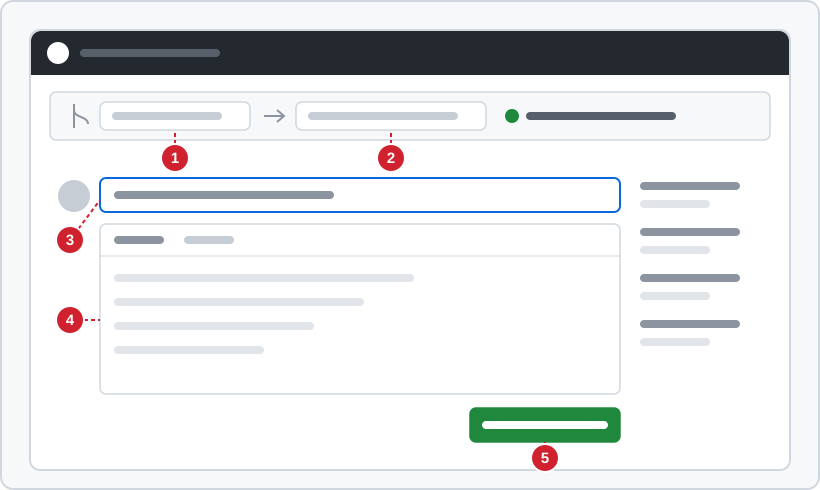
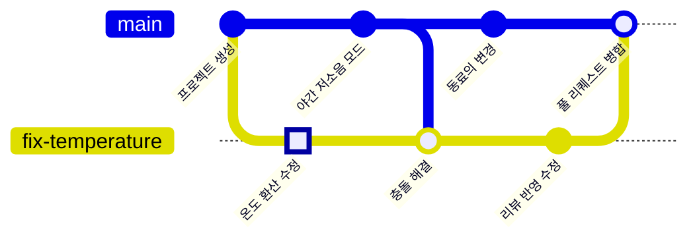

<!-- source: zh-TW/2-beyond-your-computer/07-pull-requests/README.md | sha: 7e5348fffdf0 -->

# 제7장 풀 리퀘스트와 코드 리뷰: PR 만들기, 리뷰, 병합

> 📍 **프로젝트와 변경의 현재 위치**
>
> - 프로젝트: 팀에서 "main에 바로 푸시하지 않는다"고 정하고, 모든 변경을 풀 리퀘스트로 받는다
> - 이전 단계: 수정 브랜치를 GitHub에 푸시했다
> - **이 장: 풀 리퀘스트를 만들고, 리뷰를 받아 한 번 더 고친 뒤 `main`에 병합한다**
> - 다음 단계: 프로젝트와 함께 v1.0.0으로 릴리스된다

---

## 왜 main에 바로 푸시하지 않을까

혼자 개발할 때는 다 되면 `main`에 푸시하는 것이 자연스럽습니다. 팀이 커지면 `main`은 모두가 함께 쓰는 것이라, 망가지면 모두의 손이 멈춥니다. 그래서 팀은 이렇게 약속합니다. **모든 변경은 먼저 자기 브랜치에 두고, 다른 사람이 본 다음에야 `main`에 들어간다.**

눈이 하나 더 있으면 내가 못 보는 실수를 잡을 수 있습니다. 논의 과정도 기록으로 남아, 몇 달이 지나도 "왜 이렇게 고쳤는지"를 찾아볼 수 있습니다.

---

## 풀 리퀘스트란

**풀 리퀘스트(Pull Request)**(줄여서 PR)는 GitHub에서 하는 "제 브랜치를 `main`에 병합해 주세요"라는 요청입니다. 브랜치 하나의 모든 변경이 한 페이지에 모입니다.

- **차이**: 이 브랜치에서 어떤 파일의 어떤 줄을 바꿨는지.
- **논의**: 리뷰하는 사람이 줄마다 의견을 남길 수 있다.
- **검사**: 자동으로 돌린 빌드와 테스트 결과.
- **병합 버튼**: 조건이 다 갖춰지면 한 번 눌러 병합한다.

> [!NOTE]
> **📖 용어｜풀 리퀘스트, PR（Pull Request）**
>
> - **정의**: 호스팅 서비스에서 하는 병합 요청이다. 차이, 논의, 자동 검사가 함께 있고, 리뷰를 통과한 뒤에 병합된다.
> - **현장에서는**: "PR 올렸으니 리뷰 부탁드려요", "이 PR에 아직 처리 안 한 코멘트가 두 개 있어요".
> - **관련 용어**: 코드 리뷰, 브랜치 보호, merge
> - **흔한 혼동**: 풀 리퀘스트는 GitHub 같은 서비스의 기능이지 Git 자체의 명령어가 아니다. 같은 것을 머지 리퀘스트라고 부르는 서비스도 있다.

---

## 풀 리퀘스트 만들기

**브랜치 고르기 → 제목과 설명 쓰기 → 만들기**

1. **브랜치 고르기**: GitHub의 저장소 페이지에서 **Pull requests → New pull request**를 엽니다. base에는 `main`(병합될 곳), compare에는 `fix-temperature`(내 브랜치)를 고릅니다. 막 푸시한 브랜치라면 페이지 위쪽에 **Compare & pull request** 버튼도 바로 나옵니다.
2. **제목과 설명 쓰기**: 제목에는 이 PR이 무엇을 하는지, 설명에는 왜 고쳤고 어떻게 확인했는지를 씁니다.
3. **만들기**: **Create pull request**를 누릅니다.

**Sourcetree에서는**: 왼쪽의 브랜치를 오른쪽 클릭해 **Create Pull Request**를 고르면, Sourcetree가 브라우저로 GitHub 페이지를 열어 줍니다.



*그림: ① base. 병합될 브랜치(`main`) ② compare. 내 브랜치(`fix-temperature`). 옆의 초록 점은 자동으로 병합할 수 있다는 뜻이다 ③ 제목 ④ 설명 ⑤ Create pull request 버튼.*

> [!TIP]
> **🔧 노하우｜PR 설명에는 "왜"와 "어떻게 확인했는지"를 쓴다**
>
> - **상황**: 코드는 다 고쳤고, 차이를 보면 알 테니 설명란을 비워 둔다.
> - **방법**: 어떤 문제를 해결하는지, 왜 이렇게 고쳤는지, 맞는지 어떻게 확인했는지 쓴다. 예를 들어 "보드를 50 °C까지 데워 팬이 제대로 도는 것을 확인했다".
> - **이유**: 리뷰하는 사람은 무엇을 바꿨는지는 볼 수 있어도, 왜 바꿨는지는 볼 수 없다.
> - **안 하면 어떻게 되나**: 리뷰하는 사람은 짐작할 수밖에 없어 여러 번 묻고 답하게 된다. 반년 뒤 누군가 되돌리고 싶어도 당시의 이유를 찾을 수 없다.
> - **관련 장**: [제10장 좋은 습관](../../3-when-things-go-wrong/10-good-habits/README.md)

---

## 코드 리뷰: 의견 남기기와 고치기

**코드 리뷰**(Code Review)는 동료에게 내 변경을 읽어 달라고 하는 것입니다. PR의 **Files changed** 탭에서 리뷰하는 사람은 줄 옆의 **+**를 눌러 의견을 남기고, 마지막에 다음 중 하나를 고릅니다.

| 선택지 | 뜻 |
|---|---|
| Comment | 의견만 남기고 결론은 없다 |
| Approve | 확인했으니 병합해도 된다 |
| Request changes | 먼저 이 부분들을 고쳐야 한다 |

이번에 동료가 "`500`과 `10`이 뭐예요? 이름 있는 상수로 바꿔 주세요"라고 남겼습니다. 새 PR을 만들 필요는 없습니다. 같은 브랜치에서 고치고, 커밋하고, 푸시하면 PR이 자동으로 갱신됩니다.

```bash
git switch fix-temperature
# 500과 10을 SENSOR_OFFSET_MV와 SENSOR_MV_PER_C로 바꾼다
git commit -am "Use named constants for sensor conversion"
git push
```

> [!TIP]
> **🔧 노하우｜PR은 작게, PR 하나에는 한 가지 일만**
>
> - **상황**: 일주일치 변경을 모아 천 줄이 넘는 PR 하나를 올린다.
> - **방법**: 작은 PR 여러 개로 나누고, 각각 한 가지만 해결하게 한다. 가능하면 몇백 줄 안으로.
> - **이유**: 리뷰하는 사람의 집중력에는 한계가 있다. 열 줄짜리 PR은 한 줄씩 꼼꼼히 읽히지만, 천 줄짜리 PR은 대충 훑어보게 된다.
> - **안 하면 어떻게 되나**: 리뷰하는 사람은 "괜찮아 보여요" 한마디로 승인하고, 진짜 버그가 많은 변경에 섞여 `main`에 들어간다.
> - **관련 장**: [제3장 커밋의 정체](../../1-on-your-computer/03-commits/README.md)

---

## 자동 검사와 브랜치 보호

푸시할 때마다 GitHub는 펌웨어 빌드, 테스트 실행, 코드 스타일 검사 같은 일련의 검사를 자동으로 돌릴 수 있습니다. 이것을 **지속적 통합**(Continuous Integration, CI)이라고 합니다. GitHub에는 이 자동화 기능이 들어 있고, 결과는 PR에 바로 표시됩니다.

여기에 **브랜치 보호**(Branch Protection)를 더하면 `main`이 규칙을 지키게 할 수 있습니다.

- 바로 푸시할 수 없고, PR로만 병합할 수 있다.
- 적어도 한 사람이 Approve해야 한다.
- 자동 검사를 모두 통과해야 한다.

전통적인 브랜치 보호는 저장소의 **Settings → Branches**에서 설정합니다. 여러 규칙을 겹쳐 쓸 수 있는 더 새로운 기능도 있는데, Rulesets라고 하며 **Settings → Rules → Rulesets**에서 설정합니다. 설정해 두면 누가 규칙을 잊어도 GitHub가 막아 줍니다. 2020년대 중반 현재, 무료 계정은 공개 저장소에서만 이 규칙들을 쓸 수 있습니다.

> [!NOTE]
> **📖 용어｜브랜치 보호（分支保護）**
>
> - **정의**: 호스팅 서비스에서 어떤 브랜치에 거는 규칙이다. 바로 푸시 금지, 리뷰와 자동 검사 통과 필수 같은 것들이다.
> - **현장에서는**: "main은 보호돼 있어서 바로 푸시 못 해요. PR 올려 주세요".
> - **관련 용어**: 풀 리퀘스트, CI, Approve, Rulesets
> - **흔한 혼동**: 브랜치 보호는 GitHub의 기능이라서 GitHub로의 푸시에만 효과가 있다. 내 컴퓨터의 `main`에는 여전히 커밋할 수 있고, 푸시만 안 될 뿐이다.

---

## 풀 리퀘스트 병합하기

리뷰에서 승인받고 검사도 모두 통과하면 **Merge pull request**를 누를 수 있습니다. 버튼 옆의 화살표에서 세 가지 병합 방식을 고를 수 있습니다.

| 방식 | 기록의 모양 | 알맞은 경우 |
|---|---|---|
| Create a merge commit | 브랜치의 커밋을 모두 남기고 병합 커밋을 하나 더한다 | 개발 과정을 모두 남기고 싶을 때 |
| Squash and merge | 브랜치의 모든 커밋을 하나로 합쳐 `main`에 잇는다 | 브랜치에 자잘한 커밋이 많을 때 |
| Rebase and merge | 브랜치의 커밋을 하나씩 `main`에 잇는다. 병합 커밋은 없다 | 한 줄 직선의 기록을 원할 때 |

팀에서는 보통 하나를 정해 규칙에 적어 둡니다. 이 책은 Create a merge commit을 씁니다. 병합한 뒤의 기록은 다음과 같습니다.



병합하면 PR 페이지에 **Delete branch** 버튼이 나와 GitHub의 브랜치를 지울 수 있습니다. 컴퓨터로 돌아와 `main`을 최신으로 만들고, 로컬 브랜치를 정리합니다.

```bash
git switch main
git pull
git branch -d fix-temperature
git fetch --prune    # GitHub에서 지운 브랜치의 원격 추적 브랜치를 정리한다
```

<details>
<summary><strong>🔍 더 알아보기｜풀 리퀘스트는 Git의 기능이 아니다</strong></summary>

Git 자체에는 풀 리퀘스트가 없습니다. 그 원형은 Git에 들어 있는 `git request-pull` 명령어로, "내 저장소의 이 브랜치에 이런 변경이 있으니 가져가 주세요"라는 글을 만들어 이메일로 메인테이너에게 보내는 것이었습니다. 이름의 "pull"도 여기서 왔습니다. 상대에게 내 변경을 pull해 가 달라고 하는 것입니다.

GitHub는 이 흐름을 웹 페이지로 만들고, PR마다 저장소 안에 `refs/pull/1/head` 같은 특별한 참조를 남겨 둡니다. 그래서 리뷰하는 사람은 어떤 PR이든 자기 컴퓨터로 가져와 테스트할 수 있습니다.

```bash
git fetch origin pull/1/head:pr-1
git switch pr-1
```

세 가지 병합 방식의 차이도 앞의 두 장의 개념으로 이해할 수 있습니다. Create a merge commit은 제5장의 3-way 병합이고, Rebase and merge는 제5장의 rebase라서 커밋 번호가 바뀝니다. Squash는 모든 변경을 완전히 새로운 커밋 하나로 합칩니다.

</details>

---

## 자주 겪는 문제

| 상황 | 원인 | 해결 |
|---|---|---|
| PR에 This branch has conflicts가 나온다 | 그사이 `main`에서 같은 곳을 고쳤다 | 제5장처럼 내 브랜치에서 `git merge main`을 하고, 해결한 뒤 푸시한다 |
| 내 PR을 Approve할 수 없다 | GitHub는 작성자가 자기 PR을 승인하지 못하게 한다 | 동료에게 리뷰를 부탁한다. 나는 의견만 남길 수 있다 |
| 병합 버튼이 회색이다 | 브랜치 보호 조건을 아직 채우지 못했다 | 버튼 위에 무엇이 빠졌는지 나온다 |

---

## 🧪 따라 해 보기

**시작하기 전에**: 제6장의 연습 프로젝트에 이어서 합니다. 이 장부터 시작하려면 이 책의 루트 폴더에서 `bash practice/setup.sh 7`을 실행한 뒤, 제6장 "따라 해 보기"의 1, 2단계대로 내 GitHub 저장소에 푸시합니다.

1. GitHub에서 PR을 만듭니다. base는 `main`, compare는 `fix-temperature`, 제목은 `Fix temperature sensor offset`으로 하고, 설명에는 왜 고치는지 씁니다.
2. 리뷰하는 동료 역할을 합니다. **Files changed** 탭에서 `return` 줄 옆의 **+**를 눌러, 이름 있는 상수를 쓰라는 의견을 남깁니다. 내 PR이라서 Comment만 고를 수 있습니다.
3. 컴퓨터로 돌아와 `sensor.c`를 다음처럼 바꾼 뒤 커밋하고 푸시합니다.

   ```c
   #include "board.h"
   #include "filter.h"
   #include "sensor.h"

   #define SENSOR_OFFSET_MV  500   /* output at 0 °C */
   #define SENSOR_MV_PER_C   10    /* change per °C */

   /* Analog temperature sensor: 500 mV at 0 °C, plus 10 mV per °C. */
   float sensor_read_celsius(void)
   {
       int mv = adc_read_mv();
       return smooth((mv - SENSOR_OFFSET_MV) / (float)SENSOR_MV_PER_C);
   }
   ```

   ```bash
   cd ~/git-practice/fan-controller
   git switch fix-temperature
   git commit -am "Use named constants for sensor conversion"
   git push
   ```

4. PR 페이지로 돌아가 커밋이 하나 늘었는지 확인합니다. **Merge pull request → Confirm merge**를 누르고, 이어서 **Delete branch**를 누릅니다.
5. 컴퓨터의 `main`을 갱신하고 로컬 브랜치를 정리합니다.

   ```bash
   git switch main
   git pull
   git branch -d fix-temperature
   git fetch --prune
   git log --oneline --graph -6
   ```

**이렇게 보이면 성공**: `main`의 최신 커밋이 `Merge pull request #1 from 내-계정/fix-temperature`이고, `main`의 `sensor.c`가 `SENSOR_OFFSET_MV`를 씁니다. `git branch`에는 `main`만 남습니다.

---

## 📋 이 장의 명령어

| 하고 싶은 일 | 명령어 | Sourcetree에서는 |
|---|---|---|
| 풀 리퀘스트 만들기 | —(GitHub 웹 페이지에서) | 브랜치 오른쪽 클릭 → Create Pull Request |
| 리뷰를 반영해 PR 갱신하기 | `git commit`, `git push` | Commit → Push |
| 병합 후 main 갱신하기 | `git switch main`, `git pull` | main 더블클릭 → Pull |
| 병합이 끝난 로컬 브랜치 지우기 | `git branch -d <브랜치>` | 브랜치 오른쪽 클릭 → Delete |
| 지워진 원격 브랜치 정리하기 | `git fetch --prune` | Fetch에서 Prune 체크 |
| 다른 사람의 PR을 가져와 테스트하기 | `git fetch origin pull/<번호>/head:<이름>` | — |

---

## 이 장의 핵심

1. 팀은 풀 리퀘스트로 모든 변경을 먼저 리뷰하고, `main`에는 누군가 본 코드만 들어간다.
2. PR 설명에는 왜 고쳤는지와 어떻게 확인했는지를 쓴다. PR은 작게, 하나에 한 가지만.
3. 리뷰를 반영할 때는 같은 브랜치에서 커밋하고 푸시하면 PR이 자동으로 갱신된다.
4. 지속적 통합이 푸시마다 자동으로 검사하고, 브랜치 보호가 GitHub로 규칙을 지키게 한다.
5. 병합 방식은 세 가지이고 팀에서 하나를 정한다. 병합하면 브랜치를 지우고 로컬 `main`을 갱신한다.

---

## 참고 자료

- Scott Chacon, Ben Straub, 『[Pro Git](https://git-scm.com/book/ko/v2)』 2판, 6.2절(GitHub 프로젝트에 기여하기)
- GitHub Docs: [끌어오기 요청 정보](https://docs.github.com/ko/pull-requests/collaborating-with-pull-requests/proposing-changes-to-your-work-with-pull-requests/about-pull-requests), [보호된 분기 정보](https://docs.github.com/ko/repositories/configuring-branches-and-merges-in-your-repository/managing-protected-branches/about-protected-branches)

---

[← 제6장 원격 저장소](../06-remotes/README.md) ｜ [목차](../../README.md) ｜ [제8장 브랜치 전략과 릴리스 →](../08-branching-and-releases/README.md)
