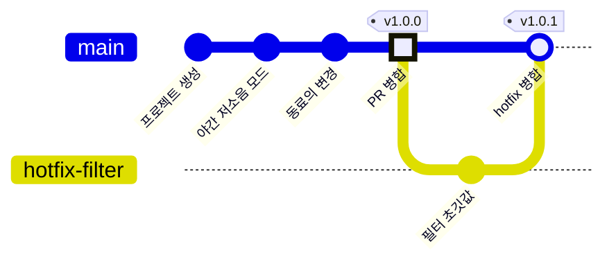

<!-- source: zh-TW/2-beyond-your-computer/08-branching-and-releases/README.md | sha: 02131aaadcc7 -->

# 제8장 브랜치 전략과 릴리스: tag, release, 트렁크 기반 개발

> 📍 **프로젝트와 변경의 현재 위치**
>
> - 프로젝트: 첫 정식 버전 v1.0.0을 릴리스하고, 그 뒤 부팅 직후의 문제를 급히 고쳐 v1.0.1을 릴리스한다
> - 이전 단계: 수정이 풀 리퀘스트를 거쳐 `main`에 병합됐다
> - **이 장: 수정이 v1.0.0의 일부가 된다**
> - 다음 단계: 누군가 reset으로 커밋을 잃어버린다

---

## 왜 버전 번호가 필요할까

펌웨어를 출하하고 나면, 서로 다른 시기의 프로그램이 올라간 보드가 여러 묶음 돌아다니게 됩니다. 고객 지원팀이 문제 연락을 받으면 가장 먼저 묻는 말은 "펌웨어 버전이 뭐예요?"입니다.

커밋 번호는 정확하지만, 16진수 문자열은 읽기 어렵고 앞뒤 순서도 알 수 없습니다. 그래서 팀은 릴리스할 커밋에 사람이 읽을 수 있는 이름을 붙입니다. 예를 들어 `v1.0.0`입니다.

---

## 유의적 버전

가장 흔한 버전 번호 형식은 **유의적 버전**(Semantic Versioning)이라고 하며, **주 버전.부 버전.수 버전** 세 숫자로 씁니다.

| 어느 숫자를 올리나 | 언제 | 예 |
|---|---|---|
| 주 버전 | 바꾼 뒤 예전 사용법이 더는 통하지 않을 때 | 통신 프로토콜이 바뀌어 예전 PC용 설정 프로그램을 못 쓰게 됐다 |
| 부 버전 | 기능을 추가했지만 예전 사용법도 그대로 될 때 | 야간 저소음 모드를 추가했다 |
| 수 버전 | 버그만 고치고 기능은 추가하지 않았을 때 | 온도 환산을 고쳤다 |

앞 숫자를 올리면 뒤 숫자는 0으로 돌아갑니다. 예를 들어 `1.4.2`에 새 기능을 더하면 `1.5.0`이 됩니다.

> [!NOTE]
> **📖 용어｜유의적 버전, SemVer（語意化版本）**
>
> - **정의**: "주 버전.부 버전.수 버전" 세 숫자로 변경의 크기를 나타내는 버전 번호 규칙이다.
> - **현장에서는**: "버그만 고쳤으니 수 버전만 올리면 돼요", "설정 형식이 바뀌어서 호환이 안 되니 주 버전을 올려야 해요".
> - **관련 용어**: 태그, 릴리스, hotfix
> - **흔한 혼동**: 버전 번호는 소수가 아니다. 세 숫자를 따로 비교하므로 `1.10.0`이 `1.9.0`보다 새것이다.

---

## 태그: 커밋에 붙이는 움직이지 않는 라벨

**태그**(Tag)는 브랜치처럼 어떤 커밋을 가리키는 이름입니다. 다른 점은, 브랜치는 커밋에 따라 앞으로 나아가지만 태그는 한 번 붙이면 움직이지 않는다는 것입니다.

```bash
git switch main
git tag -a v1.0.0 -m "Version 1.0.0"
git tag                      # 모든 태그를 나열한다
git push origin v1.0.0       # 태그는 따로 푸시해야 한다
```

`-a`를 붙이면 주석 태그가 되어, 누가 언제 왜 붙였는지가 기록됩니다. 정식 릴리스에는 반드시 주석 태그를 쓰세요.

**Sourcetree에서는**: **도구 모음의 Tag → 이름 입력 → Push tag 체크 → Add**.

> [!NOTE]
> **📖 용어｜태그（標籤）**
>
> - **정의**: 어떤 커밋에 붙이는 움직이지 않는 이름이다. 보통 릴리스한 버전을 표시하는 데 쓴다.
> - **현장에서는**: "v1.0.0 태그 찍었어요?", "v1.0.0 태그에서 hotfix 브랜치 따 주세요".
> - **관련 용어**: 브랜치, 릴리스, 유의적 버전, `git describe`
> - **흔한 혼동**: 태그는 브랜치가 아니라서 `git switch v1.0.0`은 거부된다. 옛 버전을 고치려면 `git switch -c <브랜치> v1.0.0`으로 태그에서 브랜치를 만든다.

> [!TIP]
> **🔧 노하우｜태그는 git push로 자동으로 올라가지 않는다**
>
> - **상황**: 컴퓨터에서 `v1.0.0`을 붙이고 `git push`를 했으니 릴리스가 끝났다고 생각한다.
> - **방법**: `git push origin v1.0.0`으로 이 태그를 푸시한다. `git push --follow-tags`로 주석 태그를 함께 푸시할 수도 있다.
> - **이유**: `git push`는 기본으로 브랜치만 푸시하고, 태그는 따로 지정해야 한다.
> - **안 하면 어떻게 되나**: 동료도, 자동 빌드도, GitHub도 `v1.0.0`을 보지 못한다. 모두는 아직 릴리스하지 않았다고 생각하고, 나는 이미 릴리스했다고 생각한다.
> - **관련 장**: [제6장 원격 저장소](../06-remotes/README.md)

---

## GitHub의 릴리스

GitHub의 **Releases → Draft a new release**에서 태그를 고르면 릴리스 페이지를 만들 수 있습니다.

- **릴리스 노트**: 이 버전에서 무엇이 바뀌었는지. Generate release notes를 누르면 GitHub가 병합된 PR을 바탕으로 초안을 만들어 줍니다.
- **첨부 파일**: 빌드한 펌웨어 `fan.bin`을 끌어다 놓습니다. 사용자는 직접 빌드하지 않고 여기서 내려받습니다.

> [!TIP]
> **🔧 노하우｜펌웨어 바이너리는 릴리스에 첨부하고 저장소에는 커밋하지 않는다**
>
> - **상황**: 테스트 담당 동료에게 빌드한 `fan.bin`을 주려다가 내친김에 커밋해 버린다.
> - **방법**: 저장소에는 소스 코드만 둔다. 빌드한 파일은 릴리스에 첨부하거나 자동 빌드로 만들게 한다.
> - **이유**: 바이너리는 빌드할 때마다 통째로 달라져서, Git이 차이를 효율적으로 저장할 수 없다.
> - **안 하면 어떻게 되나**: 릴리스할 때마다 파일 한 벌이 저장소에 영구히 늘어나, 몇 년 뒤에는 clone 한 번에 몇 분이 걸린다. 소스와 바이너리의 대응도 어긋나서, 어느 `.bin`이 어느 코드로 만든 것인지 아무도 모르게 된다.
> - **관련 장**: [제10장 좋은 습관](../../3-when-things-go-wrong/10-good-habits/README.md)

---

## 브랜치 전략

팀은 어떤 브랜치를 두고, 각각을 무엇에 쓰며, 언제 병합할지 정해야 합니다. 가장 흔한 것은 다음 두 가지입니다.

| | 트렁크 기반 개발(Trunk-Based Development) | Git Flow |
|---|---|---|
| 오래 남는 브랜치 | `main`뿐 | `main`, `develop`, 그리고 release와 hotfix 브랜치 |
| 기능 브랜치 | 아주 짧고, 하루 이틀 안에 `main`에 병합한다 | `develop`에서 만들고, 끝나면 `develop`에 병합한다 |
| 릴리스 방법 | `main`에서 태그를 붙인다 | `develop`에서 release 브랜치를 만들어 다듬고, `main`에 병합한 뒤 태그를 붙인다 |
| 알맞은 경우 | 작은 팀, 지속적인 릴리스, 자동 검사가 있을 때 | 정해진 일정의 릴리스, 여러 버전을 동시에 유지보수할 때 |

이 책의 프로젝트는 트렁크 기반 개발을 씁니다. `main`과 수명이 짧은 기능 브랜치만 두고, 릴리스할 때 태그를 붙입니다. 막 시작한 팀은 이 가장 단순한 방식으로 시작하고, 정말 필요할 때 브랜치를 늘리면 됩니다. Sourcetree 도구 모음의 Git-flow 버튼(macOS용은 Git Flow)을 쓰면 Git Flow에 필요한 브랜치를 한 번에 만들 수 있습니다.

---

## 긴급 수정: hotfix

v1.0.0을 출하한 뒤 현장에서 보고가 들어왔습니다. 보드를 켜고 30초쯤 동안 팬의 반응이 느리다는 것입니다. 원인은 야간 저소음 모드의 평균값이 0 °C에서 계산을 시작해서, 실제 온도를 따라잡는 데 시간이 걸리기 때문이었습니다.

당장 고쳐야 하는 문제는 릴리스한 태그에서 **hotfix** 브랜치를 만들어 그 문제만 고칩니다.

```bash
git switch -c hotfix-filter v1.0.0
# filter.c의 초깃값을 0.0f에서 실온인 25.0f로 바꾼다
git commit -am "Start temperature filter at room temperature"
git switch main
git merge --no-ff hotfix-filter -m "Merge branch 'hotfix-filter'"
git tag -a v1.0.1 -m "Version 1.0.1"
```

`--no-ff`는 빨리 감기가 가능해도 반드시 병합 커밋을 만들라고 Git에 지시합니다. 그러면 "여기서 hotfix를 병합했다"는 것이 기록에 분명히 남습니다. 팀에서 브랜치 보호를 쓴다면 이 단계는 풀 리퀘스트로 바꿉니다.



이 그래프는 간단히 하려고 제7장의 수정 브랜치를 "PR 병합" 점 안에 접어 넣었습니다.

<details>
<summary><strong>🔍 더 알아보기｜주석 태그와 git describe</strong></summary>

태그에는 두 종류가 있고, 둘 다 `.git/refs/tags/`에 저장됩니다. **가벼운 태그**(`-a` 없음)는 커밋을 바로 가리킵니다. **주석 태그**는 독립된 tag 객체를 가리키는데, 그 안에 태그를 붙인 사람, 시각, 메시지가 있고, 그 객체가 다시 커밋을 가리킵니다.

```text
$ git cat-file -t v1.0.0
tag
```

`git describe`는 가장 가까운 태그를 찾아, 거기서 커밋 몇 개만큼 떨어져 있는지 알려 줍니다.

```text
$ git describe
v1.0.1-1-g86f7e81
```

"`v1.0.1` 뒤에 커밋이 하나 더 있고, 지금은 `86f7e81`에 있다"는 뜻입니다(`g`는 Git을 뜻합니다). 정확히 태그 위에 있으면 `v1.0.1`만 출력합니다. 많은 팀이 빌드할 때 이 문자열을 펌웨어에 적어 두고 부팅할 때 출력합니다. 제3장에서 말한 "문제를 알릴 때 커밋 번호를 붙인다"가 자동으로 해결되는 셈입니다. `--dirty`를 붙이면 커밋하지 않은 변경이 있을 때 끝에 `-dirty`가 붙어, 이 펌웨어가 깨끗한 코드로 빌드되지 않았음을 알려 줍니다.

</details>

---

## 자주 겪는 문제

| 상황 | 원인 | 해결 |
|---|---|---|
| `tag 'v1.0.0' already exists` | 같은 이름의 태그가 이미 있다 | 다른 버전 번호를 쓴다. 이미 푸시한 태그는 바꾸지 않는다 |
| `git describe`가 `fatal`을 낸다 | 주석 태그가 없다. 기본으로 주석 태그만 본다 | 먼저 주석 태그를 붙이거나, `--tags`를 붙여 가벼운 태그까지 찾게 한다 |

---

## 🧪 따라 해 보기

**시작하기 전에**: 제7장의 연습 프로젝트에 이어서 합니다. 이 장부터 시작하려면 이 책의 루트 폴더에서 `bash practice/setup.sh 8`을 실행합니다. GitHub에 푸시하지 않았다면 `git push`와 GitHub 단계는 모두 건너뛰면 됩니다.

1. `main`에서 `v1.0.0`을 붙이고 푸시합니다.

   ```bash
   cd ~/git-practice/fan-controller
   git switch main
   git tag -a v1.0.0 -m "Version 1.0.0"
   git push origin v1.0.0
   ```

2. GitHub의 **Releases → Draft a new release**에서 `v1.0.0`을 고르고, Generate release notes를 누른 다음 Publish release를 누릅니다.
3. 태그에서 hotfix 브랜치를 만듭니다. 편집기에서 `filter.c`의 `static float average = 0.0f;`를 `25.0f`로 바꾼 다음 커밋합니다.

   ```bash
   git switch -c hotfix-filter v1.0.0
   git commit -am "Start temperature filter at room temperature"
   ```

4. `main`에 병합하고, `v1.0.1`을 붙이고, 푸시한 뒤 브랜치를 정리합니다.

   ```bash
   git switch main
   git merge --no-ff hotfix-filter -m "Merge branch 'hotfix-filter'"
   git tag -a v1.0.1 -m "Version 1.0.1"
   git branch -d hotfix-filter
   git push
   git push origin v1.0.1
   git tag
   git describe
   git log --oneline --graph -4
   ```

**이렇게 보이면 성공**: `git tag`에 `v1.0.0`과 `v1.0.1`이 나옵니다. `git describe`는 `v1.0.1`을 출력합니다. `git log --oneline --graph -4`의 맨 위는 `Merge branch 'hotfix-filter'`입니다.

---

## 📋 이 장의 명령어

| 하고 싶은 일 | 명령어 | Sourcetree에서는 |
|---|---|---|
| 주석 태그 붙이기 | `git tag -a <이름> -m "메시지"` | 도구 모음의 Tag |
| 태그 나열하기 | `git tag` | 왼쪽의 Tags |
| 태그 푸시하기 | `git push origin <이름>` | 태그를 붙일 때 Push tag 체크 |
| 태그에서 브랜치 만들기 | `git switch -c <브랜치> <태그>` | History에서 그 커밋 오른쪽 클릭 → Branch |
| 반드시 병합 커밋 만들기 | `git merge --no-ff <브랜치>` | Merge할 때 Create a new commit even if fast-forward is possible 체크 |
| 가장 가까운 태그 찾기 | `git describe` | — |

---

## 이 장의 핵심

1. 릴리스하는 버전은 유의적 버전(주 버전.부 버전.수 버전)으로 이름을 붙인다.
2. 태그는 움직이지 않는 이름이다. 정식 릴리스에는 주석 태그를 쓰고, 따로 푸시한다.
3. 빌드한 펌웨어는 GitHub 릴리스에 첨부하고, 저장소에는 커밋하지 않는다.
4. 작은 팀은 트렁크 기반 개발로 시작한다. `main`과 수명이 짧은 브랜치만 두고, 릴리스할 때 태그를 붙인다.
5. 긴급 수정은 릴리스한 태그에서 hotfix 브랜치를 만들어 고치고, `main`에 병합한 뒤 새 태그를 붙인다.

---

## 참고 자료

- Scott Chacon, Ben Straub, 『[Pro Git](https://git-scm.com/book/ko/v2)』 2판, 2.6절(태그)과 5.1절(분산 환경에서의 워크플로)
- [유의적 버전 2.0.0](https://semver.org/lang/ko/)
- GitHub Docs: [릴리스 정보](https://docs.github.com/ko/repositories/releasing-projects-on-github/about-releases)

---

[← 제7장 풀 리퀘스트와 코드 리뷰](../07-pull-requests/README.md) ｜ [목차](../../README.md) ｜ [제9장 되돌리기 →](../../3-when-things-go-wrong/09-undoing-things/README.md)
