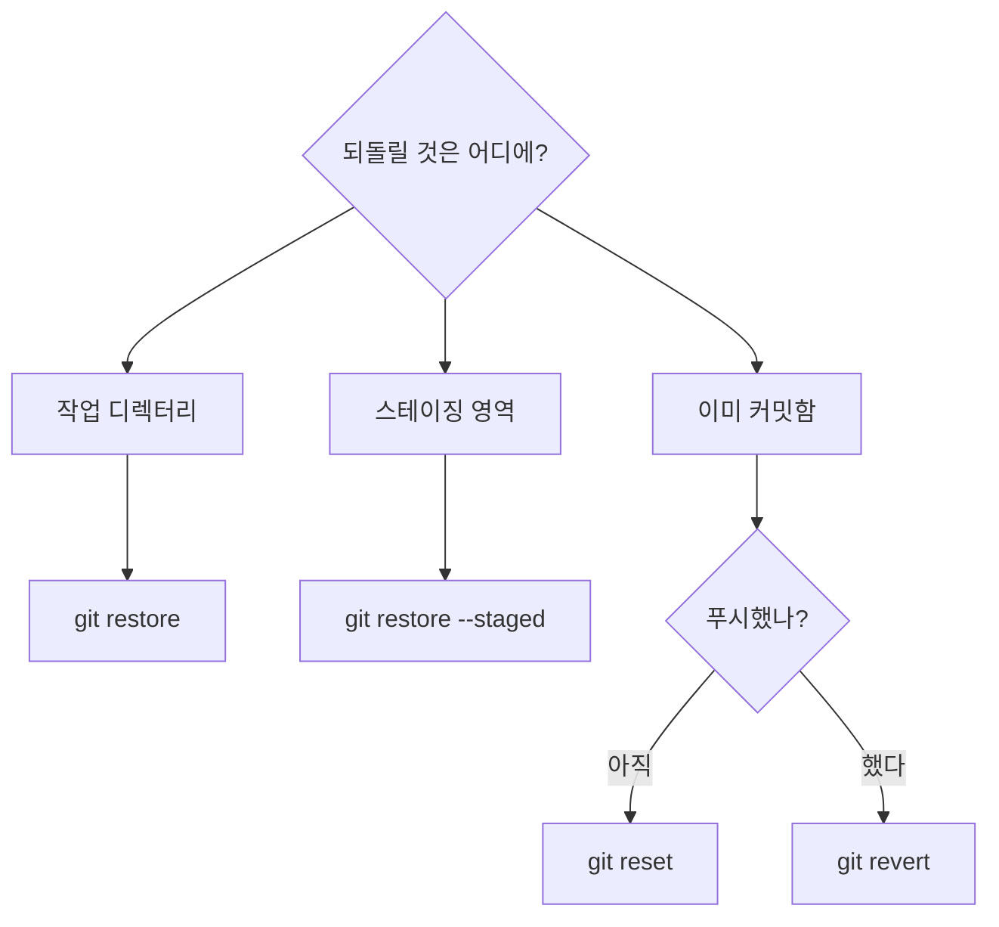
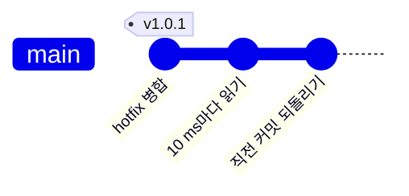

<!-- source: zh-TW/3-when-things-go-wrong/09-undoing-things/README.md | sha: 481f8fbe5f81 -->

# 제9장 되돌리기: restore, reset, revert, reflog

> 📍 **프로젝트와 변경의 현재 위치**
>
> - 프로젝트: 누군가 reset으로 커밋을 잃어버렸고, 실험 삼아 넣은 변경도 되돌려야 한다
> - 이전 단계: 수정이 v1.0.0의 일부가 됐다
> - **이 장: 수정이 reset으로 지워졌다가 reflog로 되살아난다**
> - 다음 단계: 좋은 커밋 메시지를 쓰고, 커밋해 버린 비밀번호를 처리한다

---

## 먼저 물어보기: 되돌리고 싶은 것은 어디에 있나

Git에서 되돌리는 방법은 여러 가지이고, 잘못 고르면 오히려 더 나빠집니다. 되돌리고 싶은 것이 어느 영역에 있는지 판단하면 무엇을 써야 할지 알 수 있습니다.



또 `git reflog`라는 특효약도 있습니다. "사라졌다고 생각한" 커밋을 되살리는 데 씁니다.

---

## 작업 디렉터리의 변경 버리기: git restore

한참 고치다가 방향이 틀렸다는 것을 알았습니다. 책상 위의 변경을 버리고, 파일을 상자 안의 모습으로 되돌리고 싶습니다. add한 적이 없다면 마지막 커밋의 모습으로 돌아갑니다.

```bash
git restore fan.c
```

**Sourcetree에서는**: File Status에서 파일을 오른쪽 클릭하고 **Discard**를 고릅니다.

이 동작은 되돌릴 수 없습니다. 이 변경은 한 번도 Git에 들어간 적이 없으니, 버리면 정말 사라집니다.

## 파일을 스테이징 영역에서 빼기: git restore --staged

디버그용 파일을 실수로 `git add`했습니다. 상자에서는 빼고 싶지만 책상 위의 변경은 남겨 두고 싶습니다.

```bash
git restore --staged board.h
```

**Sourcetree에서는**: Staged files에서 파일을 고르고 **Unstage Selected**를 누릅니다.

---

## 브랜치를 과거로 되돌리기: git reset

`git reset`은 현재 브랜치의 메모지를 과거의 어떤 커밋으로 되돌립니다. 건너뛴 커밋은 더 이상 그 브랜치에 속하지 않습니다.

메모지를 옮길 때 책상과 상자도 함께 되돌릴지는 세 가지 모드로 정합니다.

| 모드 | 브랜치 | 스테이징 영역 | 작업 디렉터리 | 용도 |
|---|---|---|---|---|
| `--soft` | 되돌아간다 | 그대로 | 그대로 | 최근 커밋 몇 개를 다시 쓰고 싶을 때. 변경은 상자에 그대로 있다 |
| `--mixed`(기본) | 되돌아간다 | 되돌린다 | 그대로 | 커밋할 것을 다시 고르고 싶을 때 |
| `--hard` | 되돌아간다 | 되돌린다 | 되돌린다 | 전부 버리고 그 커밋의 모습으로 돌아갈 때 |

```bash
git reset --soft HEAD~1    # 직전 커밋을 없애고, 변경은 스테이징 영역에 남긴다
```

`HEAD~1`은 "지금 위치의 바로 앞 커밋", `HEAD~2`는 그보다 하나 더 앞입니다.

**Sourcetree에서는**: History에서 커밋을 오른쪽 클릭해 **Reset current branch to this commit**(macOS용은 **Reset main to this commit**이고, 가운데에 현재 브랜치 이름이 들어갑니다)을 고른 뒤 Soft, Mixed, Hard 중 하나를 고릅니다.

> [!NOTE]
> **📖 용어｜reset과 revert**
>
> - **정의**: reset은 브랜치를 과거로 되돌려, 건너뛴 커밋이 브랜치에서 사라진다. revert는 반대 방향 커밋을 새로 만들어 옛 커밋의 변경을 상쇄한다.
> - **현장에서는**: "아직 안 푸시했으면 reset하면 돼요", "이미 푸시했으면 revert하세요".
> - **관련 용어**: `HEAD~1`, reflog, 강제 푸시
> - **흔한 혼동**: reset은 기록을 고쳐 쓰고, revert는 뒤에 덧붙일 뿐이다. Sourcetree는 revert를 Reverse commit이라고 부른다.

> [!TIP]
> **🔧 노하우｜reset --hard 전에 git status를 한번 본다**
>
> - **상황**: 브랜치를 되돌리고 싶어서 무심코 `--hard`를 붙인다.
> - **방법**: 먼저 `git status`를 실행한다. 아직 커밋하지 않았는데 남기고 싶은 변경이 있으면 먼저 커밋하거나 `git stash`한다.
> - **이유**: `--hard`는 작업 디렉터리까지 함께 되돌린다.
> - **안 하면 어떻게 되나**: 커밋하지 않은 변경은 영영 사라지고, 편집기의 로컬 기록에 운을 걸 수밖에 없다. 커밋한 것은 reflog로 되살릴 수 있지만, 한 번도 Git에 들어간 적 없는 것은 Git도 되살리지 못한다.
> - **관련 장**: [제2장 세 가지 영역](../../1-on-your-computer/02-three-areas/README.md)

---

## 잃어버린 커밋 되살리기: git reflog

동료가 `main`에서 실수로 `git reset --hard HEAD~2`를 쳤습니다. `main`이 한 번에 제6장 상태로 돌아가, 온도 수정도 hotfix도 기록에서 사라졌고, `sensor.c`는 다시 `(mv - 600)`이 됐습니다.

당황하지 마세요. 건너뛴 커밋은 여전히 `.git` 안에 있고, 가리키는 메모지가 없을 뿐입니다. **reflog**에는 HEAD가 지나온 걸음이 모두 기록되어 있습니다.

```text
$ git reflog -3
c67c821 HEAD@{0}: reset: moving to HEAD~2
c32dfaf HEAD@{1}: merge hotfix-filter: Merge made by the 'ort' strategy.
95fb995 HEAD@{2}: checkout: moving from hotfix-filter to main
```

`HEAD@{1}`이 reset하기 전의 위치입니다. 브랜치를 그리로 되돌립니다.

```bash
git reset --hard HEAD@{1}
```

**Sourcetree에서는**: Sourcetree에는 reflog를 보여 주는 화면이 없습니다. 도구 모음 오른쪽의 **Terminal**을 눌러 터미널에서 위의 명령어를 실행하세요.

> [!NOTE]
> **📖 용어｜reflog（Reference Log）**
>
> - **정의**: HEAD와 각 브랜치가 지금까지 어떤 커밋을 가리켰는지 적은 기록이다. 내 컴퓨터에만 있다.
> - **현장에서는**: "커밋이 사라졌어요? 당황하지 말고 reflog부터 보세요".
> - **관련 용어**: `HEAD@{1}`, reset, 가비지 컬렉션
> - **흔한 혼동**: reflog는 푸시되지 않고, clone해도 따라오지 않는다. 동료가 잃어버린 커밋은 동료 자신의 컴퓨터에서 reflog를 봐야 되살릴 수 있다.

---

## 이미 푸시한 커밋: git revert

누군가 온도를 읽는 간격을 1초에서 10 ms로 바꿔 푸시했는데, 야간 저소음 모드의 평균 계산이 너무 민감해져서 팬이 또 기준 온도 근처에서 켜졌다 꺼졌다 하기 시작했습니다. 이 커밋은 이미 모두가 받아 갔으니, reset으로 기록을 고쳐 쓰면 안 됩니다.

`git revert`는 반대 방향 커밋을 새로 만들어 그 변경을 상쇄합니다.

```bash
git revert HEAD
```

**Sourcetree에서는**: History에서 그 커밋을 오른쪽 클릭해 **Reverse commit**을 고릅니다.



기록 뒤에 커밋이 하나 늘어날 뿐, 아무것도 고쳐 쓰지 않습니다.

> [!TIP]
> **🔧 노하우｜이미 푸시한 커밋은 reset이 아니라 revert로 되돌린다**
>
> - **상황**: GitHub에 막 푸시한 커밋에 잘못이 있어서 없애고 싶다.
> - **방법**: `git revert`로 원래 변경을 상쇄하는 "반대 방향" 커밋을 새로 만들고, 그것을 푸시한다.
> - **이유**: 동료가 이미 그 커밋을 풀해서 그 위에서 작업을 이어 가고 있을 수 있다. revert는 기록을 뒤에 덧붙일 뿐, 이미 공유된 기록을 고쳐 쓰지 않는다.
> - **안 하면 어떻게 되나**: `reset`으로 기록을 고쳐 쓰고 강제로 푸시하면 동료의 기록과 원격 저장소가 어긋난다. 가볍게는 중복된 커밋이 잔뜩 생기고, 심하면 다른 사람의 변경이 덮어써져 사라진다.
> - **관련 장**: [제6장 원격 저장소](../../2-beyond-your-computer/06-remotes/README.md)

---

## 잠시 치워 두기: git stash

고치는 도중에 상사가 "이 급한 문제부터 봐 줘요"라고 합니다. 변경은 아직 끝나지 않아서 커밋하고 싶지 않은데, 다른 브랜치로 바꿔야 합니다.

```bash
git stash          # 변경을 서랍에 넣고, 작업 디렉터리를 깨끗하게 만든다
git stash list     # 서랍 안에 무엇이 있는지 본다
git stash pop      # 꺼내고, 서랍에서는 지운다
```

**Sourcetree에서는**: 도구 모음의 **Stash**. 꺼낼 때는 왼쪽의 Stashes 아래에서 오른쪽 클릭해 **Apply Stash**를 고릅니다.

<details>
<summary><strong>🔍 더 알아보기｜reflog로 얼마나 되살릴 수 있을까</strong></summary>

reflog는 `.git/logs/`에 있고, 브랜치마다 그리고 HEAD에 하나씩, 각자 움직일 때마다 기록이 남습니다.

건너뛴 커밋은 바로 지워지지 않습니다. Git은 이따금 가비지 컬렉션(`git gc`)을 실행해, 어떤 메모지도 어떤 reflog도 가리키지 않는 객체를 치웁니다. 기본으로 reflog 기록은 90일, 어느 브랜치에도 없는 커밋을 가리키는 기록은 30일 동안 남고, 모든 참조를 잃은 객체에도 2주의 유예 기간이 더 있습니다.

그래서 "커밋한 것은 거의 사라지지 않는다"는 말은 사실이지만 기한이 있습니다. 잃어버렸으면 미루지 말고 빨리 되살리세요.

</details>

---

## 자주 겪는 문제

| 상황 | 원인 | 해결 |
|---|---|---|
| 병합 커밋을 revert하려니 오류가 난다 | 병합 커밋에는 바로 앞 커밋이 둘이라, Git이 어느 쪽을 기준으로 할지 모른다 | `-m 1`을 붙여, 병합 전에 있던 브랜치를 기준으로 삼는다 |
| `git stash pop`에서 충돌이 난다 | 치워 둔 뒤에 같은 곳이 또 바뀌었다 | 제5장대로 충돌을 해결한다. 서랍의 내용은 남아 있으니 확인한 뒤 `git stash drop`으로 지운다 |

---

## 🧪 따라 해 보기

**시작하기 전에**: 제8장의 연습 프로젝트에 이어서 합니다. 이 장부터 시작하려면 이 책의 루트 폴더에서 `bash practice/setup.sh 9`를 실행합니다. 이 장의 단계는 모두 내 컴퓨터에서만 합니다. 끝날 때까지 푸시하지 마세요.

1. 사고를 재현합니다. 두 단계 되돌리고 수정이 사라졌는지 확인합니다.

   ```bash
   cd ~/git-practice/fan-controller
   git reset --hard HEAD~2
   grep return sensor.c
   ```

2. reflog로 되살립니다.

   ```bash
   git reflog -3
   git reset --hard HEAD@{1}
   grep return sensor.c
   ```

3. 실험을 하나 하고 되돌립니다. 편집기에서 `main.c`의 `delay_ms(1000);`을 `delay_ms(10);`으로 바꾼 뒤 다음을 실행합니다.

   ```bash
   git commit -am "Read temperature every 10 ms"
   git revert --no-edit HEAD
   ```

4. 서랍을 써 봅니다. `fan.c`를 아무렇게나 고친 뒤 `git stash`를 실행하고, `git status`로 작업 디렉터리가 깨끗해졌는지 확인한 다음, `git stash pop`으로 꺼내고, 마지막으로 `git restore fan.c`로 그 변경을 버립니다. 3, 4단계를 마치면 다음 두 줄로 결과를 확인합니다.

   ```bash
   git log --oneline -2
   git status
   ```

**이렇게 보이면 성공**: 1단계에서 `sensor.c`는 `(mv - 600)`이고, 2단계에서 다시 `SENSOR_OFFSET_MV`가 됩니다. 3단계 뒤 `git log --oneline -2`의 맨 위는 `Revert "Read temperature every 10 ms"`이고, `main.c`는 다시 `delay_ms(1000);`입니다. 4단계 뒤 `git status`에 `nothing to commit, working tree clean`이 나옵니다.

---

## 📋 이 장의 명령어

| 하고 싶은 일 | 명령어 | Sourcetree에서는 |
|---|---|---|
| 작업 디렉터리의 변경 버리기 | `git restore <파일>` | 파일 오른쪽 클릭 → Discard |
| 파일을 스테이징 영역에서 빼기 | `git restore --staged <파일>` | Unstage Selected |
| 브랜치를 과거로 되돌리기 | `git reset --soft/--mixed/--hard <커밋>` | 커밋 오른쪽 클릭 → Reset current branch to this commit(macOS: Reset main to this commit) |
| HEAD가 지나온 길 보기 | `git reflog` | Terminal을 눌러 명령어 입력 |
| 반대 방향 커밋 만들기 | `git revert <커밋>` | 커밋 오른쪽 클릭 → Reverse commit |
| 변경을 잠시 치워 두기 | `git stash`, `git stash pop` | 도구 모음의 Stash, 오른쪽 클릭 → Apply Stash |

---

## 이 장의 핵심

1. 먼저 되돌릴 것이 어느 영역에 있는지 판단한다. 작업 디렉터리는 restore, 스테이징 영역은 restore --staged, 커밋은 reset이나 revert.
2. reset에는 soft, mixed, hard 세 가지 모드가 있다. hard는 커밋하지 않은 변경을 버리고, 그것은 되살릴 수 없다.
3. 아직 푸시하지 않은 커밋은 reset해도 된다. 이미 푸시한 커밋은 반드시 revert한다.
4. 커밋한 것은 reflog로 거의 되살릴 수 있지만, 기한이 있다.
5. 작업 도중에 다른 일로 바꿔야 할 때는 stash로 잠시 치워 둔다.

---

## 참고 자료

- Scott Chacon, Ben Straub, 『[Pro Git](https://git-scm.com/book/ko/v2)』 2판, 2.4절(되돌리기)과 7.7절(Reset 명확히 알고 가기)
- Git 공식 문서: [git-reset](https://git-scm.com/docs/git-reset), [git-revert](https://git-scm.com/docs/git-revert), [git-reflog](https://git-scm.com/docs/git-reflog)

---

[← 제8장 브랜치 전략과 릴리스](../../2-beyond-your-computer/08-branching-and-releases/README.md) ｜ [목차](../../README.md) ｜ [제10장 좋은 습관 →](../10-good-habits/README.md)
