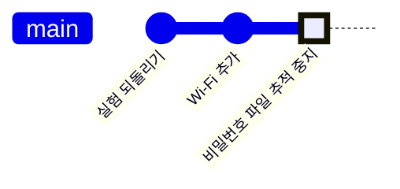

<!-- source: zh-TW/3-when-things-go-wrong/10-good-habits/README.md | sha: f6d85ea4d8a0 -->

# 제10장 좋은 습관: 커밋 메시지, .gitignore, 바이너리, 비밀 정보 유출

> 📍 **프로젝트와 변경의 현재 위치**
>
> - 프로젝트: Wi-Fi로 상태를 보고하는 기능을 넣다가 Wi-Fi 비밀번호를 커밋해 버렸다
> - 이전 단계: 수정이 reset으로 지워졌다가 reflog로 되살아났다
> - **이 장: 수정의 커밋 메시지를 돌아보고, 더 좋은 메시지를 쓰는 법을 배운다**
> - 다음 단계: 여정의 끝. 제0장으로 돌아가 책 전체의 지도를 본다

---

## 좋은 커밋 메시지 쓰기

반년 뒤, 누군가 `sensor.c`에서 `SENSOR_OFFSET_MV 500`을 보고 왜 500인지 궁금해합니다. 그 사람은 `git log`나 `git blame`(각 줄을 마지막으로 바꾼 커밋을 보여 준다)으로 그 커밋을 찾아 메시지를 읽습니다. 메시지는 미래의 사람에게 남기는 설명서입니다.

좋은 커밋 메시지는 이렇게 생겼습니다.

```text
Fix temperature sensor offset

The sensor outputs 500 mV at 0 °C, but the code subtracted 600 mV,
so every reading was 10 °C too low and the fan started at 55 °C
instead of 45 °C.
```

| 규칙 | 이유 |
|---|---|
| 첫 줄은 제목이고, 50자 이내 | `git log --oneline`, GitHub, Sourcetree는 첫 줄만 보여 준다 |
| 제목은 명령형으로, 이 커밋이 무엇을 하는지 쓴다. 예: Fix, Add, Remove | "이 커밋을 적용하면 ……한다"처럼 읽힌다. 제목 앞에 `fix:`, `feat:` 같은 접두어를 붙이기로 정한 팀도 있으니, 팀 규칙을 따른다 |
| 제목과 본문 사이는 한 줄 비운다 | Git은 빈 줄로 제목과 본문을 구분한다 |
| 본문에는 왜 바꿨는지와 어떤 영향이 있는지 쓴다 | 무엇을 바꿨는지는 차이를 보면 안다. 왜 바꿨는지는 나만 안다 |

우리의 수정에는 제목 `Fix temperature sensor offset`만 있었습니다. 제목 자체는 잘 썼습니다. 명령형이고, 무엇을 바꿨는지 구체적으로 말합니다. 하지만 본문이 없어서 왜 500인지 알 수 없습니다. 이 커밋은 이미 푸시되어 v1.0.0의 일부가 됐으니, 제9장의 원칙대로 고쳐 쓰면 안 됩니다. 앞으로의 커밋에서 더 잘 쓰는 수밖에 없습니다.

```bash
git commit -m "제목" -m "본문의 첫 문단"    # -m 하나가 한 문단
git commit                                  # -m 없이 실행하면 Git이 편집기를 열어 준다
```

**Sourcetree에서는**: 메시지 입력란에는 여러 줄을 쓸 수 있습니다. 첫 줄에 제목을 쓰고, 한 줄 비운 다음 본문을 씁니다.

> [!TIP]
> **🔧 노하우｜커밋 메시지에는 "왜"를 쓴다**
>
> - **상황**: 코드를 고치자마자 메시지를 `update`, `fix bug`, `수정` 같은 말로 대충 때운다.
> - **방법**: 제목에는 무엇을 했는지, 본문에는 왜 했는지와 어떤 증상을 고쳤는지 쓴다.
> - **이유**: 코드는 "어떻게"를 설명한다. "왜"를 설명할 수 있는 것은 커밋 메시지뿐이다.
> - **안 하면 어떻게 되나**: 기록에 `fix bug`가 줄줄이 늘어서서, 문제를 찾을 때 하나하나 열어 봐야 한다. 누군가 500을 오타로 생각하고 600으로 되돌려 버린다.
> - **관련 장**: [제3장 커밋의 정체](../../1-on-your-computer/03-commits/README.md)

---

## .gitignore: 저장소에 들어가면 안 되는 파일

절대 커밋하면 안 되는 파일이 있습니다. 빌드로 생기는 파일, 편집기의 임시 파일, 비밀번호가 들어 있는 설정 파일입니다. 이런 파일의 이름을 프로젝트 루트의 `.gitignore`에 적으면 Git이 못 본 척합니다.

```text
build/
*.bin
*.elf
secrets.h
```

- `build/`는 폴더 전체, `*.bin`은 확장자가 `.bin`인 모든 파일을 뜻합니다.
- `.gitignore` 자체는 커밋해서 팀 전체가 같은 규칙을 씁니다.
- 아직 추적하지 않는 파일에만 효과가 있습니다. 이미 커밋한 파일은 먼저 `git rm --cached`로 추적을 멈춰야 합니다.

**Sourcetree에서는**: File Status에서 추적하지 않는 파일을 오른쪽 클릭하고 **Ignore**를 고릅니다. 이 파일만, 이 확장자 전체, 폴더 전체 중에서 무시할 범위를 고를 수 있습니다.

> [!NOTE]
> **📖 용어｜.gitignore**
>
> - **정의**: Git이 무시해야 할 파일을 적어 둔 설정 파일이다. 저장소에 두고 함께 커밋한다.
> - **현장에서는**: "build 폴더 gitignore에 넣어 주세요".
> - **관련 용어**: `git rm --cached`, 빌드 산출물, `git check-ignore`
> - **흔한 혼동**: `.gitignore`는 Git이 파일을 신경 쓸지 말지를 정할 뿐, 파일을 지우지 않고 보안 장치도 아니다. `git add -f`로 억지로 넣을 수도 있다.

---

## 바이너리, 큰 파일, submodule

**바이너리**: 빌드한 펌웨어는 매번 통째로 달라집니다. 한 번 커밋할 때마다 기록에 한 벌이 통째로 늘고, 나중에 없애기도 어렵습니다. 빌드 산출물은 `.gitignore`와 제8장의 릴리스에 맡기세요.

**큰 파일**: GitHub는 50 MiB가 넘는 파일에 경고를 하고, 100 MiB가 넘는 파일은 받지 않습니다. 하드웨어 설계 파일처럼 정말 버전 관리가 필요한 큰 파일에는 **Git LFS**(Large File Storage)를 쓸 수 있습니다. 저장소에는 작은 포인터만 두고, 파일 자체는 따로 보관합니다.

**submodule**: 펌웨어 프로젝트는 칩 제조사의 드라이버 라이브러리처럼 다른 저장소의 코드를 자주 씁니다. **서브모듈**(Submodule)을 쓰면 다른 저장소를 프로젝트의 한 폴더에 두고, 그 저장소의 어느 커밋을 쓰는지 기록할 수 있습니다.

```bash
git submodule add https://github.com/어떤-조직/드라이버-라이브러리.git drivers
git clone --recurse-submodules <주소>    # clone할 때 서브모듈도 함께 가져온다
git submodule update --init              # clone할 때 깜빡했다면 이것을 실행한다
```

**Sourcetree에서는**: **Repository → Add Submodule**. clone할 때 Advanced Options를 펼쳐 Recurse submodules에 체크하면 서브모듈도 함께 가져옵니다.

> [!NOTE]
> **📖 용어｜서브모듈（子模組）**
>
> - **정의**: 한 저장소의 어떤 폴더에서 다른 저장소의 특정 커밋 하나를 고정해서 참조하는 것이다.
> - **현장에서는**: "드라이버 라이브러리는 submodule로 들어와 있으니 clone할 때 `--recurse-submodules` 꼭 붙이세요".
> - **관련 용어**: `git submodule update`, `.gitmodules`, Git LFS
> - **흔한 혼동**: 서브모듈이 기록하는 것은 "특정 커밋 하나"이지 "최신 버전"이 아니다. 상대 저장소가 업데이트돼도 내 프로젝트는 자동으로 따라가지 않으니, 직접 업데이트하고 커밋해야 한다.

---

## 비밀번호를 커밋해 버렸다

Wi-Fi 상태 보고 기능을 넣으면서 Wi-Fi 이름과 비밀번호를 `secrets.h`에 적었고, 그 파일이 함께 커밋됐습니다.

**비밀번호 바꾸기 → 추적 멈추기 → 필요하면 기록 지우기**

1. **비밀번호 바꾸기**: 가장 중요한 단계입니다. 공개 저장소에 한 번이라도 푸시했다면 비밀번호가 이미 새어 나갔다고 생각하세요. GitHub의 비밀번호를 쉬지 않고 찾아다니는 프로그램도 있습니다.
2. **추적 멈추기**: `secrets.h`는 각자의 컴퓨터에만 두고, 대신 가짜 값을 넣은 견본 `secrets.example.h`를 제공합니다.

   ```bash
   git rm --cached secrets.h      # 추적은 멈추지만 컴퓨터의 파일은 남긴다
   echo "secrets.h" >> .gitignore
   git add .gitignore secrets.example.h
   git commit -m "Stop tracking Wi-Fi credentials"
   ```

3. **필요하면 기록 지우기**: 추적을 멈춰도 옛 커밋에는 비밀번호가 그대로 있습니다. 완전히 지우려면 그 뒤의 모든 커밋을 고쳐 써야 하고, 모두가 다시 clone해야 합니다. 비밀번호를 이미 바꿨다면 보통 이 단계는 필요 없습니다.



"Wi-Fi 추가" 커밋에 있는 비밀번호는 추적을 멈춘 뒤에도 여전히 보입니다. 그래서 첫 단계는 반드시 비밀번호를 바꾸는 것입니다.

GitHub는 모든 계정에 기본으로 푸시 보호(Push Protection)를 켜 두어, 공개 저장소에 푸시할 때 흔한 형식의 키나 토큰을 발견하면 푸시를 막습니다. 하지만 Wi-Fi 비밀번호처럼 알아보지 못하는 것도 있으니 믿고 기대면 안 됩니다.

> [!TIP]
> **🔧 노하우｜비밀번호가 새면 먼저 바꾼다. 기록 고쳐 쓰기는 그다음이다**
>
> - **상황**: 비밀번호, 클라우드 서비스의 키, 토큰이 커밋되어 푸시된 것을 알았다.
> - **방법**: 곧바로 해당 서비스에서 폐기하거나 새것으로 바꾸고, 그다음 파일 추적을 멈춘다. 기록 지우기는 필요할 때만 한다.
> - **이유**: 푸시한 순간 누군가 이미 clone이나 fetch를 했을 수 있다. 내 기록을 고쳐 써도 다른 사람 컴퓨터에 있는 사본까지는 바꿀 수 없다.
> - **안 하면 어떻게 되나**: 오후 내내 기록 지우는 법을 찾는 동안 옛 비밀번호는 계속 유효하고, 이미 누군가 써 버렸다.
> - **관련 장**: [제9장 되돌리기](../09-undoing-things/README.md)

<details>
<summary><strong>🔍 더 알아보기｜추적을 멈춰도 비밀번호가 사라지지 않는 이유</strong></summary>

제3장에서 말했듯이 커밋은 tree를 가리키고, tree는 blob을 가리킵니다. "Wi-Fi 추가" 커밋의 tree에는 `secrets.h`의 내용을 담은 blob이 있습니다. 그 뒤의 커밋에는 더 이상 들어 있지 않지만, 옛 커밋이 남아 있으니 blob도 남아 있습니다.

```text
$ git show HEAD~1:secrets.h | grep PASSWORD
#define WIFI_PASSWORD  "fan-lab-2026"
```

blob을 없애려면 그것이 없는 새 tree, 즉 새 커밋을 만들어야 합니다. 새 커밋은 번호가 다르니, 그 뒤의 모든 커밋도 다시 만들어야 합니다. 기록을 지우는 데 전용 도구(예: git filter-repo)가 필요하고, 모두가 다시 clone해야 하는 이유가 이것입니다.

</details>

<details>
<summary><strong>🔍 더 알아보기｜스냅숏이 공간을 차지하지 않는 비결: packfile</strong></summary>

제3장에서 Git은 스냅숏을 저장하고, 바뀌지 않은 파일은 같은 blob을 다시 쓴다고 했습니다. 바뀐 파일은 새 blob으로 저장되고, 처음에는 각각 독립된 파일로 압축됩니다. 이것을 느슨한 객체(loose object)라고 합니다.

객체가 많아지면 Git은 이것들을 **packfile**로 묶습니다. 묶을 때 내용이 비슷한 객체를 찾아, 하나만 통째로 저장하고 나머지는 차이로 저장합니다. 그러니 저장하는 층에서는 Git도 차이를 저장합니다. 다만 그것은 저장을 위한 최적화이고, 개념상 모든 커밋은 여전히 완전한 스냅숏입니다.

텍스트 파일을 몇 줄 고친 정도라면 차이가 작아서 묶는 효과가 큽니다. 빌드한 바이너리는 매번 통째로 달라져서 차이가 원래 파일만큼 큽니다. 바이너리가 저장소를 점점 뚱뚱하게 만드는 이유가 이것입니다. `git count-objects -vH`로 지금 저장소의 크기를 볼 수 있습니다.

</details>

---

## 자주 겪는 문제

| 상황 | 원인 | 해결 |
|---|---|---|
| `.gitignore`에 적었는데도 파일이 `git status`에 나온다 | 그 파일은 이미 추적 중이다 | `git rm --cached <파일>`을 하고 커밋한다 |
| 어떤 파일이 왜 무시되는지 모르겠다 | 어떤 규칙에 걸렸다 | `git check-ignore -v <파일>`이 어느 규칙인지 알려 준다 |
| clone했더니 서브모듈 폴더가 비어 있다 | clone할 때 서브모듈을 함께 가져오지 않았다 | `git submodule update --init` |

---

## 🧪 따라 해 보기

**시작하기 전에**: 제9장의 연습 프로젝트에 이어서 합니다. 이 장부터 시작하려면 이 책의 루트 폴더에서 `bash practice/setup.sh 10`을 실행합니다.

1. 사고를 재현합니다. 편집기로 프로젝트 루트에 `secrets.h`를 만들고 내용은 다음과 같이 씁니다(연습에서는 Wi-Fi 프로그램을 빼고 비밀번호 파일만 남겼습니다).

   ```c
   #ifndef SECRETS_H
   #define SECRETS_H

   #define WIFI_SSID      "fan-lab"
   #define WIFI_PASSWORD  "fan-lab-2026"

   #endif
   ```

   이어서 빌드를 한 것처럼 흉내 내고, 비밀번호 파일을 커밋합니다.

   ```bash
   cd ~/git-practice/fan-controller
   mkdir -p build && echo "firmware" > build/fan.bin
   git add secrets.h
   git commit -m "Add Wi-Fi status reporting"
   git status
   ```

2. 편집기로 프로젝트 루트에 `.gitignore`를 만들고, 위의 네 줄을 적어 저장한 뒤 `git status`를 다시 봅니다.
3. 견본으로 쓸 사본을 만들고 그 안의 이름과 비밀번호를 `your-ssid`, `your-password`로 바꾼 다음, 진짜 비밀번호 파일의 추적을 멈춥니다.

   ```bash
   cp secrets.h secrets.example.h
   git rm --cached secrets.h
   git add .gitignore secrets.example.h
   git commit -m "Stop tracking Wi-Fi credentials" -m "secrets.h holds the real password, so it must stay on each developer's machine. Copy secrets.example.h to secrets.h and fill in your own values."
   ```

4. 비밀번호 파일이 더는 추적되지 않지만, 기록에는 여전히 남아 있는지 확인합니다.

   ```bash
   git status
   git ls-files
   git show HEAD~1:secrets.h
   ```

**이렇게 보이면 성공**: 1단계의 `git status`는 Untracked files에 `build/`를 보여 줍니다. 2단계 뒤에는 `.gitignore`만 남습니다. 마지막 `git status`에는 `nothing to commit, working tree clean`이 나옵니다. `git ls-files`에는 `secrets.example.h`는 있지만 `secrets.h`는 없습니다. `git show HEAD~1:secrets.h`는 여전히 `fan-lab-2026`을 출력합니다.

이것이 이 책의 마지막 "따라 해 보기"입니다. `git log --oneline --graph --all`로 전체 기록을 보고 제0장의 그래프와 비교해 보세요. 변경이 지나온 길이 모두 있고, 여기에 제8～10장의 hotfix, 되돌린 실험, 비밀번호 파일이 더해져 있습니다.

---

## 📋 이 장의 명령어

| 하고 싶은 일 | 명령어 | Sourcetree에서는 |
|---|---|---|
| 본문이 있는 커밋 메시지 쓰기 | `git commit -m "제목" -m "본문"` | 메시지 입력란 첫 줄에 제목, 한 줄 비우고 본문 |
| 각 줄을 누가 바꿨는지 찾기 | `git blame <파일>` | 파일 오른쪽 클릭 → Blame Selected |
| 추적은 멈추되 파일은 남기기 | `git rm --cached <파일>` | 파일 오른쪽 클릭 → Stop Tracking |
| 파일이 왜 무시되는지 보기 | `git check-ignore -v <파일>` | — |
| 서브모듈 추가하기 | `git submodule add <주소> <폴더>` | Repository → Add Submodule |
| 서브모듈 가져오기 | `git submodule update --init` | — |
| 저장소 크기 보기 | `git count-objects -vH` | — |

---

## 이 장의 핵심

1. 커밋 메시지의 제목에는 무엇을 했는지, 본문에는 왜 했는지 쓴다. 제목은 50자 이내, 명령형으로.
2. 빌드 산출물, 임시 파일, 비밀번호 파일은 `.gitignore`에 적는다. 이미 추적 중인 파일은 먼저 `git rm --cached`한다.
3. 바이너리는 버전마다 한 벌이 통째로 기록에 남는다. 빌드 산출물은 릴리스에 두고, 꼭 필요한 큰 파일에는 Git LFS를 쓴다.
4. 비밀번호를 커밋했다면 먼저 비밀번호를 바꾸고, 그다음 추적을 멈추고, 필요할 때만 기록을 지운다.

---

## 참고 자료

- Scott Chacon, Ben Straub, 『[Pro Git](https://git-scm.com/book/ko/v2)』 2판, 2.2절(파일 무시하기), 5.2절(커밋 가이드라인), 7.11절(서브모듈)
- GitHub Docs: [파일 무시](https://docs.github.com/ko/get-started/getting-started-with-git/ignoring-files), [리포지토리에서 중요한 데이터 제거](https://docs.github.com/ko/authentication/keeping-your-account-and-data-secure/removing-sensitive-data-from-a-repository)

---

[← 제9장 되돌리기](../09-undoing-things/README.md) ｜ [목차](../../README.md) ｜ [부록 A 용어집 →](../../appendix/glossary.md)
