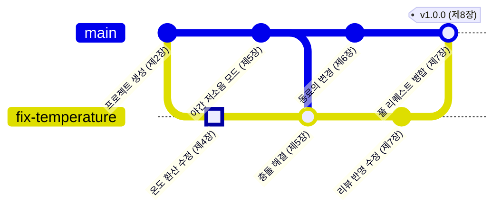

<!-- source: zh-TW/README.md | sha: 44319858e0bc -->

<div align="center">


# Git 입문

**하나의 프로젝트와 하나의 변경을 따라, 첫 코드 한 줄부터 정식 릴리스까지의 여정을 걸어 봅니다**

🌐 [繁體中文](../zh-TW/README.md) ｜ [English](../en/README.md) ｜ [日本語](../ja/README.md) ｜ **한국어** ｜ [홈](../README.md)

</div>

---

## 이 책은 무엇을 다루나요

이런 폴더를 본 적이 있을 겁니다. "firmware_v2", "firmware_v2_수정", "firmware_v2_최종", "firmware_v2_진짜_최종". 사본은 계속 늘어나는데, 지금 보드에 올라가 있는 것이 어느 것인지는 아무도 모릅니다.

Git은 바로 이 문제를 해결하는 도구입니다. 프로젝트의 모든 버전을 기억하고, 여러 사람이 같은 코드를 동시에 고칠 수 있게 해 주며, 문제가 생기면 원하는 시점으로 되돌아갈 수 있게 해 줍니다.

이 책은 두 주인공을 따라갑니다.

- **하나의 프로젝트**: 온도 센서를 읽고 팬을 제어하는 작은 펌웨어 프로젝트입니다. 혼자 개발하던 프로젝트에 동료가 합류하고, 마지막에는 정식 버전을 릴리스합니다.
- **하나의 변경**: 이 프로젝트에 있는 버그 하나입니다. 온도 환산이 잘못되어 팬이 너무 늦게 돌기 시작합니다. 이 수정은 여러분이 코드를 고치는 순간부터 시작해 스테이징, 브랜치, 충돌, 푸시, 리뷰를 한 정거장씩 지나, 마지막에는 정식 릴리스의 일부가 됩니다.

## 이런 분께 추천합니다

이 책은 두 부류의 독자를 위해 썼습니다. 배경지식이 전혀 없는 사람, 그리고 Git을 실제로 제대로 써야 하는 컴퓨터공학과 학생입니다. 내용이 두 층으로 나뉘어 있으니 필요한 부분을 골라 읽으세요.

| 독자 | 읽을 부분 | 읽고 나면 할 수 있는 일 |
|---|---|---|
| 🌱 Git을 써 본 적이 없는 사람 | 본문, 커밋 그래프, 따라 해 보기. "더 알아보기"는 건너뛴다 | 자기 프로젝트에서 Git을 쓰고, GitHub로 다른 사람과 협업한다 |
| 🎓 컴퓨터공학과 학생 | 전부. "더 알아보기"까지 읽는다 | Git의 내부 동작을 설명하고, 과제, 인턴십, 팀 개발에서 쓴다 |
| 🔧 이미 쓰고 있는 사람 | 각 장의 명령어 표, 부록 C, 제9장 | 명령어를 빨리 찾고, 문제가 생겼을 때 복구하는 방법을 안다 |

본문을 읽는 데 Git이나 프로그래밍 지식은 필요 없습니다. 터미널에서 명령어를 칠 수 있으면 더 좋지만, 못 쳐도 괜찮습니다. 모든 작업에 GUI 도구로 하는 방법이 함께 있습니다.

## 모든 작업을 두 가지 방법으로

모든 작업은 먼저 일상적인 비유로 개념을 설명한 다음, 명령어와 Sourcetree에서 하는 방법을 보여 줍니다. 예를 들어 변경을 커밋하는 방법은 이렇습니다.

```bash
git add sensor.c
git commit -m "Fix temperature sensor offset"
```

**Sourcetree에서는**: **sensor.c 선택 → Stage Selected → 메시지 입력 → Commit**

- 명령어는 Windows, macOS, Linux에서 모두 같습니다.
- Sourcetree는 Windows와 macOS용만 있습니다. Linux 독자는 명령어만 따라 해도 됩니다.
- 호스팅 서비스의 예로는 GitHub를 씁니다. 다른 서비스도 개념은 거의 같고, 이름과 화면만 다릅니다.

## 각 장에 있는 길잡이

| 표시 | 내용 |
|---|---|
| 📍 프로젝트와 변경의 현재 위치 | 프로젝트가 어디까지 자랐는지, 변경이 여정의 어느 정거장에 있는지 |
| 🌿 커밋 그래프 | 작업 전후의 커밋 기록. 브랜치가 어떻게 뻗고 병합 후 어떤 모양이 되는지 |
| 📖 용어 상자 | 정의, 현장에서 쓰는 법, 관련 용어, 가장 헷갈리기 쉬운 점 |
| 🔧 노하우 상자 | 팀에서 실제로 하는 방법과, "왜 그렇게 하는지, 안 하면 어떻게 되는지" |
| 🔍 더 알아보기 | 컴퓨터공학과 학생을 위한 내부 동작 설명. 처음에는 접혀 있고 건너뛰어도 됩니다 |
| 🧪 따라 해 보기 | 연습 프로젝트로 그 장의 작업을 직접 해 보고, 성공하면 어떻게 보이는지 확인합니다 |
| 📋 이 장의 명령어 | 그 장에서 쓴 명령어와 Sourcetree에서 누르는 곳 |

예를 들어 제9장 "되돌리기"에 있는 노하우 상자입니다.

> [!TIP]
> **🔧 노하우｜이미 푸시한 커밋은 reset이 아니라 revert로 되돌린다**
>
> - **상황**: GitHub에 막 푸시한 커밋에 잘못이 있어서 없애고 싶다.
> - **방법**: `git revert`로 원래 변경을 상쇄하는 "반대 방향" 커밋을 새로 만들고, 그것을 푸시한다.
> - **이유**: 동료가 이미 그 커밋을 풀해서 그 위에서 작업을 이어 가고 있을 수 있다. revert는 기록을 뒤에 덧붙일 뿐, 이미 공유된 기록을 고쳐 쓰지 않는다.
> - **안 하면 어떻게 되나**: `reset`으로 기록을 고쳐 쓰고 강제로 푸시하면 동료의 기록과 원격 저장소가 어긋난다. 가볍게는 중복된 커밋이 잔뜩 생기고, 심하면 다른 사람의 변경이 덮어써져 사라진다.

이 노하우의 바탕이 되는 원리는 "더 알아보기"에 있습니다. 펼쳐 봐도 되고, 건너뛰어도 됩니다.

<details>
<summary><strong>🔍 더 알아보기｜커밋 번호는 어떻게 정해질까</strong></summary>

모든 커밋에는 `21e1fda` 같은 번호가 있습니다. 이것은 일련번호가 아닙니다. Git이 커밋의 내용을 해시 함수에 넣어 계산한 결과입니다. 내용에는 그때의 스냅숏, 바로 앞 커밋의 번호, 작성자, 시각, 메시지가 들어갑니다.

여기서 두 가지 중요한 성질이 나옵니다.

- 내용이 한 글자만 달라도 번호가 완전히 달라집니다. 누군가 기록을 건드리면 번호를 비교하는 것만으로 알 수 있습니다.
- 앞 커밋의 번호도 내용에 들어가므로, 오래된 커밋 하나를 고쳐 쓰면 그 뒤에 오는 모든 커밋의 번호가 바뀝니다. 이미 공유한 기록을 고쳐 쓰면 동료의 기록과 어긋나는 이유가 바로 이것입니다.

제3장에서는 `git cat-file`로 커밋을 열어 안에 무엇이 저장되어 있는지 직접 봅니다.

</details>

## 연습 프로젝트

이 책에는 연습 프로젝트가 들어 있습니다. 이야기에 나오는 `fan-controller`입니다. 모든 장의 "따라 해 보기"에서 이 프로젝트를 쓰므로, 읽으면서 자기 컴퓨터에서 똑같은 기록을 만들 수 있습니다.

처음부터 시작할 필요는 없습니다. 이 책을 컴퓨터에 내려받고, 그 루트 폴더에서 다음 한 줄을 실행하면 그 장이 시작될 때의 연습 저장소가 만들어집니다.

```bash
bash practice/setup.sh 4
```

Windows에서는 Git을 설치할 때 함께 설치되는 Git Bash에서 실행하세요. Sourcetree를 쓰는 사람은 실행이 끝난 뒤 만들어진 폴더를 Sourcetree에 추가하면 됩니다.

---

## 전체 지도

이 그래프는 변경이 지나가는 커밋 기록입니다. 위쪽 선이 `main`, 아래쪽 선이 수정용 브랜치이고, 강조된 커밋이 바로 그 변경입니다.



변경은 먼저 여러분의 컴퓨터에서 자기 브랜치에 커밋되고, `main`에 들어온 새 기능과 충돌한 뒤 해결됩니다. 그다음 GitHub에 푸시되고, 동료의 리뷰를 거쳐 `main`에 병합되며, 마지막으로 프로젝트와 함께 v1.0.0으로 릴리스됩니다.

그래프에 나오지 않는 장도 있습니다. 제0장과 제1장은 출발 전 준비, 제3장은 커밋 안을 들여다보는 장, 제9장과 제10장은 문제가 생겼을 때 복구하는 법과 문제를 미리 막는 습관입니다.

---

## 목차

### 제0부 시작하기 전에

| 장 | 읽을 내용 |
|---|---|
| [제0장 Git의 전체 그림](0-before-you-start/00-overview/README.md) | 버전 관리가 필요한 이유와 두 주인공의 앞으로의 여정 |
| [제1장 도구 준비](0-before-you-start/01-setup/README.md) | Git과 Sourcetree 설치, 첫 설정, GitHub 연결 |

### 제1부 내 컴퓨터에서

| 장 | 읽을 내용 |
|---|---|
| [제2장 세 가지 영역](1-on-your-computer/02-three-areas/README.md) | 작업 디렉터리, 스테이징 영역, 저장소와 스테이징 영역이 있는 이유 |
| [제3장 커밋의 정체](1-on-your-computer/03-commits/README.md) | 커밋에 실제로 무엇이 저장되는지, 기록을 보는 법 |
| [제4장 브랜치](1-on-your-computer/04-branches/README.md) | branch, switch, HEAD와 브랜치가 이렇게 가벼운 이유 |
| [제5장 병합과 충돌](1-on-your-computer/05-merging-and-conflicts/README.md) | 빨리 감기 병합, 3-way 병합, 충돌 해결, rebase의 장단점 |

### 제2부 내 컴퓨터 밖으로

| 장 | 읽을 내용 |
|---|---|
| [제6장 원격 저장소](2-beyond-your-computer/06-remotes/README.md) | clone, fetch, pull, push와 fetch와 pull의 차이 |
| [제7장 풀 리퀘스트와 코드 리뷰](2-beyond-your-computer/07-pull-requests/README.md) | 풀 리퀘스트 만들기, 리뷰, 자동 검사, 브랜치 보호 |
| [제8장 브랜치 전략과 릴리스](2-beyond-your-computer/08-branching-and-releases/README.md) | 버전 번호, 태그와 릴리스, 팀에서 흔히 쓰는 브랜치 전략 |

### 제3부 문제가 생겼을 때

| 장 | 읽을 내용 |
|---|---|
| [제9장 되돌리기](3-when-things-go-wrong/09-undoing-things/README.md) | restore, reset, revert, reflog. 잘못 고친 코드, 잃어버린 커밋, 잘못된 병합에서 복구하기 |
| [제10장 좋은 습관](3-when-things-go-wrong/10-good-habits/README.md) | 커밋 메시지, .gitignore, 펌웨어 바이너리, 비밀번호가 유출됐을 때의 대처 |

### 부록

| 부록 | 읽을 내용 |
|---|---|
| [부록 A 용어집](appendix/glossary.md) | 책에 나오는 용어의 한국어·영어·중국어 대조. 책 전체 용어의 기준 |
| [부록 B 현장 용어](appendix/jargon.md) | 팀에서 자주 듣는 표현과 예문 |
| [부록 C 명령어와 Sourcetree 대응표](appendix/commands-and-sourcetree.md) | 같은 작업을 명령어로는 어떻게 치고, Sourcetree에서는 어디를 누르는지 |
| [부록 D 참고 자료](appendix/further-reading.md) | 공식 문서와 공개된 책 |

---

## 읽는 방법 추천

순서대로 읽는 것이 가장 확실합니다. 눈앞의 문제부터 해결하고 싶다면 다음 경로로 시작하세요.

| 경로 | 추천 장 |
|---|---|
| 🚀 오늘 바로 쓰고 싶다 | 제0, 1, 2, 4, 6장 |
| 👥 팀에 합류할 준비 | 제6～8장과 부록 B |
| 🚑 문제가 생겼다 | 제9장과 부록 C |

---

## 참여하기

이 책은 열린 프로젝트입니다. 함께 더 좋은 책으로 만들어 주세요.

- **잘못된 곳을 찾았다면**: 이 프로젝트의 [Issues](../../../issues)에서 "勘誤回報 / Erratum" 템플릿으로 알려 주세요.
- **내용이나 그림을 보태고 싶다면**: 먼저 [기여 가이드](../CONTRIBUTING.md)와 [작성 규칙](../STYLE_GUIDE.md)을 읽어 주세요.
- **다른 언어로 번역하고 싶다면**: [번역 가이드](../TRANSLATIONS.md)를 읽어 주세요.

이 책이 도움이 되었다면 오른쪽 위의 ⭐ Star를 눌러 주세요. 더 많은 사람에게 닿을 수 있습니다.

---

## 면책 조항

- 이 책의 내용은 공개된 문서와 업계에서 일반적인 방식을 바탕으로 정리했습니다.
- 이 책은 Git 프로젝트, GitHub, Sourcetree와 아무런 관계가 없습니다. Sourcetree와 GitHub는 GUI 도구와 호스팅 서비스의 예로 썼을 뿐입니다.
- 이 도구들의 화면은 버전과 운영체제에 따라 바뀌므로, 이 책에서는 스크린숏 대신 단순화한 그림을 씁니다. 실제 화면과 조금 다를 수 있습니다.
- 잘못되었거나 오래된 내용이 있으면 Issue로 알려 주세요.

## 라이선스

이 책의 글과 그림은 [크리에이티브 커먼즈 저작자표시-비영리-동일조건변경허락 4.0 국제](../LICENSE)(CC BY-NC-SA 4.0) 라이선스로 제공합니다. 출처를 밝히고, 영리 목적으로 쓰지 않으며, 같은 라이선스로 공유한다면 자유롭게 옮겨 싣고, 고치고, 번역할 수 있습니다.
