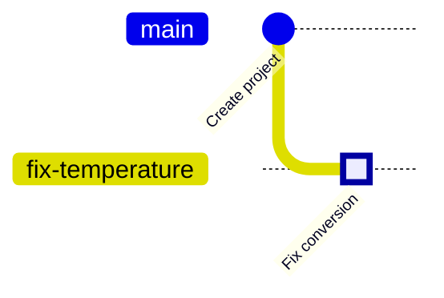

<!--
Chapter template (English): copy this file into a chapter folder under en/ and rename it to README.md.
The first line of a translated file must be the source marker (an HTML comment), for example:
source: zh-TW/1-on-your-computer/02-three-areas/README.md | sha: pending
See TRANSLATIONS.md for the exact format. Read STYLE_GUIDE.md (section 9) first, and delete this comment when you are done.
-->

# Chapter N: Topic — Subtitle

> 📍 **Where the project and the change are**
>
> - Project: ...
> - Previous stop: ...
> - **This chapter: ...**
> - Next stop: ...

---

## Why you need this

Use an everyday comparison to explain what problem this chapter solves.

---

## The idea

Explain the idea as briefly as possible, without equations.

> [!NOTE]
> **📖 Term | English term (中文術語)**
>
> - **Definition**:
> - **On the job**:
> - **Related terms**:
> - **Common confusion**:

---

## Doing it

**Step one → Step two → Step three**

```bash
git status
```

**In Sourcetree**: **Button one → Button two**

The history before and after:



> [!TIP]
> **🔧 Know-how | One sentence that states the point**
>
> - **Situation**:
> - **Practice**:
> - **Why**:
> - **If you skip it**:
> - **Related chapters**:

<details>
<summary><strong>🔍 Deep dive | A title that tells readers whether to open it</strong></summary>

How it works inside, for computer science students. Readers who skip this must still understand the rest of the book.

</details>

---

## Common problems

| Problem | Cause | What to do |
|---|---|---|
| | | |

---

## 🧪 Hands-on

**Before you start**: Continue with the practice project from the previous chapter. To start from this chapter, run `bash practice/setup.sh N` from the root of this repository.

1. Say what this step does:

   ```bash
   git status
   ```

   In Sourcetree: ...

2. ...

**What you should see**: ...

---

## 📋 Commands in this chapter

| What you want to do | Command | In Sourcetree |
|---|---|---|
| | | |

---

## Key takeaways

1. Point one
2. Point two
3. Point three

---

## Further reading

- Author, *Title*, relevant chapter

---

[← Chapter N-1: Title](relative/path) | [Contents](../../README.md) | [Chapter N+1: Title →](relative/path)
