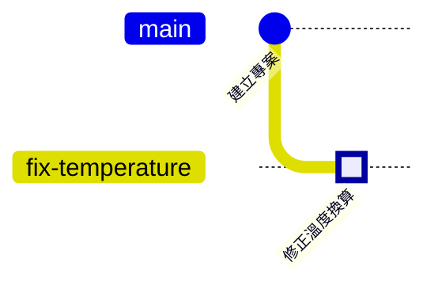

<!--
章節範本（繁體中文）：把這個檔案複製到 zh-TW/ 底下新的章節資料夾，並改名為 README.md。
動筆前請先閱讀 STYLE_GUIDE.md，完成後刪除這段註解。
-->

# 第 N 章　主題：副標題

> 📍 **專案與修改位置**
>
> - 專案進度：……
> - 前一站：……
> - **本章：……**
> - 下一站：……

---

## 為什麼需要這個

用一個生活中的比喻，說明這一章要解決什麼問題。

---

## 概念

用最少的篇幅說明概念，不寫公式。

> [!NOTE]
> **📖 名詞｜中文（English）**
>
> - **定義**：
> - **現場用法**：
> - **相關名詞**：
> - **常見混淆**：

---

## 操作

**步驟一 → 步驟二 → 步驟三**

1. **步驟一**：

```bash
git status
```

**在 Sourcetree 裡**：**按鈕一 → 按鈕二**

操作前後的歷史：



> [!TIP]
> **🔧 Know-how｜一句話點出重點**
>
> - **情境**：
> - **做法**：
> - **為什麼**：
> - **沒做會怎樣**：
> - **相關章節**：

<details>
<summary><strong>🔍 深入一點｜標題要讓讀者判斷要不要點開</strong></summary>

給資工系的原理說明。跳過這一段，也要能讀懂後面的內容。

</details>

---

## 常見問題

| 狀況 | 原因 | 怎麼處理 |
|---|---|---|
| | | |

---

## 🧪 跟著做

**開始前**：接著上一章的練習專案繼續做。想從這一章開始，在本書的根目錄執行 `bash practice/setup.sh N`。

1. 說明這一步要做什麼：

   ```bash
   git status
   ```

   在 Sourcetree 裡：……

2. ……

**你應該看到**：……

---

## 📋 本章指令

| 想做的事 | 指令 | 在 Sourcetree 裡 |
|---|---|---|
| | | |

---

## 本章重點

1. 重點一
2. 重點二
3. 重點三

---

## 延伸閱讀

- 作者，《書名》，相關章節

---

[← 上一章：第 N-1 章 標題](相對路徑) ｜ [目錄](../../README.md) ｜ [下一章：第 N+1 章 標題 →](相對路徑)
