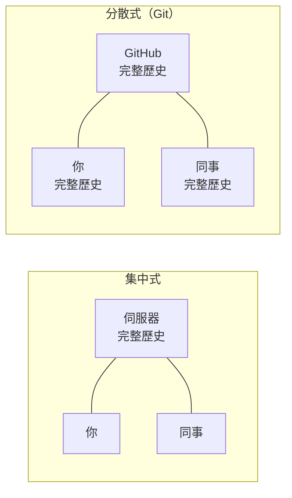
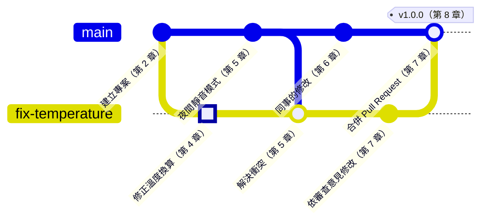

# 第 0 章　Git 全景：一個專案、一筆修改

> 📍 **專案與修改位置**
>
> - 專案進度：`fan-controller` 用複製資料夾的方式管理版本，檔名越來越亂
> - 前一站：旅程的起點
> - **本章：發現 bug，風扇太晚啟動**
> - 下一站：安裝 Git 與 Sourcetree，準備開始修正

---

## 沒有版本控制的日子

你可能看過這樣的資料夾：

```text
fan_v1/
fan_v2/
fan_v2_改/
fan_v2_最終/
fan_v2_真的最終/
fan_v2_同事改過.zip
```

每一份都差不多，又不太一樣。很快就會遇到這些問題：

- 現在燒進板子的，到底是哪一份？
- `fan_v2_改` 改了哪幾行？為什麼要改？
- 同事寄來的壓縮檔和你的版本，要怎麼合在一起？
- 昨天還能動，今天改壞了，要怎麼回到昨天？

這些問題，就是版本控制要解決的事。

---

## 版本控制在做什麼

**版本控制（Version Control）**就像一本專案日記。每次你完成一個段落，就在日記上記一筆：改了什麼、誰改的、什麼時候、為什麼。

有了這本日記，你可以做到四件事：

| 能力 | 解決什麼問題 | 在第幾章 |
|---|---|---|
| 記錄每個版本 | 知道誰在什麼時候、為什麼改了什麼 | 第 2、3 章 |
| 比較差異 | 一眼看出兩個版本差在哪幾行 | 第 2 章 |
| 平行開發 | 修 bug 和開發新功能可以同時進行，互不干擾 | 第 4、5 章 |
| 回到過去 | 改壞了，可以回到任何一個記錄過的版本 | 第 9 章 |

Git 是目前最普及的版本控制工具。從個人的小專案到數千人開發的作業系統，都用它來管理程式碼。

> [!NOTE]
> **📖 名詞｜Git 與 GitHub**
>
> - **定義**：Git 是裝在你電腦上的版本控制工具；GitHub 是一個網站，讓大家把 Git 儲存庫放上去分享與協作。
> - **現場用法**：「這個專案有用 Git 嗎？」問的是版本控制；「推到 GitHub 上」講的是放到網站上。
> - **相關名詞**：儲存庫、遠端、Sourcetree
> - **常見混淆**：Git 和 GitHub 是兩回事。沒有網路、沒有 GitHub 帳號，也可以在自己的電腦上用 Git。

---

## 集中式與分散式

版本控制工具有兩種做法。

**集中式**：歷史只存在一台伺服器上。每個人從伺服器拿最新的檔案，改完再送回去。像全班共用一本點名簿，伺服器一停機，大家都不能記錄。

**分散式**：每個人的電腦上都有完整的歷史。Git 屬於這一種。你在飛機上、在沒有網路的實驗室裡，一樣可以記錄版本、查看歷史。GitHub 上那一份，只是大家約好要同步的那一份。



> [!NOTE]
> **📖 名詞｜分散式版本控制（Distributed Version Control）**
>
> - **定義**：每個人的電腦上都有一份完整歷史的版本控制方式。
> - **現場用法**：平常很少講全名。大家說「clone 下來」，就是把完整的歷史複製一份到自己的電腦。
> - **相關名詞**：集中式版本控制、clone、遠端
> - **常見混淆**：分散式不代表沒有中心。團隊通常還是以 GitHub 上那一份為準，只是在技術上，它和你電腦裡的那一份地位相同。

<details>
<summary><strong>🔍 深入一點｜Git 是怎麼來的</strong></summary>

Git 誕生於 2005 年。當時 Linux 作業系統核心的開發者，原本使用的商業版本控制工具不能再免費使用，Linus Torvalds 便花了幾週寫出 Git 的第一版。

它的設計目標直接反映了開放原始碼專案的需要：

- **快**：上千人、數萬個檔案的專案，查歷史、開分支都要在一瞬間完成。
- **分散**：任何人都能複製完整的歷史，在自己的電腦上工作，再把修改提供給維護者。
- **不可竄改**：每個版本都用內容算出的雜湊值當編號，歷史只要被動過，一比對就會發現（第 3 章）。

分散式也讓「誰都可以參與」變得自然：你不需要伺服器的寫入權限，先在自己的副本上改好，再請維護者拉回去。這正是第 7 章 Pull Request 的原型。

</details>

---

## 這本書的兩個主角

**大主角：一個專案。** `fan-controller` 是一個小型韌體：每秒讀一次溫度感測器，超過 45 °C 就開風扇，低於 40 °C 就關掉。全書會跟著它從一個人開發，長大到有同事加入、發布正式版本。

**小主角：一筆修改。** 感測器的規格是「0 °C 時輸出 500 mV，每升高 1 °C 多 10 mV」，程式卻寫成先減掉 600 mV。結果算出來的溫度永遠少了 10 °C，風扇要到實際 55 °C 才啟動。

這個 bug 的修正只有一行，但它會走完 Git 的整趟旅程。下面這張圖是它走過的歷史，特別標出來的 commit 就是這筆修改：



現在看不懂這張圖沒關係。讀完第 8 章再回來看，每一個點你都會知道它是怎麼來的。

> [!TIP]
> **🔧 Know-how｜專案的第一天就開始用 Git**
>
> - **情境**：專案剛開始，只有你一個人，覺得版本控制是以後的事。
> - **做法**：建立專案資料夾的當天就 `git init`，做出第一個 commit。
> - **為什麼**：最常需要回頭找的，往往是「第一版能動的程式」。那時的版本最單純，最適合用來對照問題。
> - **沒做會怎樣**：等到出問題才想用 Git，最關鍵的「上次還能動的版本」已經找不回來，只能靠記憶慢慢試。
> - **相關章節**：[第 2 章 三個區域](../../1-on-your-computer/02-three-areas/README.md)

> [!TIP]
> **🔧 Know-how｜存檔不等於記錄版本**
>
> - **情境**：以為編輯器按了儲存，Git 就記住了。
> - **做法**：完成一個小段落，例如修好一個 bug、加完一個函式，就 commit 一次。
> - **為什麼**：Git 只記錄你 commit 的那些時間點，兩次 commit 之間的存檔它都不知道。
> - **沒做會怎樣**：改了一整天才 commit，中間改壞了也只能回到早上的版本，一整天的工作一起賠進去。
> - **相關章節**：[第 3 章 Commit 的真面目](../../1-on-your-computer/03-commits/README.md)

---

## 指令和 Sourcetree，兩種都教

Git 本身是在終端機裡用指令操作的。指令一開始比較陌生，但它在每個作業系統上都一樣，網路上的說明也幾乎都用指令。

**Sourcetree** 是 Git 的圖形介面，用滑鼠就能完成大部分操作，歷史也會畫成圖，很適合剛開始的人。它在幕後呼叫的，就是同一套 Git 指令。

所以這本書的每個操作都教兩次：先講概念，再示範指令，最後說明在 Sourcetree 裡怎麼按。你可以只用其中一種，也可以兩種對照著學。

---

## 🧪 跟著做

**開始前**：這一章還不需要 Git，只要能開啟網頁和資料夾就好。

1. 打開本書的 GitHub 頁面，按 **Code → Download ZIP**，下載後解壓縮。
2. 打開解壓縮後的 `practice/fan-controller` 資料夾，這就是故事裡的專案。
3. 用任何文字編輯器打開 `sensor.c`，對照第 5 行的註解和最後的 `return`，找到那個 bug。
4. 讀一下 `practice/README.md`，它說明了之後每一章怎麼使用這個練習專案。

**你應該看到**：`sensor.c` 的註解寫著 500 mV，程式卻寫成：

```c
    return (mv - 600) / 10.0f;
```

先不要修改它。第 2 章會在 Git 的記錄下修正這一行。

---

## 📋 本章指令

這一章還不需要輸入指令。下面是全書最常用的幾個，之後各章會詳細說明：

| 想做的事 | 指令 | 在 Sourcetree 裡 |
|---|---|---|
| 查看目前狀態 | `git status` | 左側的 File Status |
| 記錄一個版本 | `git add`、`git commit` | Stage → Commit |
| 開分支、切換分支 | `git switch -c`、`git switch` | 工具列的 Branch、雙擊分支 |
| 和 GitHub 同步 | `git pull`、`git push` | 工具列的 Pull、Push |

---

## 本章重點

1. 版本控制記錄每個版本是誰、何時、為什麼改的，並能比較、平行開發和回到過去。
2. Git 是分散式的，每個人的電腦上都有完整的歷史；GitHub 是大家約好同步的那一份。
3. Git 是工具，GitHub 是網站，兩者不是同一個東西。
4. 這本書跟著一個韌體專案和一筆修改，走完 Git 的整趟旅程。

---

## 延伸閱讀

- Scott Chacon、Ben Straub，《[Pro Git](https://git-scm.com/book/zh-tw/v2)》第二版，第 1 章（入門，可免費線上閱讀）
- Git 官方網站的介紹：[About Git](https://git-scm.com/about)

---

[目錄](../../README.md) ｜ [下一章：第 1 章 準備工具 →](../01-setup/README.md)
