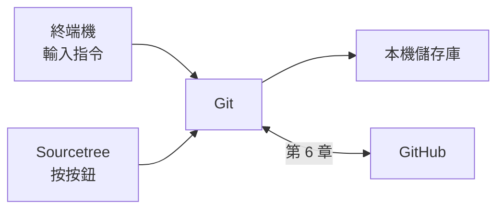
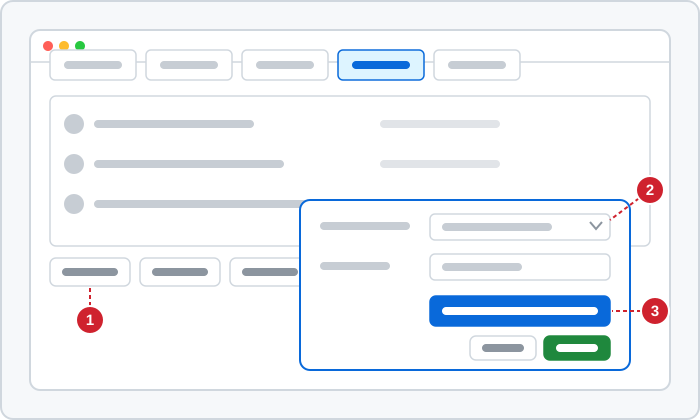

# 第 1 章　準備工具：安裝 Git 與 Sourcetree

> 📍 **專案與修改位置**
>
> - 專案進度：電腦上還沒有任何工具，本章把 Git、Sourcetree 和 GitHub 帳號準備好
> - 前一站：bug 被發現，風扇太晚啟動
> - **本章：修改還沒開始，先把工具準備好**
> - 下一站：建立儲存庫，把修正放進暫存區

---

## 你需要準備什麼

| 工具 | 用途 | 必要嗎 |
|---|---|---|
| Git | 版本控制本身 | 必要 |
| 終端機 | 輸入指令的地方。Windows 用安裝 Git 時一起裝好的 Git Bash，macOS 與 Linux 用內建的終端機 | 必要 |
| 程式編輯器 | 修改程式碼，任何一種都可以 | 必要 |
| Sourcetree | Git 的圖形介面，只有 Windows 與 macOS 版 | 選用 |
| GitHub 帳號 | 第 6 章開始和別人協作時使用 | 第 6 章前準備好 |

這些工具的關係如下。不管你按 Sourcetree 的按鈕，還是在終端機打指令，最後做事的都是同一個 Git：



---

## 終端機的三個基本動作

沒用過終端機也不用擔心，這本書只需要三個動作：

```bash
pwd                          # 我現在在哪個資料夾
ls                           # 這個資料夾裡有什麼
cd ~/git-practice            # 走進某個資料夾；~ 代表你的家目錄
```

`cd ..` 是回到上一層。路徑打一半按 Tab 鍵，終端機會幫你補完。

> [!NOTE]
> **📖 名詞｜終端機（Terminal）**
>
> - **定義**：用文字輸入指令來操作電腦的視窗。
> - **現場用法**：也常叫命令列、command line 或 shell，例如「在終端機打 `git status` 就知道了」。
> - **相關名詞**：Git Bash、指令、路徑
> - **常見混淆**：Windows 內建的命令提示字元也是一種終端機，但很多指令不同，例如沒有 `ls`。本書的指令請在 Git Bash 裡輸入。

---

## 安裝 Git

**Windows**：到 Git 官方網站 git-scm.com 下載安裝程式。大部分畫面維持預設即可，只有兩個畫面要注意：

1. **預設編輯器**：預設是一個終端機裡的編輯器，沒用過的人很容易卡住。請改選你熟悉的程式編輯器。
2. **新儲存庫的初始分支名稱**：選擇 Override the default branch name，填入 `main`。

換行設定請維持預設的 Checkout Windows-style, commit Unix-style line endings。

**macOS**：打開終端機，輸入 `git --version`。如果還沒安裝，系統會跳出視窗，詢問是否安裝開發者命令列工具，按安裝即可。

**Linux**：用發行版的套件管理工具安裝，例如 `sudo apt install git`。

裝好之後確認版本：

```bash
git --version
```

本書使用 `git switch` 這類 2019 年之後才有的指令。如果之後打 `git switch` 出現找不到指令，代表 Git 太舊，請更新到最新版。

---

## 第一次設定：git config

Git 會把你的姓名和 email 記在每一個 commit 裡。第一次使用前，先告訴它你是誰：

```bash
git config --global user.name "Chen Xiao-Ming"
git config --global user.email "xiaoming@example.com"
git config --global init.defaultBranch main
```

- `--global` 代表這台電腦上的所有儲存庫都套用這個設定。
- `init.defaultBranch main` 讓新的儲存庫一開始就叫 `main`。Git 長期以來的預設名稱是 `master`，社群已規劃在之後的版本改成 `main`；GitHub 和新的教學都已經改用 `main`。

**在 Sourcetree 裡**：Sourcetree 預設會沿用上面的設定。也可以在 **Tools → Options → General** 的 Default user information 填寫（macOS 版在 **Settings → General**，較舊的版本叫 Preferences）。

> [!NOTE]
> **📖 名詞｜設定（git config）**
>
> - **定義**：Git 的各種選項，例如姓名、email、預設分支名稱，用 `git config` 讀寫。
> - **現場用法**：「你 global 的 email 設錯了」，指的就是 `--global` 那一層的設定。
> - **相關名詞**：`--global`、`.gitconfig`、`.git/config`
> - **常見混淆**：Git 的設定和 GitHub 網站上的帳號設定是兩回事。改了 GitHub 的個人資料，不會改到電腦上 commit 用的姓名。

> [!TIP]
> **🔧 Know-how｜email 要和 GitHub 帳號一致，或使用它提供的隱藏 email**
>
> - **情境**：第一次設定 `user.email`，隨手填了一個信箱。
> - **做法**：填寫 GitHub 帳號使用的 email。不想公開信箱的話，在 GitHub 的 email 設定開啟隱藏，改用它提供的 noreply 地址。
> - **為什麼**：GitHub 用 email 判斷 commit 是誰做的。commit 推上公開的儲存庫後，裡面的 email 任何人都看得到。
> - **沒做會怎樣**：commit 不會連到你的帳號，貢獻紀錄是空的；或是私人信箱被公開，開始收到垃圾郵件。
> - **相關章節**：[第 6 章 遠端儲存庫](../../2-beyond-your-computer/06-remotes/README.md)

### 換行字元

Windows 的文字檔每一行用兩個字元結尾（CRLF），macOS 與 Linux 只用一個（LF）。Git 可以在提交時統一成 LF，取出時再依系統轉換：

| 系統 | 設定 |
|---|---|
| Windows | `core.autocrlf true`，安裝程式預設已經設好 |
| macOS、Linux | `git config --global core.autocrlf input` |

> [!TIP]
> **🔧 Know-how｜團隊裡的換行設定要一致**
>
> - **情境**：同一個專案，有人用 Windows，有人用 macOS 或 Linux。
> - **做法**：每個人都照上表設定。團隊也可以在儲存庫放一個 `.gitattributes` 檔，統一規定換行方式。
> - **為什麼**：換行字元只要不同，Git 就會認為整個檔案的每一行都改過了。
> - **沒做會怎樣**：只改了一行，差異卻顯示整個檔案都被刪掉重寫，審查的人看不出真正改了什麼，合併時也容易衝突。
> - **相關章節**：[第 7 章 Pull Request 與程式碼審查](../../2-beyond-your-computer/07-pull-requests/README.md)

<details>
<summary><strong>🔍 深入一點｜設定的三個層級</strong></summary>

Git 的設定分成三層，範圍越小，優先權越高：

| 層級 | 選項 | 存在哪裡 | 範圍 |
|---|---|---|---|
| system | `--system` | Windows 在 Git 的安裝位置裡；macOS 與 Linux 通常是 `/etc/gitconfig` | 這台電腦的所有使用者 |
| global | `--global` | 家目錄的 `.gitconfig` | 你的所有儲存庫 |
| local | 不加選項 | 儲存庫裡的 `.git/config` | 只有這個儲存庫 |

所以可以在 global 設定個人的 email，再到公司專案的資料夾裡執行 `git config user.email` 設定工作用的 email，只有那個儲存庫會改用它。想知道某個設定是從哪一層來的，執行 `git config --list --show-origin`。

</details>

---

## 建立 GitHub 帳號

到 github.com 註冊帳號。GitHub 會要求開啟兩步驟驗證（Two-Factor Authentication，2FA），請準備手機上的驗證 App。

帳號在第 6 章之前準備好就可以；要用 Sourcetree 的話，下一節連結帳號時就會用到。推送時怎麼證明「我是我」，第 6 章會說明。

---

## 安裝 Sourcetree 並連上 GitHub

**下載與安裝**：到 Sourcetree 官方網站 sourcetreeapp.com 下載。安裝過程中如果要求登入或註冊帳號，依畫面指示完成或略過即可。

**使用系統的 Git**（Windows）：Sourcetree 內建一份自己的 Git。到 **Tools → Options → Git**，在 Git Version 選擇 **System**，讓 Sourcetree 和終端機用同一個 Git、同一份設定。

**連結 GitHub 帳號**：

- Windows：**Tools → Options → Authentication → Add**，Hosting Service 選 GitHub，用瀏覽器登入授權。
- macOS：**Settings → Accounts → Add**，選 GitHub，用瀏覽器登入授權。



*圖：① Add 按鈕，新增一個帳號；② Hosting Service 選單，選擇 GitHub；③ 授權按鈕，按下後會開啟瀏覽器登入。實際畫面依版本和作業系統略有不同。*

---

## 🧪 跟著做

**開始前**：照上面的說明安裝 Git。Sourcetree 和 GitHub 帳號可以稍後再準備。

1. 打開終端機（Windows 在開始選單找 Git Bash），確認 Git 已經裝好：`git --version`
2. 設定姓名、email 與預設分支。macOS 與 Linux 另外設定換行：

   ```bash
   git config --global user.name "你的名字"
   git config --global user.email "你的 email"
   git config --global init.defaultBranch main
   git config --global core.autocrlf input    # 只有 macOS、Linux 需要
   ```

3. 列出全域設定：`git config --global --list`
4. 如果要使用 Sourcetree：安裝後選擇使用系統的 Git，並連結 GitHub 帳號。
5. 第 0 章用 ZIP 下載本書的話，現在可以改用 Git 下載，這是你第一次用 Git 從網路上取得儲存庫：

   ```bash
   git clone https://github.com/chenwei810/Git_Introduction.git
   ```

**你應該看到**：`git config --global --list` 列出你剛才的設定。設定名稱會顯示成小寫：

```text
user.name=Chen Xiao-Ming
user.email=xiaoming@example.com
init.defaultbranch=main
```

macOS 與 Linux 還會多一行 `core.autocrlf=input`。

---

## 📋 本章指令

| 想做的事 | 指令 | 在 Sourcetree 裡 |
|---|---|---|
| 確認 Git 的版本 | `git --version` | — |
| 設定姓名與 email | `git config --global user.name`、`user.email` | Tools → Options → General（macOS：Settings → General） |
| 新儲存庫的分支叫 main | `git config --global init.defaultBranch main` | — |
| 設定換行（macOS、Linux） | `git config --global core.autocrlf input` | — |
| 列出全域設定 | `git config --global --list` | — |
| 連結 GitHub 帳號 | — | Tools → Options → Authentication（macOS：Settings → Accounts） |

---

## 本章重點

1. 需要的工具是 Git、終端機和程式編輯器；Sourcetree 是選用的圖形介面，背後也是同一個 Git。
2. 第一次使用前，用 `git config --global` 設定姓名、email 與預設分支 `main`。
3. email 會公開在 commit 裡，要和 GitHub 帳號一致，或使用 GitHub 提供的隱藏 email。
4. 團隊裡每個人的換行設定要一致，否則只改一行也會看起來像整個檔案都改了。

---

## 延伸閱讀

- Scott Chacon、Ben Straub，《[Pro Git](https://git-scm.com/book/zh-tw/v2)》第二版，1.5 節（安裝 Git）與 1.6 節（第一次設定）
- Git 官方文件：[git-config](https://git-scm.com/docs/git-config)
- GitHub 官方文件：[設定 commit 的 email 地址](https://docs.github.com/en/account-and-profile/setting-up-and-managing-your-personal-account-on-github/managing-email-preferences/setting-your-commit-email-address)

---

[← 上一章：第 0 章 Git 全景](../00-overview/README.md) ｜ [目錄](../../README.md) ｜ [下一章：第 2 章 三個區域 →](../../1-on-your-computer/02-three-areas/README.md)
