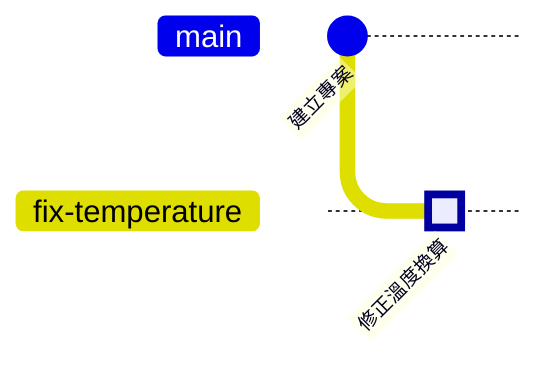

# 第 3 章　Commit 的真面目：快照、雜湊與物件

> 📍 **專案與修改位置**
>
> - 專案進度：儲存庫裡有了第一個 commit「Initial commit」
> - 前一站：修正寫好了，被放進暫存區
> - **本章：修正還在暫存區等著；先打開第一個 commit，看看提交之後會變成什麼**
> - 下一站：開一條新分支，把修正提交上去

---

## commit 是快照，不是差異

很多人以為 commit 記錄的是「這次改了哪幾行」。其實 Git 記錄的是**快照**：按下 commit 的那一刻，整個專案長什麼樣子。

就像每完成一個段落，就替整個專案拍一張團體照。下次再拍時，沒有變的檔案不會重拍，直接沿用上一張照片裡的同一份；只有改過的檔案才存新的一份。

所以快照不浪費空間，而「這次改了哪幾行」是 Git 拿兩張快照比對出來的。這也是為什麼 Git 可以比較任意兩個版本，不只是相鄰的兩個。

---

## 一個 commit 裡有什麼

| 內容 | 說明 |
|---|---|
| 快照 | 這個版本所有檔案的內容 |
| 上一個 commit | 指向它的「前一個版本」，第一個 commit 沒有 |
| 作者與時間 | 誰在什麼時候寫了這些修改 |
| 訊息 | 為什麼要做這次修改 |

這些內容會被算成一串 40 個字元的編號，例如 `21e1fda6273505ec510e3aec8e96e4888e3c597a`。它就是這個 commit 的身分證字號，平常只寫前 7 個字元，例如 `21e1fda`。

> [!NOTE]
> **📖 名詞｜提交（Commit）**
>
> - **定義**：專案在某個時間點的快照，加上作者、時間、訊息，以及指向上一個 commit 的連結。
> - **現場用法**：可以當名詞也可以當動詞，例如「這個 bug 是哪個 commit 帶進來的？」「改完記得 commit」。
> - **相關名詞**：快照、雜湊值、父 commit、`git log`
> - **常見混淆**：commit 只存在你的電腦上，還沒有到 GitHub。要 push 之後（第 6 章）別人才看得到。

> [!NOTE]
> **📖 名詞｜雜湊值（Hash）**
>
> - **定義**：把一段內容丟進雜湊函式（Hash Function）算出來的固定長度編號。內容只要差一個字，編號就完全不同。
> - **現場用法**：常叫 commit hash、commit ID 或 SHA，例如「把有問題的那個 SHA 貼給我」。
> - **相關名詞**：commit、SHA-1、SHA-256
> - **常見混淆**：它不是流水號，看不出先後順序。要知道先後，看的是 commit 之間「上一個」的連結。

---

## 查看歷史：git log

```bash
git log              # 完整的歷史
git log --oneline    # 一個 commit 一行
```

```text
commit 21e1fda6273505ec510e3aec8e96e4888e3c597a
Author: Chen Xiao-Ming <xiaoming@example.com>
Date:   Tue Oct 13 00:32:17 2026 +0800

    Initial commit
```

歷史比較長的時候，終端機會停在一個可以捲動的畫面，按空白鍵往下，按 `q` 離開。

**在 Sourcetree 裡**：左側的 **History**。每一列是一個 commit，左邊的線就是歷史圖。

現在的歷史只有一個點。暫存區裡的修正，會在下一章變成第二個點：



---

## 看一個 commit 改了什麼：git show

```bash
git show HEAD            # 最新的 commit，以及它改了什麼
git show --stat HEAD     # 只列出改了哪些檔案、幾行
```

`HEAD` 代表「目前所在的那個 commit」，第 4 章會詳細說明。也可以把 `HEAD` 換成任何一個 commit 編號。

**在 Sourcetree 裡**：在 History 點一下某個 commit，下方會列出它改了哪些檔案，點檔案就能看到差異。

> [!TIP]
> **🔧 Know-how｜一個 commit 只做一件事**
>
> - **情境**：修了一個 bug，順手改了排版，又調整了一個參數，打算一起 commit。
> - **做法**：分成三個 commit。利用第 2 章的暫存區，一次只放一件事進去。
> - **為什麼**：每個 commit 都是之後可以單獨查看、單獨撤回的單位。
> - **沒做會怎樣**：發現參數調錯了想撤回，卻會連 bug 的修正一起撤掉；審查的人也很難看出哪幾行是真正的修正。
> - **相關章節**：[第 9 章 後悔藥](../../3-when-things-go-wrong/09-undoing-things/README.md)

> [!TIP]
> **🔧 Know-how｜回報問題時，附上 commit 編號**
>
> - **情境**：測試的同事說「新版的韌體有問題」。
> - **做法**：請對方告訴你燒錄的是哪個 commit，或在韌體裡記錄建置時的 commit 編號，開機時印出來。
> - **為什麼**：「新版」每天都在變，只有 commit 編號能精確指出是哪一份程式。
> - **沒做會怎樣**：你在最新的程式上找不到問題，對方手上的卻是三天前的版本，兩邊白忙一場。
> - **相關章節**：[第 8 章 分支策略與版本發布](../../2-beyond-your-computer/08-branching-and-releases/README.md)

<details>
<summary><strong>🔍 深入一點｜blob、tree、commit 三種物件</strong></summary>

`.git/objects/` 裡存的東西叫物件，最常見的有三種：

- **blob**：一個檔案的內容。只有內容，沒有檔名。
- **tree**：一個資料夾。列出裡面每個檔名，以及它對應的 blob 或子資料夾的 tree。
- **commit**：指向最上層的 tree，再加上父 commit、作者、時間與訊息。

用 `git cat-file -p` 可以打開任何一個物件：

```text
$ git cat-file -p HEAD
tree ba262450ee64e15410fdcb083ad5d02175363fb7
author Chen Xiao-Ming <xiaoming@example.com> 1791822737 +0800
committer Chen Xiao-Ming <xiaoming@example.com> 1791822737 +0800

Initial commit
```

每個物件的編號，都是用它的內容算出來的。所以內容相同的檔案，編號一定相同。試試 `git rev-parse HEAD:sensor.c`，你會得到和書上一模一樣的 `28a712d460300d19b5ccfad1dedb2fe190f91adc`，因為我們的 `sensor.c` 內容完全相同。快照不浪費空間，靠的就是這一點：沒改的檔案，新舊快照指向同一個 blob。

</details>

<details>
<summary><strong>🔍 深入一點｜從 SHA-1 到 SHA-256</strong></summary>

Git 一直以來用 SHA-1 演算法計算編號，產生 40 個十六進位字元。SHA-1 後來被證明可以刻意製造出兩份內容不同、編號相同的資料，Git 因此加上了偵測這種攻擊的保護，並開始支援更安全的 SHA-256，編號長度變成 64 個字元。

截至 2020 年代中期，大多數儲存庫和託管平台仍使用 SHA-1，Git 社群正規劃讓新的儲存庫預設改用 SHA-256。對一般使用者來說，差別只在編號變長；指令的用法不變。

</details>

---

## 常見問題

| 狀況 | 原因 | 怎麼處理 |
|---|---|---|
| commit 編號和書上不同 | 作者和時間不同，算出來的編號就不同 | 正常現象 |
| `git log` 裡的作者名字不對 | 第 1 章的 `user.name` 設定有誤 | 修正設定，之後的 commit 就會正確 |

---

## 🧪 跟著做

**開始前**：接著第 2 章的練習專案繼續做。想從這一章開始，在本書的根目錄執行 `bash practice/setup.sh 3`。

1. 查看歷史，看到一個 commit。如果畫面停住，按 `q`：

   ```bash
   cd ~/git-practice/fan-controller
   git log
   git log --oneline
   ```

   在 Sourcetree 裡：左側的 History。

2. 看第一個 commit 包含了哪些檔案：`git show --stat HEAD`
3. 確認修正還在暫存區，沒有被提交：`git status`
4. 想看深入一點的讀者，打開 commit 物件，並查看 `sensor.c` 的 blob 編號：

   ```bash
   git cat-file -p HEAD
   git rev-parse HEAD:sensor.c
   ```

**你應該看到**：`git log --oneline` 只有一行 `Initial commit`；`git show --stat HEAD` 列出 10 個檔案；`git status` 仍然在 Changes to be committed 底下列出 `modified: sensor.c`。`git rev-parse HEAD:sensor.c` 的結果是 `28a712d460300d19b5ccfad1dedb2fe190f91adc`，和書上相同。

---

## 📋 本章指令

| 想做的事 | 指令 | 在 Sourcetree 裡 |
|---|---|---|
| 查看歷史 | `git log` | 左側的 History |
| 一個 commit 一行 | `git log --oneline` | History 預設就是這樣 |
| 看某個 commit 改了什麼 | `git show <編號>` | 在 History 點那個 commit |
| 只看改了哪些檔案 | `git show --stat <編號>` | 在 History 點 commit，看下方的檔案清單 |
| 打開一個物件 | `git cat-file -p <編號>` | — |

---

## 本章重點

1. commit 是整個專案的快照，不是差異；差異是比較兩張快照得到的。
2. 每個 commit 包含快照、上一個 commit、作者、時間與訊息，並由這些內容算出唯一的編號。
3. 用 `git log` 看歷史，用 `git show` 看一個 commit 改了什麼。
4. 一個 commit 只做一件事，之後才能單獨查看和單獨撤回。

---

## 延伸閱讀

- Scott Chacon、Ben Straub，《[Pro Git](https://git-scm.com/book/zh-tw/v2)》第二版，2.3 節（查看提交歷史）與 10.2 節（Git 物件）
- Git 官方文件：[git-log](https://git-scm.com/docs/git-log)、[git-cat-file](https://git-scm.com/docs/git-cat-file)

---

[← 上一章：第 2 章 三個區域](../02-three-areas/README.md) ｜ [目錄](../../README.md) ｜ [下一章：第 4 章 分支 →](../04-branches/README.md)
