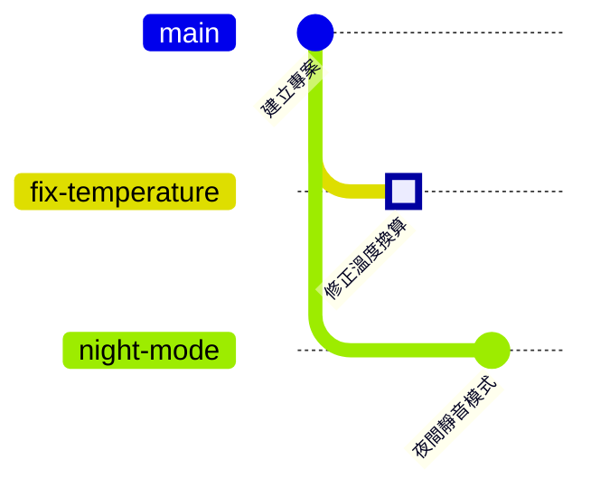

# 第 4 章　分支：其實只是一張便利貼

> 📍 **專案與修改位置**
>
> - 專案進度：要同時做兩件事，修正溫度換算，以及開發「夜間靜音模式」
> - 前一站：修正還在暫存區等著
> - **本章：修正跟著切到新分支 `fix-temperature`，在分支上成為一個 commit**
> - 下一站：夜間靜音模式先合併進 `main`，修正分支和它發生衝突

---

## 為什麼需要分支

`main` 上的程式，應該永遠是可以燒進板子、能正常運作的版本。可是你手上同時有兩件事：

- 修正溫度換算，改完要先在板子上驗證。
- 開發夜間靜音模式，可能要做好幾天，中間的半成品不能動。

如果兩件事都直接改在 `main` 上，半成品會混進來，驗證到一半的修正也會干擾新功能。**分支（Branch）**讓每件事都在自己的線上進行，彼此不干擾，做好了再合併回 `main`。

---

## 分支其實只是一張便利貼

想像每個 commit 是相簿裡的一張照片，每張照片都記得它的上一張是哪張。

**分支就是貼在某張照片上的便利貼**，上面寫著名字，例如 `main`。你在這條分支上 commit 時，新照片會接在後面，便利貼也自動移到新照片上。

開一條新分支，只是多貼一張便利貼，不會複製任何檔案。所以在 Git 裡開分支幾乎不花時間，大家才會一天開好幾條。

另外還有一個特別的箭頭叫 **HEAD**，意思是「你在這裡」。它通常指向一張便利貼，表示你現在在哪一條分支上。

> [!NOTE]
> **📖 名詞｜分支（Branch）**
>
> - **定義**：一個指向某個 commit 的名字。在這條分支上 commit 時，它會自動往前移到新的 commit。
> - **現場用法**：「開一條 branch 來修」「你現在在哪條分支上？」
> - **相關名詞**：`main`、HEAD、`git switch`
> - **常見混淆**：分支不是一份複製出來的資料夾。切換分支時，同一個資料夾裡的檔案會變成那條分支的內容。

> [!NOTE]
> **📖 名詞｜HEAD**
>
> - **定義**：表示「目前所在位置」的指標，通常指向一條分支，再透過分支指向一個 commit。
> - **現場用法**：「HEAD 指在哪裡？」問的是你現在在哪條分支、哪個 commit 上。
> - **相關名詞**：分支、detached HEAD、`git switch`
> - **常見混淆**：舊的教學用 `git checkout` 切換分支。它身兼好幾種功能，連還原檔案也是它，所以 Git 在 2019 年新增了 `git switch`（切換分支）和 `git restore`（還原檔案），分擔它的工作。

---

## 開分支並切換：git switch -c

**列出分支 → 開新分支並切換 → commit**

```bash
git branch                       # 列出所有分支，* 是目前所在的那一條
git switch -c fix-temperature    # 開一條新分支，並切換過去
git commit -m "Fix temperature sensor offset"
```

**在 Sourcetree 裡**：**工具列的 Branch → 輸入分支名稱 → 確認勾選 Checkout New Branch → Create Branch**，再到 File Status 按 Commit。

上一章留在暫存區的修正，會跟著你切到新分支上，所以直接 commit 就好。

> [!TIP]
> **🔧 Know-how｜改到一半才想到要開分支，修改會跟著你走**
>
> - **情境**：已經在 `main` 上改了程式，才想到應該開一條分支。
> - **做法**：直接 `git switch -c 新分支名稱`。還沒 commit 的修改，不管在工作目錄還是暫存區，都會跟著帶過去。
> - **為什麼**：開新分支只是貼一張新的便利貼，資料夾裡的檔案完全不會動。
> - **沒做會怎樣**：以為只能先 commit 到 `main` 再想辦法搬，結果半成品進了 `main`；或是手動複製檔案到別處，最後搞不清楚哪一份是新的。
> - **相關章節**：[第 2 章 三個區域](../02-three-areas/README.md)

---

## 切換分支：git switch

```bash
git switch main
```

**在 Sourcetree 裡**：在左側的 **Branches** 底下，雙擊分支名稱。

切換之後，打開 `sensor.c` 看看：`main` 上還是有 bug 的 `(mv - 600)`。修正只存在 `fix-temperature` 這條分支上，切回去它就又出現了。

> [!TIP]
> **🔧 Know-how｜切換分支之前，先處理手上的修改**
>
> - **情境**：在一條分支上改到一半，臨時要切到另一條分支看東西。
> - **做法**：先 commit，或用 `git stash` 把修改暫時收起來（第 9 章），再切換。
> - **為什麼**：沒 commit 的修改不屬於任何分支，它會跟著你切過去。
> - **沒做會怎樣**：如果你改過的檔案在兩條分支上內容不同，Git 會拒絕切換；否則修改就跟到另一條分支上，很容易被誤 commit 在錯的地方。
> - **相關章節**：[第 9 章 後悔藥](../../3-when-things-go-wrong/09-undoing-things/README.md)

---

## 開第二條分支：夜間靜音模式

夜間靜音模式的做法，是把溫度讀值做平均，讓風扇不要在門檻附近一下開、一下關。回到 `main` 後再開一條分支：

```bash
git switch -c night-mode
# 把 sensor.c 的 return 那一行改成 return smooth((mv - 600) / 10.0f);
git commit -am "Smooth temperature readings for night mode"
```

`-a` 會先把所有改過的、已經被追蹤的檔案放進暫存區，再 commit。全新的檔案不會被加進去，還是要先 `git add`。

現在歷史分成了兩條線，都從「建立專案」長出來：



在終端機裡，可以用 `--graph` 畫出同樣的圖：

```text
$ git log --oneline --graph --all
* 8303532 Smooth temperature readings for night mode
| * 5b16173 Fix temperature sensor offset
|/
* 21e1fda Initial commit
```

注意兩條分支都修改了 `sensor.c` 的同一行。下一章把它們合在一起時，就會發生衝突。

<details>
<summary><strong>🔍 深入一點｜分支只是一個文字檔</strong></summary>

分支存在 `.git/refs/heads/` 底下，一條分支就是一個檔案，內容只有一行 commit 編號：

```text
$ cat .git/refs/heads/fix-temperature
5b161734b18d772125579ecab6dcdce2955b740c
$ cat .git/HEAD
ref: refs/heads/main
```

開分支就是寫一個 41 位元組的小檔案，commit 時改寫裡面的編號，所以再大的專案開分支也是一瞬間。分支很多時，Git 也可能把它們集中寫進 `.git/packed-refs`，道理相同。`HEAD` 檔案則記錄「目前在哪一條分支」。

如果直接切換到一個 commit，而不是一條分支，例如 `git switch --detach 21e1fda`，HEAD 就會直接指向 commit，這叫 **detached HEAD**。這時可以查看舊版本，但新的 commit 不屬於任何分支，一切換走就很難再找到。想保留，先用 `git switch -c 新分支名稱` 給它貼上便利貼。

</details>

---

## 常見問題

| 狀況 | 原因 | 怎麼處理 |
|---|---|---|
| `fatal: a branch named '…' already exists` | 分支名稱已經被用過 | 換一個名字，或用 `git switch` 切過去 |
| `Your local changes … would be overwritten` | 手上的修改和目標分支衝突 | 先 commit 或 `git stash`，再切換 |
| `HEAD detached at …` | 切換到的是 commit，不是分支 | 用 `git switch main` 回到分支上 |

---

## 🧪 跟著做

**開始前**：接著第 3 章的練習專案繼續做。想從這一章開始，在本書的根目錄執行 `bash practice/setup.sh 4`。

1. 開修正用的分支，修正會跟過來，直接 commit：

   ```bash
   cd ~/git-practice/fan-controller
   git switch -c fix-temperature
   git status
   git commit -m "Fix temperature sensor offset"
   ```

2. 回到 `main`，確認 `sensor.c` 又變回 `(mv - 600)`：`git switch main`
3. 開夜間靜音模式的分支。用編輯器把 `sensor.c` 的 `return (mv - 600) / 10.0f;` 改成 `return smooth((mv - 600) / 10.0f);`，然後提交：

   ```bash
   git switch -c night-mode
   git commit -am "Smooth temperature readings for night mode"
   ```

4. 回到 `main`，畫出歷史：

   ```bash
   git switch main
   git log --oneline --graph --all
   git branch
   ```

   在 Sourcetree 裡：左側的 History，上方選單選擇顯示所有分支（All Branches）。

**你應該看到**：歷史分成兩條線，`fix-temperature` 和 `night-mode` 都從 `Initial commit` 長出來；`git branch` 列出三條分支，`*` 在 `main` 前面。

---

## 📋 本章指令

| 想做的事 | 指令 | 在 Sourcetree 裡 |
|---|---|---|
| 列出分支 | `git branch` | 左側的 Branches |
| 開新分支並切換過去 | `git switch -c <名稱>` | 工具列的 Branch |
| 切換分支 | `git switch <名稱>` | 雙擊左側的分支名稱 |
| 提交所有改過的檔案 | `git commit -am "訊息"` | Stage All → Commit |
| 畫出所有分支的歷史 | `git log --oneline --graph --all` | History，選擇 All Branches |

---

## 本章重點

1. 分支讓修 bug 和開發新功能各走各的線，`main` 保持隨時可用。
2. 分支只是貼在 commit 上的便利貼，開分支不會複製檔案，所以幾乎不花時間。
3. HEAD 代表「你在這裡」；切換分支時，資料夾裡的檔案會變成那條分支的內容。
4. 還沒 commit 的修改會跟著你切換分支，切換前先 commit 或收起來。

---

## 延伸閱讀

- Scott Chacon、Ben Straub，《[Pro Git](https://git-scm.com/book/zh-tw/v2)》第二版，3.1 節（分支簡介）
- Git 官方文件：[git-switch](https://git-scm.com/docs/git-switch)、[git-branch](https://git-scm.com/docs/git-branch)

---

[← 上一章：第 3 章 Commit 的真面目](../03-commits/README.md) ｜ [目錄](../../README.md) ｜ [下一章：第 5 章 合併與衝突 →](../05-merging-and-conflicts/README.md)
