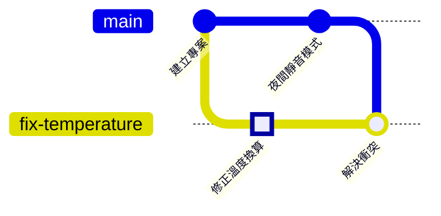

# 第 5 章　合併與衝突：merge、rebase 與衝突處理

> 📍 **專案與修改位置**
>
> - 專案進度：夜間靜音模式完成，合併回 `main`
> - 前一站：修正在 `fix-temperature` 分支上成為一個 commit
> - **本章：`main` 和修正改到同一行，在修正分支上解決衝突**
> - 下一站：把專案推上 GitHub

---

## 合併是什麼

分支讓兩件事各走各的線。事情做完，總要把線接回來，這就是**合併（Merge）**。

Git 的合併有兩種情況：一種只要把便利貼往前移，另一種要真的把兩邊的修改合在一起。

---

## 最簡單的情況：快轉合併

夜間靜音模式做好了，要合併回 `main`。從 `night-mode` 開出去之後，`main` 一直沒有新的 commit，所以 `night-mode` 只是「`main` 再往前走幾步」。

這時 Git 只要把 `main` 的便利貼往前移到 `night-mode` 的位置就好，這叫**快轉（Fast-forward）**：

```bash
git switch main
git merge night-mode
git branch -d night-mode    # 合併完成，刪掉這條分支
```

```text
Updating 21e1fda..8303532
Fast-forward
 sensor.c | 2 +-
```

**在 Sourcetree 裡**：先切到 `main`，在左側的 `night-mode` 上按右鍵，選 **Merge night-mode into current branch**。

刪掉分支只是撕掉便利貼，commit 都還在 `main` 的歷史裡。

---

## 兩條線都往前走了：三方合併

接下來要讓修正分支跟上 `main`。這次不一樣：修正分支有自己的 commit，`main` 也多了夜間靜音模式，兩條線都往前走了。

Git 會找出三個版本來比較：兩條線各自最新的版本，以及它們分岔的那個點，叫**合併基準（Merge Base）**。如果兩邊改的是不同的地方，Git 會自動合在一起，做出一個有兩個「上一個」的合併 commit。這種做法叫**三方合併（Three-way Merge）**。

> [!NOTE]
> **📖 名詞｜合併（Merge）**
>
> - **定義**：把另一條分支的修改合進目前的分支。需要時會產生一個合併 commit，它有兩個上一個 commit。
> - **現場用法**：「這支 merge 進 main 了嗎？」「先把 main merge 回你的分支」。
> - **相關名詞**：快轉、合併 commit、合併基準、rebase
> - **常見混淆**：`git merge night-mode` 是把 `night-mode` 合進「目前所在的分支」，不是反過來。合併前先確認自己在哪一條分支上。

> [!TIP]
> **🔧 Know-how｜先把 main 合進自己的分支，在自己的分支上解決衝突**
>
> - **情境**：自己的分支做好了，但 `main` 在這段期間也有了新的 commit。
> - **做法**：先在自己的分支上 `git merge main`，解決衝突、確認程式正常，之後再合併回 `main`。
> - **為什麼**：衝突在自己的分支上解決，出錯也只影響自己；`main` 永遠只收到已經整合好的版本。
> - **沒做會怎樣**：直接在 `main` 上合併，衝突解錯了，`main` 就壞了，所有人拉下來的程式都不能動。
> - **相關章節**：[第 7 章 Pull Request 與程式碼審查](../../2-beyond-your-computer/07-pull-requests/README.md)

---

## 衝突：兩邊改到同一行

```bash
git switch fix-temperature
git merge main
```

```text
Auto-merging sensor.c
CONFLICT (content): Merge conflict in sensor.c
Automatic merge failed; fix conflicts and then commit the result.
```

兩條分支都改了 `sensor.c` 的 `return` 那一行，Git 不知道該聽誰的，只好停下來問你。打開 `sensor.c`，會看到 Git 插入的**衝突標記**：

```text
<<<<<<< HEAD
    return (mv - 500) / 10.0f;
=======
    return smooth((mv - 600) / 10.0f);
>>>>>>> main
```

`<<<<<<< HEAD` 到 `=======` 是你目前分支的版本，`=======` 到 `>>>>>>> main` 是 `main` 的版本。

**看懂兩邊 → 改成正確的內容 → 刪掉標記 → git add → git commit**

1. **看懂兩邊**：上面是修正（600 改成 500），下面是夜間靜音模式（加上 `smooth`）。兩個都要留。
2. **改成正確的內容**：`return smooth((mv - 500) / 10.0f);`
3. **刪掉三行標記**，存檔。
4. **git add**：告訴 Git 這個檔案的衝突解決了。
5. **git commit**：完成合併。`--no-edit` 代表直接使用 Git 預設的合併訊息。

```bash
git add sensor.c
git commit --no-edit
```

**在 Sourcetree 裡**：衝突的檔案在 File Status 會出現警告圖示。按右鍵選 **Resolve Conflicts**，可以選擇只用某一邊（Resolve Using 'Mine' 或 'Theirs'）或開啟合併工具。這次兩邊都要留，所以用編輯器手動修改後，按右鍵選 **Resolve Conflicts → Mark Resolved**，再 Commit。


*圖：在有警告圖示的衝突檔案上按右鍵。① Resolve Conflicts 子選單；② Resolve Using 'Mine'，只用目前分支的版本；③ Resolve Using 'Theirs'，只用對方的版本；④ Mark Resolved，手動改好之後標記為已解決。*

> [!NOTE]
> **📖 名詞｜衝突（Merge Conflict）**
>
> - **定義**：兩條分支修改了同一個地方，Git 無法自動決定要用哪一個，需要人來判斷。
> - **現場用法**：「merge 的時候 conflict 了」「解 conflict」。
> - **相關名詞**：衝突標記、合併基準、`git merge --abort`
> - **常見混淆**：衝突不是錯誤，也不代表有人做錯事。只是兩個人改到同一處，需要一個懂程式的人做決定。

> [!TIP]
> **🔧 Know-how｜解衝突不是二選一**
>
> - **情境**：遇到衝突，Sourcetree 給了「用我的」或「用對方的」兩個按鈕。
> - **做法**：先看懂兩邊各自想做什麼，再寫出同時滿足兩邊的版本。不確定時，問寫另一邊的人。
> - **為什麼**：衝突的兩邊通常都是有意義的修改，只是剛好改到同一行。
> - **沒做會怎樣**：選「用我的」，夜間靜音模式就悄悄消失；選「用對方的」，修好的 bug 又回來了。程式照樣能編譯，問題要到板子上才會發現。
> - **相關章節**：[第 9 章 後悔藥](../../3-when-things-go-wrong/09-undoing-things/README.md)

合併完成後，修正分支同時擁有了修正和夜間靜音模式：



---

## 另一種做法：rebase

**重新定基（Rebase）**是另一種跟上 `main` 的方法。它不做合併 commit，而是把你分支上的 commit，一個一個重新接到 `main` 的最前面，歷史會變成一條直線。

| | merge | rebase |
|---|---|---|
| 歷史的樣子 | 保留分岔，多一個合併 commit | 一條直線 |
| 原本的 commit | 不變 | 變成新的 commit，編號都會改變 |
| 衝突 | 一次解決 | 每個 commit 都可能要解一次 |
| 適合 | 已經分享給別人的分支 | 只有自己在用、還沒推上去的分支 |

**在 Sourcetree 裡**：在 `main` 上按右鍵，選 **Rebase current changes onto main**。

本書的練習使用 merge。rebase 很好用，但它會改寫 commit，已經推給別人的 commit 不要 rebase，原因在第 9 章。

<details>
<summary><strong>🔍 深入一點｜三方合併怎麼判斷</strong></summary>

Git 用合併基準 B、目前分支 O（ours）、對方分支 T（theirs）三個版本，逐段比較：

| B 和 O | B 和 T | 結果 |
|---|---|---|
| 相同 | 相同 | 不變 |
| 不同 | 相同 | 用 O |
| 相同 | 不同 | 用 T |
| 不同 | 不同，但兩邊改得一樣 | 用改過的內容 |
| 不同 | 不同，而且兩邊改得不一樣 | 衝突 |

所以只有一邊改的地方，Git 一定能自動處理。用 `git merge-base main fix-temperature` 可以看到合併基準是哪個 commit。

commit 和它的「上一個」連起來，形成一張有向無環圖（Directed Acyclic Graph，DAG）：每條線都指向過去，不會繞回來。合併 commit 就是有兩條線指出去的那個點。`git log --graph` 畫的就是這張圖。

</details>

---

## 常見問題

| 狀況 | 原因 | 怎麼處理 |
|---|---|---|
| 跳出看不懂的編輯器畫面 | 沒加 `--no-edit`，Git 打開編輯器讓你寫合併訊息 | 如果是終端機裡的編輯器，常見的是按 Esc 後輸入 `:wq` 再按 Enter |
| 解到一半想放棄 | — | `git merge --abort`，回到合併之前 |
| 程式編譯失敗，出現 `<<<<<<<` | 忘了刪掉衝突標記 | 搜尋 `<<<<<<<`，修正後再 commit 一次 |

---

## 🧪 跟著做

**開始前**：接著第 4 章的練習專案繼續做。想從這一章開始，在本書的根目錄執行 `bash practice/setup.sh 5`。

1. 把夜間靜音模式快轉合併進 `main`，再刪掉這條分支：

   ```bash
   cd ~/git-practice/fan-controller
   git switch main
   git merge night-mode
   git branch -d night-mode
   ```

2. 切到修正分支，把 `main` 合併進來，這時會出現衝突：

   ```bash
   git switch fix-temperature
   git merge main
   ```

3. 用編輯器打開 `sensor.c`，把衝突標記和中間的兩行，換成這一行後存檔：

   ```c
       return smooth((mv - 500) / 10.0f);
   ```

4. 標記為已解決，完成合併，再回到 `main` 看歷史：

   ```bash
   git add sensor.c
   git commit --no-edit
   git switch main
   git log --oneline --graph --all
   ```

**你應該看到**：第 1 步顯示 `Fast-forward`；第 2 步顯示 `CONFLICT`；最後的歷史圖裡，`fix-temperature` 上有一個 `Merge branch 'main' into fix-temperature`，兩條線在這裡接起來。

---

## 📋 本章指令

| 想做的事 | 指令 | 在 Sourcetree 裡 |
|---|---|---|
| 把某條分支合進目前的分支 | `git merge <分支>` | 右鍵分支 → Merge … into current branch |
| 刪掉已經合併的分支 | `git branch -d <分支>` | 右鍵分支 → Delete |
| 標記衝突已解決 | `git add <檔案>` | 右鍵檔案 → Resolve Conflicts → Mark Resolved |
| 用預設訊息完成合併 | `git commit --no-edit` | Commit |
| 放棄這次合併 | `git merge --abort` | — |
| 把分支重新接到 main 前端 | `git rebase main` | 右鍵 main → Rebase current changes onto main |

---

## 本章重點

1. 目標分支沒有新的 commit 時，合併只是把便利貼往前移，叫快轉。
2. 兩邊都往前走時，Git 用合併基準和兩邊的版本做三方合併，改到同一處才會衝突。
3. 解衝突要先看懂兩邊的意圖，寫出同時滿足兩邊的版本，不是二選一。
4. 先把 `main` 合進自己的分支解決衝突，`main` 只收整合好的版本。
5. rebase 讓歷史變成直線，但會改寫 commit，已經分享出去的 commit 不要 rebase。

---

## 延伸閱讀

- Scott Chacon、Ben Straub，《[Pro Git](https://git-scm.com/book/zh-tw/v2)》第二版，3.2 節（基本的分支與合併）與 3.6 節（rebase）
- Git 官方文件：[git-merge](https://git-scm.com/docs/git-merge)、[git-rebase](https://git-scm.com/docs/git-rebase)

---

[← 上一章：第 4 章 分支](../04-branches/README.md) ｜ [目錄](../../README.md) ｜ [下一章：第 6 章 遠端儲存庫 →](../../2-beyond-your-computer/06-remotes/README.md)
