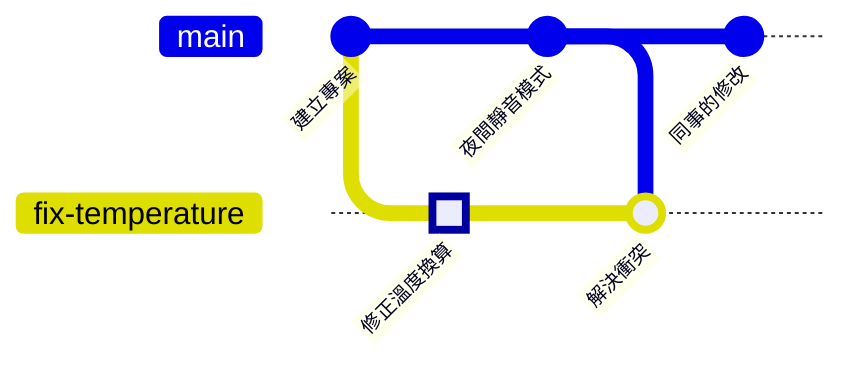

# 第 6 章　遠端儲存庫：clone、fetch、pull、push

> 📍 **專案與修改位置**
>
> - 專案進度：推上 GitHub，同事 clone 下來，也推了一個修改
> - 前一站：在修正分支上解決了衝突
> - **本章：修正分支被推到 GitHub**
> - 下一站：開 Pull Request，請同事審查

---

## 遠端是什麼

到目前為止，所有歷史都只在你的電腦上。同事要參與，就需要一個大家都連得到的地方，放一份同樣的儲存庫。這一份就叫**遠端儲存庫（Remote Repository）**，通常放在 GitHub 上。

可以把它想成共用的雲端相簿。每個人手機裡都有完整的照片（分散式），但大家約好以雲端那一份為準：拍了新照片就上傳，看到別人上傳的就下載。

| 動作 | 指令 | 方向 |
|---|---|---|
| 第一次把整個儲存庫複製下來 | `git clone` | GitHub → 你的電腦 |
| 把你的 commit 送上去 | `git push` | 你的電腦 → GitHub |
| 把別人的 commit 拿下來，先不動你的檔案 | `git fetch` | GitHub → 你的電腦 |
| 拿下來，並合併進目前的分支 | `git pull` | GitHub → 你的電腦 |

> [!NOTE]
> **📖 名詞｜遠端（Remote）與 origin**
>
> - **定義**：遠端是另一個地方的同一個儲存庫，通常在 GitHub 上。`origin` 是預設給它取的名字。
> - **現場用法**：「推到 origin」「origin 上的 main 已經有新的 commit 了」。
> - **相關名詞**：`git remote`、`origin/main`、clone、push
> - **常見混淆**：`origin` 只是一個名字，不是指令，也不一定指向 GitHub。一個儲存庫可以有好幾個遠端，各取不同的名字。

---

## 在 GitHub 建立儲存庫

到 GitHub 按 **New repository**，名稱填 `fan-controller`，選擇 Public 或 Private，然後按 Create repository。建立後的頁面會顯示這個儲存庫的網址，例如 `https://github.com/你的帳號/fan-controller.git`。

> [!TIP]
> **🔧 Know-how｜要推上已有歷史的專案，GitHub 那邊要建立空的儲存庫**
>
> - **情境**：建立 GitHub 儲存庫時，看到可以順便加上 README、.gitignore 和授權條款的選項。
> - **做法**：專案在電腦上已經有 commit 了，這些選項全部不要勾，建立一個空的儲存庫。
> - **為什麼**：勾了之後，GitHub 那邊會先有一個自己的 commit，和你電腦上的歷史毫無關係。
> - **沒做會怎樣**：第一次 push 就被拒絕。新手常在這時用強制推送硬蓋過去，或越弄越亂。
> - **相關章節**：[第 10 章 好習慣](../../3-when-things-go-wrong/10-good-habits/README.md)

---

## 連上遠端並推送：git remote add、git push

```bash
git remote add origin https://github.com/你的帳號/fan-controller.git
git push -u origin main
git push -u origin fix-temperature
```

- `git remote add` 替這個網址取名叫 `origin`。
- `-u` 讓本機的分支記住「我對應的是 origin 上的哪一條」。之後在這條分支上，只要打 `git push` 就好。

**在 Sourcetree 裡**：**工具列的 Settings → Remotes → Add**（macOS 版在選單的 **Repository → Repository Settings**），名稱填 `origin`，貼上網址。之後按工具列的 **Push**，勾選要推送的分支，以及 Track 欄位。

**證明你是你**：第一次推送時，GitHub 要確認身分，密碼欄位**不能**填 GitHub 的登入密碼。常見的做法有三種：

- 用瀏覽器授權。Windows 安裝 Git 時已附帶這個功能，會自動跳出瀏覽器。
- 在 GitHub 的開發者設定產生個人存取權杖（Personal Access Token），在密碼欄位貼上它。產生時，Repository access 選這個儲存庫，Permissions 的 Contents 設成 Read and write（classic 權杖則勾選 `repo`），否則推送會被拒絕。
- 設定 SSH 金鑰，改用 `git@github.com:` 開頭的網址。已經加過 `origin` 的話，用 `git remote set-url origin git@github.com:你的帳號/fan-controller.git` 換掉網址。

Sourcetree 使用者在第 1 章連結過 GitHub 帳號，就不用另外處理。

---

## clone：同事把專案複製回去

同事加入後，第一件事是把整個儲存庫複製到自己的電腦：

```bash
git clone https://github.com/你的帳號/fan-controller.git
```

**在 Sourcetree 裡**：新分頁的 **Clone**（macOS 版是 **New → Clone from URL**），貼上網址，選擇要放的資料夾。

clone 會帶回完整的歷史，並自動把來源設成 `origin`。

---

## fetch 與 pull：把別人的修改拿回來

同事把風扇的 PWM 頻率（控制風扇的開關訊號每秒切換幾次）從 1 kHz 調高到 25 kHz，讓馬達的聲音跑到人耳聽不到的範圍，並推上了 `main`。現在 GitHub 上的 `main` 比你的多一個 commit：



**fetch** 像是收信：把新的 commit 下載回來，但還沒拆開，你的檔案完全不變。**pull** 是收信並照著改：fetch 之後，立刻合併進目前的分支。

```bash
git fetch
git status
```

fetch 會更新你電腦上一張叫 `origin/main` 的便利貼，記錄「上次聯絡時，GitHub 上的 `main` 在哪裡」。`git status` 就是拿你的 `main` 和它比較：

```text
On branch main
Your branch is behind 'origin/main' by 1 commit, and can be fast-forwarded.
```

確認內容沒問題，再拉下來合併：

```bash
git pull
```

**在 Sourcetree 裡**：工具列的 **Fetch** 和 **Pull**。fetch 之後，左側分支名稱旁會出現向下的箭頭和數字，表示有幾個新的 commit 可以拉下來。

> [!NOTE]
> **📖 名詞｜fetch 與 pull**
>
> - **定義**：fetch 只下載遠端的新 commit；pull 是 fetch 之後再合併進目前的分支。
> - **現場用法**：「開工前先 pull 一下」「先 fetch 看看別人推了什麼」。
> - **相關名詞**：`origin/main`、merge、push
> - **常見混淆**：pull 會動到你的檔案，可能產生衝突；fetch 不會。不確定時先 fetch。

> [!TIP]
> **🔧 Know-how｜push 被拒絕時，先 pull，不要強制推送**
>
> - **情境**：`git push` 出現 `rejected` 和 `fetch first`，因為同事先推了新的 commit。
> - **做法**：先 `git pull`，有衝突就照第 5 章解決，確認程式正常後再 push。
> - **為什麼**：遠端有你沒有的 commit，Git 不允許你直接蓋過去。
> - **沒做會怎樣**：用 `git push --force` 硬推，GitHub 上同事的 commit 就被你的版本蓋掉了。他下次 pull 時，歷史會完全對不上。
> - **相關章節**：[第 9 章 後悔藥](../../3-when-things-go-wrong/09-undoing-things/README.md)

<details>
<summary><strong>🔍 深入一點｜origin/main 是什麼</strong></summary>

`origin/main` 叫**遠端追蹤分支**，是你的電腦上記錄「上次聯絡時，origin 的 main 在哪裡」的便利貼，存在 `.git/refs/remotes/origin/main`。

它只會在 fetch、pull、push 的時候更新。所以 `git status` 說 behind by 1 commit，比較的是你的 `main` 和這張便利貼，不是即時的 GitHub。很久沒 fetch，它就是舊的。

```text
$ git branch -vv
  fix-temperature 28dd820 [origin/fix-temperature] Merge branch 'main' into fix-temperature
* main            c67c821 [origin/main] Raise fan PWM frequency to 25 kHz
```

中括號裡就是每條分支對應的遠端追蹤分支，這個對應關係是 `push -u` 設定的，記在 `.git/config` 裡。`git log main..origin/main` 可以列出遠端有、你還沒有的 commit。

</details>

---

## 常見問題

| 狀況 | 原因 | 怎麼處理 |
|---|---|---|
| `Authentication failed` | 密碼欄位填了 GitHub 的登入密碼 | 改用瀏覽器授權、個人存取權杖或 SSH |
| `Need to specify how to reconcile divergent branches` | 兩邊都有新 commit，Git 要你決定 pull 時用 merge 還是 rebase | 執行 `git config --global pull.rebase false` 使用 merge，再 pull 一次 |
| `remote origin already exists` | 已經加過 `origin` 了 | 用 `git remote -v` 檢查網址 |

---

## 🧪 跟著做

**開始前**：需要 GitHub 帳號。接著第 5 章的練習專案繼續做；想從這一章開始，在本書的根目錄執行 `bash practice/setup.sh 6`。

1. 在 GitHub 建立一個空的儲存庫 `fan-controller`，不要勾選任何預設檔案，複製它的網址。
2. 連上遠端，推送兩條分支（把網址換成你的）：

   ```bash
   cd ~/git-practice/fan-controller
   git remote add origin https://github.com/你的帳號/fan-controller.git
   git push -u origin main
   git push -u origin fix-temperature
   ```

3. 扮演同事：在 GitHub 網頁上打開 `main` 分支的 `fan.c`，按編輯（鉛筆圖示），把 `FAN_PWM_HZ       1000` 改成 `25000`。commit 訊息寫 `Raise fan PWM frequency to 25 kHz`，選擇直接 commit 到 `main`。
4. 回到電腦，先 fetch 看看，再 pull：

   ```bash
   git switch main
   git fetch
   git status
   git pull
   git log --oneline --graph --all
   ```

5. 想體驗同事的角度，可以 clone 一份到別的資料夾：`git clone 你的網址 ~/git-practice/colleague`

**你應該看到**：fetch 之後 `git status` 顯示 `behind 'origin/main' by 1 commit`；pull 之後顯示 `Fast-forward`，`main` 的最上面是 `Raise fan PWM frequency to 25 kHz`。GitHub 上可以看到 `main` 和 `fix-temperature` 兩條分支。

---

## 📋 本章指令

| 想做的事 | 指令 | 在 Sourcetree 裡 |
|---|---|---|
| 加上遠端 | `git remote add origin <網址>` | Settings → Remotes → Add |
| 查看遠端 | `git remote -v` | Settings → Remotes |
| 第一次推送一條分支 | `git push -u origin <分支>` | Push，勾選分支與 Track |
| 推送 | `git push` | Push |
| 複製整個儲存庫 | `git clone <網址>` | 新分頁的 Clone |
| 只下載，不動檔案 | `git fetch` | Fetch |
| 下載並合併 | `git pull` | Pull |
| 列出遠端有、自己還沒有的 commit | `git log main..origin/main` | — |

---

## 本章重點

1. 遠端是放在別處的同一個儲存庫，預設叫 `origin`，大家約好以它為準。
2. push 送上去，clone 第一次複製，fetch 只下載，pull 下載並合併。
3. 推送到 GitHub 時要用瀏覽器授權、個人存取權杖或 SSH 證明身分，不能用登入密碼。
4. push 被拒絕時先 pull 再 push，不要強制推送。

---

## 延伸閱讀

- Scott Chacon、Ben Straub，《[Pro Git](https://git-scm.com/book/zh-tw/v2)》第二版，2.5 節（與遠端協同工作）與 3.5 節（遠端分支）
- GitHub 官方文件：[About remote repositories](https://docs.github.com/en/get-started/getting-started-with-git/about-remote-repositories)

---

[← 上一章：第 5 章 合併與衝突](../../1-on-your-computer/05-merging-and-conflicts/README.md) ｜ [目錄](../../README.md) ｜ [下一章：第 7 章 Pull Request 與程式碼審查 →](../07-pull-requests/README.md)
