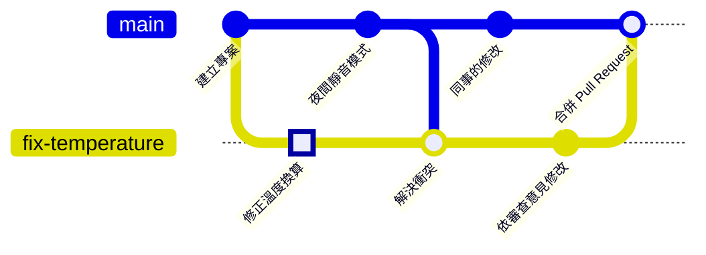

# 第 7 章　Pull Request 與程式碼審查：開 PR、審查與合併

> 📍 **專案與修改位置**
>
> - 專案進度：團隊約定不直接推 `main`，所有修改都要經過 Pull Request
> - 前一站：修正分支被推到 GitHub
> - **本章：開 Pull Request，依審查意見再改一次，合併進 `main`**
> - 下一站：跟著專案一起發布成 v1.0.0

---

## 為什麼不直接推 main

一個人開發時，改好就推上 `main` 很自然。團隊變大之後，`main` 是大家共用的，壞了就是所有人一起停工。於是團隊會約定：**所有修改都先放在自己的分支，經過別人看過，才能進 `main`**。

多一雙眼睛，能抓到自己看不到的錯；討論的過程也會留下紀錄，幾個月後還查得到「當初為什麼這樣改」。

---

## Pull Request 是什麼

**Pull Request**（常簡稱 PR）是在 GitHub 上提出的一個請求：「請把我的分支合併進 `main`」。它把一條分支的所有修改集中在一個頁面上：

- **差異**：這條分支改了哪些檔案、哪幾行。
- **討論**：審查的人可以針對某一行留言。
- **檢查**：自動執行的建置與測試結果。
- **合併按鈕**：條件都滿足了，按一下就合併。

> [!NOTE]
> **📖 名詞｜Pull Request（PR）**
>
> - **定義**：在託管平台上提出的合併請求，附帶差異、討論與自動檢查，審查通過後才合併。
> - **現場用法**：「我發了一個 PR，幫我 review 一下」「這個 PR 還有兩個留言沒處理」。
> - **相關名詞**：程式碼審查、分支保護、merge
> - **常見混淆**：Pull Request 是 GitHub 這類平台的功能，不是 Git 本身的指令。有的平台把同樣的東西叫 Merge Request。

---

## 開一個 Pull Request

**選擇分支 → 寫標題與說明 → 建立**

1. **選擇分支**：在 GitHub 的儲存庫頁面打開 **Pull requests → New pull request**。base 選 `main`（要合併進去的），compare 選 `fix-temperature`（你的分支）。剛 push 完的分支，頁面上方也會直接出現 **Compare & pull request** 按鈕。
2. **寫標題與說明**：標題說這個 PR 做什麼，說明寫為什麼和怎麼驗證。
3. **建立**：按 **Create pull request**。

**在 Sourcetree 裡**：在左側的分支上按右鍵，選 **Create Pull Request**，Sourcetree 會開啟瀏覽器，帶你到 GitHub 的頁面。


*圖：① base，要合併進去的分支（`main`）；② compare，你的分支（`fix-temperature`），旁邊的綠點表示可以自動合併；③ 標題；④ 說明；⑤ Create pull request 按鈕。*

> [!TIP]
> **🔧 Know-how｜PR 的說明要寫「為什麼」和「怎麼驗證」**
>
> - **情境**：程式已經改好了，覺得差異一看就懂，說明欄留白。
> - **做法**：寫下要解決什麼問題、為什麼這樣改，以及你怎麼確認它是對的，例如「在板子上加熱到 50 °C，風扇有正確啟動」。
> - **為什麼**：審查的人看得到你改了什麼，看不到你為什麼改。
> - **沒做會怎樣**：審查的人只能猜，來回問好幾輪；半年後有人想改回去，也找不到當初的理由。
> - **相關章節**：[第 10 章 好習慣](../../3-when-things-go-wrong/10-good-habits/README.md)

---

## 程式碼審查：留言與修改

**程式碼審查（Code Review）**就是請同事讀你的修改。在 PR 的 **Files changed** 分頁，審查的人可以點某一行旁邊的 **+** 留言，最後選擇：

| 選項 | 意思 |
|---|---|
| Comment | 只是留言，沒有結論 |
| Approve | 看過了，可以合併 |
| Request changes | 要先改這些地方 |

這次同事留言：「`500` 和 `10` 是什麼？請改成有名字的常數。」你不需要開新的 PR，只要在同一條分支上修改、commit、push，PR 就會自動更新：

```bash
git switch fix-temperature
# 把 500 和 10 改成 SENSOR_OFFSET_MV 和 SENSOR_MV_PER_C
git commit -am "Use named constants for sensor conversion"
git push
```

> [!TIP]
> **🔧 Know-how｜PR 要小，一個 PR 只做一件事**
>
> - **情境**：累積了一週的修改，一次發成一個上千行的 PR。
> - **做法**：拆成好幾個小 PR，每個只解決一件事，最好幾百行以內。
> - **為什麼**：審查的專注力有限。十行的 PR 會被逐行細看，一千行的 PR 只會被草草掃過。
> - **沒做會怎樣**：審查的人只回一句「看起來沒問題」就核准，真正的 bug 跟著大量的修改一起混進 `main`。
> - **相關章節**：[第 3 章 Commit 的真面目](../../1-on-your-computer/03-commits/README.md)

---

## 自動檢查與分支保護

每次 push，GitHub 都可以自動執行一連串的檢查，例如編譯韌體、跑測試、檢查程式風格，這叫**持續整合（Continuous Integration，CI）**。GitHub 內建這項自動化功能，檢查結果會直接顯示在 PR 上。

再搭配**分支保護（Branch Protection）**，就能讓 `main` 遵守規則：

- 不能直接推送，只能透過 PR 合併。
- 至少要有一個人 Approve。
- 自動檢查必須全部通過。

傳統的分支保護在儲存庫的 **Settings → Branches** 設定；另一套較新、可以疊加多條規則的功能叫 Rulesets，在 **Settings → Rules → Rulesets**。設定之後，就算有人忘了規則，GitHub 也會擋下來。截至 2020 年代中期，免費帳號只有公開的儲存庫能使用這些規則。

> [!NOTE]
> **📖 名詞｜分支保護（Branch Protection）**
>
> - **定義**：託管平台上替某條分支設定的規則，例如禁止直接推送、要求審查與自動檢查通過。
> - **現場用法**：「main 有開保護，不能直接推，請發 PR」。
> - **相關名詞**：Pull Request、CI、Approve、Rulesets
> - **常見混淆**：分支保護是 GitHub 的功能，只管推到 GitHub 的動作。你電腦上的 `main` 照樣可以 commit，只是推不上去。

---

## 合併 Pull Request

審查通過、檢查也都過了，就可以按 **Merge pull request**。按鈕旁的箭頭有三種合併方式：

| 方式 | 歷史的樣子 | 適合 |
|---|---|---|
| Create a merge commit | 保留分支上的每個 commit，再加一個合併 commit | 想完整保留開發過程 |
| Squash and merge | 分支上的所有 commit 壓成一個，接在 `main` 上 | 分支上有很多零碎的 commit |
| Rebase and merge | 分支上的 commit 一個一個接到 `main` 上，沒有合併 commit | 想要一條直線的歷史 |

團隊通常會選定一種，寫進規範裡。本書使用 Create a merge commit，合併後的歷史如下：



合併之後，PR 頁面會出現 **Delete branch** 按鈕，可以刪掉 GitHub 上的分支。回到電腦，把 `main` 更新到最新，並清掉本機的分支：

```bash
git switch main
git pull
git branch -d fix-temperature
git fetch --prune    # 清掉 GitHub 上已經刪除的分支的遠端追蹤分支
```

<details>
<summary><strong>🔍 深入一點｜Pull Request 不是 Git 的功能</strong></summary>

Git 本身沒有 Pull Request。它的原型是 Git 內建的 `git request-pull` 指令：產生一段文字，說明「我的儲存庫的某條分支有這些修改，請拉回去」，再用 email 寄給維護者。這也是名稱裡「pull」的由來：請對方來 pull 你的修改。

GitHub 把這個流程做成網頁，並在儲存庫裡為每個 PR 保留一個特別的參考，例如 `refs/pull/1/head`。所以審查的人可以把任何一個 PR 抓到自己的電腦上測試：

```bash
git fetch origin pull/1/head:pr-1
git switch pr-1
```

三種合併方式的差別，也可以用前兩章的觀念理解：Create a merge commit 是第 5 章的三方合併；Rebase and merge 是第 5 章的 rebase，所以 commit 編號會改變；Squash 則是把所有修改壓成一個全新的 commit。

</details>

---

## 常見問題

| 狀況 | 原因 | 怎麼處理 |
|---|---|---|
| PR 顯示 This branch has conflicts | `main` 在這段期間改到同樣的地方 | 照第 5 章在自己的分支上 `git merge main`，解決後 push |
| 不能 Approve 自己的 PR | GitHub 不允許作者核准自己的 PR | 請同事審查；自己只能留言 |
| 合併按鈕是灰色的 | 分支保護的條件還沒滿足 | 看按鈕上方列出缺少哪一項 |

---

## 🧪 跟著做

**開始前**：接著第 6 章的練習專案繼續做。想從這一章開始，在本書的根目錄執行 `bash practice/setup.sh 7`，再照第 6 章「跟著做」的第 1、2 步，推到你自己的 GitHub 儲存庫。

1. 在 GitHub 開一個 PR：base 選 `main`，compare 選 `fix-temperature`，標題寫 `Fix temperature sensor offset`，說明寫下為什麼要改。
2. 扮演審查的同事：在 **Files changed** 分頁，點 `return` 那一行旁邊的 **+**，留言請對方改用有名字的常數。因為是自己的 PR，只能選 Comment。
3. 回到電腦，把 `sensor.c` 改成下面這樣，再 commit、push：

   ```c
   #include "board.h"
   #include "filter.h"
   #include "sensor.h"

   #define SENSOR_OFFSET_MV  500   /* output at 0 °C */
   #define SENSOR_MV_PER_C   10    /* change per °C */

   /* Analog temperature sensor: 500 mV at 0 °C, plus 10 mV per °C. */
   float sensor_read_celsius(void)
   {
       int mv = adc_read_mv();
       return smooth((mv - SENSOR_OFFSET_MV) / (float)SENSOR_MV_PER_C);
   }
   ```

   ```bash
   cd ~/git-practice/fan-controller
   git switch fix-temperature
   git commit -am "Use named constants for sensor conversion"
   git push
   ```

4. 回到 PR 頁面，確認多了一個 commit。按 **Merge pull request → Confirm merge**，再按 **Delete branch**。
5. 更新電腦上的 `main`，清掉本機的分支：

   ```bash
   git switch main
   git pull
   git branch -d fix-temperature
   git fetch --prune
   git log --oneline --graph -6
   ```

**你應該看到**：`main` 最新的 commit 是 `Merge pull request #1 from 你的帳號/fix-temperature`，`main` 上的 `sensor.c` 已經使用 `SENSOR_OFFSET_MV`。`git branch` 只剩 `main`。

---

## 📋 本章指令

| 想做的事 | 指令 | 在 Sourcetree 裡 |
|---|---|---|
| 開 Pull Request | —（在 GitHub 網頁上） | 右鍵分支 → Create Pull Request |
| 依審查意見修改後更新 PR | `git commit`、`git push` | Commit → Push |
| 合併後更新 main | `git switch main`、`git pull` | 雙擊 main → Pull |
| 刪掉本機已合併的分支 | `git branch -d <分支>` | 右鍵分支 → Delete |
| 清掉已刪除的遠端分支 | `git fetch --prune` | Fetch，勾選 Prune |
| 把別人的 PR 抓下來測試 | `git fetch origin pull/<編號>/head:<名稱>` | — |

---

## 本章重點

1. 團隊用 Pull Request 讓每個修改都先經過審查，`main` 只收看過的程式。
2. PR 的說明要寫為什麼改、怎麼驗證；PR 要小，一個只做一件事。
3. 依審查意見修改時，在同一條分支上 commit、push，PR 會自動更新。
4. 持續整合自動檢查每次 push，分支保護讓規則由 GitHub 強制執行。
5. 合併方式有三種，團隊選定一種；合併後刪掉分支並更新本機的 `main`。

---

## 延伸閱讀

- Scott Chacon、Ben Straub，《[Pro Git](https://git-scm.com/book/zh-tw/v2)》第二版，6.2 節（參與專案）
- GitHub 官方文件：[About pull requests](https://docs.github.com/en/pull-requests/collaborating-with-pull-requests/proposing-changes-to-your-work-with-pull-requests/about-pull-requests)、[About protected branches](https://docs.github.com/en/repositories/configuring-branches-and-merges-in-your-repository/managing-protected-branches/about-protected-branches)

---

[← 上一章：第 6 章 遠端儲存庫](../06-remotes/README.md) ｜ [目錄](../../README.md) ｜ [下一章：第 8 章 分支策略與版本發布 →](../08-branching-and-releases/README.md)
