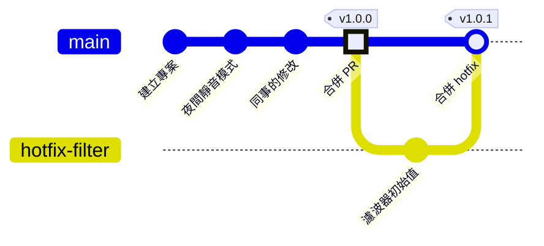

# 第 8 章　分支策略與版本發布：tag、release、主幹開發

> 📍 **專案與修改位置**
>
> - 專案進度：發布第一個正式版本 v1.0.0，之後緊急修正一個開機時的問題，發布 v1.0.1
> - 前一站：修正透過 Pull Request 合併進 `main`
> - **本章：修正成為 v1.0.0 的一部分**
> - 下一站：有人用 reset 弄丟了 commit

---

## 為什麼需要版本號

韌體出貨之後，會有好幾批板子跑著不同時期的程式。客服接到問題，第一句話一定是：「你的韌體是哪一版？」

commit 編號雖然精確，但一串十六進位字元很難念、也看不出先後。所以團隊會在要發布的 commit 上，貼一個人看得懂的名字，例如 `v1.0.0`。

---

## 語意化版本

最常見的版本號格式叫**語意化版本（Semantic Versioning）**，寫成三個數字：**主版號.次版號.修訂號**。

| 哪個數字加一 | 什麼時候 | 例子 |
|---|---|---|
| 主版號 | 改了之後，舊的用法不再相容 | 通訊協定改版，舊的電腦端設定軟體不能用了 |
| 次版號 | 新增功能，但舊的用法照樣能用 | 加入夜間靜音模式 |
| 修訂號 | 只修 bug，不加功能 | 修正溫度換算 |

前面的數字加一時，後面的歸零。例如 `1.4.2` 加了新功能變成 `1.5.0`。

> [!NOTE]
> **📖 名詞｜語意化版本（Semantic Versioning，SemVer）**
>
> - **定義**：用「主版號.次版號.修訂號」三個數字，表示這次改動大小的版本號規則。
> - **現場用法**：「只修 bug，修訂號加一就好」「改了設定格式，不相容，主版號要往上跳」。
> - **相關名詞**：tag、release、hotfix
> - **常見混淆**：版本號不是小數。`1.10.0` 比 `1.9.0` 新，因為三個數字是分開比較的。

---

## tag：替 commit 貼上永久的標籤

**標籤（Tag）** 和分支一樣，都是指向某個 commit 的名字。差別在於分支會隨著 commit 往前移，tag 貼上之後就不動了。

```bash
git switch main
git tag -a v1.0.0 -m "Version 1.0.0"
git tag                      # 列出所有 tag
git push origin v1.0.0       # tag 要另外推送
```

`-a` 會建立附註 tag，記錄是誰、在什麼時候、為什麼打的。正式發布請一律使用附註 tag。

**在 Sourcetree 裡**：**工具列的 Tag → 輸入名稱 → 勾選 Push tag → Add**。

> [!NOTE]
> **📖 名詞｜tag**
>
> - **定義**：貼在某個 commit 上、不會移動的名字，通常用來標示發布的版本。
> - **現場用法**：「v1.0.0 的 tag 打了嗎？」「從 v1.0.0 那個 tag 拉一條 hotfix 出來」。
> - **相關名詞**：分支、release、語意化版本、`git describe`
> - **常見混淆**：tag 不是分支，`git switch v1.0.0` 會被拒絕。要在舊版本上修改，用 `git switch -c <分支> v1.0.0` 從 tag 開一條分支。

> [!TIP]
> **🔧 Know-how｜tag 不會跟著 git push 自動上去**
>
> - **情境**：在電腦上打好了 `v1.0.0`，接著 `git push`，以為發布完成了。
> - **做法**：用 `git push origin v1.0.0` 推送這個 tag。也可以用 `git push --follow-tags`，連同附註 tag 一起推送。
> - **為什麼**：`git push` 預設只推送分支，tag 要另外指定。
> - **沒做會怎樣**：同事、自動建置和 GitHub 都看不到 `v1.0.0`，大家以為還沒發布；你以為已經發布了。
> - **相關章節**：[第 6 章 遠端儲存庫](../06-remotes/README.md)

---

## GitHub 的 Release

在 GitHub 的 **Releases → Draft a new release**，選擇一個 tag，就能建立一個發布頁面：

- **發布說明**：這一版改了什麼。按 Generate release notes，GitHub 會依合併過的 PR 自動整理出一份草稿。
- **附加檔案**：把編譯好的韌體 `fan.bin` 拖進來。使用者從這裡下載，不用自己編譯。

> [!TIP]
> **🔧 Know-how｜韌體的二進位檔放在 Release，不要 commit 進儲存庫**
>
> - **情境**：想讓測試的同事拿到編譯好的 `fan.bin`，順手把它 commit 進去。
> - **做法**：儲存庫只放原始碼；編好的檔案附加在 Release 上，或交給自動建置產生。
> - **為什麼**：二進位檔每次編譯都整個不同，Git 沒辦法有效地儲存它的差異。
> - **沒做會怎樣**：每發布一次，儲存庫就永久多出一整份檔案，幾年後 clone 一次要好幾分鐘；原始碼和二進位檔也可能對不上，沒人知道哪個 `.bin` 是哪份程式編出來的。
> - **相關章節**：[第 10 章 好習慣](../../3-when-things-go-wrong/10-good-habits/README.md)

---

## 分支策略

團隊要約定：有哪些分支、各自的用途、什麼時候合併。最常見的有兩種：

| | 主幹開發（Trunk-Based Development） | Git Flow |
|---|---|---|
| 長期存在的分支 | 只有 `main` | `main`、`develop`，加上 release 與 hotfix 分支 |
| 功能分支 | 很短，一兩天就合併回 `main` | 從 `develop` 開出，做完合併回 `develop` |
| 發布方式 | 在 `main` 上打 tag | 從 `develop` 開 release 分支，整理後合併進 `main` 再打 tag |
| 適合 | 小團隊、持續發布、有自動檢查 | 固定時程發布、同時維護好幾個版本 |

這本書的專案使用主幹開發：`main` 加上短命的功能分支，發布時打 tag。剛開始的團隊，從這種最簡單的做法開始就好，真的需要時再增加分支。Sourcetree 工具列的 Git-flow 按鈕（macOS 版是 Git Flow），可以一鍵建立 Git Flow 需要的分支。

---

## 緊急修正：hotfix

v1.0.0 出貨後，現場回報：板子剛開機的前半分鐘左右，風扇反應很慢。原因是夜間靜音模式的平均值從 0 °C 開始算，要好一陣子才追上實際溫度。

這種要立刻修好的問題，從發布的 tag 開一條 **hotfix** 分支，只修這一個問題：

```bash
git switch -c hotfix-filter v1.0.0
# 把 filter.c 的初始值從 0.0f 改成室溫 25.0f
git commit -am "Start temperature filter at room temperature"
git switch main
git merge --no-ff hotfix-filter -m "Merge branch 'hotfix-filter'"
git tag -a v1.0.1 -m "Version 1.0.1"
```

`--no-ff` 要求 Git 一定做一個合併 commit，即使可以快轉。這樣歷史上能清楚看到「這裡合併過一個 hotfix」。團隊有分支保護時，這一步改成開 Pull Request。



這張圖為了簡潔，把第 7 章的修正分支收進了「合併 PR」那個點。

<details>
<summary><strong>🔍 深入一點｜附註 tag 與 git describe</strong></summary>

tag 有兩種，都存在 `.git/refs/tags/` 裡。**輕量 tag**（不加 `-a`）直接指向 commit。**附註 tag** 則指向一個獨立的 tag 物件，裡面有打 tag 的人、時間和訊息，再由它指向 commit：

```text
$ git cat-file -t v1.0.0
tag
```

`git describe` 會找出離目前最近的 tag，並說明距離它幾個 commit：

```text
$ git describe
v1.0.1-1-g86f7e81
```

意思是「`v1.0.1` 之後又多了 1 個 commit，目前在 `86f7e81`」（`g` 代表 Git）。剛好在 tag 上時只會印出 `v1.0.1`。很多團隊在編譯時把這個字串寫進韌體，開機時印出來，第 3 章說的「回報問題時附上 commit 編號」就自動完成了。加上 `--dirty`，有沒 commit 的修改時還會多一個 `-dirty` 結尾，提醒這份韌體不是從乾淨的程式編出來的。

</details>

---

## 常見問題

| 狀況 | 原因 | 怎麼處理 |
|---|---|---|
| `tag 'v1.0.0' already exists` | 同名的 tag 已經存在 | 換一個版本號；已經推送的 tag 不要改 |
| `git describe` 出現 `fatal` | 沒有附註 tag；它預設只看附註 tag | 先打一個附註 tag，或加 `--tags` 連輕量 tag 一起找 |

---

## 🧪 跟著做

**開始前**：接著第 7 章的練習專案繼續做。想從這一章開始，在本書的根目錄執行 `bash practice/setup.sh 8`。沒有推到 GitHub 的話，略過所有 `git push` 和 GitHub 的步驟即可。

1. 在 `main` 上打 `v1.0.0`，並推送：

   ```bash
   cd ~/git-practice/fan-controller
   git switch main
   git tag -a v1.0.0 -m "Version 1.0.0"
   git push origin v1.0.0
   ```

2. 在 GitHub 的 **Releases → Draft a new release**，選擇 `v1.0.0`，按 Generate release notes，再按 Publish release。
3. 從 tag 開 hotfix 分支。用編輯器把 `filter.c` 的 `static float average = 0.0f;` 改成 `25.0f`，然後提交：

   ```bash
   git switch -c hotfix-filter v1.0.0
   git commit -am "Start temperature filter at room temperature"
   ```

4. 合併回 `main`，打 `v1.0.1`，推送並清掉分支：

   ```bash
   git switch main
   git merge --no-ff hotfix-filter -m "Merge branch 'hotfix-filter'"
   git tag -a v1.0.1 -m "Version 1.0.1"
   git branch -d hotfix-filter
   git push
   git push origin v1.0.1
   git tag
   git describe
   git log --oneline --graph -4
   ```

**你應該看到**：`git tag` 列出 `v1.0.0` 和 `v1.0.1`；`git describe` 印出 `v1.0.1`；`git log --oneline --graph -4` 最上面是 `Merge branch 'hotfix-filter'`。

---

## 📋 本章指令

| 想做的事 | 指令 | 在 Sourcetree 裡 |
|---|---|---|
| 打附註 tag | `git tag -a <名稱> -m "訊息"` | 工具列的 Tag |
| 列出 tag | `git tag` | 左側的 Tags |
| 推送 tag | `git push origin <名稱>` | 打 tag 時勾選 Push tag |
| 從 tag 開分支 | `git switch -c <分支> <tag>` | 在 History 右鍵該 commit → Branch |
| 一定要做合併 commit | `git merge --no-ff <分支>` | Merge 時勾選 Create a new commit even if fast-forward is possible |
| 目前離哪個 tag 最近 | `git describe` | — |

---

## 本章重點

1. 發布的版本用語意化版本命名：主版號.次版號.修訂號。
2. tag 是不會移動的名字；正式發布用附註 tag，而且要另外推送。
3. 編譯好的韌體附加在 GitHub 的 Release 上，不要 commit 進儲存庫。
4. 小團隊從主幹開發開始：`main` 加上短命的分支，發布時打 tag。
5. 緊急修正從發布的 tag 開 hotfix 分支，修好後合併回 `main`，再打新的 tag。

---

## 延伸閱讀

- Scott Chacon、Ben Straub，《[Pro Git](https://git-scm.com/book/zh-tw/v2)》第二版，2.6 節（標籤）與 5.1 節（分散式工作流程）
- [語意化版本 2.0.0](https://semver.org/lang/zh-TW/)
- GitHub 官方文件：[About releases](https://docs.github.com/en/repositories/releasing-projects-on-github/about-releases)

---

[← 上一章：第 7 章 Pull Request 與程式碼審查](../07-pull-requests/README.md) ｜ [目錄](../../README.md) ｜ [下一章：第 9 章 後悔藥 →](../../3-when-things-go-wrong/09-undoing-things/README.md)
