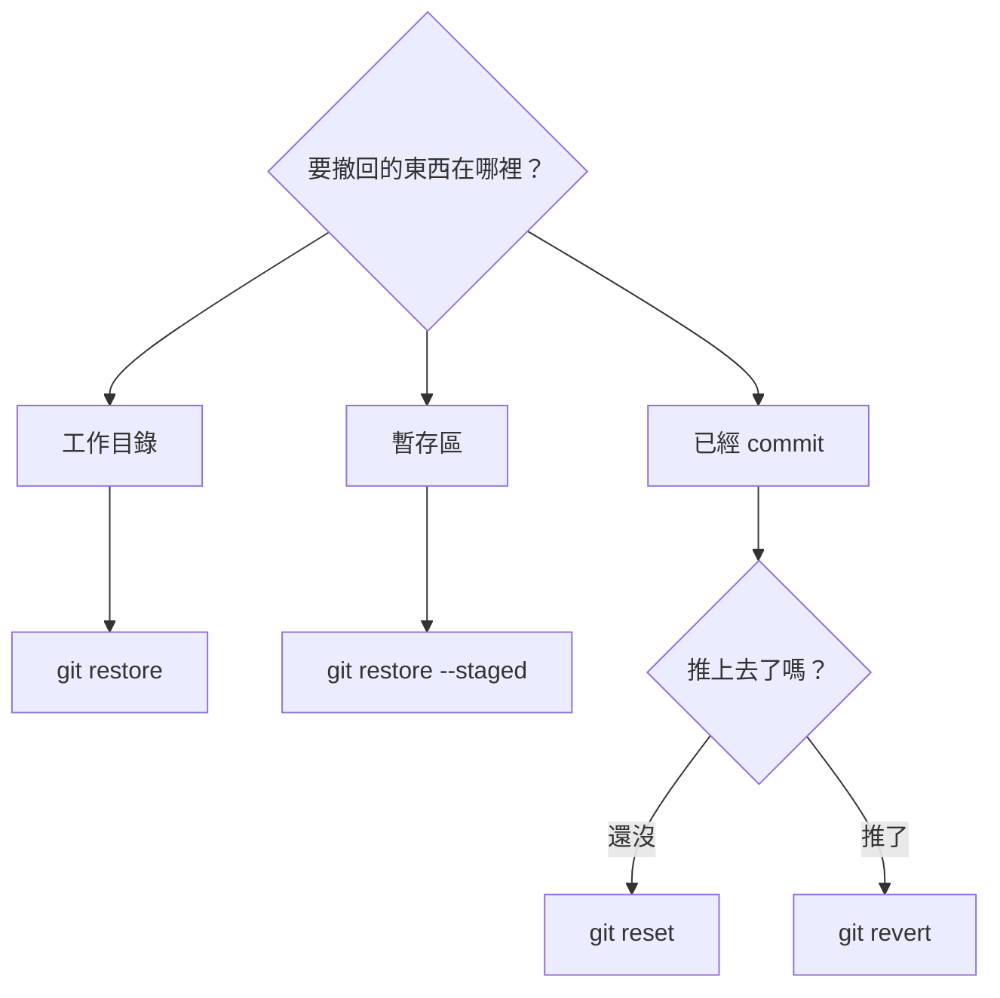
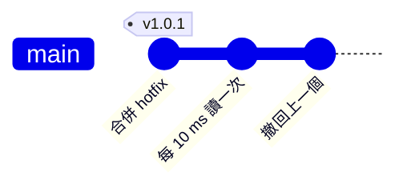

# 第 9 章　後悔藥：restore、reset、revert、reflog

> 📍 **專案與修改位置**
>
> - 專案進度：有人用 reset 弄丟了 commit，還有一個實驗性的修改要撤回
> - 前一站：修正成為 v1.0.0 的一部分
> - **本章：修正被 reset 誤刪，再用 reflog 救回**
> - 下一站：寫好 commit 訊息，處理被 commit 進去的密碼

---

## 先問自己：要撤回的東西在哪裡

Git 的後悔藥有好幾種，吃錯了反而更糟。先判斷要撤回的東西在哪一區，就知道該用哪一個：



另外還有一顆特效藥 `git reflog`，專門救回「以為已經消失」的 commit。

---

## 丟掉工作目錄的修改：git restore

改了半天發現方向錯了，想丟掉書桌上的修改，讓檔案回到紙箱裡的樣子。沒有 add 過的話，就是上一次 commit 的樣子：

```bash
git restore fan.c
```

**在 Sourcetree 裡**：在 File Status 的檔案上按右鍵，選 **Discard**。

這一招沒有辦法反悔。這些修改從來沒有進過 Git，丟掉就真的沒了。

## 把檔案拿出暫存區：git restore --staged

不小心把除錯用的檔案 `git add` 了，想把它拿出紙箱，但保留書桌上的修改：

```bash
git restore --staged board.h
```

**在 Sourcetree 裡**：在 Staged files 選取檔案，按 **Unstage Selected**。

---

## 讓分支回到過去：git reset

`git reset` 把目前分支的便利貼，往回移到某個 commit。被跳過的 commit 不再屬於這條分支。

移動便利貼時，書桌和紙箱要不要跟著還原，由三種模式決定：

| 模式 | 分支 | 暫存區 | 工作目錄 | 用途 |
|---|---|---|---|---|
| `--soft` | 往回移 | 保留 | 保留 | 想重寫最近幾個 commit，修改都還在紙箱裡 |
| `--mixed`（預設） | 往回移 | 還原 | 保留 | 想重新挑選要 commit 的東西 |
| `--hard` | 往回移 | 還原 | 還原 | 全部丟掉，回到那個 commit 的樣子 |

```bash
git reset --soft HEAD~1    # 撤掉最近一個 commit，修改留在暫存區
```

`HEAD~1` 代表「目前位置的上一個 commit」，`HEAD~2` 是上上一個。

**在 Sourcetree 裡**：在 History 的 commit 上按右鍵，選 **Reset current branch to this commit**（macOS 版是 **Reset main to this commit**，中間是目前分支的名稱），再選擇 Soft、Mixed 或 Hard。

> [!NOTE]
> **📖 名詞｜reset 與 revert**
>
> - **定義**：reset 把分支移回過去，被跳過的 commit 從分支上消失；revert 新增一個反向的 commit，抵銷某個舊 commit 的修改。
> - **現場用法**：「還沒推的話 reset 掉就好」「已經推了，用 revert」。
> - **相關名詞**：`HEAD~1`、reflog、強制推送
> - **常見混淆**：reset 改寫歷史，revert 只是往後加。Sourcetree 把 revert 叫 Reverse commit。

> [!TIP]
> **🔧 Know-how｜reset --hard 之前，先看一眼 git status**
>
> - **情境**：想把分支退回去，順手加上 `--hard`。
> - **做法**：先執行 `git status`。有還沒 commit、又想保留的修改，先 commit 或 `git stash`。
> - **為什麼**：`--hard` 會把工作目錄一起還原。
> - **沒做會怎樣**：沒 commit 的修改永久消失，只能碰運氣去找編輯器的本機歷史。commit 過的東西 reflog 救得回來，從沒進過 Git 的東西 Git 也救不回來。
> - **相關章節**：[第 2 章 三個區域](../../1-on-your-computer/02-three-areas/README.md)

---

## 救回弄丟的 commit：git reflog

同事在 `main` 上誤打了 `git reset --hard HEAD~2`。`main` 一口氣退回到第 6 章，溫度修正和 hotfix 都從歷史裡消失了，`sensor.c` 又變回 `(mv - 600)`。

先別慌。被跳過的 commit 還在 `.git` 裡，只是沒有便利貼指著它們。**reflog** 記錄了 HEAD 走過的每一步：

```text
$ git reflog -3
c67c821 HEAD@{0}: reset: moving to HEAD~2
c32dfaf HEAD@{1}: merge hotfix-filter: Merge made by the 'ort' strategy.
95fb995 HEAD@{2}: checkout: moving from hotfix-filter to main
```

`HEAD@{1}` 就是 reset 之前的位置。把分支移回去：

```bash
git reset --hard HEAD@{1}
```

**在 Sourcetree 裡**：Sourcetree 沒有顯示 reflog 的畫面。請按工具列右側的 **Terminal**，在終端機裡執行上面的指令。

> [!NOTE]
> **📖 名詞｜reflog（Reference Log）**
>
> - **定義**：記錄 HEAD 與每條分支曾經指向哪些 commit 的日誌，只存在你自己的電腦上。
> - **現場用法**：「commit 不見了？先別慌，翻一下 reflog」。
> - **相關名詞**：`HEAD@{1}`、reset、垃圾回收
> - **常見混淆**：reflog 不會被 push，也不會跟著 clone 過來。同事弄丟的 commit，要在他自己的電腦上翻 reflog 才救得回來。

---

## 已經推送的 commit：git revert

有人把讀取溫度的間隔從 1 秒改成 10 ms，推上去之後發現夜間靜音模式的平均計算變得太敏感，風扇又在門檻附近一下開、一下關。這個 commit 大家都已經拉下來了，不能用 reset 改寫歷史。

`git revert` 會新增一個反向的 commit，把那次修改抵銷掉：

```bash
git revert HEAD
```

**在 Sourcetree 裡**：在 History 的 commit 上按右鍵，選 **Reverse commit**。



歷史往後多了一個 commit，沒有任何東西被改寫。

> [!TIP]
> **🔧 Know-how｜已經推上去的 commit，用 revert 撤回，不要用 reset**
>
> - **情境**：你發現剛推到 GitHub 的 commit 有錯，想把它拿掉。
> - **做法**：用 `git revert` 新增一個「反向」的 commit，抵銷原本的修改，再推上去。
> - **為什麼**：同事可能已經拉下那個 commit，並在它上面繼續工作。revert 只會往後新增歷史，不會改寫已經分享出去的歷史。
> - **沒做會怎樣**：用 `reset` 改寫歷史再強制推送，同事的歷史就會和遠端對不上。輕則出現一堆重複的 commit，重則別人的修改被蓋掉。
> - **相關章節**：[第 6 章 遠端儲存庫](../../2-beyond-your-computer/06-remotes/README.md)

---

## 暫時收起來：git stash

改到一半，老闆說「先幫我看一個緊急問題」。修改還沒完成，不想 commit，又必須切到別的分支：

```bash
git stash          # 把修改收進抽屜，工作目錄變乾淨
git stash list     # 看抽屜裡有什麼
git stash pop      # 拿回來，並從抽屜裡移除
```

**在 Sourcetree 裡**：工具列的 **Stash**。要拿回來時，在左側的 Stashes 底下按右鍵，選 **Apply Stash**。

<details>
<summary><strong>🔍 深入一點｜reflog 能救多久</strong></summary>

reflog 存在 `.git/logs/` 裡，每條分支和 HEAD 各有一份，記錄它們每一次移動。

被跳過的 commit 不會立刻被刪掉。Git 偶爾會執行垃圾回收（`git gc`），清掉沒有任何便利貼、也沒有 reflog 指向的物件。預設上，reflog 的紀錄會保留 90 天，指向已經不在任何分支上的 commit 的紀錄保留 30 天，失去所有參考的物件還有兩週的寬限期。

所以「commit 過的東西幾乎不會不見」這句話是真的，但有期限。弄丟了就盡快救，不要拖。

</details>

---

## 常見問題

| 狀況 | 原因 | 怎麼處理 |
|---|---|---|
| revert 一個合併 commit 時出現錯誤 | 合併 commit 有兩個上一個，Git 不知道要以哪邊為準 | 加上 `-m 1`，表示以合併前所在的那條分支為準 |
| `git stash pop` 出現衝突 | 收起來之後，同樣的地方又被改了 | 照第 5 章解決衝突；抽屜裡的內容會保留，確認後用 `git stash drop` 刪掉 |

---

## 🧪 跟著做

**開始前**：接著第 8 章的練習專案繼續做。想從這一章開始，在本書的根目錄執行 `bash practice/setup.sh 9`。這一章的步驟都在電腦上進行，做完前不要 push。

1. 模擬意外：退回兩步，確認修正不見了：

   ```bash
   cd ~/git-practice/fan-controller
   git reset --hard HEAD~2
   grep return sensor.c
   ```

2. 用 reflog 救回來：

   ```bash
   git reflog -3
   git reset --hard HEAD@{1}
   grep return sensor.c
   ```

3. 做一個實驗，再撤回。用編輯器把 `main.c` 的 `delay_ms(1000);` 改成 `delay_ms(10);`，然後：

   ```bash
   git commit -am "Read temperature every 10 ms"
   git revert --no-edit HEAD
   ```

4. 試試抽屜。隨意修改 `fan.c` 後，執行 `git stash`，用 `git status` 確認工作目錄變乾淨，再 `git stash pop` 拿回來，最後 `git restore fan.c` 丟掉這個修改。第 3、4 步做完，用下面兩行確認結果：

   ```bash
   git log --oneline -2
   git status
   ```

**你應該看到**：第 1 步的 `sensor.c` 是 `(mv - 600)`；第 2 步變回 `SENSOR_OFFSET_MV`；第 3 步之後 `git log --oneline -2` 最上面是 `Revert "Read temperature every 10 ms"`，`main.c` 又是 `delay_ms(1000);`；第 4 步之後 `git status` 顯示 `nothing to commit, working tree clean`。

---

## 📋 本章指令

| 想做的事 | 指令 | 在 Sourcetree 裡 |
|---|---|---|
| 丟掉工作目錄的修改 | `git restore <檔案>` | 右鍵檔案 → Discard |
| 把檔案拿出暫存區 | `git restore --staged <檔案>` | Unstage Selected |
| 分支退回過去 | `git reset --soft/--mixed/--hard <commit>` | 右鍵 commit → Reset current branch to this commit（macOS：Reset main to this commit） |
| 查看 HEAD 走過的路 | `git reflog` | 按 Terminal 輸入指令 |
| 新增反向的 commit | `git revert <commit>` | 右鍵 commit → Reverse commit |
| 暫時收起修改 | `git stash`、`git stash pop` | 工具列的 Stash；右鍵 → Apply Stash |

---

## 本章重點

1. 先判斷要撤回的東西在哪一區：工作目錄用 restore，暫存區用 restore --staged，commit 用 reset 或 revert。
2. reset 有 soft、mixed、hard 三種模式；hard 會丟掉沒 commit 的修改，而且救不回來。
3. 還沒推送的 commit 可以 reset；已經推送的一律用 revert。
4. commit 過的東西，reflog 幾乎都救得回來，但有期限。
5. 改到一半要切換工作時，用 stash 暫時收起來。

---

## 延伸閱讀

- Scott Chacon、Ben Straub，《[Pro Git](https://git-scm.com/book/zh-tw/v2)》第二版，2.4 節（復原）與 7.7 節（重置揭密）
- Git 官方文件：[git-reset](https://git-scm.com/docs/git-reset)、[git-revert](https://git-scm.com/docs/git-revert)、[git-reflog](https://git-scm.com/docs/git-reflog)

---

[← 上一章：第 8 章 分支策略與版本發布](../../2-beyond-your-computer/08-branching-and-releases/README.md) ｜ [目錄](../../README.md) ｜ [下一章：第 10 章 好習慣 →](../10-good-habits/README.md)
