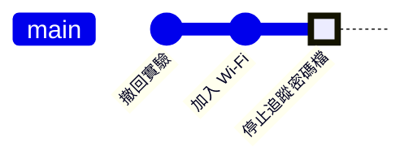

# 第 10 章　好習慣：commit 訊息、.gitignore、二進位檔與機密外洩

> 📍 **專案與修改位置**
>
> - 專案進度：加入 Wi-Fi 回報功能時，Wi-Fi 密碼被 commit 進去了
> - 前一站：修正被誤刪，再用 reflog 救回
> - **本章：回頭看修正的 commit 訊息，學會寫出更好的版本**
> - 下一站：旅程的終點，回到第 0 章看那張全書的歷史圖

---

## 寫好 commit 訊息

半年後，有人在 `sensor.c` 裡看到 `SENSOR_OFFSET_MV 500`，想知道為什麼是 500。他會用 `git log` 或 `git blame`（列出每一行最後是哪個 commit 改的）找到那個 commit，然後讀它的訊息。訊息就是你留給未來的說明書。

一則好的 commit 訊息長這樣：

```text
Fix temperature sensor offset

The sensor outputs 500 mV at 0 °C, but the code subtracted 600 mV,
so every reading was 10 °C too low and the fan started at 55 °C
instead of 45 °C.
```

| 規則 | 原因 |
|---|---|
| 第一行是標題，50 個字元以內 | `git log --oneline`、GitHub 和 Sourcetree 都只顯示第一行 |
| 標題用祈使句，說這個 commit 做什麼，例如 Fix、Add、Remove | 讀起來像「套用這個 commit，就會……」。有些團隊另外規定在前面加 `fix:`、`feat:` 等前綴，照團隊的規範即可 |
| 標題和內文之間空一行 | Git 用空行區分標題和內文 |
| 內文寫為什麼，以及造成什麼影響 | 改了什麼，差異已經看得到；為什麼，只有你知道 |

我們的修正只寫了標題 `Fix temperature sensor offset`。標題本身寫得不錯：用祈使句，具體指出改了什麼。但它少了內文，看不出當初為什麼是 500。現在它已經推上去、成為 v1.0.0 的一部分，照第 9 章的原則不能再改寫，只能在之後的 commit 寫好一點。

```bash
git commit -m "標題" -m "內文第一段"    # 每個 -m 是一段
git commit                              # 不加 -m，Git 會開啟編輯器讓你寫
```

**在 Sourcetree 裡**：訊息欄可以輸入多行。第一行寫標題，空一行，再寫內文。

> [!TIP]
> **🔧 Know-how｜commit 訊息要寫「為什麼」**
>
> - **情境**：剛改完程式，訊息隨手寫了 `update`、`fix bug` 或 `修改`。
> - **做法**：標題說做了什麼，內文說為什麼要做、修正了什麼現象。
> - **為什麼**：程式碼說明了「怎麼做」，只有 commit 訊息能說明「為什麼」。
> - **沒做會怎樣**：歷史裡一整排 `fix bug`，找問題時每個都要打開來看；有人以為 500 是打錯的，又改回 600。
> - **相關章節**：[第 3 章 Commit 的真面目](../../1-on-your-computer/03-commits/README.md)

---

## .gitignore：不該進儲存庫的檔案

有些檔案永遠不該被 commit：編譯產生的檔案、編輯器的暫存檔，以及含有密碼的設定檔。把它們的名稱寫進專案根目錄的 `.gitignore`，Git 就會當作沒看到：

```text
build/
*.bin
*.elf
secrets.h
```

- `build/` 代表整個資料夾；`*.bin` 代表所有副檔名是 `.bin` 的檔案。
- `.gitignore` 本身要 commit，讓整個團隊共用同一份規則。
- 它只對還沒被追蹤的檔案有效。已經 commit 過的檔案，要先用 `git rm --cached` 停止追蹤。

**在 Sourcetree 裡**：在 File Status 未追蹤的檔案上按右鍵，選 **Ignore**，可以選擇忽略這個檔案、這個副檔名或整個資料夾。

> [!NOTE]
> **📖 名詞｜.gitignore**
>
> - **定義**：列出 Git 應該忽略哪些檔案的設定檔，放在儲存庫裡並一起 commit。
> - **現場用法**：「build 資料夾記得加進 gitignore」。
> - **相關名詞**：`git rm --cached`、建置產物、`git check-ignore`
> - **常見混淆**：`.gitignore` 只決定 Git 要不要理會一個檔案，不會刪除它，也不是安全機制。用 `git add -f` 還是可以強制加進去。

---

## 二進位檔、大檔案與 submodule

**二進位檔**：編譯好的韌體每次都整個不同，commit 一次，歷史裡就多一整份，之後很難去掉。編譯產物交給 `.gitignore` 和第 8 章的 Release。

**大檔案**：GitHub 會對超過 50 MiB 的檔案發出警告，並拒絕超過 100 MiB 的檔案。真的需要版本控制的大型檔案，例如硬體的設計檔，可以使用 **Git LFS（Large File Storage）**：儲存庫裡只放一個小小的指標，檔案本身另外存放。

**submodule**：韌體專案常常要用到另一個儲存庫的程式，例如晶片廠商的驅動程式庫。**子模組（Submodule）**讓你把另一個儲存庫放在專案的某個資料夾裡，並記錄用的是它的哪一個 commit：

```bash
git submodule add https://github.com/某個組織/驅動程式庫.git drivers
git clone --recurse-submodules <網址>    # clone 時一起把子模組抓下來
git submodule update --init              # clone 時忘了加，就補執行這行
```

**在 Sourcetree 裡**：**Repository → Add Submodule**。clone 時展開 Advanced Options，勾選 Recurse submodules，就會一併取得子模組。

> [!NOTE]
> **📖 名詞｜子模組（Submodule）**
>
> - **定義**：在一個儲存庫的某個資料夾裡，固定引用另一個儲存庫的某一個 commit。
> - **現場用法**：「驅動程式庫是用 submodule 拉進來的，clone 記得加 `--recurse-submodules`」。
> - **相關名詞**：`git submodule update`、`.gitmodules`、Git LFS
> - **常見混淆**：子模組記錄的是「某一個 commit」，不是「最新版」。對方的儲存庫更新了，你的專案不會自動跟著變，要自己更新並 commit。

---

## 密碼被 commit 進去了

加入 Wi-Fi 回報功能時，Wi-Fi 的名稱和密碼被寫在 `secrets.h` 裡，跟著 commit 進去了。

**換密碼 → 停止追蹤 → 視情況清除歷史**

1. **換密碼**：這是最重要的一步。只要推上過公開的儲存庫，就要假設密碼已經外洩；有些程式會持續掃描 GitHub 上的密碼。
2. **停止追蹤**：讓 `secrets.h` 只留在每個人自己的電腦上，另外提供一份填了假值的範本 `secrets.example.h`：

   ```bash
   git rm --cached secrets.h      # 停止追蹤，但保留電腦上的檔案
   echo "secrets.h" >> .gitignore
   git add .gitignore secrets.example.h
   git commit -m "Stop tracking Wi-Fi credentials"
   ```

3. **視情況清除歷史**：停止追蹤之後，舊的 commit 裡還是有密碼。要徹底清除，必須改寫所有後面的 commit，所有人都要重新 clone。密碼已經換掉的話，通常不需要這一步。



「加入 Wi-Fi」那個 commit 裡的密碼，在停止追蹤之後依然看得到。這就是為什麼第一步一定是換密碼。

GitHub 對每個帳號預設開啟推送保護（Push Protection），推到公開儲存庫時，如果偵測到常見格式的金鑰或權杖，會直接擋下來。但它認不出所有密碼，例如 Wi-Fi 密碼，不能依賴它。

> [!TIP]
> **🔧 Know-how｜密碼外洩之後，第一件事是換密碼，不是改寫歷史**
>
> - **情境**：發現密碼、雲端服務的金鑰或權杖被 commit 並推送了。
> - **做法**：立刻到對應的服務撤銷或更換它，再停止追蹤檔案；有需要才清除歷史。
> - **為什麼**：推上去的那一刻，別人可能已經 clone 或 fetch 了，改寫你的歷史改不到別人電腦上的副本。
> - **沒做會怎樣**：花了一下午研究怎麼清除歷史，舊的密碼卻一直有效，早就被拿去用了。
> - **相關章節**：[第 9 章 後悔藥](../09-undoing-things/README.md)

<details>
<summary><strong>🔍 深入一點｜為什麼停止追蹤不能讓密碼消失</strong></summary>

第 3 章說過，commit 指向 tree，tree 指向 blob。「加入 Wi-Fi」那個 commit 的 tree 裡，有一個指向 `secrets.h` 內容的 blob。之後的 commit 不再包含它，但舊的 commit 還在，blob 也就還在：

```text
$ git show HEAD~1:secrets.h | grep PASSWORD
#define WIFI_PASSWORD  "fan-lab-2026"
```

要讓 blob 消失，必須做出一個不含它的新 tree，也就是新的 commit。而新 commit 的編號不同，它之後的每個 commit 都要跟著重做。這就是清除歷史需要專門的工具（例如 git filter-repo），而且所有人都要重新 clone 的原因。

</details>

<details>
<summary><strong>🔍 深入一點｜快照怎麼不佔空間：packfile</strong></summary>

第 3 章說 Git 存的是快照，沒改的檔案沿用同一個 blob。改過的檔案則會存一份新的 blob，一開始各自壓縮成獨立的檔案，叫鬆散物件。

物件多了以後，Git 會把它們打包成 **packfile**。打包時，Git 會找出內容相近的物件，只存其中一份完整內容，其他的存成差異。所以從儲存方式來看，Git 也會存差異；只是這是儲存層的最佳化，概念上每個 commit 仍然是完整的快照。

文字檔改幾行，差異很小，打包效果很好。編譯好的二進位檔每次都整個不同，差異和原檔一樣大，這就是二進位檔讓儲存庫越來越肥的原因。`git count-objects -vH` 可以看到儲存庫目前的大小。

</details>

---

## 常見問題

| 狀況 | 原因 | 怎麼處理 |
|---|---|---|
| 加進 `.gitignore` 了，檔案還是出現在 `git status` | 檔案已經被追蹤 | `git rm --cached <檔案>` 後 commit |
| 不知道某個檔案為什麼被忽略 | 某條規則符合了它 | `git check-ignore -v <檔案>` 會列出是哪一條 |
| clone 之後子模組的資料夾是空的 | clone 時沒有一起取得子模組 | `git submodule update --init` |

---

## 🧪 跟著做

**開始前**：接著第 9 章的練習專案繼續做。想從這一章開始，在本書的根目錄執行 `bash practice/setup.sh 10`。

1. 重現意外。用編輯器在專案根目錄建立 `secrets.h`，內容如下（練習時省略了 Wi-Fi 的程式，只留下密碼檔）：

   ```c
   #ifndef SECRETS_H
   #define SECRETS_H

   #define WIFI_SSID      "fan-lab"
   #define WIFI_PASSWORD  "fan-lab-2026"

   #endif
   ```

   再模擬一次編譯，然後把密碼檔 commit 進去：

   ```bash
   cd ~/git-practice/fan-controller
   mkdir -p build && echo "firmware" > build/fan.bin
   git add secrets.h
   git commit -m "Add Wi-Fi status reporting"
   git status
   ```

2. 用編輯器在專案根目錄建立 `.gitignore`，內容是上面那四行，存檔後再看一次 `git status`。
3. 複製一份範本，把裡面的名稱和密碼改成 `your-ssid`、`your-password`，再停止追蹤真正的密碼檔：

   ```bash
   cp secrets.h secrets.example.h
   git rm --cached secrets.h
   git add .gitignore secrets.example.h
   git commit -m "Stop tracking Wi-Fi credentials" -m "secrets.h holds the real password, so it must stay on each developer's machine. Copy secrets.example.h to secrets.h and fill in your own values."
   ```

4. 確認密碼檔不再被追蹤，但還在歷史裡：

   ```bash
   git status
   git ls-files
   git show HEAD~1:secrets.h
   ```

**你應該看到**：第 1 步的 `git status` 把 `build/` 列在 Untracked files；第 2 步之後只剩 `.gitignore`。最後的 `git status` 顯示 `nothing to commit, working tree clean`；`git ls-files` 列出 `secrets.example.h`，但沒有 `secrets.h`；`git show HEAD~1:secrets.h` 仍然印出 `fan-lab-2026`。

這是全書最後一個「跟著做」。用 `git log --oneline --graph --all` 看看整段歷史，再和第 0 章那張圖對照：那筆修改走過的路都在，另外多了第 8～10 章的 hotfix、撤回的實驗和密碼檔。

---

## 📋 本章指令

| 想做的事 | 指令 | 在 Sourcetree 裡 |
|---|---|---|
| 寫有內文的 commit 訊息 | `git commit -m "標題" -m "內文"` | 訊息欄第一行寫標題，空一行寫內文 |
| 查每一行是誰改的 | `git blame <檔案>` | 右鍵檔案 → Blame Selected |
| 停止追蹤，但保留檔案 | `git rm --cached <檔案>` | 右鍵檔案 → Stop Tracking |
| 查看檔案為什麼被忽略 | `git check-ignore -v <檔案>` | — |
| 加入子模組 | `git submodule add <網址> <資料夾>` | Repository → Add Submodule |
| 取得子模組 | `git submodule update --init` | — |
| 查看儲存庫的大小 | `git count-objects -vH` | — |

---

## 本章重點

1. commit 訊息的標題說做了什麼，內文說為什麼；標題 50 字元以內，用祈使句。
2. 編譯產物、暫存檔和密碼檔寫進 `.gitignore`；已追蹤的檔案要先 `git rm --cached`。
3. 二進位檔每個版本都會留下一整份；編譯產物放 Release，必要的大檔案用 Git LFS。
4. 密碼被 commit 進去，第一步是換密碼，再停止追蹤，有需要才清除歷史。

---

## 延伸閱讀

- Scott Chacon、Ben Straub，《[Pro Git](https://git-scm.com/book/zh-tw/v2)》第二版，2.2 節（忽略檔案）、5.2 節（提交訊息的準則）與 7.11 節（子模組）
- GitHub 官方文件：[Ignoring files](https://docs.github.com/en/get-started/getting-started-with-git/ignoring-files)、[Removing sensitive data from a repository](https://docs.github.com/en/authentication/keeping-your-account-and-data-secure/removing-sensitive-data-from-a-repository)

---

[← 上一章：第 9 章 後悔藥](../09-undoing-things/README.md) ｜ [目錄](../../README.md) ｜ [附錄 A 術語總表 →](../../appendix/glossary.md)
