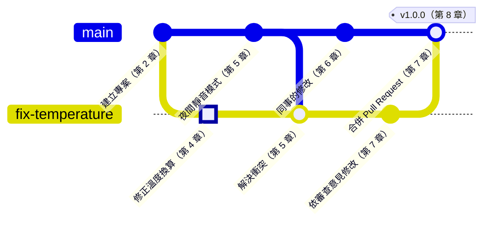

<div align="center">


# Git 概論

**跟著一個專案和一筆修改，走完從第一行程式到正式版本的旅程**

🌐 **繁體中文** ｜ [English](../en/README.md) ｜ [日本語](../ja/README.md) ｜ [한국어](../ko/README.md) ｜ [總覽首頁](../README.md)

</div>

---

## 這本書在講什麼

你一定看過這樣的資料夾：「韌體_v2」「韌體_v2_改」「韌體_v2_最終」「韌體_v2_真的最終」。檔案越存越多，卻沒有人說得出哪一份才是現在燒進板子的版本。

Git 就是用來解決這件事的工具。它記住專案的每一個版本，讓好幾個人同時修改同一份程式，出錯時也能回到任何一個時間點。

這本書會跟著兩個主角走：

- **一個專案**：一個小型韌體專案，讀取溫度感測器、控制風扇轉速。它會從一個人開發，長大到有同事加入，最後發布正式版本。
- **一筆修改**：專案裡的一個 bug。溫度換算寫錯了，風扇太晚啟動。這筆修正會從你改程式開始，一站一站走過暫存、分支、衝突、推送和審查，最後成為正式版本的一部分。

## 適合誰讀

這本書寫給兩種人：完全沒有底子的人，以及需要真正用上 Git 的資工系學生。內容分成兩層，各取所需：

| 讀者 | 讀什麼 | 讀完能做到 |
|---|---|---|
| 🌱 完全沒碰過 Git | 正文、歷史圖和跟著做，跳過「深入一點」 | 在自己的專案裡使用 Git，和別人用 GitHub 協作 |
| 🎓 資工系學生 | 全部，包括「深入一點」 | 說出 Git 內部怎麼運作，並用在專題、實習與團隊開發 |
| 🔧 已經在用的人 | 本章指令、附錄 C 和第 9 章 | 快速查到指令，出事時知道怎麼救 |

正文不需要任何 Git 或程式背景。會在終端機輸入指令更好，不會也沒關係，每個操作都有圖形介面的做法。

## 每個操作都教兩次

每個操作都會先用比喻講概念，再分別示範指令和 Sourcetree 的做法。例如把修改提交成一個 commit：

```bash
git add sensor.c
git commit -m "Fix temperature sensor offset"
```

**在 Sourcetree 裡**：**選取 sensor.c → Stage Selected → 輸入訊息 → Commit**

- 指令在 Windows、macOS 與 Linux 上都一樣。
- Sourcetree 只有 Windows 與 macOS 版，Linux 讀者可以只看指令。
- 遠端平台以 GitHub 為例。其他平台的概念大致相同，只是名稱和畫面不一樣。

## 每一章都有的小幫手

| 標示 | 內容 |
|---|---|
| 📍 專案與修改位置 | 專案現在長到哪裡，那筆修改走到旅程的哪一站 |
| 🌿 歷史圖 | 操作前後的 commit 歷史，看見分支怎麼長、合併後變成什麼形狀 |
| 📖 名詞框 | 定義、現場用法、相關名詞，以及最容易搞混的地方 |
| 🔧 Know-how 框 | 團隊裡的做法，以及「為什麼要這樣做、沒做會怎樣」 |
| 🔍 深入一點 | 給資工系的原理說明，預設收合，可以跳過 |
| 🧪 跟著做 | 用練習專案把本章的操作親手做一遍，並告訴你應該看到什麼 |
| 📋 本章指令 | 本章用到的指令，以及在 Sourcetree 裡怎麼按 |

例如第 9 章後悔藥裡的一個 Know-how 框：

> [!TIP]
> **🔧 Know-how｜已經推上去的 commit，用 revert 撤回，不要用 reset**
>
> - **情境**：你發現剛推到 GitHub 的 commit 有錯，想把它拿掉。
> - **做法**：用 `git revert` 新增一個「反向」的 commit，抵銷原本的修改，再推上去。
> - **為什麼**：同事可能已經拉下那個 commit，並在它上面繼續工作。revert 只會往後新增歷史，不會改寫已經分享出去的歷史。
> - **沒做會怎樣**：用 `reset` 改寫歷史再強制推送，同事的歷史就會和遠端對不上。輕則出現一堆重複的 commit，重則別人的修改被蓋掉。

這個 Know-how 背後的原理，就放在「深入一點」裡。點開來看看，不想看也可以直接跳過：

<details>
<summary><strong>🔍 深入一點｜commit 的編號是怎麼算出來的</strong></summary>

每個 commit 都有一串像 `21e1fda` 這樣的編號。它不是流水號，而是 Git 把 commit 的內容丟進雜湊函式（Hash Function）算出來的結果。commit 的內容包括這次的快照、上一個 commit 的編號、作者、時間和訊息。

這帶來兩個重要的性質：

- 內容只要差一個字，編號就完全不同。只要有人動過歷史，一比對編號就會發現。
- 上一個 commit 的編號也算在裡面，所以改寫一個舊的 commit，它之後每一個 commit 的編號都會跟著改變。這就是改寫已經分享出去的歷史，會讓同事的歷史對不上的原因。

第 3 章會用 `git cat-file` 打開一個 commit，親眼看看裡面存了什麼。

</details>

## 練習專案

書裡附一個練習專案，也就是故事裡的 `fan-controller`。每一章的「跟著做」都用它，所以你可以一邊讀、一邊在自己的電腦上做出一模一樣的歷史。

想從某一章開始，不必從頭做起。把這本書下載到電腦後，在它的根目錄執行下面這行，就會建立那一章開始時的練習儲存庫：

```bash
bash practice/setup.sh 4
```

Windows 請用安裝 Git 時一起裝好的 Git Bash 執行。Sourcetree 使用者執行完之後，把建立好的資料夾加進 Sourcetree 就可以了。

---

## 全書地圖

這張圖是那筆修改走過的 commit 歷史。上面那條是 `main`，下面那條是修正用的分支，特別標出來的 commit 就是那筆修改。



這筆修改在你的電腦上被提交到自己的分支，和 `main` 的新功能發生衝突並解決，接著推上 GitHub，經過同事審查後合併進 `main`，最後跟著專案一起發布成 v1.0.0。

圖上沒有出現的幾章：第 0、1 章是出發前的準備；第 3 章打開 commit 看看裡面存了什麼；第 9、10 章則是出事時怎麼救，以及怎麼避免出事。

---

## 目錄

### 第 0 部　開始之前

| 章節 | 你會讀到 |
|---|---|
| [第 0 章　Git 全景](0-before-you-start/00-overview/README.md) | 為什麼需要版本控制，以及兩個主角接下來的旅程 |
| [第 1 章　準備工具](0-before-you-start/01-setup/README.md) | 安裝 Git 與 Sourcetree、第一次設定，以及連上 GitHub |

### 第 1 部　在自己的電腦上

| 章節 | 你會讀到 |
|---|---|
| [第 2 章　三個區域](1-on-your-computer/02-three-areas/README.md) | 工作目錄、暫存區與儲存庫，以及暫存區為什麼存在 |
| [第 3 章　Commit 的真面目](1-on-your-computer/03-commits/README.md) | 一個 commit 裡到底存了什麼，以及怎麼查看歷史 |
| [第 4 章　分支](1-on-your-computer/04-branches/README.md) | branch、switch 與 HEAD，以及開分支為什麼這麼便宜 |
| [第 5 章　合併與衝突](1-on-your-computer/05-merging-and-conflicts/README.md) | 快轉合併、三方合併、解決衝突，以及 rebase 的取捨 |

### 第 2 部　走出自己的電腦

| 章節 | 你會讀到 |
|---|---|
| [第 6 章　遠端儲存庫](2-beyond-your-computer/06-remotes/README.md) | clone、fetch、pull、push，以及 fetch 和 pull 差在哪裡 |
| [第 7 章　Pull Request 與程式碼審查](2-beyond-your-computer/07-pull-requests/README.md) | 開 Pull Request、審查、自動檢查與分支保護 |
| [第 8 章　分支策略與版本發布](2-beyond-your-computer/08-branching-and-releases/README.md) | 版本號、tag 與 release，以及團隊常見的分支策略 |

### 第 3 部　出事的時候

| 章節 | 你會讀到 |
|---|---|
| [第 9 章　後悔藥](3-when-things-go-wrong/09-undoing-things/README.md) | restore、reset、revert 與 reflog，改錯、刪錯、合併錯時怎麼救 |
| [第 10 章　好習慣](3-when-things-go-wrong/10-good-habits/README.md) | commit 訊息、.gitignore、韌體二進位檔，以及密碼外洩後怎麼辦 |

### 附錄

| 附錄 | 你會讀到 |
|---|---|
| [附錄 A　術語總表](appendix/glossary.md) | 全書術語的中英對照，也是全書用詞的依據 |
| [附錄 B　現場行話](appendix/jargon.md) | 團隊裡常聽到的說法與例句 |
| [附錄 C　指令與 Sourcetree 對照表](appendix/commands-and-sourcetree.md) | 同一個操作，指令怎麼打、Sourcetree 怎麼按 |
| [附錄 D　延伸閱讀](appendix/further-reading.md) | 官方文件與公開的書籍 |

---

## 閱讀路線

依序閱讀是最完整的方式。只想先解決眼前的需要，可以從這幾條路線開始：

| 路線 | 建議章節 |
|---|---|
| 🚀 今天就要開始用 | 第 0、1、2、4、6 章 |
| 👥 準備加入團隊 | 第 6～8 章與附錄 B |
| 🚑 出事了 | 第 9 章與附錄 C |

---

## 參與這個專案

這本書是開放的專案，歡迎一起把它變得更好：

- **發現錯誤**：請到本專案的 [Issues](../../../issues) 頁面，使用「勘誤回報」範本告訴我們。
- **補充內容或圖片**：請先閱讀[貢獻指南](../CONTRIBUTING.md)和[寫作規範](../STYLE_GUIDE.md)。
- **翻譯成其他語言**：請閱讀[翻譯指南](../TRANSLATIONS.md)。

如果這本書對你有幫助，歡迎按下右上角的 ⭐ Star，讓更多人看到它。

---

## 免責聲明

- 本書內容整理自公開文件與業界通用的做法。
- 本書與 Git 專案、GitHub、Sourcetree 都沒有隸屬關係。書中只是以 Sourcetree 和 GitHub 作為圖形介面與託管平台的範例。
- 這兩個工具的畫面會隨版本和作業系統改變，所以書裡使用簡化的示意圖，不放截圖。實際畫面可能和示意圖略有不同。
- 內容如有錯誤或過時之處，歡迎透過 Issue 指正。

## 授權

本書的文字與圖片採用 [創用 CC 姓名標示－非商業性－相同方式分享 4.0 國際](../LICENSE)（CC BY-NC-SA 4.0）授權。只要註明出處、不用於商業目的，並以相同的授權方式分享，就可以自由轉載、改編與翻譯。
